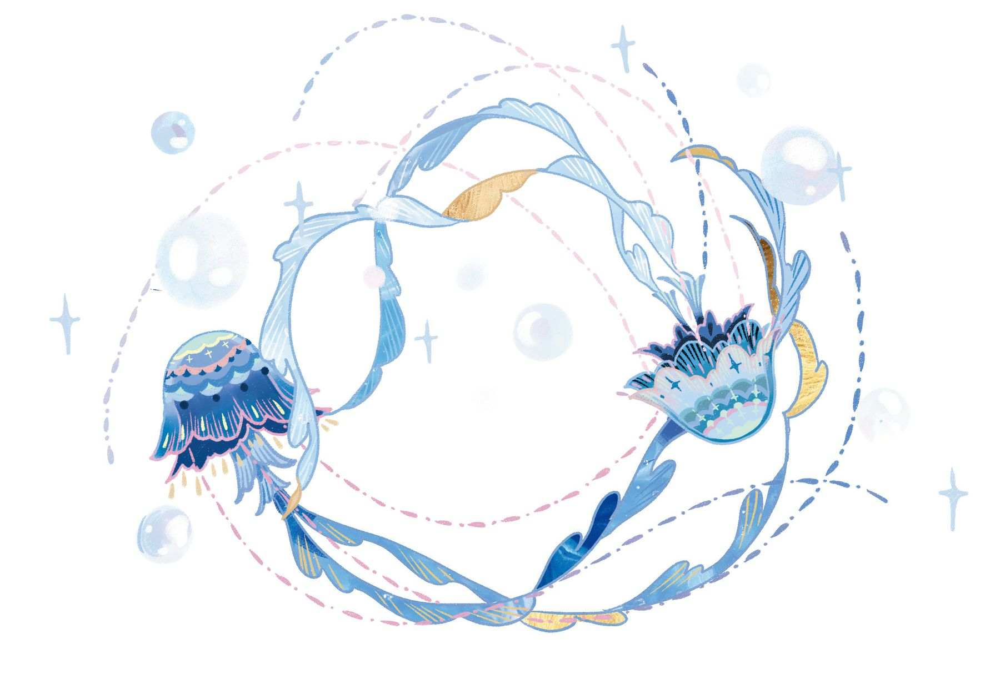
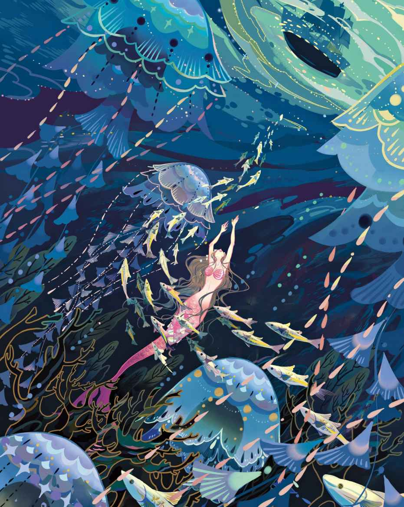
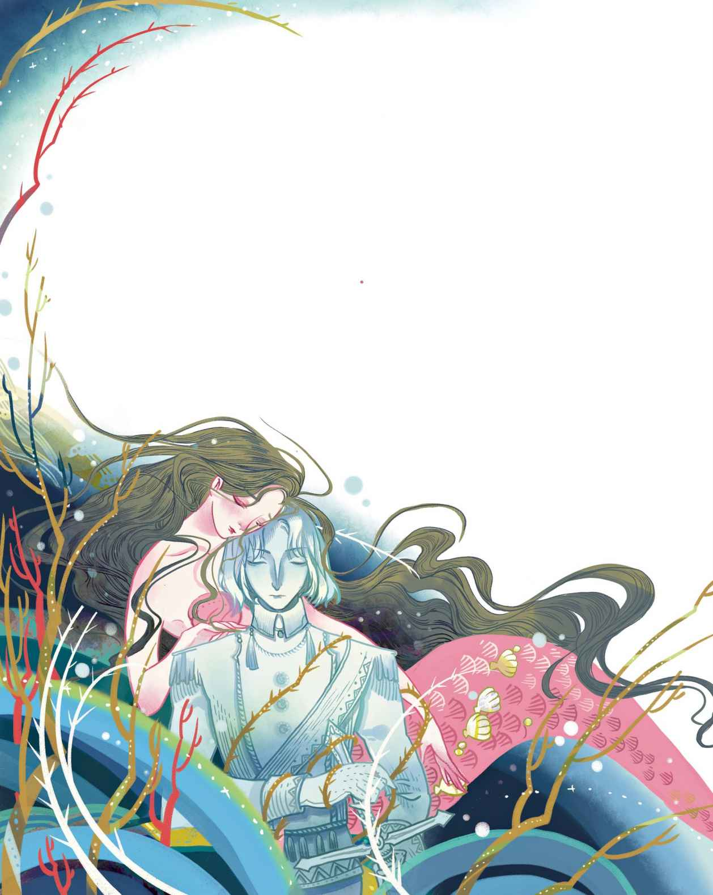
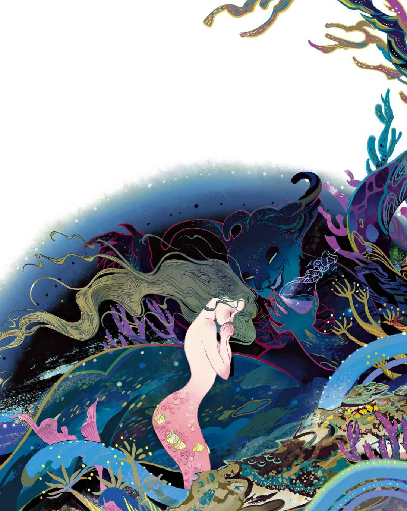
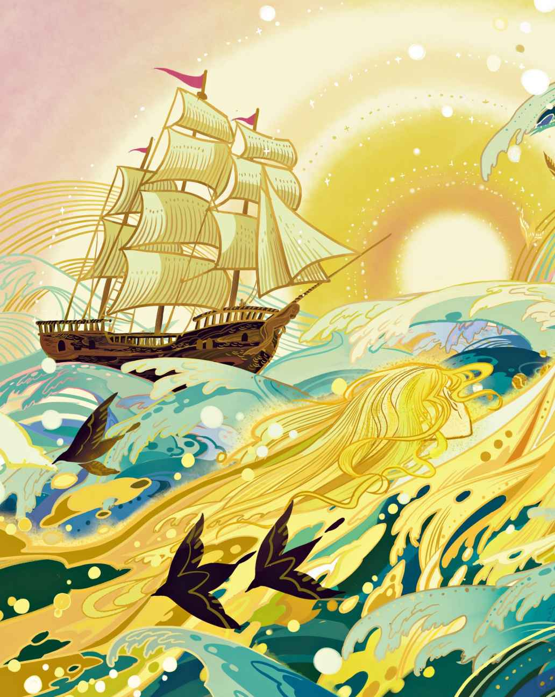
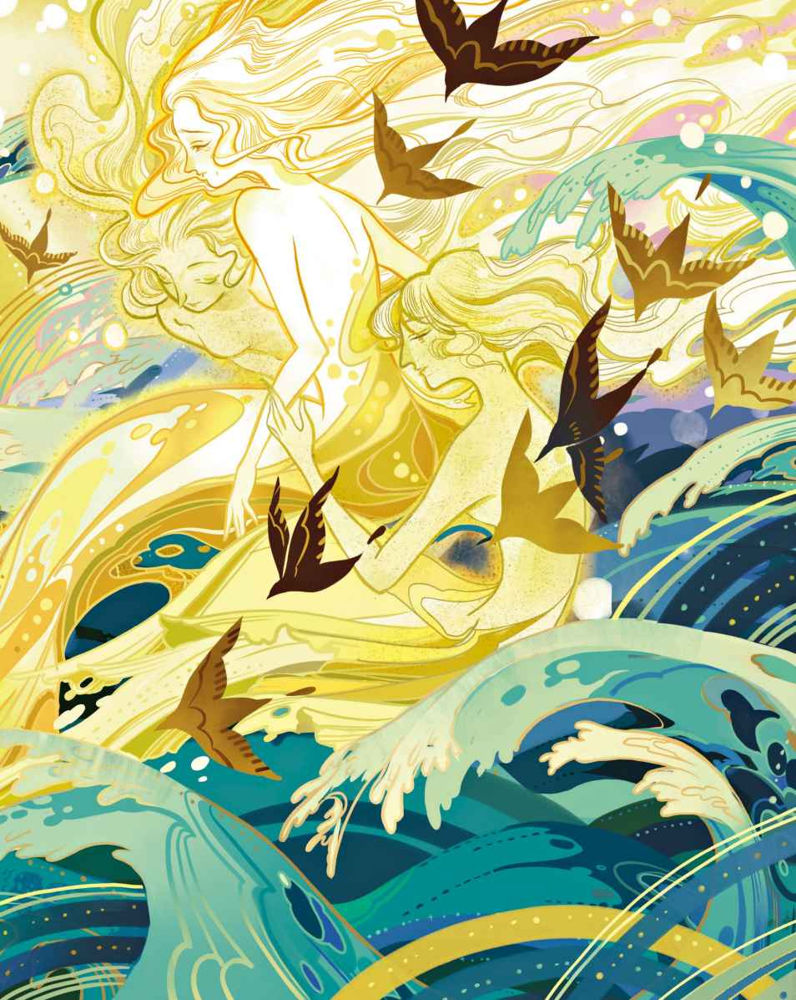

# 海的女儿

> **注 1**　原文为“小人鱼”。《海的女儿》这个译名，乃是国内约定俗成的译法。

在那片遥远的海域，海水蓝得如同最美丽的矢车菊花瓣，清澈得宛若最纯净的水晶。然而那里深邃极了，任何锚索都无法探到它的底部，许许多多的教堂尖塔堆叠在一起才能够由海底触及海面。也就是在那样的地方，居住着海洋的臣民。

此时此刻，不要以为海底只存在着白色的沙子。可不是那样的！那里生长着不可思议的树与花，它们那柔韧的茎蔓和叶片在海水中微微摇曳，看上去仿佛正在生机勃勃地游动着。鱼儿们在树枝间穿梭，如同鸟儿们轻快地掠过树梢。它们的长相不尽相同，体形也各不一样。在大海的最深处，矗立着海王的宫殿。宫殿的壁垒由珊瑚筑就，顶端的窗户用最为明净的琥珀制成，而屋顶则由贝壳组成，随着洋流翕动不息。这样的场景真是华丽至极，因为每块贝壳都拥有一颗闪亮的珍珠，而每颗珍珠都配得上女王的冠冕。

海王就生活在这里，他孑然一身，当鳏夫已有多年。替他打理宫殿的是他那年迈的老母亲。作为女性，这位母亲颇为聪慧，而对于自己高贵的出身，她也感到颇为得意。她在尾巴上戴了十二块贝壳，便是如此显摆。宫廷中的其他女子通常只能戴六块贝壳，再多就会被禁。除此以外，她倒也算得上是个值得称赞的人物，尤其是对自己的小孙女们——那些小小的海公主——无微不至地关爱。那是六个可爱的小公主，其中最美的就要属年龄最小的那位了。她的皮肤吹弹可破，细柔得如同玫瑰花瓣，她的眼睛蓝得宛如深深的海水。不过她没有双腿，唯有这点跟其他海公主是一样的，她的身体下面是一条鱼尾巴。

她们整天在宫殿里玩耍，沿着规模庞大的长廊在长满花朵的墙壁间钻来钻去。只要琥珀窗一打开，鱼儿们就会一拥而入，这跟我们平时打开窗户时燕子飞入屋内的情形如出一辙。鱼儿们会游到公主们面前，在她们手里找东西吃，求得公主们的宠爱。

宫殿外面有个巨大的花园，那里长着火红与碧蓝相间的树。它们的果实宛若金子般闪着光芒，花梗不停地随波而动，看上去像是燃烧的火焰。花园的底部铺着上乘的蓝沙，如同熊熊燃起的硫黄。而那无处不在的、罕见的蓝色如同面纱一般笼罩着整个花园，你会觉得自己被蓝色环抱着。这与其说是置身于海底世界，不如说是飘浮于蓝色的天空。风平浪静的时候，你还能看见太阳。太阳就像一朵绯红的花儿，它的花萼在洋流中曳动出明晃晃的光。

每个小公主在花园里都有属于自己的小园地，在那里，她们可以随心所欲地打理自己的园艺。一位公主把小花坛塑造成了鲸鱼的形状，另一位则做成了小人鱼的形状，她觉得这么做更简洁一些。而最小的那位公主把小花坛塑造得跟太阳一般圆乎乎的，也只有同样跟太阳一般红彤彤的花儿，她才会种在那里。她是个不同寻常的孩子，喜欢安静和沉思。她的姐姐们粉饰花园的时候，总爱到那些沉船里寻找各种深埋着的千奇百怪的遗物。而她只喜欢像太阳一样红的花朵，其他的她统统看不上，也绝不会放进花园里。除此之外，她还喜欢大理石制成的雕像。这尊英俊的少年雕像，就是用纯净的汉白玉

> **注 2**　即纯白色大理石。

年轻的海公主是那么喜欢聆听关于人类的故事，只要是关于陆地上的事都能为她带来欢欣和雀跃。她的老祖母不得不把自己所知道的一切全都拿出来讲给她听——那些关于船和城市、关于人类和动物的故事。其中最让她感到动容的，是那些生长在陆地上的芳香四溢的花儿——那是在海底世界无处寻觅的风景。在她的脑海中，陆地上的绿色森林也是那么美好，那里的树枝间也穿梭着鱼儿，而且那里的鱼儿都会歌唱，它们唱得那么嘹亮，那么甜美。对于这样的声音，谁都会愿意去侧耳倾听。老祖母说起这些的时候，不得不采用了“鱼儿”这个词，不然的话，小公主根本就没法去想象她说的究竟是什么样的动物，因为小公主从来就没有见过鸟儿。

“等你到了十五岁，”老祖母说，“就可以游到海面上去了。你可以坐到月光下的礁石上，观看那些了不得的航船，看它们从你眼前航行而过。你还会看到树林和人类的城镇。”

明年，她的一位姐姐会满十五岁，至于其他的公主们——好吧，她们每个人都比最小的公主大上一整岁，而最小的那位还要等上足足五年时间。只有到了那个时候，她才能亲眼目睹人类的世界。幸好，每位公主都有所承诺：等她们回来之后，会把自己所见识到的一切、把头一天最不可思议的见闻统统讲述给其他公主听。她们的老祖母讲过的那些，还不及现实中的一半呢。仍有许许多多的故事，令她们充满了向往。

对此最充满渴望的就是海公主中最小的那位了，正是她，安静又喜欢沉思的她。许多个夜晚，她就那么驻足于敞开的窗台，透过深蓝色的海水仰望着鱼儿们，看它们划动鱼鳍和鱼尾巴。视线穿过海水的时候，鱼儿们看上去变得更大了。时不时会有一团乌云般的阴影晃过鱼群，她知道，那若不是鲸鱼从上面游了过去，就是人类的船只刚刚航行而过。船上应该乘载着很多人类吧？可是他们都不知道，就在他们的下面有个美丽的小人鱼，此刻正朝着他们的船底挥动着那洁白的双臂。

年龄最大的那位公主终于过了她的十五岁生日，如今已经获许游出海面了。等到她回来的时候，简直有着成百上千的事情要告诉妹妹们。这其中最令人叹为观止的，她说，就是躺在月光下的沙洲上的那种感受。那一刻的海洋是如此的平静，凝视着海岸上的庞大城市，你会觉得那些闪烁的灯火就如同上百颗星星释放出的光华；从那里传来的音乐声、来自人类的说话声、车水马龙的喧闹声，还有那嘹亮的钟响全都传入了耳畔。可惜不能进入人类的城市，这成了她最大的遗憾。

噢，那最年轻的公主，她听得多么入迷啊。自那之后，只要她站在夜晚的窗前仰望深蓝色的海水时，就会禁不住联想起人类的庞大城市以及城市里的各种说话声和喧闹声。当幻想渐入佳境的时候，她甚至能听到教堂的钟声。

到了第二年，她的另一位姐姐也终于获许游出海面，可以自由自在地游到任何想去的地方。黄昏的时候，她钻出水面看到了那不可思议的日落奇观，她说她这辈子也没见过那样的场面：整个天宇弥散着金色的光辉，就连云朵也被染成了金色——她简直无法用言语去形容那种美——那是红色的泼墨、紫罗兰色的晕染从她头顶的天空飘逸而过。比云朵们飘行得更快的是成群的野天鹅，它们就像一抹在海蓝中拖曳出来的白纱，一齐飞向那下沉的夕阳。于是她也游了起来，追向那样的光景，然而它们还是远去了，只剩下一片玫瑰色的柔光在海天之间缓缓地淡去。

接下来的那年，她的第三位姐姐获许游出大海，在所有姐妹中她的胆子最大。她游入一条与大海相汇的宽阔河流，看到了叠青泻翠、色泽如同藤蔓的群山；穿过了秀丽的树林，还望见人类的宅邸和庄园；听见了鸟儿们在歌唱，而太阳的光芒是那么耀眼，以至于她不得不间或潜回水面之下，好让被阳光烤热的皮肤冷却下来。在一处小峡谷，她发现了一所学校，那里满是人类的孩子，他们光着身子在水里嬉戏，是那么的无拘无束。她也多么想跟他们一起玩耍呀，可是他们一见到她就吓得纷纷逃跑了。接着，跑来一只黑乎乎的小动物——那是一只狗。她从来就没有见过狗。狗朝她凶狠地吠了一通，弄得她惊慌失措，一路逃回了大海。可是，她仍然忘不了那些秀丽的树林、绿色的群山，还有那些可爱的孩子，他们虽然没有鱼尾巴，却照样可以在水里游个不停。

第四位姐姐没什么冒险精神。她小心翼翼地远离着那些波涛汹涌的海域，不过还是禁不住觉得那是多么不可思议的景象，那些波涛延绵万里、无处不在，她将这一切尽收眼底，而天空就像是一只巨大的圆形玻璃罩。她看到了船，可是那些船是如此遥远，看上去仿佛变成了海鸥的模样。顽皮的海豚们在水中翻腾、嬉戏，巨大的鲸鱼们用鼻腔喷出水雾

> **注 3**　虽然此处的原文是“水”，但实际上鲸鱼喷出的并不是水，而是气体——在空气中遇冷的瞬间，才形成了人们所看到的水雾。

现在，轮到第五位姐姐了。她的生日伴随冬季而来，所以她所看到的跟其他姐妹迥然不同。海水变成了深绿色，庞大的冰山漂浮其上，每一座都白若珍珠。她说它们看上去比人类建造的教堂尖塔更加蔚为壮观，它们呈现出各种极富想象力的形态，晶莹剔透，宛若钻石。她坐到了最大的那座冰山上，那些迎面而来的船只一看到她那在风中飞舞的长发，竟全都慌慌张张地躲了开去。

到了黄昏时分，天空中乌云密布。整个天际电闪雷鸣，黑色的海浪将冰山高高地托起，雷电的闪光在冰块上不断映现。

所有的船只都收起了帆，四处弥漫着恐惧和颤抖的气息。唯有她依然安坐在那里，坐在她的冰山上，观望着海上波涛怒涌、风驰电掣的光景。

对于每一位公主而言，第一次浮出海面时所看到的新事物都能为她们带来欣喜。不过，等到她们真正成年，可以随心所欲地去任何地方的时候，情况反倒有所不同了。她们变得更恋家了。仅仅过去一个月，她们便又觉得再也没有比海底更好的地方了，还是待在家里比较舒适。

有很多个夜晚，那些年长的姐姐会浮出海面，她们手挽着手，五人成行。她们有着美轮美奂的嗓音，比任何凡夫俗子都要迷人。风起的时候，她们料想会有人类的船只失事，于是便游到船前用歌声魅惑那些人类，想让他们知道海底世界是多么美丽，想要借此让船员们心甘情愿地跟她们一起共赴海洋的怀抱。然而那些人类无法理解她们的歌声，他们只以为那是风暴来临的声音。深邃海底的华丽世界，他们永远也无法亲眼目睹，因为当船沉没的时候，他们也就随之溺水而下，等到抵达海王的宫殿时，他们都已然失去了生命。

某天晚上，人鱼公主们像往常一样手挽着手浮出海面，而她们最年轻的小妹妹却孤单地留在她们身后。她望着她们离去的身影，心里有种想哭的感觉。可是人鱼没有眼泪，这让她变得更加难过了。

“噢，我多么希望自己也已经年满十五岁了！”她说，“我知道，我一定会热爱上面的世界，一定会热爱在那里生活的人们的。”

到后来，她终于等来了十五岁。

“现在我可以放手了，”她的老祖母，那年迈的女王说，“过来吧，让我为你上装，就像你的姐姐们那样。”她用洁白的百合花做成花环戴在了小公主的头上，花环上的每一片花瓣都是用半颗珍珠精雕而成的。年迈的女王还把八块大贝壳装饰在了公主的鱼尾巴上，以彰显她的高贵身份。

“可是这样好痛呀！”小人鱼说。

“你必须将就着，要有个像模像样的尊荣才行。”老祖母告诉她。

噢，如果能卸掉这些装束，摘掉那笨重的花环，那该有多好啊！在小花园里有着更为适合她的红花，可是她不敢擅自换掉这身行头。“再见了。”她说，然后便向上游去，身姿明亮而轻盈，宛若泛着光的气泡。

小人鱼冒出水面的时候夕阳刚刚隐没，不过晚霞仍然透着光亮，那是糅合着金色与玫瑰色的霞光。在那被霞光浸染的天空中已经有了一抹夜晚的星辉，空气是那么柔和而清新，整片海洋洋溢着宁静的气息。目力所及之处有一艘巨大的三桅船，它只扬起一道船帆，因为此时就连风的细语也无迹可寻。海员们闲来无事，全都懒洋洋地坐在索具上或靠在帆桁边，船上传来音乐声和歌声。随着夜幕降临，他们点起上百盏色彩明亮的灯笼，看上去仿佛是来自所有国度的旗帜齐聚在空中一起飘荡。

小人鱼径直游到了主客舱的窗户旁，当她乘着海浪、身子被倏地托起的时候，就能透过玻璃舷窗窥见里面盛装打扮、光彩夺目的人群。在这些人中最英俊的就要属那位年轻的王子了，他有着黑乌乌的大眼睛，年纪应该不超过十六岁。这天正是他的生日，所以才会有那么多人前来共享盛宴。甲板上，海员们正在翩翩起舞，当王子现身的时候上百支烟火齐齐发射，升向夜空，照得整个夜空都如同白昼般明亮。这可把小人鱼给吓坏了，她赶紧躲回了水面之下。不过，她很快又冒上来偷看了。只见夜幕中的烟火仿佛流星般坠落在她的身边，那是她从未见过的烟火。太阳一般的巨大光芒在眼前旋转，它们释放出的火焰如同鱼儿那样在蓝色的空气中穿梭，而这一切又被映洒在水晶般清澈透明的海面上。那种闪亮的光耀使得船上的每一根细小的绳索都能够清晰地映入眼帘，人们的模样也因此尽显无遗。噢，那位年轻的王子竟是如此的英俊！在这个美轮美奂的夜晚，当人们被音乐环绕的时候，他畅快地大笑着，伸手摇晃着别人的肩膀。

小人鱼久久地注视着他，简直无法将目光从船和王子的身上移开。那些灯笼的明亮色彩终于快要熄灭了，这时也不再有烟火飞入夜空，礼炮也不再轰轰作响了。取而代之的是来自深海的低语，以及隆隆的声音。浪头将小人鱼高高地托起，这下她能看见客舱里面的情景了。

眼下，船已扬起航帆，重重叠叠的帆布迎风招展。可是海浪高卷而起，乌云也开始聚集，闪电在远处掣动。噢，他们正面临着一场可怕的风暴。水手们不得不匆忙地将帆收起，冲过那些怒涛的时候船体被海浪所裹卷而变得倾斜。海浪卷起的样子如同高耸而起的黑色山脉，眼看就要把船的桅顶给吞没了，而那状如天鹅的船一头钻入了巨浪之间的浪底，紧接着又再次被抬上了浪尖。在小人鱼眼里这不过是一场表演，但对船员们来说，就完全是另一码事了。船体咯嘣作响、苦苦呻吟，原本厚实的木材在巨浪持续的摧击下终于还是分崩离析了。浪头摧毁了船体，主桅杆断成两截活像是折断了的芦苇秆。整艘船终于侧翻，海水开始朝里头猛灌。

直到此时，小人鱼才意识到这些人正在陷入死亡的漩涡，她自己也必须避开那些在浪中翻腾的断梁和残骸。某个时刻，黑暗遮蔽了视线，她什么也无法看见了；而下一瞬间，空中电光闪烁，她总算是看清了船上那些人——每个人都在千方百计地力求自保。她凝目寻找王子的身影，就在船体裂成两截的时候，她看到他沉入了海水之中。她先是大喜过望，因为他终于和她一样成为了大海的一员。可是她很快就清醒了过来，因为她意识到人类根本就无法在水中存活。也就是说，他只能以死人的身份造访父王的宫殿。不，他绝不能就这样死去！于是她在那些翻腾着的木板和断梁之间奋力地游了起来，根本就不顾危险。她忽而向下潜游，忽而乘风破浪，终于来到他的身边。而这位王子早已无力再同汹涌的海水抗衡了，他的双臂和双腿已经精疲力竭，那俊美的眼睛也正在合上。若不是小人鱼过来将他救起，恐怕已经没命了。她把他的头托出水面，然后就那么随波逐流，让海浪带他们去任何地方。

拂晓时分，风暴终于过去，船的踪影已经无迹可寻。旭日升出海面，暖红而明亮，它所释放出的光与热让王子的面容又恢复了血色。然而他的双眼始终紧闭着，于是小人鱼亲吻了他那尊贵而俊朗的前额。她湿漉漉的发丝在王子的脸上轻轻抚过，此刻的他看上去如同置身于海底花园里的石雕像。她再次亲吻了他，希望他能够活过来。

她的眼前是一块陆地，还有高耸的蔚蓝色山脉，山顶上覆盖着白雪，那白色的光耀就像成群的天鹅栖息在那儿。山下的海岸边遍布着风景宜人的森林，教堂矗立在颇为显眼的地方，当然，那也可能是一座修道院——她分不太清。然而不管怎么说，那至少是一座人类的建筑。那座建筑的花园里生长着橘子树和柠檬树，而入口的通道两侧则种植着高大的棕榈树。海水在此处汇成湾流，形成了一片宁静的、深深的海湾，白色的细沙冲刷着崖底，仿佛含情脉脉地将群山枕向高处的温煦阳光。

那座宏伟的白色建筑里响起了铃声，一群年轻的姑娘随即来到花园。小人鱼赶紧游开，躲到了突立在水面上的岩石背后，用泡沫掩盖住了自己的头发和肩膀，这样就没人会发现她那张小脸蛋了。接下来她想看看，究竟有谁会发现可怜的王子。

不一会儿，年轻姑娘中有人来到了王子身边。她看上去吓得不轻，不过很快就回过了神，接着便喊来了更多人。小人鱼看到王子恢复了知觉，还对周围的人露出了微笑。可是他没有对她微笑，因为他根本就不知道是她救了他一命，她感到有些悲伤。当她们把王子带回那巨大的建筑时，她难过地钻回了水里，游向父王的宫殿。

她原本就喜欢安静和沉思，现在更为变本加厉了。姐姐们问她，第一次造访陆地世界到底看到了些什么，可她只是沉默不语。

日复一日，夜复一夜，她总是回到那个失去王子的地方。她看着花园里的果实成熟，看着它们被采摘下来，看着高山上的积雪渐渐融化，可是她看不到王子的身影。每一次回家，她都比离家时更加忧伤。唯一的安慰，就是坐在自己的小花园里，两手抱着那尊美丽的大理石雕像，因为它总是会让她想起王子的模样。她再也没有心思照料那些花儿了，它们到处蔓延，直到整个花园变成了荒园。它们那修长的花梗和叶片跟树枝纠缠在一起，形成了一片灰暗的阴影。

最后她再也无法忍受，把心中的秘密告诉了一位姐姐。很快，消息便在其他姐姐那里传遍了。别人都不知道这件事，除了少数几位人鱼公主——她们也只是向最亲密的朋友有所透露而已。这些朋友当中，有人知道那位王子的身份，她也看到过船上的生日宴会，知道他来自哪里，也知道他的王国位于何方。

“来吧，小妹妹！”公主们说，她们手挽着手游成一排浮出了水面。而此时坐落在她们面前的，正是她们所知的王子的宫殿。这座宫殿由灰白的、亮闪闪的、泛着金光的三种石头以及巨大的大理石楼梯共同筑成，其中一道石阶延伸至大海。宏伟的圆屋顶上镀了金，屹立于整座宫殿之上。宫殿环绕着石柱，石柱之间摆放着栩栩如生的石雕像。透过那高耸而明净的玻璃窗，人们可以看到富丽堂皇的内厅礼堂，那里布置着昂贵的丝绸帷幔和挂毯，墙壁上挂满了赏心悦目的画作。主厅的中央有一座巨大的喷泉，它喷洒出来的水柱甚至能触及上面的玻璃圆顶。阳光透过玻璃圆顶洒落在喷泉水上，滋养着水盆里那些可爱的花草。

现在，小人鱼终于得知了他的居所，无数个黄昏和夜晚，就那么在海里观望着。后来她干脆游向海岸，比姐姐们离得都近。她已经变得有些奋不顾身了，甚至游入了狭窄的护城河，就躲在那恢弘的大理石宫殿在水中形成的阴影里。她总是坐在这里看着年轻的王子，而王子却浑然不知，只以为明朗月光下的自己始终是孤身一人。

在那些夜晚，她看着他乘上精致的小船，在音乐的演奏声中，在飘动的旗帜下起航。她的目光悄悄地穿过绿色的草丛，而风吹起她的银色面纱时，所见之人无不以为那是天鹅在舒展它的羽翼。

那些夜晚，她看到渔夫们手持火把出海夜航，她听见他们说，年轻的王子是多么善良。这让她感到欣慰极了，因为当他在海浪中漂浮不定、垂死挣扎之际，是她挽救了他的生命。她回想起他的脑袋曾多么轻柔地依偎在她的怀里，而她又多么温柔地亲吻了他，虽然他根本就不知道这一切，哪怕是在梦境里面。

渐渐地，她变得更喜欢人类了，越来越渴望同他们生活在一起。他们的世界看上去远比她的世界要辽阔得多，他们可以借由船只在海上航行，可以登上高耸入云的巍峨山顶；他们的大地在森林和田野之间延伸开去，根本就望不到尽头。她想要知道的太多太多，以至于姐姐们已经无力招架她提出的问题。于是她转而又问老祖母，有谁通晓“上面的世界”——那便是她给那个位于海洋之上的世界所起的名字。

“如果人类不会溺水而亡，”小人鱼问道，“那他们能够得以永生吗？他们是否也会像我们一样在海里死去呢？”

“会的，”老祖母说，“他们最终也逃不过一死。而且，他们的寿命远比我们要短。我们可以存活三百年之久，死去的时候会化作海面上细微的泡沫。我们在海底没有墓场，无法与爱人埋葬在一起，我们也没有不朽的灵魂，死去之后便彻底不复存在了。我们就像绿色的海藻——一旦被摘下，就再也不可能复苏了。人类却相反，他们的灵魂可以长存。在他们的躯体归于尘土之后灵魂依然延续着，会跃过虚空，升入闪耀的星辰之列。正如同我们浮出水面，可以看到陆地上的世界，人类也会飘去未知的美丽世界，只是我们无法看见。”

“为什么我们就没有不朽的灵魂呢？”小人鱼悲伤地问道，“只要可以变成人类，我宁愿放弃三百年的寿命，哪怕只当一天人类也好。等到离开人世之后，我还是可以在天国里继续存在。”

“你可不能有那样的想法。”老祖母说，“比起上面的生活，我们这儿远远要快活、美好得多。”

“可是我迟早会死去，变成漂浮在海面上的泡沫，听不见海浪的音韵，看不到美丽的花朵和红彤彤的太阳！难道我就不能做点什么为自己争取到不朽的灵魂吗？”

“不可能的，”老祖母答道，“除非有人类爱你至深，在心中视你比父母还要重要。如果他每时每刻都牵挂着你，毫无保留地心系于你，那么他就会请求神父，把他的手放在你的手里，以示他永世不变的衷心。这样，他的灵魂就会与你同在，你便可以得享人类的幸福。而现在的关键，是你在海洋世界中被视为最美的存在——你的鱼尾巴——在陆地世界会被认为是丑陋的。他们的品位十分低劣，在他们的世界对此有着另一种审美。你得拥有两根颇为费事的支柱才行，他们管那叫做腿。”

小人鱼叹了口气，然后忧伤地看着自己的鱼尾巴。

“哎，还是让我们快快乐乐的吧！”老祖母说，“让我们欢快雀跃地度过这三百年的生命时光。没错，我们有的是时间消受，而等时候到了，我们自然也会欣然迎接死亡的来临。我们要举办一场宫廷舞会，就在今晚。”

舞会华丽极了，简直举世无双。舞厅的墙壁和天花板全部由硕大而清澈的玻璃制成，通道的两侧布置着成百上千的红玫瑰和草绿色的贝壳。每块贝壳里燃烧着蓝色的火苗，使得整个舞厅都熠熠生辉，玻璃墙也被映照得透亮，就连墙外的海水也明亮了起来——可以看见数不胜数的鱼儿，大鱼儿或小鱼儿正朝着玻璃墙这边游来，它们身上的鱼鳞要么闪烁着紫红色，要么是银色和金色。大厅的楼板上有一道宽阔的水流铺陈而过，而人鱼们纷纷在这水舞台上随着动人的歌曲翩翩起舞。生活在陆地上的人类绝不可能聆听到如此美轮美奂的歌声，小人鱼的歌声无比甜美，每个人都为她鼓掌。有那么一瞬间，她的内心确实感到了快乐，因为她知道自己拥有着最惹人喜爱的嗓音，不管是在海洋世界还是在陆地世界。可是她的思绪很快又飘去了上面的那个世界，对于那位英俊的王子，她始终无法忘怀。对于自己不曾拥有像他那样的不朽灵魂，她也感到哀痛不已。于是她悄悄离开了父王的宫殿，那里歌舞升平，一切都充满了欢愉，而她却哀伤地坐到了自己的小花园里。

接着，有号角声穿过海水传入了她的耳畔。她心想：“那一定是王子的船在上面航行。我爱他胜过自己的父母亲，他就是我朝思暮想的人，我多么愿意同他携手拥有终生不渝的幸福。为了赢得他的爱情，我愿意付出一切，一定要争取到不朽的灵魂。趁现在，姐姐们还在父王的宫殿里跳舞，我要前往那片海域去拜访一下那个人，虽然我一直都很怕她，但她也许能够给我建议，对我有所帮助。”

小人鱼从她的花园出发了。她要穿过那些猛烈的漩涡，漩涡的背后便是海女巫的居所。她从来没有去过那里。那里没有花儿，寸草不生，光秃秃的一片灰暗。沙子被那些漩涡吸裹而去，如同轰轰作响的石磨，带动着水势飞速旋转不止，把一切都卷入其中带入海底。她不得不奋力穿过这些漩涡，只有这样才能够抵达海女巫的居所。不知过了多久，眼前终于出现了一洼热乎乎、沸腾着的泥潭，那是女巫的黑泥潭。越过黑泥潭，有一片古怪奇异的森林，海女巫的屋子就隐藏在那里面。那儿的大树和灌木其实全是些珊瑚虫，它们既非动物又非植物，不伦不类的，看上去就像是不计其数的、从泥堆里钻出来的蛇脑袋。它们的枝杈长极了，如同布满了黏液的手臂，而手指则活像是蠕动的虫子。它们扭来扭去，从底部的根脉到伸展出去的触须全都互相纠缠在一起。不管什么东西，一旦落到它们手里被它们死死缠住，就再也别想脱身了。小人鱼害怕极了，她停在了森林的边缘，心脏因为恐惧而颤动，几乎就要退却了。然而她又想起了王子，想起了人类的不朽灵魂，这再度唤起了她的勇气。她将自己的长发束起，这样，那些珊瑚虫就不会缠住她了。她收起双臂护在胸前，然后像鱼儿一般在水中游梭，穿过那些扭动着的、黏糊糊的珊瑚虫触手。那些数不清的触手已经捉住了很多东西，她全都看到了，它们牢牢地困住那些东西，就像钢轱辘紧紧箍住轮子那样。她还看到了人的白骨，他们都是海上遇难者，如今沉到这里成为那些触手的掌中物。船舵、海员的箱子、陆地动物的骸骨，全都被它们死死地缠住，而最叫人触目惊心的是一具小人鱼的遗体，她也被触手给缠住，被活活扼死在了那里。

森林里面有一大片泥泞的空地，她到了那儿，发现有肥大水蛇们正在泥浆里翻滚，袒露着它们那臭烘烘、泛黄的腹部。就在这片泥地当中坐落着一间屋子，它用骸骨建成，而那些骸骨全都来自遭遇海难的人类。海女巫就坐在这间屋子里面，正在用嘴巴喂食着蟾蜍，就跟人们用糖喂食小金丝雀一样。她把那些又肥又丑的水蛇称为乖宝宝，让它们在她那软趴趴、肉乎乎的胸脯上爬来爬去，蜿蜒盘踞成一整摊。

“我很清楚你想要什么，”海女巫说，“你这样真是傻透了，不过我还是可以成全你，因为这会给你带来悲惨的下场，我尊贵的公主。你想要摆脱鱼尾巴，换之以双腿，这样就可以像人类那样行走，让王子爱上你，从而赢得他的爱情，拥有不朽的灵魂。”说到这儿，海女巫爆发出一阵刺耳的大笑，连她身上的蟾蜍和水蛇们都被震落到了地上，然后在那儿扭来扭去。

“你真是来对时候了，”海女巫又说，“明天日出之后我就什么忙也帮不上了，到时就得再等上整整一年才行。我会给你一剂汤药，在日出之前你必须带着汤药游到海岸边，然后就地而坐把汤药喝下去。接着你的尾巴便会分开、萎缩，最后变成陆地世界的人类所说的双腿。但是这个过程会伴随着剧痛，那种感觉就好像有把锋利的刀正在割裂着你的身体。每个见到你的人都会认为你是他们所见过的最美的人，你作为人鱼的优美身姿仍然得以保留，而你那轻盈的步态也没有任何舞蹈可以媲美。可是你每走一步，都会感到如履刀锋，鲜血横流。我固然可以帮你，但是你能忍受那样的痛苦吗？”

“我能。”小人鱼用颤抖的声音说道，她的心里想着王子，还有那不朽的灵魂。

“切记！”女巫说，“一旦你变成人类，就再也无法变回人鱼了。你再也无法回到海里，无法回到姐姐们身边，也无法回到父王的宫殿。而且，假如你没有真正地赢得王子的爱情，让他对你的爱超越对父母亲的爱，没有让他每时每刻都牵挂着你、心系于你，并让神父见证你们的婚姻的话，那么你将无法赢得不朽的灵魂。而如果他同别人结为夫妻，那么在他们喜结连理的次夜，你的心将会破碎，你也会变成海上的泡沫。”

“我愿意冒这个险。”小人鱼说，可是她看上去已经面如死灰。

“对了，你必须予我以回报。”女巫说，“我要的可不是一般的东西。你拥有海底世界里最为甜美的声音，而我毫不怀疑你会用这种声音把王子给迷住。所以我要定了你的声音，我要取走你身上最为珍贵的东西作为对我那举世无双的魔药的报偿。我还要把自己的魔血灌入汤药里面，让你喝下去的时候感受到双刃剑割过喉咙般的苦楚。”

“可是，如果你夺走我的声音，”小人鱼说，“那我还能剩下什么呢？”

“你还有绝美的外形、”女巫告诉她，“轻盈的体态以及动人的双眸。有了这些，你就足以令任何男人心醉神迷。难不成你胆怯了？快伸出你的小舌头，我要把它割下来。我得到我的报偿，你拿走你的魔药。”

“动手吧。”小人鱼说。

女巫把锅放在火上煎制起汤药来。“干干净净才够好。”她一边说着，一边把蛇们打成绳结，然后用它们把容器擦了个遍。接着她便在自己的胸口那儿戳了一下，把黑乌乌的魔血泼入锅内。眼前旋即翻腾起一股烟雾，那烟雾的形状简直诡异可怕至极，不管谁见了都会被怵得不轻。女巫又往锅里添了什么料，于是那汤药开始沸腾，声音听上去活像是鳄鱼发出的哭声。而当汤药最终完成之际，看上去无异于至净的纯水。

“这就是你的汤药。”女巫说。她割下了小人鱼的舌头，把她变成了哑巴，令她再也不能歌唱和说话。

“当你穿过我的森林回去的时候，如果那些珊瑚虫朝你扑过来，”女巫又说，“只要朝它们洒上一滴魔药，它们的触须便会分解成数不清的碎片。”不过，实际上已经不需要这么做了，因为那些珊瑚虫一看到发光的魔药就全都惊恐地瑟缩了起来。魔药在小人鱼的手中发着光，看上去像是闪亮的星星。她就这么快速地穿过了森林、泥潭以及那些猛烈的漩涡。

她终于又看到父王的宫殿了。舞会的灯火已经熄灭，毫无疑问，宫殿里的所有人都已经进入了梦乡。可是她没有勇气回到他们身边。现在的她已经成了哑巴，要永远地离开家乡了。她悲伤至极，心都快要破碎了。她悄无声息地来到花园，从每位姐姐的园地里摘下一朵花，朝着宫殿的方向送去了一千个吻，然后穿过深蓝色的海水向上游去。

旭日还未升起，小人鱼已经看到了王子的宫殿。她登上华丽的大理石台阶，此时月亮的光华依然清晰可见。她喝下了苦涩而浓烈的魔药，那种感觉就像是一把双刃剑洞穿了柔弱的身躯。她因剧痛而昏厥，随即倒在了地上仿佛已经死去了，直到太阳升出海面她才苏醒过来，身上仍留着一丝痛楚。不过，也正是在这样的时刻，王子出现在了她的面前，正用他那墨黑色的眼睛凝视着她。她则垂目凝视自己的身体，发现鱼尾巴已经不见了。现在，她终于有了雪白的双腿，那是任何正当年华的少女都渴望拥有的美丽双腿。然而她赤身裸体，只能用长发遮羞。

王子问她是谁，为什么会来到此地。她用深蓝色的眼睛温柔地看着他，目光里却含着悲伤，因为她没有办法开口说话。于是他牵起她的手，把她带去了他的宫殿。每走一步她都感到如履刀锋、如踏刀尖，就跟女巫预言的如出一辙。然而她心甘情愿地承受着，走在王子身边让身姿轻盈得宛若气泡。她的步态已经轻盈到了不可思议的地步，何止是王子，任何人见了都会被这种魅力所俘获。

到了宫殿，她穿上了华丽的丝绸衣裳，披上了薄纱，立即就变成了最漂亮的人儿。可是她是个哑巴，既不能歌唱也无法说话。美丽的女仆们来到王子和王室成员面前，她们也身着丝绸盛装，看上去颇为夺人眼球。她们引声歌唱，其中有一个唱得最为动听。王子对着她微笑，为她鼓掌。小人鱼感到那么失落，因为只有她自己知道，她的歌声曾经无比甜美。

“噢，”她心想，“正是为了来到他身边我才失去了自己的声音，如果他能知道该有多好啊。”

现在，最美妙的音乐响起了，那些美丽的女仆随着音乐声翩翩起舞。小人鱼也抬起姣美的臂弯，踮起脚尖，舞动着滑过地板，她的舞姿无人能及。她愈舞愈美，每一个动作都将她的美尽显无遗；她的眉目传情，比任何女仆的歌声都要动人。

她迷倒了所有人，尤其是王子，他称她为“我亲爱的小孤儿”。她一次又一次地起舞，虽然每次一碰触到地板就会感到仿佛踩在了锋利的钢刃上。王子说，他要把她留在身边。于是她获赐一只天鹅绒的枕头，得以睡在他的房间门外。

王子还为她添置了一身男装，这样她便可以同他一起骑马。他们骑着马穿过散发着甜蜜香味的森林，硕大的绿色树枝掠过她的肩膀，小鸟们在随风飘动的树叶间歌唱。

她和王子一起攀登群山之巅，哪怕她纤柔的双脚流满了鲜血——每个人都瞧见了，可她还是开心地笑着，陪伴在王子身边。最后他们终于目睹了云层远远地在脚下浮动的情景，那就像是一群飞鸟正在遥远的大地上飞翔。

当时间步入夜晚，王子寝宫里所有人都已入睡，唯有她走下台阶，把双脚浸泡在冰冷的海水里缓解那种灼痛般的苦楚。也正是在这样的时候，她会想起生活在海洋世界的那些亲人。有天晚上，她的姐姐们从这里经过，手挽着手从海浪中浮起，悲伤地歌唱着。当她向她们伸出双手的那一刻，她们认出了她。她们说，她的离开让她们难过极了。从那以后，姐姐们每天晚上都会来看她，还有一次，她在很远很远的海面上看到了年迈的老祖母——她已经多年没有浮出过海面了。她的父王就在祖母身旁，头上还戴着王冠，他们向她伸出臂弯，却无法像姐姐们那样冒险靠近人类的土地。

随着时间的推移，王子对她的宠爱与日俱增。他爱着她就像爱着一个可爱的小孩子，可他从未想过要娶她为妻。而她若是无法成为他的妻子，就永远也不可能拥有不朽的灵魂。一旦王子跟别人成婚，那么她就会在次日清晨化作浪花中的泡沫。

“你最爱的人是我吗？”当王子搂住她亲吻她的前额时，小人鱼仿佛在用目光追问着他。

“是啊，你是我最珍视的人，”王子说，“因为你有着一颗善良的心，比任何人都要爱我。而且，你看上去很像某个女孩，我和她只有过一面之缘，此后便再也没有相见。那时我的船沉没了，海浪将我推向岸边，岸边有一座形如教堂的圣殿。许许多多的女孩在那里举行着某种仪式，她们当中最年轻的那位发现了躺在海边的我，也正是她救了我。虽然我再也没有见到她，但我明白她是全世界唯一会让我爱上的姑娘，而你如此像她，几乎取代了她在我心中留下的记忆。她始终属于那座神圣的圣殿，而我是何等的幸运，竟然可以拥有你，我们永远都不会分离。”

“唉，可是他根本就不知道，我才是救了他的那个人。”小人鱼心想，“是我带着他漂洋过海来到了那座圣殿所在的花园，是我躲在了泡沫后面观望着是否有人前来。我看到了那个少女，那个让王子更为倾心的少女。”一声叹息满含着她最深的悲伤，因为她无法哭出声音。“他说那个少女属于那座神圣的圣殿，永远也不可能来到我们的世界，所以他们绝不可能再次相见。我还是可以体贴他，爱着他，把我的一切都献给他。”

如今传言四起，据说王子就要结婚了，对方是一位邻国的美丽公主。为赴这门婚事，王子甚至准备了极为豪华的船只。传言还说，王子之所以大动干戈其实是为了前去一睹对方公主的真容，他还带上了大量随行人员。小人鱼摇摇脑袋然后笑了，因为王子的真实意图她比谁都清楚。

“对于此次旅程我也是无可奈何，”王子对她说，“我是不得已才去拜访那位美丽公主的，其实这是奉父母之命，但是他们无法让我违背自己的意愿，我绝不会把对方娶回来，也绝不可能爱上她。除了你以外，不可能再有人跟那位圣殿里的少女那么相像。要是我非得找一位新娘，我宁愿选择你，我亲爱的小孤儿。虽然你不会说话，可是你的双眼却饱含了千言万语。”说着，他亲吻了她的双唇，十指紧紧缠住她的长发，他们的心与心靠在一起，让她幻想起无与伦比的幸福和不朽的灵魂。

“我相信你是不会害怕大海的，我安静的孩子。”他说。此时他带着她登上了华丽、气派的大船，他们即将乘着它航向邻国的土地。他告诉她风暴的故事、遇难船只的故事，还有那些奇异的深海鱼以及潜在水下的海底奇景。听着这些故事她只是微笑，因为她比谁都了解那个深海之下的世界。

那个明朗的月夜里所有人都睡着了，唯有舵手还在工作。她坐在船的边缘凝望着下面的大海，恍然间，透过那清澈的海水仿佛看见了父王的宫殿。她的老祖母仿佛就站在最高的塔楼上，头戴银王冠，隔着湍急的洋流仰望着船底的龙骨。接着她的姐姐们浮出了水面，她们悲伤地望着她，雪白的双手紧紧相扣。而她微笑着、飘摇着，竭力要让她们以为一切都还好，她还是幸福快乐的。此时客舱里走出一个男孩，于是姐姐们赶紧躲回了水下，而那个男孩只以为，那是海面上的一片美丽泡沫。

第二天早晨，船入港口，他们抵达了邻国那座气势恢宏的都城。所有的教堂都响起了钟声，所有的塔楼都吹起了号角。士兵们整齐列队，手握飘舞的旗帜，身佩耀目的刺刀。这里每一天都如同节日般欢庆，舞会和盛宴轮番上演，唯独公主迟迟没有现身。人们说她正在一处偏远的神圣庙宇里修养身心，在那里学习王室的规矩。不过，她终于还是现身了。

小人鱼惊讶地发现这位公主是多么的美丽，不得不承认，她从未见过如此细致优美的身段。公主的肌肤纯洁光滑，修长的黑睫毛后面隐藏着深邃的蓝眼睛，那双眼睛会微笑，蕴含着诚挚之意。

“原来是你！”王子不禁喊出了声，“你就是那个救了我的女孩。当时我躺在海边，如同死了一般。”他把脸色绯红的公主紧紧拥入怀中，她已然成为了他心目中的新娘。“噢，我就要成为世上最幸福的人了！”他对小人鱼说，“我最渴望的梦幻——昔日根本就不敢奢求成真的梦幻——现在居然成真了。请一定要和我分享这个喜悦，因为你比任何人都懂得爱我。”

小人鱼亲吻了他的手，她感到自己的心开始破碎。婚礼结束的次日早晨，他们将会看到她已经死去，化作海水里的泡沫。

教堂的钟声齐齐响起，使者驱马穿过大街小巷宣布皇室婚礼的喜讯，圣坛上放满了昂贵的银灯，灯盏里燃烧着芬芳的香油。神父们晃动着灯盏，新娘与新郎携起手来接受了主教的祝福。小人鱼穿着丝绸衣裳，披金戴银地为新娘托着婚纱的后摆，仿佛听不见婚礼进行曲，也看不见华丽的婚礼仪式。她的思绪凝固在了这世上最后一个夜晚和此后她将失去的一切。

这天晚上，新娘和新郎一起上了船。礼炮轰鸣，彩旗飘扬，船的甲板上临时建起一座紫金色的皇室楼亭，里面布置着奢华的寝具。在这个宁静而明朗的夜晚，这对新婚夫妇将在此共眠。微风徐起，船只扬帆起航，静幽幽地滑过平静的海面。随着夜晚降临，流光溢彩的灯笼纷纷亮起，海员们在甲板上跳起舞来。小人鱼还记得第一次离开深海世界浮到海面上来时看到的情景，她无法忘怀当时所看到的也是这般盛大隆重、洋溢着快乐的场面。她像是一只被追逐的燕子，轻盈地飞入了旋转的舞群，每个人都为她喝彩，因为这是她最美的一支舞蹈。她那纤弱的双脚像是被数把匕首刺穿一般疼痛，可是她已经不顾一切，因为心所承受的是远比这更为强烈的痛楚。她知道这是自己最后的夜晚，日后将再也无法见到王子。为了他，她曾告别海底的故乡，遗弃了自己的家；为了他，她失去了甜美的声音，忍受着接连不断的折磨，可是他却始终不知道这一切。这是最后的夜晚了，她还能与他呼吸一样的空气，还能看一看深深的海水，还能仰望蓝色夜空中的星之旷野。这是一个永恒的夜晚，思绪飘去，梦境散尽，而等待着她的，却是一个没有永恒灵魂的结局。狂欢持续到了午夜，她开怀大笑，尽情舞蹈，尽管心中已经注满了死亡。王子亲吻着美丽的新娘，新娘情意绵绵地轻抚着王子墨黑色的头发，他们手牵着手走进了那座楼亭准备休息。

整艘船被宁静的气息笼罩，唯有舵手还在甲板上掌舵。小人鱼俯身向前，将雪白的手臂搁在舷樯边遥望着东方，目光寻觅着第一抹破晓的红色。她知道，当第一道阳光来临的时候自己就会死去。她看到姐姐们从浪花中浮现，她们看上去脸色苍白，与此时此刻的她一样。她们那美丽的长发已经消失得无影无踪，再也不会在微风中飘动了——她们已经剪断了长发。

“我们把头发交给了女巫。”姐姐们说，“这样她就会救你一命，让你免死于今夜。她给了我们一把匕首，快拿好，瞧瞧那锋利的刀刃！只要在旭日升起之前将匕首刺入王子的心脏，用他的热血沐浴你的双腿，它们便会再度合拢变回原来的鱼尾。这样，你就能重新成为人鱼，回到海里和我们在一起了。在临死之前，在你变成海上的泡沫之前，还有一次机会挽回三百年的生命，赶快啊！他或你，在太阳升起之前必须要死一个。我们在女巫的剪刀下失去了自己的长发，而我们的老祖母为此悲伤至极、受尽打击，白发日渐零落。杀死王子，然后回来找我们。快啊！快！天际已经有了红光！用不了多久太阳就会升起，到时你将必死无疑。”她们说着这些，发出难过的、深深的叹息，然后沉入了浪花之中。

小人鱼掀开皇室楼亭的帘幕看见了那个美丽的新娘，她把头枕在王子胸前睡得正香。小人鱼俯下身亲吻了王子那俊朗的前额，然后仰望天空，拂晓的天际正在迅速泛红。她又低头看了看那把锋利的匕首，目光旋即转向王子。他正在梦中呓语，嘴里说着新娘的名字，脑海中全是新娘的倩影。刀刃在小人鱼的手中颤抖，下一刻，她将匕首扔了出去。匕首划过无数的海浪，在它坠落的地方，海浪泛出了红光，仿佛沸腾着血色的水泡。她最后一次含情脉脉地凝望了王子，然后跃过船的舷樯纵身跳入大海。她的身体开始融化，融化成了海上的泡沫。

太阳升出了海面，温暖和煦的阳光铺洒在海面冰冷的泡沫上。小人鱼没有感觉到死亡的降临，而是在明朗的天空中看到了成百上千飘逸的精灵。它们是如此的清澈而明净，透过它们，她看到了白色的船帆和天空中的红色纱幕。它们的声音如同音乐，那声音中的灵气是凡人的耳朵根本无法辨听得到的，这个世界里也没有任何人的眼睛可以看到它们的形态。它们没有翅膀，却如同空气一般轻盈地飘着。小人鱼明白了，她正在幻化成它们的模样，徐徐地从泡沫中升腾而起。

“你们是谁，我将飞向何方？”她问道。她的声音听上去和天空中的它们如此相像，如此圣洁且带着灵气，全世界没有任何音乐能与之媲美。

“我们是天空的女儿。”她们回答道，“人鱼没有不朽的灵魂，永远也不可能拥有，除非她能够赢得人类的爱情。她的永生势必要依靠自身以外的力量。天空的女儿原本也没有不朽的灵魂，但是她们可以通过自身的善行为自己争取到不朽。我们曾经飞去北方，那里的空气炙热含毒，人们因此而死亡，而我们带去了凉爽的轻风，让那里的空气里飘着花香，我们所到之处空气会变得清新起来，所有的伤痛都会得以治愈。我们始终在竭尽所能地致力于善行，三百年以后，我们便会拥有不朽的灵魂和唯有人类才能享受的极乐与幸福。而你，可怜的小人鱼，你也竭尽自己所能做了同样的好事。你所承受的痛苦还有你的忠贞不渝，都会让你升华为天空中的精灵。因为你的善行，三百年后，你也将会拥有永生的不朽灵魂。”

小人鱼向着神圣的太阳抬起了明亮的双眼，生平第一次，她的眼睛因泪水而湿润了

> **注 4**　上文曾说“人鱼没有眼泪”，而故事进行到这里，小人鱼流出了眼泪，喻示着她已经创造了奇迹。

船上传来了骚动声，人们又起身忙碌了。她看见王子和他美丽的新娘正在寻找她。他们忧伤地凝望着翻涌的泡沫，仿佛已经知道她已融身于大海。他们已经无法看见她了，她给新娘的前额送去一吻，然后朝着王子露出微笑。接着，她跟随天空的女儿们一起飞向了那玫瑰红色的云层，游弋于天空的世界。

“三百年后，这就是我们飞往天国的道路。”

“或许，我们可以提前抵达那里。”有个精灵低语道，“人们无法看见我们，但我们可以飞进人类的家中，因为那里住着孩子们。每一天，我们都要去寻觅到一个好孩子，一个能为父母带来幸福，同时值得被爱的孩子。每找到一个这样的孩子，上天就会缩短我们修行的时日。我们飘进孩子的房间，孩子对此一无所知，但是当我们对他微笑的时候，我们的三百年修行就会因此而减免一年；而每当顽皮、淘气的孩子流下伤心的眼泪，那么每一滴眼泪，都会让我们的修行再延长一年。”
