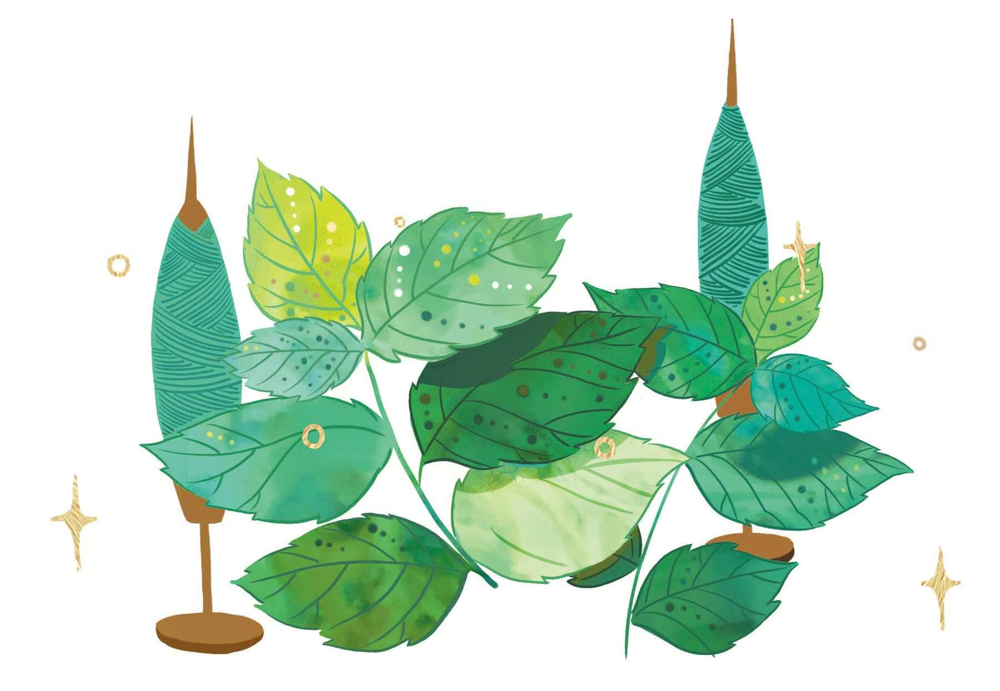
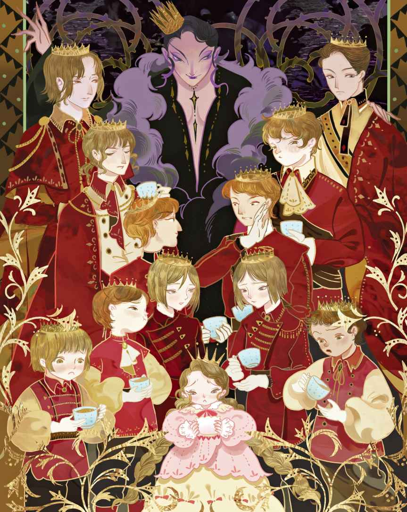
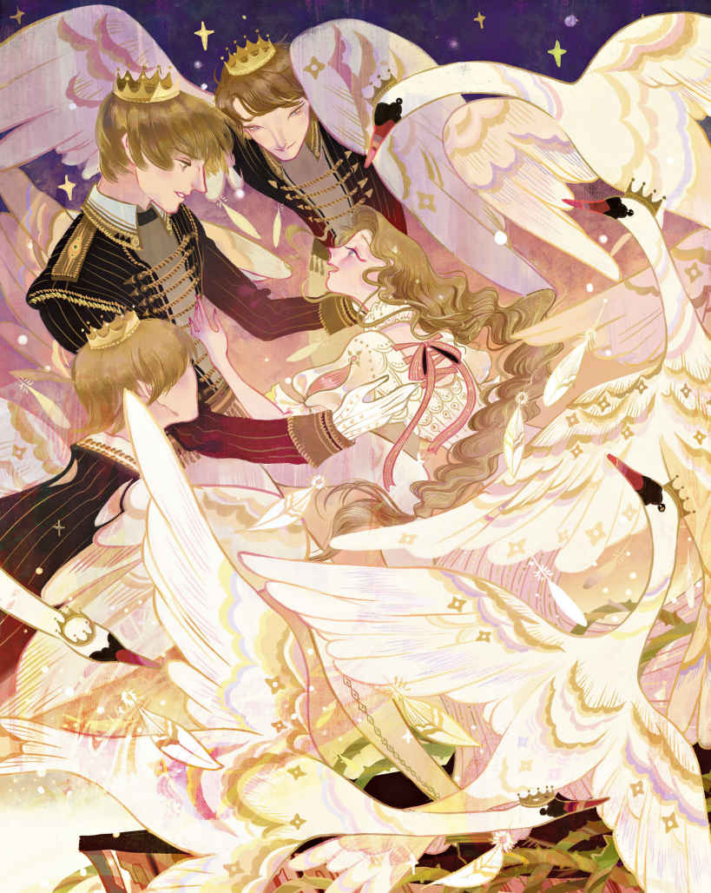
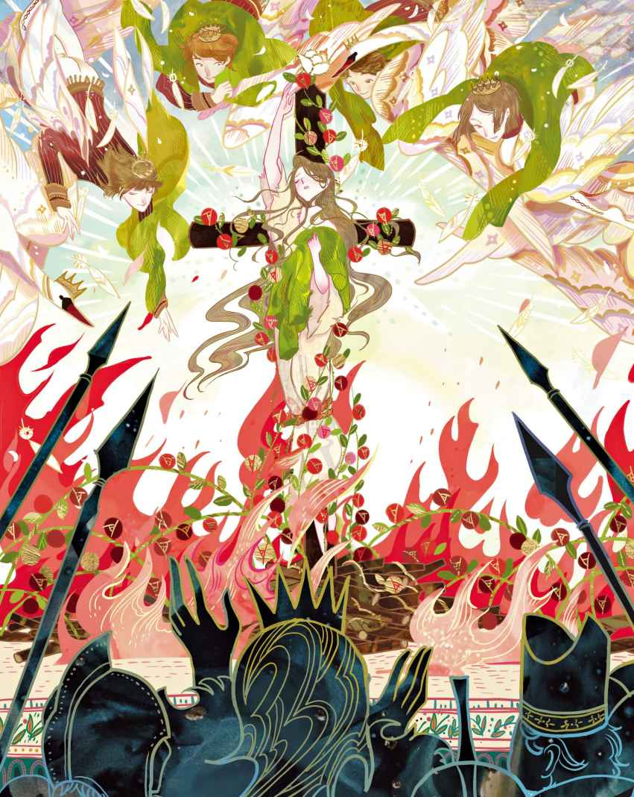

# 野天鹅

每当我们迎来冬季，天鹅们便会不远千里向遥远的彼方飞去。也就是在那里，住着一位国王，国王有十一个儿子，还有一个女儿爱丽莎。那十一个兄弟都是王子，他们去上课的时候都在胸前佩戴着星形徽章，在侧身佩挂着宝剑。他们用钻石做成的笔，在黄金制成的板上写字。对于课业内容，他们只消把书读上一遍就能轻而易举地铭刻在心，进而说得头头是道。只要瞧上一眼，你就能立刻明白，他们可都是真正的王子。他们的妹妹爱丽莎正坐在一张用纯净无瑕的玻璃做成的小脚凳上，她有一本图画书，它的价值相当于半个王国。噢，孩子们过得真不错，可惜好景却不长。

他们的父亲，整个国度的君王，娶了一位邪恶的王后。她对待这些可怜的孩子们的方式真是连一丁点儿的好也谈不上，头一天他们就领教到了这点。婚礼期间，整个宫殿都在举办盛宴，孩子们和各种有趣的宾客一起玩耍。然而，他们的继母却连一块蛋糕和一只烤苹果都不许他们吃。要知道，这些东西他们本来都可以吃的。她只给了他们一只茶杯，里面竟放了些沙子。她告诉他们，这已经算是特别款待了。

接下来的那个礼拜，王后把小爱丽莎送去了乡下，让她跟农民们住在一起。不久之后，她又设法让国王听信了一大堆关于王子们的谗言，以至于他们就此失宠，不再受到父亲的眷顾。

“飞去外面的世界，自己想办法活下去吧，”邪恶的王后对他们说道，“像大鸟一样无声无息地离开这里。”

然而她的诅咒并没有完全得逞，王子们变成了十一只俊美的白色天鹅。他们飞出宫殿的窗户时发出了诡异的叫声，穿过皇家公园，然后进入了森林。

这天时间尚早，当他们飞过农民的棚屋时，妹妹爱丽莎还在清晨的睡梦中。他们在烟囱屋顶上盘旋，又是伸动又是挥舞着长脖子，还拍打着翅膀，可是既没有人看见他们，也没有人听见动静。于是他们只好继续高飞，直入云端，飞去了遥远的茫茫世界。他们降落在一片巨大的黑暗森林里，这片森林一直延伸到海岸。

可怜的小爱丽莎仍留在农民的棚屋里，正在把玩一片绿色的叶子，因为她已经没有任何玩具了。她在叶子上弄出个小洞，然后透过小洞看起太阳来。她仿佛看见了哥哥们明亮的眼睛，当温暖的阳光触摸到她的脸颊时，那感觉让她想起了哥哥们的吻。

日子就这么一天天地流逝。棚屋外面是玫瑰围成的篱墙，风拂过的时候朝着玫瑰们低声细语：“还有谁会比你们更美呢？”玫瑰们摇头晃脑地回答说：“爱丽莎！”在接下来的那个周日，老妇人坐在门口读赞美诗，风掠过纸页时对书说道：“还有谁比你更圣洁善良呢？”“爱丽莎！”书言之凿凿。书和玫瑰们所说的确实一点儿也不假。

爱丽莎就要回家了，因为她已经年满十五岁。可是，当王后看到爱丽莎已经出落成一位如此美丽的公主便心生恶意，对爱丽莎充满了憎恨。她一度想要把爱丽莎也变成野天鹅，就像她的那些哥哥们一样，然而眼下她还不能这么做，因为国王要求见自己的女儿。

清晨，王后来到浴室。这间浴室由白色的大理石打造而成，陈设着柔软的垫子，铺着最为豪华的地毯。她带来三只蟾蜍并亲吻了它们，然后对第一只蟾蜍说：“当爱丽莎洗澡的时候，蹲到她的头上去，这样她就会变得跟你一样麻木迟钝。”对第二只蟾蜍，她说：“爬到她的前额上去，这样她就会变得跟你一样丑陋，让她的父亲认不出来。”接着对第三只，她低声说道：“趴在她心脏的位置，这样她就会受到诅咒，为邪恶的欲念饱受折磨。”

就这样，王后把三只蟾蜍都扔进了水里，原本干净清澈的水旋即变成了颜色泛绿的脏水。她把爱丽莎喊来，让她脱去衣服进入浴池。爱丽莎一下到水里，一只蟾蜍就牢牢缠住了她的头发，另一只跳上了她的前额，第三只则爬上了她的心脏所在的位置。然而，爱丽莎似乎并没有察觉到它们。当她从水里起身的时候，水面上漂浮着三朵红色的罂粟花。要不是这三只蟾蜍带有毒性，要不是它们被那女巫亲吻过，它们眼下甚至会变成红色的玫瑰。不过，它们至少还是变成了花朵，因为来自爱丽莎额头和心灵的碰触是那么的单纯而美好。她实在是太天真、太善良了，以至于那些巫毒的魔法竟奈何不了她。

当邪恶的王后意识到这点之后，她又用胡桃的汁液把爱丽莎抹成了深褐色，用难闻的油膏涂在她美丽的脸蛋上，然后揉乱了那秀丽的头发。这下，再也没谁能认出美丽的爱丽莎了。她的父亲见到她的时候简直吓了一跳，他说那绝对不可能是自己的女儿。除了看门狗和王宫里的家燕，没有任何人认得她了。然而燕子是如此卑微的小生灵，它们根本就说不上话。

可怜的爱丽莎哭了，她想念自己的哥哥们，可是他们全都不在了。她的心里充满了哀伤，悄然离开宫殿，终日在荒野和湿地里游荡，直到遇见那片巨大的森林。她已经无处可去了，心中满藏伤心和难过，只想和哥哥们在一起。他们一定也跟她一样被逐去了陌生的世界，她渴望能找到他们。她进入森林才一小会儿，夜幕便降临了。她迷了路。做完祈祷后，爱丽莎就着柔软的苔藓躺下，脑袋枕在了树桩上。四处阒然，空气柔和，许许多多的萤火虫在草地和苔藓上发着光，看上去仿佛是绿色的火焰。她轻轻地挥手碰触一根树枝，于是那些闪烁着的萤火虫便像坠落的星星一般纷纷倾洒在她的身上。

整夜，她不停地梦见哥哥们：他们又变回了小孩子在一起玩耍；用钻石做成的笔在黄金制成的板上写字；还梦见了那本无比精美、价值相当于半个王国的图画书。然而哥哥们不再像以往那样书写算术和练习题了，不是了，他们写下的是自己的英勇事迹以及一切所见所闻。图画书上的所有东西都活了起来，鸟儿们开始歌唱，书中的小人们也从纸页里溜达出来同爱丽莎和她的哥哥们聊起天来。而一旦她要翻页，他们就会立马蹦回去，恢复成原先图片上的模样。

醒来的时候，太阳已经高挂空中。她看不太清太阳，因为这里的树木极为高大，树枝在上方横生交叉。光线在那儿嬉戏、晃动，看上去宛如泛着微光的金色网纱。绿色的树叶散发出怡人的清香，鸟儿们来到近旁，飞落在她的肩膀。她听见声势颇大的泉水声，听见水花溅落的声响，泉水全都汇聚到了一个池子里，池底铺满最为美丽的沙子。虽然这个池子被茂密的灌木丛包围着，但还是有一条通道——那是鹿踩出来的小径，足以让爱丽莎穿行而过。整个水池是如此清澈，若不是微风轻轻拂动起树枝和灌木丛，她几乎要以为它们是绘在池底的画，无论是沐浴在阳光下还是隐藏在阴影里的每一片叶子都在倒影中清晰可见。

爱丽莎在水中看见自己的脸庞，她惊讶地发现这张脸竟是如此的棕黑丑陋。她用水打湿自己纤柔的双手，然后擦洗眉毛和眼睛，原本光滑的肌肤又露了出来。接着她把衣服放到一边，跳入了清澈的池水。在这个世界上，再也没有比爱丽莎更可爱的公主了。她穿起衣裳，编起发辫，然后走向那闪亮的泉水，以手掬水而饮。她继续游荡，步步深入森林，却不知要去哪里。她想起了哥哥们，想起了仁慈的天父，知道他不会将她遗弃。是他让山楂果子茁壮成长，以供人果腹；是他指引她的脚步，带她来到树下，树上的果实沉得压弯了树枝。她在这里享用了午餐，在承重的树枝下放了些支撑物，然后进入了森林深处。这里寂静极了，她只听见自己的脚步声以及每一片枯叶在脚下发出的嚓嚓声。眼前连一只鸟儿也没有，太阳的光线无法穿透那庞大而密集的枝杈。高耸的树木相互紧靠，一眼看去如同坚实的围墙，将爱丽莎肃穆地囚禁了起来。如此这般的孤寂感，她还是头一回面对。

夜晚来临之际，四处一片漆黑。树叶之间没有萤火虫出没，爱丽莎感到有些落寞，于是躺下来睡觉。这时候，头上的树枝似乎分了开来，天父从那儿慈祥地望着她，小天使们躲在他的背后从头顶和身后探出来偷看着她。

翌日早晨，爱丽莎醒来后简直分不清那究竟是梦还是真实发生过的事情。

她又走了一段路，遇到了一位老妇人。老妇人挎着一篮浆果，还送了一些给爱丽莎。爱丽莎问她，有没有看到过十一位王子骑着马穿过森林。

“没有看到，”老妇人说，“不过，昨天我倒是见过十一只头戴金色王冠的天鹅，它们就在离这儿不远的河里游泳。”

于是她带了一小段路，把爱丽莎领到了一座山坡顶上。山坡朝着一条蜿蜒的河流倾斜而去，河畔两侧的树木生长得枝繁叶茂，修长的树枝相互交织。在河道较为宽阔的地方，它们的树枝无法横跨，于是便将树根脱离泥土，跃过河面伸展而去，以这种方式盘根错节起来。爱丽莎向老妇人道别，然后沿河流而下，前往那宽阔的入海口。

整片美丽的大海呈现在了这位少女面前，然而眼前的海面上没有一片帆，不见一艘船。她要怎么继续前行呢？她看着海滩上不计其数的小圆石，发现海水竟把它们打磨得如此光滑。玻璃、铁矿、石头，全都因海水而改头换面，全都被塑造成如此柔和的模样，简直比她那纤柔的双手还要柔和。

“海浪孜孜不倦地翻涌着，它就是这样把那么坚硬的东西都变得光滑了，”她说，“我也要像海浪一样孜孜不倦。谢谢你给我上了一课，清澈的、翻涌着的海浪。我的心告诉我，你或许会带着我找到心爱的哥哥们。”

在湿漉漉的海草之间，她发现了十一根白色的天鹅羽毛。她把它们收集起来扎成一束，羽毛上沾着水滴，没人知道那究竟是海水还是眼泪。海岸沿线是那么寂寥，她却并不在意，因为海水一直在不断地变幻。事实上，大海在数小时内的变化比内陆湖泊一年的变化还要大。当天空中乌云密布的时候，大海仿佛在说：“我也能变得很吓人哦。”然后风吹起，海浪扬起白色的浪尖；而当风浪渐息的时候，云朵变成了红色，使得整片海看上去宛若玫瑰花瓣一般。

大海时而变成白色时而又换成绿色，不管它变得多么平静，海岸边总会有海浪轻柔地拍打，海水的涌动看上去就像是孩子睡着时胸口的起伏。

日落时分，爱丽莎看见了十一只白天鹅，它们头戴金色王冠飞向海岸。飞行的时候，它们前后依次排列，看上去仿佛是一道飘浮在天空中的白色缎带。爱丽莎爬上崖坡，躲到了灌木丛后面，天鹅们在她附近着陆，拍打着那华美的白色羽翼。

当夕阳隐没在地平线之下，天鹅们蜕去了羽毛变成了十一位英俊的王子，正是爱丽莎的哥哥们。虽然他们的模样已经有了巨大的改变，但是爱丽莎从心底知道自己是绝不会认错的。她大哭起来，喊着每一位哥哥的名字扑进了他们的臂弯。见到小妹妹的王子们也开心极了，他们也立刻认出了她，发现她长高了，变得更加可爱了。他们先是大笑，接着又是哭泣，因为他们很快便意识到继母对待他们的手段是多么的残酷。

“只要太阳还挂在空中，”最年长的那位王子说道，“我们这些兄弟就不得不以野天鹅的形体飞翔于天际，只有等到夕阳西沉我们才能变回人形。所以，当太阳开始落下的时候，我们总是会及时找寻合适的落脚处。因为在这种时候如果我们依然继续在云层间飞行，那么势必会突然坠落下去。

“我们并不住在这片海岸，在大海的另一端有着另一片陆地，它跟这里一样美丽。不过它离这儿很远，我们必须穿过浩瀚的海洋才能够抵达那里。整个飞行线路当中没有任何可以让我们过夜的岛屿，有的只是那种突出海面的小礁石。礁石的大小也只能勉强容得下我们立足，不管我们靠得有多么紧。海面动荡的时候，海浪还会把我们给浇透，尽管如此，我们还是要感谢上帝，因为他给了我们这块礁石。

“变回人形之后，我们会在礁石上度过夜晚。要是没有这块礁石，我们就不可能回到心爱的故土。归程需要耗费一年中最漫长的两天，而在一年里面我们只能回去一天，滞留时间则不得超过十一天。当我们飞过这片森林的时候，我们就能看到故国的宫殿，那是我们父王居住的地方，也是我们出生的地方。我们能看见教堂高耸的尖顶，那是我们母亲长眠的地方。在这里，就连大树和灌木也变得如此亲近我们；在这里，野马在旷野上疾驰而过，就跟我们小时候看到的一样；在这里，烧炭人依旧唱着昔日的老歌，当我们还是孩子时曾跟随歌声一起跳舞。这里是我们的家园，它一直在召唤我们，而此时此刻，亲爱的妹妹，我们再次找到了你。我们将停留两天，然后必须飞越大海去那片美丽的陆地，虽然那里并不是我们的家乡。可我们要怎么样才能带上你呢？我们既没有大船，也没有小舟。”

“我要怎么做才能解救你们呢？”爱丽莎问道。他们彻夜讨论，只睡了几个小时。

早晨，爱丽莎在天鹅“哗哗”的振翅声中醒来，哥哥们身上的魔法再度应验。他们在上空盘旋了好几圈然后消失在她的视线中，最年轻的那位哥哥留了下来，把脑袋枕在爱丽莎胸前，而爱丽莎则轻抚着他的翅膀。他们整日都待在一块儿，直到黄昏时分其他兄弟再度归来。一等太阳落山，他们就变回了原来的模样。

“明天，”一位哥哥说道，“我们就必须飞离这里了。我们不能再回来，除非再等上一整年。但是我们不能就这样把你丢下，你有足够的勇气跟我们一起走吗？我的臂膀很有力量，足以带着你飞过森林。毫无疑问，我们的翅膀也都足够强壮，能载着你穿过海洋。”“行，带上我吧。”爱丽莎说。

整晚，他们都在编织网兜，用的是柔软的柳条和坚韧的芦苇。他们把网兜做得又大又牢，让爱丽莎躺到了里面。等到旭日初升再次变身为野天鹅之后，他们便用嘴衔起网兜然后高飞入云端，而爱丽莎在下面的网兜里依旧睡得很熟。当阳光照射到她的脸上时，天鹅中的一只飞到她的脑袋上方，用自己宽阔的翅膀替她遮挡阳光。

当爱丽莎醒来的时候他们已经离海岸很远了。她心想，自己一定是还在做梦。这实在太奇异了，她居然被带着一起在空中飞行，而且距离海面是那么遥远。她的身旁放着一根树枝，上面长满了熟透的浆果，还有一把味道甜美的根茎。这些都是她最年轻的那位哥哥搜集来的，是他把这些东西带给了她，于是她给他送去一个满含着谢意的微笑。她知道，刚才飞到头顶不让阳光刺伤她的眼睛的，一定也是他。

他们飞得如此之高，以至于映入眼帘的第一艘船看上去就活像是漂浮在水上的海鸥。云团在他们身后卷起，巨大得如同山峦，爱丽莎在那上面看到自己和十一只天鹅的巨大影子，是她从未见过的奇异景象。随着太阳升高，云朵渐渐远去变小，他们飞行时映在云团上的影子奇观也在视线中消失了。

整日，他们都像箭一般在天空中穿行，不过由于他们带着爱丽莎，所以还是飞得比以往慢得多。夜晚将至，暴风雨即将来临。爱丽莎望着逐渐隐没的太阳心里开始感到害怕了，因为那块孤零零的礁石还没有出现，她感到天鹅们正在不顾一切地奋力振翅。唉，都是因为她他们才没能飞得够快。而一旦太阳彻底隐没，他们就会变成人形然后统统坠落下去，最后淹死在海里。她在心底深处向上帝祈祷，可还是没有看见那块礁石。黑色的云正在聚集，猛烈的强风阵阵来袭，这一切预示着暴风雨即将到来。滚滚乌云如同浪涛般朝他们压来，浓重得活像是成堆的铅块，雷电交织，掣动不止。此时太阳已经落至大海的边缘，爱丽莎的心狂跳起来，因为天鹅们开始飞快地向下俯冲，她以为大家就要这么坠落下去了，好在他们控制住了俯冲的态势。当太阳下沉到一半的时候爱丽莎终于看见了下面的小礁石，它看上去还没露出水面的海豹脑袋大。太阳下沉得很快，现在它的大小已经不及一颗星星了，也就是在这个时候，爱丽莎的双脚踩在了礁石上面。太阳彻底隐没，那景象如同纸片燃尽时最后的一道火光。她看到哥哥们在自己身边站成一圈，他们手拉着手，这是仅有的立足之地。海浪拍打着礁石，溅起的浪花将他们淋湿。天空被接连不断的闪电映得通亮，到处都是电光交加、雷声轰鸣。爱丽莎和哥哥们的双手紧紧相握，他们一起唱赞美诗，以此互相安抚内心，为各自增添勇气。

黎明时分，天空终于变得晴朗而平静了，太阳一升起天鹅们便带着爱丽莎起飞，离开了那块礁石。海面仍然动荡不止，从他们飞行的高空俯瞰，那白花花的泡沫和墨绿色的海浪看上去就像是成千上万的天鹅正在水面游动。

当太阳升得更高的时候，爱丽莎的眼前出现了一块山峦迭起、半浮在空中的陆地。那里的山峰全都覆盖着晶亮的冰层，山峰之间耸立着足足延绵一英里的城堡。城堡的粗实石柱鳞次栉比地排列成廊，棕榈树在下面悠悠摇摆，灿烂的花朵盛放得如同水车轮一般硕大。爱丽莎问，这是不是他们即将着陆的国度，然而天鹅们摇着头。她所看到的瑰丽宫殿其实是某种变化多端的幻景

> **注 5**　即人们常说的“海市蜃楼”，原文“Morgana”又指亚瑟王传说中的一位仙女，她拥有变幻出海市蜃楼的能力。下文中的仙女亦是从幻景（海市蜃楼）中现身。

> **注 6**　在中国，很多人经常把风琴和钢琴混为一谈，实际上它们是两种乐器（只是外观比较相似）。教堂里使用的是风琴。

幻景不断交替，在眼前轮番上演，直至爱丽莎终于看到那个真正要去的国度。那里山脉迭起，在她面前呈现出美丽的蓝色，还有茂盛成林的雪松布满了城市与宫殿。日落之前，他们在一处山腰落脚，后面有个爬满了绿色藤蔓的巨大山洞，那些藤蔓看上去如此细致，无异于刺绣的铺饰。

“让我们瞧瞧，今晚你在这里会梦见什么。”最年轻的那位哥哥说道，他正要告诉爱丽莎晚上睡在哪里。

“我只希望自己能梦见怎么把你们解救出来。”爱丽莎说。

这个念头牢牢地占据着她的脑海。她无比虔诚地向上帝祈祷，希望他能帮帮她，即便进入了梦乡也没有停止祷告。在梦里，她感到自己好像飞到了空中，飞进了云雾间的幻景。迎接她的是一位仙女，她是那么美丽，身上熠熠生辉。然而，她却近乎让她想起了那位老妇人，那位曾经在森林里给她浆果的老妇人。她还告诉过她有关头戴金冠的天鹅的事。

“你的哥哥们是有办法重新获得自由的。”仙女说，“只是你是否拥有勇气和坚韧的品质呢？石头非常坚硬，海水却能改变它们的形状；海水比你纤弱的双手更柔，但它并不像你的手指那样会感受到疼痛。水是没有心的，所以它既不会被痛苦左右，也不会被悲伤所困，而这些正是你必须要承受的。看到我手中这些带刺的荨麻

> **注 7**　荨麻的刺（蜇毛）带有毒性，与皮肤接触后可引起皮炎和烧伤，又称“咬人草”“蜇人草”。

她用荨麻碰触了爱丽莎的手，一阵火烧般的灼痛惊醒了她。日光普照，在爱丽莎睡觉的位置旁长着一株荨麻，就跟在梦中见到的一样。她双膝跪地感谢了上帝，然后离开洞穴去落实她的任务。

她用自己的双手捧着那些可怕的荨麻，而它们如同火一般灼手，使得双手和手臂全都起了很大的水泡。然而她心甘情愿地忍受着，因为这是解救哥哥们的希望所在。她裸着脚踩碎那些荨麻，然后用绿色的麻纺成线。

夕阳西下，哥哥们回来了，他们惊恐地发现小妹妹不再说话了。他们担心这是邪恶继母的又一个诅咒，然而看到她的双手时他们便立刻明白过来了，她这是想通过自己的努力来拯救他们啊。最年轻的那位哥哥哭了，他的眼泪滴落在爱丽莎身上，而泪珠碰触到的地方竟不再感到疼痛，灼烧的水泡也被治愈了。

爱丽莎彻夜劳作，在把心爱的哥哥们从魔法中解救出来之前绝不停歇，第二天也是如此。天鹅们飞走了，她独坐了一整天。不过，她从未觉得时间过得这样快。一件衣衫做好了，便立刻着手做第二件。

这时候，山腰上突然传来了狩猎的号角声，可把爱丽莎给吓了一跳。声音越来越近，她都能听见猎狗的吠声了。出于害怕，她跑回了山洞里，把采集来的荨麻还有编织过的麻全都捆在一块儿，然后坐到了这捆东西上面。

紧接着，一只大狗从灌木丛中跳了出来，后面还有一只，再后面又是一只，它们一边大声吠叫着一边跑来跑去。没过多久山洞口就站满了猎手，而猎手中最为英俊的是这片土地的国王。“我可爱的孩子，”他说，“你怎么会在这儿？”

爱丽莎摇着脑袋，因为她不能开口说话。能否解救哥哥们，能否保住他们的生命，全都取决于此。她把手藏在围裙下面，不让国王看到她所承受的痛苦。

“跟我走吧，”国王对她说，“你不能留在这里。如果你的内心跟你的外貌一样美，那我就给你穿上丝绸和天鹅绒的衣裳，为你戴上金质的冠冕，让你住进我最好的宫殿。”说着，他把她送上了马。当她开始哭泣、紧紧攥住双手的时候，他又说：“我只想让你快乐起来，日后你一定会感激我的。”他让她坐在身前然后驱马下山，猎手们在后面策马相随。

黄昏时分，国王的那座布满塔楼和圆屋顶的辉煌城邦终于出现在了他们面前。国王领着爱丽莎走进了他的宫殿，在那里，蔚为壮观的喷泉在高大而华丽的大理石厅堂里喷着水，墙壁和天花板上全都饰满了绘画。可是爱丽莎毫不关心这些东西，只是不停地哭泣和哀伤。她漠然地让女侍给她换上王室的服装，把成串的珍珠编入她的头发，把柔软舒适的手套戴到她那起了水泡的手上。

她是如此的光彩夺目，这些华贵的服饰将她推向了美的极致。整个宫廷上下无不向她躬身致意，人们躬身的程度远胜过以往的任何一次。国王要把她选为自己的新娘，然而大主教摇着他的脑袋低声说，这个美丽的少女来自森林，一定是个女巫，她蒙蔽了大家的眼睛，偷走了国王的心。

可是国王并没有听信这些话。他下令把音乐演奏起来，布置好昂贵的餐具，让最漂亮的宫女为爱丽莎起舞。她被带去参观了芳香四溢的花园和华丽宏伟的宫廷走廊，然而没有任何东西能让她的嘴角露出笑意，让她的眼睛绽放出亮光。因此，这一切都带上了悲伤的色彩。末了，国王打开了一扇门，里面通向一间小卧房，这便是她睡觉的地方了。这里跟国王发现她的山洞一模一样——地板上放着捆起来的荨麻，天花板上挂着已经做好的衣衫——猎手中有人出于好奇，把这些东西都给带了回来。

“在这里，你可以再次梦回以前的老地方，”国王告诉她，“你在那里做的东西都已经搬到这里来了，而你身边这些无处不在的华丽典雅则会让你过去的回忆也带上快乐的气息。”

爱丽莎看见这些东西，这些对她而言如此宝贵的东西，嘴角立即洋溢出了微笑，脸蛋也恢复了血色。希望又回来了，她又可以解救哥哥们了。她吻了国王的手，而国王则把她拥入心口，下令敲响所有教堂的钟来宣布他们的婚讯。来自森林的美丽哑女孩即将成为这个国家的王后。

大主教又在国王耳边说了一堆污言秽语，但是国王的心意并没有为之所动，婚礼照常举行。大主教不得不亲手给爱丽莎戴上王冠，为了泄恨，他把原本就很紧的王冠使劲往她的前额上压，想要把她弄疼。然而，爱丽莎的心里还有更为沉重的心结，哥哥们的事所带来的悲伤令她根本感觉不到任何肉体上的疼痛。她闭口不语，因为只要说出一个字哥哥们就会死去。不过，她还是朝善良而英俊的国王投去了充满爱意的目光，因为他竭尽所能地想要让她快乐。每一天，她都会在心里更爱他一些。噢，如果可以表达对他的信赖，可以把自己的伤心事都告诉他就好了，可是她必须继续当哑巴，在沉默中完成她的任务。如此这般，只要一到晚上她便悄悄地离开他身边，去那间布置成山洞模样的小卧房继续编织衣衫，一件接着一件，可当她准备动手织第七件时却发现已经没有足够的麻可用了。

她知道自己只能使用教堂墓地里的荨麻，而且必须亲手采集它们才行。可是她要怎么去那儿呢？

“噢，跟我心里所受的煎熬比起来，手指的疼痛又算得了什么！”她心想，“我必须铤而走险，好心的国王是不会抛弃我的。”

她感到害怕极了，就像自己正在做什么坏事。她蹑手蹑脚地潜入月光下的花园，穿过幽长的小径，然后沿着寂静无人的街道一路来到教堂里的墓地。在那里，她发现了一群食尸鬼

> **注 8**　原文是吸血鬼。但是根据紧接着的内容，可以看得出安徒生描写的其实是食尸鬼——专门掠食坟墓死人的怪物。食尸鬼是阿拉伯故事中的怪物，安徒生早年读过这方面的民间故事，所以他所写的一定是食尸鬼，而不是吸血鬼。

> **注 9**　此处的原文是“ghoul”（阿拉伯文也差不多是这几个字母），这个词就是食尸鬼的意思。

只有一个人看到了她——大主教。别人都睡着了，他却醒着。之前他就觉得她不对劲，现在果然被他抓到了把柄，这位新王后身上肯定藏着什么问题。她一定是个女巫，所以才能蒙骗住国王和所有的臣民。

在忏悔室里，他把自己目睹的一切和令人担忧的事实全都告诉了国王。当那些尖刻的谗言从他的嘴里喷薄而出时，就连圣者的雕像都连连摇起头来，仿佛在说：“他在说谎，爱丽莎是无辜的。”然而大主教自有一番说辞，他说这些雕像恰恰是在印证她的罪行，是因为她的恶毒才频频摇头。

国王回去的时候心里充满了震惊，两颗硕大的眼泪沿着他的脸颊滚落而下。这天夜里，他假装自己睡着了，实际上却毫无睡意。他亲眼目睹爱丽莎下床离开。每天晚上，他都看着她起身，而每次他都悄无声息地尾随在她身后，看着她消失在那间私人的小卧房里。日复一日，他变得越发愁眉不展。爱丽莎见他这样，并不明白是为什么，但这还是给她带来了烦恼，原本就已经为哥哥而悲伤不已的心为此又增添了一道忧愁。滚烫的眼泪滴落在她那身紫色天鹅绒做成的女王礼服上，那些滴落在衣服上的眼泪显得晶莹透亮，宛若钻石。无论谁见了这样璀璨的光景，都会希望自己也能成为女王。

与此同时，她的任务也将近完成，还差一件衣衫。可是她的麻又用完了，一株荨麻也没剩下。必须再去一次，这是最后一次了，她一定要前往教堂墓地再去采摘几把荨麻。她恐惧地回想起了那条寂静无人的小径和那些可怕的食尸鬼，不过她还是毅然决然地出发了，如同对上帝的信仰。

她去履行她的使命，然而国王和大主教却跟踪了她。他们透过教堂的铁门发现她消失在了里面，于是跟了进去，然后看到那些坐在石墓上的食尸鬼——就跟她之前看到的一样。

国王转身离去，他以为爱丽莎也是它们中的一员——这个今晚还曾把头枕在他心口上的爱丽莎。

“让我的臣民审判她。”他说。于是臣民们对她进行了审判：用火烧死她。

她从豪华的王室殿堂跌入了黑暗、潮湿的地牢，风从窗棂钻进来，再也没有丝绸和天鹅绒了，他们只给她一捆荨麻当枕头——正是她自己采来的荨麻；他们还给她一堆粗糙不堪的床单——也正是她给哥哥们编织的灼人的麻衣衫。但其实，再也没什么能比这些东西更令她称心的了。

她又开始劳作和祈祷。外面的街道上，男孩们唱着嘲笑、奚落她的歌，没有任何有心人来安慰她，一句善意的话语也听不到。

随着夜幕降临，她听见了天鹅飒飒的振翅声。那声音正在朝牢窗靠近，是她最年轻的哥哥，他终于找到了爱丽莎。她不禁喜极而泣，虽然她知道今晚显然会是她有生之年的最后一晚，但她的任务也几近完工，而且，哥哥们就在附近。

在她留在这世上的最后一段时间，大主教前来陪她一起度过，但这多半是国王的吩咐，他不得不照办罢了。爱丽莎摇着头，极尽表情和手势请求他离开。这是最后的夜晚了，她必须尽快完成那项任务，否则一切——她所有的伤痛、眼泪和不眠的夜晚都会因此而前功尽弃。于是大主教离开了，临走之际仍不忘对她恶言相向。不过，可怜的爱丽莎坦然于自身的清白，只管继续完成任务。

小老鼠们在地板上跑来跑去把荨麻送到爱丽莎脚边，尽己所能来帮助她；画眉鸟在地牢的窗闩旁边落脚，用最振奋人心的声音整夜歌唱，就这样让爱丽莎又有了坚持的勇气和力量。

黎明时分，离太阳升起还有一个小时。十一位王子来到宫殿门前要求见国王一面，然而他们被告知这是不可能的。现在仍是晚上，国王还在睡梦中，不会允许被打扰。他们进一步请求，甚至大声威胁，不仅把侍卫招惹出来，连国王本人也跑出来一看究竟。可就是在那一刻，太阳升起了，十一位王子旋即统统消失，人们只看到十一只天鹅飞过宫殿上方的天空。

全国的臣民一齐涌向城门口，他们都想看女巫如何被火刑处死。一匹年迈的老马拉着囚车，上面坐着爱丽莎。他们给她换上了粗糙不堪的麻布衣，那曾经美丽的长发此刻全部四散披落。她的脸色死一般苍白，嘴唇在默念的祈祷中颤抖，而手指仍在编织着绿色的麻。哪怕是在行刑的路上，她也没有放弃未完成的任务。十件衣衫已经摆在脚边，她继续编织着第十一件。“瞧啊，这女巫在念咒语呢，”坏心眼的刁民对她奚落道，“她手里可没有赞美诗。不好，她这是坐在那儿摆弄肮脏的妖术，快把那东西从她手里抢过来，把它撕成碎片！”

一群乌合之众朝她拥挤过来，想要毁掉她手上的东西。就在他们快要碰到她的时候，十一只白天鹅飞了下来，它们挥动着翅膀在囚车四周围成一圈。惊骇中，那些暴民退缩了。

“这是上天的旨意，她一定是无罪的。”人们议论纷纷，但是没有人胆敢大声说出来。

当刽子手抓起爱丽莎的胳膊时，她飞快地就势抛起十一件衣衫。衣衫落到天鹅们身上，它们变成了十一位英俊的王子。不过最年轻的那位王子身上还有一条胳膊仍是翅膀的模样，那件衣服上还有一只袖子没有织好，爱丽莎实在是来不及了。

“现在，”她大声说道，“我可以说话了！我是清白的。”

所有目睹这一切的城民全都俯身向她致意，就好像面对的是一位圣者。然而已经承受了太多污蔑、痛苦和折磨的爱丽莎跌进哥哥们的臂弯，似乎已经耗尽了自己的生命。

“她确实是清白的！”最年长的哥哥说道。他把发生过的一切全都告诉了大家，当他说话的时候空气中充满了无处不在的玫瑰花的味道。那些高筑起来的、用来烧死爱丽莎的柴火竟全部在地上生了根，长出了枝条，人们眼前伫立起高耸的树篱，上面长满了芳香扑鼻的红色玫瑰。在这些玫瑰的最上面，还盛开着一朵纯白色的花，它是那么闪耀，宛若星辰一般。国王摘下它放在爱丽莎的胸前，于是爱丽莎苏醒了过来，心间满溢着平静与幸福。

所有教堂里的钟都自行敲响，天空中满是飞翔的鸟儿。返回王宫的时候，所有人都变成了婚礼队伍，这可是任何国王都不曾享有过的幸福。
