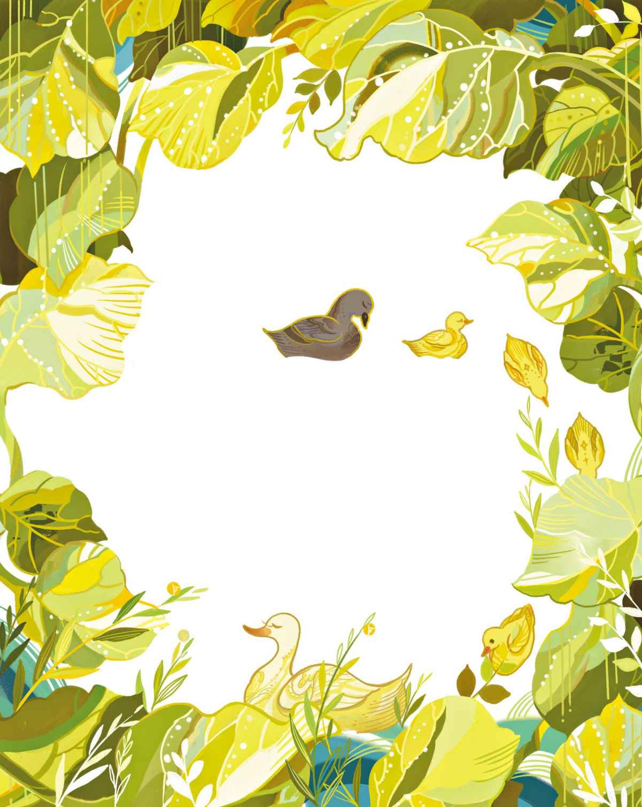
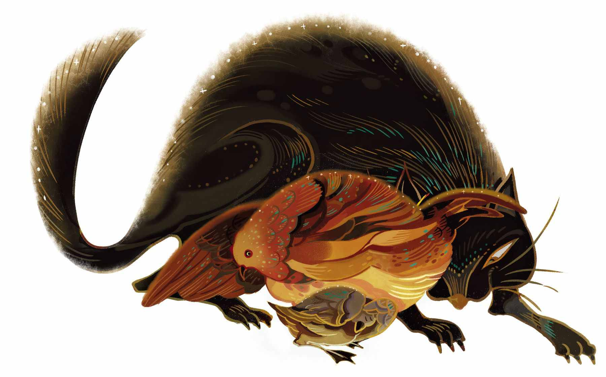
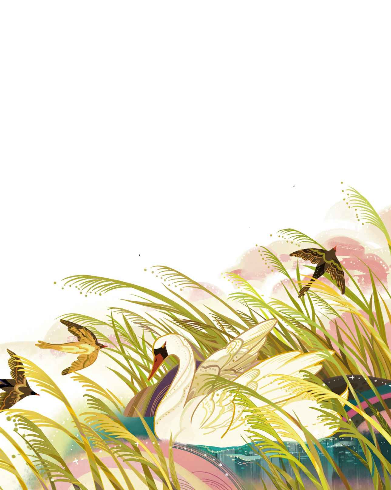

# 丑小鸭

时值夏日，郊外真是美丽——小麦田里金灿灿，燕麦田里绿油油，草场上堆放着干草。也就是在那里，白鹳用他那红色的双腿踱着小步，嘴里叽里咕噜地讲着古埃及语，这种语言传自他的母亲。在旷野和草场周围环绕着广阔的大森林，在森林的内部则隐藏着深深的湖泊。是啊，郊外实在是太美好了。

阳光照在一栋庄园宅邸上面。这栋宅子颇为老旧，四周围绕着深河。从庄园的围墙到河的边缘地带全都长满了硕大的牛蒡叶，有些长得非常高大。在那种最高大的叶片下面，让小孩子站直了都不成问题。那些叶片稠密得如同森林，将这一带覆盖成了牛蒡的原野。这儿有只鸭子正坐在自己的窝里孵化幼鸭，她有点累了，因为孵蛋委实是一项漫长的工作，更何况眼下什么也没孵出来。比起摇摇摆摆地走来走去或者蹲在牛蒡叶下跟她闲聊，其他鸭子倒是更乐意到宅子周围的河里去游泳。

不过到最后，那些蛋壳终于接二连三地裂开了。“唧唧，唧唧！”小东西们纷纷叫着，探出脑袋来到了这个世界。

“嘎嘎，嘎嘎！”鸭妈妈说。很快，他们便蹒跚学步，摇摇晃晃地走起路来，走去观看牛蒡叶下的绿色世界。鸭妈妈让他们尽情地看了个够，因为绿色对眼睛是很有裨益的。

“世界是多么广阔呀。”小鸭子们都这么说。因为跟他们原先居住的蛋壳比起来，眼下这地方的空间确实足够巨大。

“你们以为这就是世界的全部了吗？”鸭妈妈问道，“其实啊，这里不断朝外延伸，跨过整个花园，一直能到教区牧师的田里。不过那实在太远了，我从来没有去过。我只操心如何把你们都孵化出来。”说着，她站起身子，“不对，好像还没全孵完。最大的那只蛋还躺在那儿呢。这只蛋究竟还需要孵多久呢？我已经累得不行啦。”她虽然这么说，但还是把身子挪回窝里去了。

“唔，孵得如何啦？”一只前来造访的老鸭子问道。

“已经孵了很长时间了，”鸭妈妈在窝里说道，“看样子是孵不出来了。不过，瞧瞧其他蛋，他们都已经成了我见过的最可爱的小鸭子，看上去跟他们的父亲像极了。可是这个贱骨头！到现在还不肯出来见我。”

“让我们来瞧瞧这只孵不出来的蛋吧。”老鸭子说，“这是一只火鸡蛋

> **注 10**　此处一语双关，原文既有“火鸡”的意思，又有“失败之作”和“败类”的意思。

“噢，我再孵上一小会儿就好。我都已经孵了那么久啦，再坐上半个夏天也没什么。”

“那随你的便吧。”老鸭子说。

最后，那只大蛋终于裂开了，“唧唧”小家伙叫道。他从蛋壳里滚出来，看上去又大又丑。

鸭妈妈打量着他，“真是一只大得恐怖的鸭子，”她说，“看上去跟其他鸭子一点儿也不像。难不成他真是一只小火鸡？得了，得了！我很快就会搞明白的，他必须下到水里去，哪怕由我亲手把他推下去也在所不辞。”

翌日，天气大好，晴空万里，阳光铺洒在绿色的牛蒡叶上，鸭妈妈带着一家子去河边。扑通！她下了水。“嘎嘎，嘎嘎！”随着她的叫声，小鸭子们也接二连三地跳进了水里，河水旋即淹没了他们的脑袋，不过才一眨眼工夫，他们就纷纷浮出了水面，随后便游得得心应手了。他们的双腿自然而然地划动着，全都已经在水里游起来了，就连那只又大又丑的小鸭子也跟着一块儿游了起来。

“哈，他不是火鸡哦。”鸭妈妈说，“瞧啊，他的腿划得多么自如，游得多么稳健，到底是我亲生的儿子呀。只要别用有色眼镜看待他，还是很好看的嘛。嘎嘎，嘎嘎，跟我来，我要带你们见识见识这个世界，把你们介绍给鸭棚里的其他鸭子。不过，你们可要跟紧我以免走散了，还要提防着猫！”

这么着，他们便出发前往鸭棚了。那地方一片喧嚣，两个家族正为了一条鳗鱼争得不可开交。不过弄到最后，鳗鱼还是被猫给抢去了。

“你们瞧，这个世界就是如此。”鸭妈妈咂巴着嘴，因为她自己也很想吃鳗鱼头。“现在动起腿来，打起精神来，见到那边的老母鸭时要记得弯下脖子鞠个躬，她是我们这儿出身最高贵的，身上有西班牙血统。也正是因为如此，她才会那么肥。看到裹在她腿上的红色衣服片儿了吧？那可是很高档的东西，只有地位最显赫的鸭子才会拥有。这说明人们将她视若珍宝，人类和动物都高看她一等。你们把自己整顿一下！别老是紧缩着脚趾，有教养的鸭子应该把脚趾舒展开才对，就像爸爸妈妈示范的那样。那么，现在弯下脖子，说声‘嘎嘎’表示你们明白了！”

小鸭们照办不误。其他鸭子围过来对他们打量起来，然后说：“瞧瞧他们！难道我们连这种小鸭子也要接纳吗？搞得好像我们人还不够多似的。呃——呸！那只鸭子多么丑陋啊！我们这里可容不了他。”有只鸭子冲上来，咬了丑小鸭的脖子。

“放过他吧，”鸭妈妈说，“他不会做什么坏事的。”

“就算不会，”咬丑小鸭的那只鸭子说，“他还是太大、太怪了。光是因为这点，就应该好好给他点颜色瞧瞧。”

“你的孩子都多么漂亮啊，这位母亲。”那位腿上裹着红布的老母鸭说道，“他们都长得很不错，唯有一只除外，他实在出落得不怎么样。真是遗憾，你没法把他重新孵化一遍。”

“可是木已成舟，尊贵的夫人。”鸭妈妈说，“他虽然长得谈不上英俊，但还是可以变得很优秀的。他游起泳来跟其他小鸭子一样出色，或者这么说好了，甚至比其他小鸭子游得还要好一点儿。我希望随着他慢慢长大，模样也会渐渐变得好起来，到时就不会显得很大了。他在蛋里待的时间太久啦，所以容貌才走了样，他本来不该是这样的。”她撸了撸丑小鸭的脖子，然后用嘴巴理了理他的羽毛，“再说了，他是一只公鸭，长相不会太碍事。我觉得他会茁壮成长，也相信他将来一定会有所作为的。”

“好在其他小鸭子都长得很好。”老母鸭说，“现在，你就把这里当成自己的家吧。要是找到鳗鱼头的话，记得带给我就行了。”

就这样，他们终于有了宾至如归的感觉。不过那只可怜的小鸭子，就是那只最后才从蛋里孵出来的小鸭子，他看上去实在太丑了，所以总是遭到其他鸭子的啄咬、排挤和嘲笑，连鸡群也这么对待他。“他长得太大了。”他们都这么说。有只雄火鸡生来就长有鸡冠，于是便以国王自居，自高自大得不行。他鼓起尾翼

> **注 11**　此处原文有自负、自大之意，亦为一语双关。

> **注 12**　火鸡的尾翼可以展开呈扇形，状如孔雀开屏。

这种情形打从头一天起就没消停过，并且有愈演愈烈之势，所有人都来追啄和推搡丑小鸭，就连他自己的兄弟姐妹也参与了辱骂。“噢，”他们总是这么说，“我们真希望你被猫抓走，你这个丑东西。”鸭妈妈说：“我多么希望你能远离这里啊。”鸭子们咬他，母鸡们啄他，饲养他们的姑娘则用脚踢他。

于是他逃跑了。他飞过藩篱，灌木丛里的小鸟们纷纷被惊起。“那是因为我实在太丑了。”他心想。于是他闭起眼睛，不停地跑啊跑，一直跑到一片大沼泽地，那里住着很多野鸭。他在那儿过了一晚，疲倦不堪，灰心丧气。

到了早晨，野鸭们纷纷飞过来打量他们的新伙伴。“你是什么动物啊？”当丑小鸭朝着所有方向，对着所有人深深地鞠躬致意的时候，野鸭们这么问道。“你真是丑得吓人。”他们对他说，“不过这对我们而言倒也不打紧，反正你也不可能跟我们的人联姻，成为我们家族的一员。”

可怜的丑小鸭！他根本就没敢有过结婚的念头啊。他所想的，充其量也就是希望他们能允许他在芦苇丛里休憩一下，在沼泽里喝一小口水罢了。

在那里逗留了两天之后他遇见两只野鹅，更确切地说，那是两只雄野鹅——他俩都是男的。他们钻出蛋壳还不久，因此有些过于自说自话。

“说你呢，朋友，”他们说，“你长得这么丑，倒是很合我们的胃口哟。加入我们，一起来当候鸟吧。附近还有另一片沼泽，那儿有不少迷人的野鹅，她们可都是年轻又漂亮的女士哦，她们嘎嘎叫得可好听了。你这么丑，绝对能引起她们兴趣。”

砰！砰！空中响起枪声，两只雄野鹅倒在芦苇里死了，血染红了沼泽里的水。砰！砰！枪声再度响起，整群野鹅都从芦苇丛里惊飞起来。紧接着又是一阵枪响，有人正在进行大规模狩猎。猎人们埋伏在沼泽周围，甚至还有人藏到了芦苇丛上方的树枝里。蓝色的烟如同云雾般从树荫中升起，然后沿着沼泽的水面缓缓地飘散开去。

专门捕杀鸟类的猎狗们正从沼泽涉水而过，唰唰，唰唰！芦苇和灯芯草被他们踩得七倒八歪。这把可怜的丑小鸭给吓坏了，他盘起脖子把脑袋藏进了翅膀里。也就在这个时候，一只可怕的大狗出现在了他的右侧，狗的舌头耷拉在嘴巴外面，凶恶的眼睛放出恐怖的光。它张开血盆大口亮出尖锐的利牙，然后——唰唰，唰唰——他又继续狩猎去了，他并没有对丑小鸭下手。

“感谢老天，”丑小鸭感叹道，“我实在太丑了，丑得连猎狗都不愿意来咬我。”

他一动不动地躺在原地，子弹飞射着穿过芦苇丛，一轮又一轮的射击过后，芦苇燃烧了起来。这天晚些时候，一切才归于寂静，而直到那时丑小鸭还是不敢动弹。他等了好几个钟头，才冒险四处查看了一下，接着便拼命地逃出了沼泽地。他穿过田野，又穿过草场。风很大，他不停地奋力迈着脚步。

入夜后，他来到一处破破烂烂的小屋。小屋看上去一副摇摇欲坠的样子，似乎随时都有可能倒塌，不过它还没想好要朝哪儿倒，所以眼下也就没倒。风猛烈地吹打着丑小鸭，可怜的小鸭子为了抵御风力只能用自己的尾巴抵住地面。风吹得越来越凶，不过他留意到小屋的门铰有一处松脱了，整扇门变了形，就那么松松垮垮地挂在屋体上。这么看来，他应该能从裂缝钻进屋子里，还真的钻进去了。

屋内住着一位老婆婆，还住着她的猫和母鸡。她管那只猫叫“宝贝儿”，宝贝儿会弓起身子发出咕噜咕噜的声音

> **注 13**　除了通常的“喵”声，猫其实还能发出“咕噜”声、“嗷”声和“哈”声。

天亮了，他们立刻注意到了奇怪的丑小鸭。老婆婆的猫马上发出咕噜咕噜的声音，母鸡则咯咯地叫了起来。

“这到底是什么呀！”老婆婆看了又看，不过她是个近视眼，误把丑小鸭看成了迷路走错门的大肥鸭。“来得正好，”她说，“这下我能有鸭蛋了——除非它是只公鸭，我们必须搞清楚才行。”就这样，丑小鸭被“试用”了三个星期，不过他连一只蛋也没下出来。

在这间屋子里，老婆婆的猫是男主人，母鸡是女主人。他们老把“我和这个世界”挂在嘴上，因为他们觉得自己就是半个世界，而且是比较好的那一半。丑小鸭认为，看待事物的方式应该不止一种，不过母鸡根本就听不进去。

“你能下蛋吗？”她问道。

“不能。”

“那就最好管好你的嘴巴。”

猫问道：“你能弓起背来，能发出咕噜咕噜的声音，能弄出火星来吗？”

“不能。”

“那么当有能耐的人谈话时，你最好别发表意见。”

丑小鸭坐在角落里感到前所未有的沮丧，他开始想念新鲜的空气和阳光，想要去水里游泳的渴望占据着他的身心，以至于他实在忍不住把这一切都告诉了母鸡。

“你到底在胡闹些什么啊？”母鸡嚷道，“你整天无所事事，所以才会冒出那种傻不拉几的念头。要么给我们下只蛋，要么学会咕噜咕噜叫，到时你就会撇开那种傻念头了。”

“可是，浮在水上的感觉是多么清爽舒适啊。”丑小鸭说，“潜入水底，让河水没过你的头顶，那种感觉也是多么清爽舒适啊。”

“是啊，肯定爽得要死！”母鸡说，“我觉得你八成是疯了。你去问问猫，他是我认识的人里面最聪明的，你问问他会不会喜欢游泳，会不会喜欢潜到水下去。我自己先什么也不说，你还可以问问老婆婆，我们的女主人。全世界都没人能比她更聪明了，你觉得她会想去游泳，会享受河水淹没脑袋的那种感觉吗？”

“你们不懂我。”丑小鸭说。

“哟嗬，如果我们都不懂，那还有谁懂啊？很明显，你不会自认为比猫和老婆婆还要聪明吧——我还没提我自己呢。千万别自以为是啊，小朋友，好好感谢造物主吧，感谢他让仁慈友善的我们出现在你面前。你进了一间温暖舒适的屋子，还遇见了能开导你的人，难道不是吗？可是你这个蠢蛋竟然还不知足。相信我，我跟你说这些都是为了你好，我说的事实或许不中听，但是只有这样你才能明白谁才是你的朋友。当务之急是一定要下出蛋来呀，学会咕噜咕噜叫或者弄出火星，那才是正事儿啊。”

“我觉得我还是到外面的世界去比较好。”丑小鸭说。

“随你的便吧。”母鸡说。

就这样，丑小鸭离开了。他去水里游泳，到水底潜水，可是仍遭受着所有动物的蔑视，只因为他长得丑。

秋天来了，森林里的叶子变成了黄褐色，风将它们摘下，然后吹得四处飞舞。天空看上去冷冰冰的，云层夹带着雪与冰雹，显得低垂而浓重。栖息在篱墙上的渡鸦在寒冷中瑟瑟发抖，发出阵阵怪叫：“啊，啊！”这种情形，光是想想都会令人禁不住打个寒战。丑小鸭啊，可怜哪可怜！

这天晚上，太阳刚从霞光中隐没，一大群鸟便在芦苇丛一带现身了，他们全都长得又高大又漂亮。丑小鸭从未见过这么美丽的鸟儿，他们长着白得耀目的羽毛，有修长而优雅的脖颈——是天鹅。他们发出一阵奇异的叫声，然后展开绝美的双翼从这片冰冷的土地上起飞，飞往气候更为温暖的国度，飞往那些开阔的水域。他们飞翔得那么高，简直高得不可思议。丑小鸭望着他们的时候，身上涌起一股异样的感觉。他绕着脚下的水洼急得团团转，活像只轮子。他伸长了脖子，想要跟他们一起走。他大声呼唤着，不料竟发出一记尖锐的叫声，连他自己也吃了一惊。噢！他们——那些绝美的、快乐的鸟儿，简直令他难以忘怀。当他们消失在视线之外，他便潜入了深深的水底。而当他再度浮出水面的时候，又变成了孤身一人。他并不清楚他们究竟是什么鸟，也不知道他们要飞向何方，可他就是很爱他们，以往他从未这样爱过谁。这并不是说他在嫉羡他们，因为他怎么可能敢于想象自己也会拥有他们那般美得惊艳的外貌呢？只要鸭界能容纳他，他就心满意足了——丑陋的、可怜的小东西啊。

冬季来临，天气愈来愈冷——天寒地冻，丑小鸭不得不在水里来回往复地游动以免水面凝结成冰。然而每过一晚，他靠游泳保住的那个水洞就会变小一点，最后还是结结实实地冻了起来。丑小鸭一刻不停地搅动着碎冰，以免洞口被彻底封住之后，把他自己也冰在里面。可是到最后，他实在累得无力再动弹了。很快，他就被冰封住了。

翌日清晨，有个农夫打这儿经过，见到眼前的景象，便到结冰的水面上去查看情况，然后用他的木鞋凿开冰块，把丑小鸭带回家给他妻子看。在他们家，丑小鸭终于苏醒了过来，不过当孩子们想要跟他玩耍的时候，他以为他们是要来伤害他。出于惊恐，他拍着翅膀飞扑进了牛奶桶里，把整个屋子溅得都是牛奶。而当他扑进奶油桶的时候，女主人尖叫起来，两手甩个不停。接着他又在谷粉桶里钻进钻出，想象一下他现在的模样好了！女主人惊声尖叫，她拿起火钳狠狠地教训了他一顿。为了逮住他，孩子们跌来撞去的，他们大喊大笑，滚作一团。幸运的是，房门开着，丑小鸭赶紧逃了出去，钻进了灌木丛，然后躺了下来。那里刚下过雪，白茫茫的一片让他觉得如坠云雾般恍惚。

如果把丑小鸭在这个严酷的冬天里不得不经受的艰难困苦和惨痛遭遇统统说上一遍，那可就太悲惨了。暖阳重现的时候，丑小鸭还活着，他仍在沼泽地的芦苇丛里。这时百灵鸟再度歌唱起来，春天已经来了。

忽然之间，丑小鸭展开了翅膀，双翼划过空气的时候似乎变得比以前更为有力了。它们变得如此强健，挥舞起来时可以带着他飞向远方，他尚未反应过来就发现自己已经飞到了一片美丽的花园。那里的苹果树上绽放着花朵，丁香花在空气中散发着甜蜜的香味，花簇压弯修长的绿枝，使得花枝跨过了蜿蜒的溪流。噢，这里真是太美了，一切都沐浴在明媚的春光里！

丑小鸭眼前的丛林里出现了三只天鹅，他们竖起羽毛轻盈地游过溪流。丑小鸭认出了这些高贵的生灵，一种类似悲戚的奇特感觉旋即涌上心头。

“我好想飞去那些高贵的鸟儿身边，可是他们会把我啄成碎片。我是如此丑陋，怎么敢接近他们。可是我已不在乎死亡，与其被那些鸭子咬、被母鸡啄、被饲养他们的姑娘踢，与其在严冬中遭受痛苦的折磨，我宁愿选择高贵的死亡。”

于是他扑进水里，朝那些绝美的天鹅游去。天鹅们看见了他，也立刻飞了过来。他们的羽毛竖起，发出沙沙的声响。“要了我的命吧！”可怜的丑小鸭说道。他弯下脑袋面朝水面，等待着死亡。但，水里的那是什么？那明净的溪水里，倒映出的是什么？他注视着自己的倒影，那已不再是一只蠢乎乎、脏兮兮、灰头土脸的鸟儿，不再是丑陋不堪、令人讨厌的模样了。他，原来是一只天鹅！只要是从天鹅蛋里钻出来的，那么就算是出生在鸭棚里也没有关系。

他感到快乐极了，承受了那么多磨难，历经了那么多不幸，直至此刻他才彻底明白自己其实是多么幸运，又是多么美丽啊。那些高贵的天鹅游在他的周围，纷纷用嘴巴轻轻亲吻着他。

几个小孩子来到花园，朝水上撒了一些谷粒和面包屑。最小的那个孩子喊了起来：“有一只新来的天鹅嘛。”于是其他孩子也欢呼起来：“是啊，一只新来的天鹅。”他们拍着手跳起舞来，还把爸爸妈妈也带了过来。

他们又朝水上撒了些面包和蛋糕，一致同意：“新来的那只天鹅，是所有天鹅当中最英俊的。他是那么年轻，又是那么美丽。”原本就生活在这里的天鹅全都向他躬身致敬。

这么一来，他感到害羞极了，羞得都把脑袋藏到翅膀里去了，都不晓得该如何是好啦。他感到那么幸福，但是一点儿也不骄傲，一颗善良的心永远也不会变得骄傲。他回想起了自己曾经遭受的羞辱和蔑视，而今在人们的口中他竟成了美丽的天鹅之首。在他面前，丁香花簇浸入了水中，阳光是如此的温煦、如此的暖人心脾。他振动翅膀，羽毛飒飒作响；他伸出纤细的脖颈，把内心最深处的声音呼喊了出来：“当我还是丑小鸭的时候，从来就没有想过自己也会拥有这种满满的幸福。”
