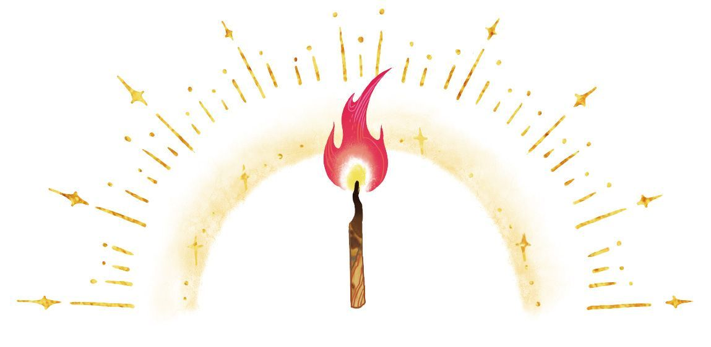
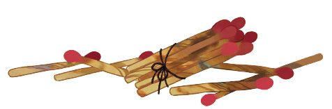
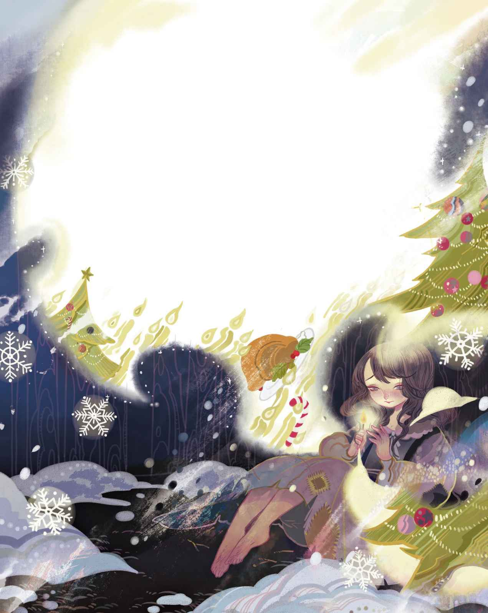

# 卖火柴的小女孩

天气极度寒冷，大雪纷飞，天就快黑了。

夜幕降临，这是今年的最后一个夜晚。寒冷与昏暗中，有一位可怜的小女孩没有帽子也没有鞋子，赤脚走在街道上。离开家的时候她还穿着拖鞋，可是穿着它们又能有什么用呢？那是一双大拖鞋，对她而言实在太大了，是她妈妈的拖鞋。小女孩跑过马路的时候，两辆马车隆隆地疾驶而过，害得她把拖鞋给弄丢了。一只怎么也找不回来，另一只则被一个男孩拿着跑开了。男孩说，等以后自己有了孩子，可以把这只大拖鞋当摇篮用。

就这样，女孩只能光着脚走路，双脚在寒冷中冻得又红又紫。她用破旧的围裙兜着几盒火柴，手里也拿着一盒。已经过去整整一天了，始终没有人来买火柴，也没有人给她一分钱。

她在寒冷和饥饿中颤抖着，步履维艰地缓缓前行，真是一幅悲惨的画面，可怜的小女孩！雪花飘落在她的长发上，那美丽的长发打着漂亮的卷儿一直披落至脖颈。眼前所有的窗户都闪烁着灯火，烤鹅的香味扑鼻而来，今晚是平安夜。是啊，她这才想起来！

转角处有两栋房子，其中一栋朝着街道凸出，于是她来到墙角坐下，把瘦小的双脚缩到了身子底下。她感到愈来愈冷却不敢回家，因为连一盒火柴也没卖出去、一分钱也没有挣到，爸爸一定会揍她的。再说家里也很冷，只有一个破败漏风的屋顶，虽然那些最大的缝隙都用稻草和破布塞住了，可是风照样能钻进来。

她的手已经冻得失去了知觉。噢，只要点亮一根火柴就能够温暖她了！要是能从火柴盒里抽出一根来在墙上擦亮，暖一暖双手就好了。于是她抽出了一根，哧——嚓！火星四射，火柴点燃了！她用手护了上去，果然带来了暖意。明亮的火焰恍若一根小小的蜡烛，那是一种奇异的光亮。女孩觉得自己仿佛坐在一只大铁炉跟前，这铁炉是那么真实，还带有铜把手和铜壳呢。多么不可思议的火光！多么让人温暖的火光！小女孩伸出双脚，想要把它们也暖一暖，可就在这时候，微弱的火焰熄灭了，大铁炉也消失不见了，她的手里只剩下火柴烧完后的余烬。

她对着墙壁又划亮了一根火柴，明亮的火焰燃起，火光映落在墙上宛若透明的薄纱。透过这层纱，她的视线仿佛穿过墙壁看到了里面的房间。房间里的桌子上铺着一块雪白的餐布，餐布上摆着丰盛的晚餐。烤鹅冒着诱人的热气，肚子里塞满了苹果和梅干。还有更妙的呢：烤鹅把刀叉抱在胸前，然后跳下餐盘，在地板上摇摇晃晃地朝着小女孩走过来了。可就在这时，火柴又熄灭了，在她眼前的不过是一道冰冷的厚墙。她再度划亮一根火柴。这回，她发现自己坐在了全世界最美的圣诞树下。去年圣诞节，她曾透过玻璃门看到过富商家里的圣诞树。可是眼前的这棵圣诞树比去年见过的那棵还要大得多，绿色的树枝上点着成百上千的烛火，彩色的画片悬挂上方，就跟在商店里见过的一模一样。小女孩向它们伸出双手，火光却再次熄灭了。圣诞节的光亮向上升去，此刻在她眼中已然明亮得宛若夜空中的星辰了。此时，一颗星星倏然划落，在夜空中留下了一道火焰般的轨迹。

“那一定是有人离开了这个世界。”小女孩心想，因为她的老祖母——那个唯一爱着她，如今却已离开人世的人，曾经告诉她，每当一颗星星坠落，就有一个灵魂升入天堂。

她对着墙壁又划亮了一根火柴，火光又亮起来了，浮现出了老祖母的形象。她就在那儿，样子清晰可辨、熠熠生辉，那么慈祥又可亲。

“奶奶！”小女孩喊道，“噢，请您把我也带走吧！我知道，只要火柴熄灭您就会消失的，您会和那只暖融融的铁炉、香喷喷的烤鹅，还有美丽的大圣诞树一样彻底消失的！”

她飞快地划燃了整把火柴，因为想和祖母在一起。那些火柴燃烧起来，明亮得如同白昼。祖母的形象从未像此刻这般栩栩如生、这般美丽，她张开双臂拥抱住小女孩，然后一起飞向那远在这世界之上的光明与快乐，她们飞得很高、很远，在那里没有寒冷、没有饥饿、没有害怕——在那里，她们与上帝同在。

墙角里，小女孩依偎着墙壁。她仍然坐在地上，脸颊红红的，嘴角挂着微笑。在这新年的最后一个夜晚，她被活活冻死了。新年的朝阳升起，俯照着那个可怜的、小小的身躯，那孩子就坐在那儿，冰冷而僵硬。她的手里拿着火柴，一捆已经燃尽的火柴。

“她只不过是想取暖。”人们说。可是没人会知道，她曾经见过多么美好的事物，也不会有人知道，当她和老祖母一起飞向那光明的新年

> **注 14**　所谓“光明的新年”，是双关，亦是作者的美好寄托，喻示着小女孩虽然离开了人世，却去往了光明的新世界——天堂。
