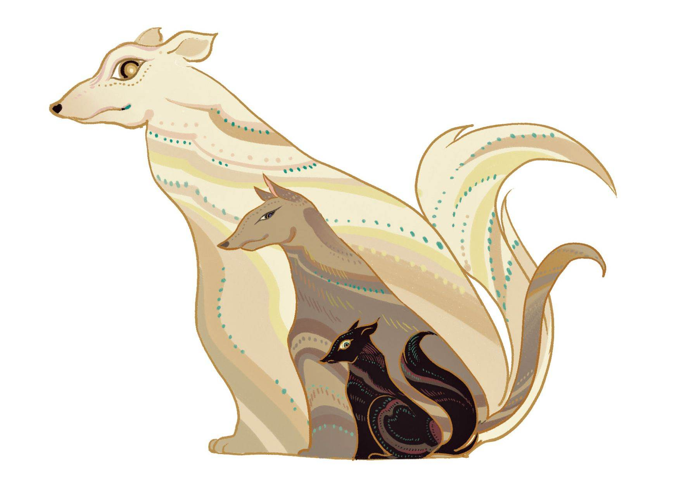
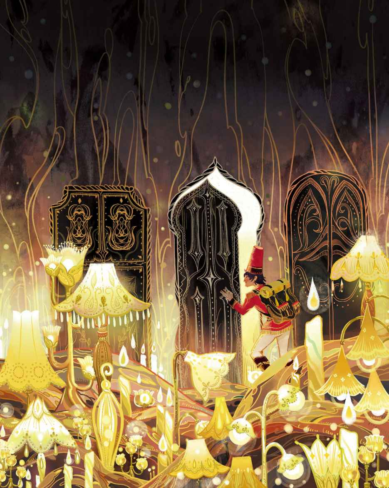
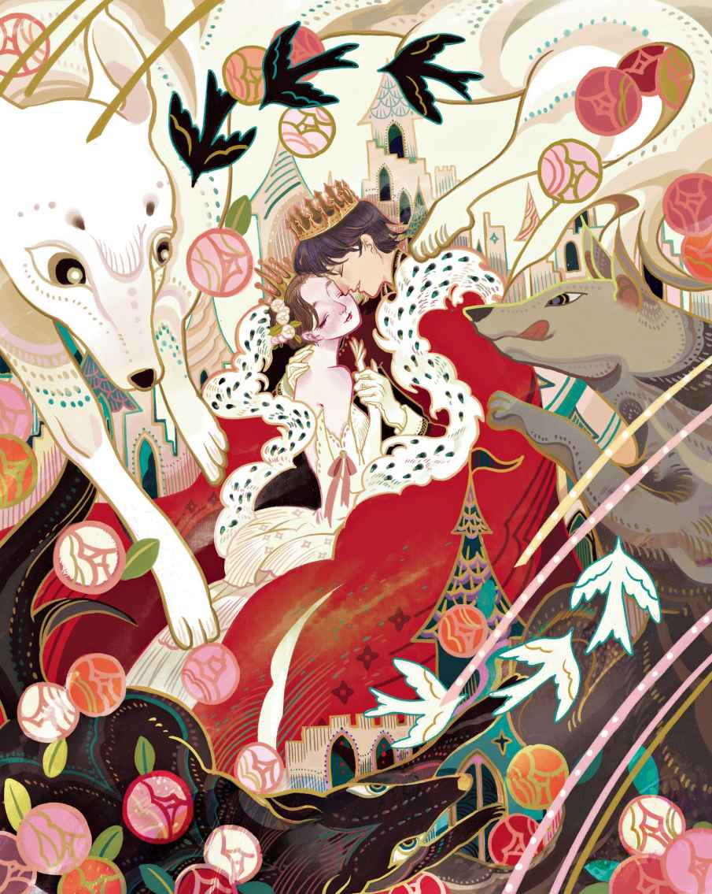

# 打火盒

大道上传来士兵前进的声音——一，二！一，二！士兵身后背着行囊，腰间佩戴着军刀，正从家乡赶赴战场。半道上，他碰见一个巫婆——那真是个又丑又老的巫婆，下嘴唇耷拉在胸脯上。

“早上好啊，士兵。”巫婆说，“你的佩刀真棒，行囊真大。你这身派头不愧是个正宗的士兵啊！眼下你可以捞上一笔钱，想要多少就能有多少。”

“听上去不坏嘛，老巫婆。”士兵说。

“瞧见那棵大树了吧，”巫婆指向他们身边的那棵树，“树根里头是空的。你爬上树干，就能找到一个洞，爬进那个洞，就可以深入到树底。我会在你腰间系根绳子，这样，只要你叫我，我就把你拉上来。”

“深入树底之后我要做些什么呢？”士兵很想知道。

“拿钱呗。”巫婆说，“听好了，等你到了底下，你就会发现自己其实是在一个很大的洞里。那里头亮得很，因为点着上百盏灯。借助灯光可以看到三扇门，每扇门上都插有钥匙，你可以把它们全都打开。

“等你进到第一个房间，就会发现地板上摆着一只大箱子，箱子上坐着一只狗，狗的眼睛大得活像一对茶碟。不过别担心，我会给你一条蓝色的格子围裙，把它铺到地上就行了。把那只狗抱起来，然后放到我的围裙上。接着你就只管打开箱子，想拿多少钱就拿多少，那都是些铜币。

“不过，如果你更喜欢银币的话就进到第二个房间里去。那儿也坐着一只狗，它的眼睛大得活像一对水车轮子。不过还是不用担心，只要往口袋里装银币的时候，把那只狗也抱到我的围裙上就行了。

“你或许也不会错过金币吧。你准能弄到手，你可是明白人。只要你进入第三个房间，只要还有办法装得下，就能拿走所有的金币。唯一碍事的，还是钱箱上坐着的狗。那只狗的每只眼睛都有哥本哈根圆塔那么大，它的长相就是这么穷凶极恶。不过，只是看上去凶恶罢了，你完全不必担心，只要让它坐在我的围裙上就行了，然后你就只管自己从箱子里拿钱，想拿多少就拿多少，它不会过来坏你的事儿的。”

“这种事情我倒是最拿手，”士兵说，“可是除了这些，你自己又能得到什么好处呢，老巫婆？我猜你也要分一杯羹的吧。”

“一分钱也不要，真的，”巫婆说，“我一个子儿也不会拿的，只要你替我拿一样东西，那是一只老旧的打火盒，我祖母上次下去的时候把它忘在那儿了。”

“那好吧，”士兵说，“替我把绳子绑到腰上。”

“这就绑。”巫婆说，“对了，这是我的蓝格子围裙。”

士兵爬到了树上的洞口，然后让自己滑身进去。他的双脚先落地，里头果然有个点了上百盏灯的大厅，就跟巫婆说的一模一样。

这会儿，他打开第一扇门走了进去。呃！那里头果然坐着一只狗，而且那狗正用大得活像茶碟的眼睛瞪着他。

“你可真是个好家伙。”士兵说。说着，他把狗挪到了巫婆的围裙上，继而开始往口袋里塞铜币，直到塞不下为止。他关上箱子，然后把狗又放回了箱盖上，接着便去了第二个房间。哎哟妈呀！那里头也坐着一只狗，眼睛大得活像水车轮子。

“别那么瞪着我，”士兵把它弄到了巫婆的围裙上，“你也太喜欢瞪着眼睛了吧。”当他看到装满银币的箱子时，便把铜币全都扔了，然后把口袋和行囊都塞满了银币。接着他又去了第三个房间。噢，那景象也太惊悚了！那里头的狗，真的有一对大得活像哥本哈根圆塔的眼睛，当它转动眼睛的时候，眼珠子滚得像车轮似的。

“晚上好。”士兵说道，然后行了个军礼，因为他从没见过这样的狗。不过再瞧上一眼之后，他便暗自想道：“看来不要紧。”于是他把狗搬到地上，然后一把打开了箱子。瞧，那是什么！全都是金币啊，多得一塌糊涂。用这些金币，他都可以把整个哥本哈根买下来了，所有女糕点师的糖猪，所有的玩具锡兵、马鞭，还有全世界的摇摆木马，他都可以买下来了。没错，就是这么一大笔钱！

士兵马上倒掉了口袋和行囊里的银币，然后全部装满了金币。没错，他的口袋、行囊、帽子和皮靴全都塞满了，几乎没法走路。现在，他算是腰缠万贯啦。把狗放回箱盖上之后，他快步走出了房间，通过树洞朝上面喊道：“现在把我拉上去吧，老巫婆。”

“你拿到打火盒了吗？”巫婆问道。

“该死的打火盒，”士兵嚷道，“我忘得一干二净了。”

等他找来打火盒，巫婆才把他拉上去。眼下他又站在大道上了，他的口袋、皮靴、行囊和帽子里全都装满了金币。

“你要那只打火盒做什么？”他问老巫婆。

“这跟你没关系。”她对他说，“你的钱已经到手了，现在把我的打火盒交出来。”

“少废话，”士兵说，“你到底要拿它干什么，如果不马上告诉我，我这就拔刀砍下你的脑袋。”

“休想。”巫婆朝他嚷道。

这么着，他真的砍掉了她的脑袋，巫婆当即倒下！而他把所有金币装进巫婆的围兜，扎好后挎到肩上，又把打火盒塞进口袋，然后朝城里继续进发。

这是一座繁华的城市，他找了家最好的旅店，住进了最好的房间，然后把自己喜欢的菜点了个遍。现在的他已经是个富翁了，因为有那么多钱。替他擦皮靴的仆从或许会觉得奇怪，一个像他这么富有的人物居然会穿如此碍眼的旧皮靴，不过这种想法仅限于士兵出去购物之前。第二天早上，士兵已经买好了配得上自己身份的新皮靴和最上乘的服装。现在他摇身一变，成为了时髦的绅士。人们把城里的上流世界讲给他听——关于他们的国王还有国王的女儿，那可是一位美丽动人的公主。

“在哪儿可以见到她？”士兵打听道。

“你根本不可能见得到。”人们说，“她住在一座巨大的铜城堡里，城堡外围还有层层叠叠的围墙和高塔，只有国王才可以出入。因为有个预言说公主会嫁给一个普通的士兵，国王当然不情愿啦。”

“可我还是想见她。”士兵心想，不过对此一筹莫展。现在他算是过上好日子了，去剧院看戏、驾着马车游览国王的花园、把钱送去救济穷人，这些成就了他的声誉，因为他还记得以往的那些日子，记得出门在外却身无分文的那种感受。如今他丰衣足食、生活富裕，朋友也多得不行，人们都称呼他为真正的绅士，这些都让他感到很是高兴。然而，每天都要花出去很多钱，却没有任何新的经济来源，这导致他最后虽然名声在外，手头却紧得只剩下两块铜币了。于是他只好退掉高档的房间转而住进了阁楼

> **注 15**　在西方，顶楼和阁楼的租金最便宜。阁楼一般用来堆放杂物，是最破旧的房间。

> **注 16**　这里也是在强调士兵的落魄。在那个时代，这种事情一般都应该由仆人代劳。

有天晚上，他正坐在黑暗里（他连买蜡烛的钱都凑不出来），突然想起来打火盒里还有一根残留的蜡烛，就是那只巫婆让他从树洞里找来的打火盒。于是他取出了打火盒，就在他用燧石擦出火星的一刹那，房门猛地打开了。那只曾在树洞底下见过的狗眼下就站在他门口，狗的眼睛大得活像一对茶碟。

“我的主人，”狗说，“请问有何吩咐？”

“这是怎么回事？”士兵说，“难不成，我得到的这只打火盒可以让我想要什么就有什么吗？去给我取些钱来。”他对狗下令道。嗖！狗消失了。嗖！狗又回来了，嘴里咬着满满一袋铜币。

这下子，士兵算是明白过来了，自己有了一只非同凡响的打火盒。擦一下，看管铜币的狗就会出现。擦两下，看管银币的狗就会出现。擦三下，看管金币的狗就会出现。

士兵又搬回了高档的住处，又能穿上时髦的衣服，又能体面地出门了。他的朋友们立马得知了消息，因为他们实在太喜欢他了

> **注 17**　此处和上文中“他的朋友一个也没来看望他”都是在讲反话。安徒生本意是在讽刺那些所谓的“朋友”。

而他心中冒出一个疑问：“从来就没人见过公主，这不是很奇怪吗？他们都说她很漂亮，可是她就那么一直被关在那种被层层高塔围住的大铜堡里有什么意思呢？我为何不去找她？我的打火盒在哪儿？”他擦出一道火星，嗖！那只眼睛大得活像茶碟的狗出现了。

“眼下虽然已经很晚了，”士兵说，“差不多已经是午夜了，但我还是想去看看公主，哪怕只看上一眼也好。”

狗出门去了。士兵还没反应过来，狗就已经背着公主回来了。公主睡得很香，她是那么美丽，任凭谁见了都会立即明白，这就是公主啊。士兵忍不住吻了她，毕竟他是个真正的士兵。之后狗又把公主给送了回去。

翌日早晨，国王和王后正在喝茶，公主对他们说，昨晚她做了一个奇怪的梦，梦里没别的，只有一只狗和一个士兵。狗背着她，而士兵吻了她。

“这倒是个有意思的故事。”王后说。这天晚上，宫廷里的一个老侍女被派去坐在公主的床边，不管怎么说，还是得看看那究竟是梦还是别的什么。士兵很想再次见到美丽的公主，于是，到了夜里狗又以最快的速度把公主给带了过来。不过老侍女穿上了风雨靴紧紧跟在他们后面，当她看到他们进了一栋大房子时，她心想：“现在我记住这地方了。”于是，她用一块粉笔在门上画了一个大十字标记，然后便回去睡觉了。不一会儿，狗也把公主送了回去。不过当狗发现士兵家门前的十字标记之后，它也弄来一块粉笔在整座城里的所有房门上都画了十字标记。它干得聪明极了，这么一来，那老侍女根本就分不清哪扇门才是她标记的了。

清晨，国王、王后和那个老侍女还有所有的官员，一同前去查看公主昨晚的去处。

“是这里。”国王看到第一个十字标记的时候，说道。

“错啦，我亲爱的，是这里。”王后说。她看的是第二个十字标记。

“这里有一个，那里也有一个，再往前还有一个！”大家说。不管到哪里查看，都能看到粉笔画的标记。这么着，他们只好放弃了搜查。

不过王后是个聪明的女人，比起端坐在四轮马车上，她还有更多的能耐。她找出一把金剪刀裁下一块绸缎，然后做了一只灵巧的小袋子。她在这只小袋子里装满了细荞麦粉，然后把它系在了公主的后背上，最后又在袋子上开了个小洞。这样，不管公主跑去哪里，荞麦粉都会沿路留下痕迹。

到了晚上，狗再度光临，它又跑来背起公主，然后把她带去见士兵。士兵已经彻底爱上她了，他多么想变成王子，这样就能娶她为妻了。

狗没有留意到从城堡一直到士兵住处的窗下，那些荞麦粉已经留下了一串记号——它刚才就是从窗户那儿把公主背上去的。就这样到了早上，国王和王后轻而易举地弄清了女儿的去向。

他们逮捕了士兵，把他关进牢房。他坐在里头面对着黑暗与绝望，他们告诉他：“明天就是给你执行绞刑的日子。”他再也振作不起来了，因为他的打火盒还在旅店里。到了早上，他透过又窄又小的牢窗看到全城的人们倾巢而出，专程跑来看他被绞死。他听见鼓声响起，看见士兵们列队前进。在涌动的人群中，他看到一个围皮裙、穿拖鞋的男孩，那是鞋匠的儿子。那孩子跑得飞快，以至于跑丢了一只拖鞋，那只拖鞋刚好飞到牢墙上，而士兵的脸正贴着牢窗的铁栏杆。

“嘿，过来，鞋匠的儿子，别跑得那么急。”士兵喊道，“我人还在这儿呐，绞刑不会那么快开始的。对了，你要是去我的住处帮我把我的打火盒取来，我就给你四块铜币。用你最快的速度跑去取。”

四块铜币，这对鞋匠的儿子来说是很大一笔钱。于是他赶紧跑去取来了打火盒交给了士兵。然后嘛——唔，让我们听听后来发生了什么吧！

城外，高高的绞刑架已经搭好，国王的士兵们也已经围着架子站好。成百上千的民众聚集在那儿，国王和王后坐在宝座上面对着审判官和全体陪审团。士兵已经在梯子上站好了，不过，正当他们要往他脖子上套绳子的时候，他说，按照行刑的惯例，可怜的犯人有权提出最后一个小小的请求。他要求吸上一口烟——在这世上的最后一口烟。

国王没法拒绝。于是士兵开始用打火盒打火，一下——两下——紧接着是第三下。嗖！眼前出现了三只狗，一只眼睛大得像茶碟，一只眼睛大得像水车轮子，还有一只眼睛大得像哥本哈根圆塔。

“快救我。别让他们绞死我！”士兵说。三只狗立刻咬住审判官和陪审员们，他们有的被咬住腿，有的被咬住鼻子，继而被抛到高空，然后掉下来摔了个稀巴烂。

“别这样！”国王叫道。可是最大的那只狗还是咬住了他和王后，然后让他们也步了刚才那些人的后尘。国王的士兵们全都吓得浑身发抖，人们喊了起来：“士兵，当我们的国王，娶公主为妻吧。”

于是他们把士兵送进了国王的马车，士兵的三只狗在车前跳舞，欢呼着“万岁！”男孩们用手指吹起口哨，国王的士兵们纷纷向他敬礼。公主终于走出了铜城堡，成为女王，这一切正合她意。婚礼持续了一周，三只狗坐在餐桌上，眼睛睁得比以往任何时候都要大。

