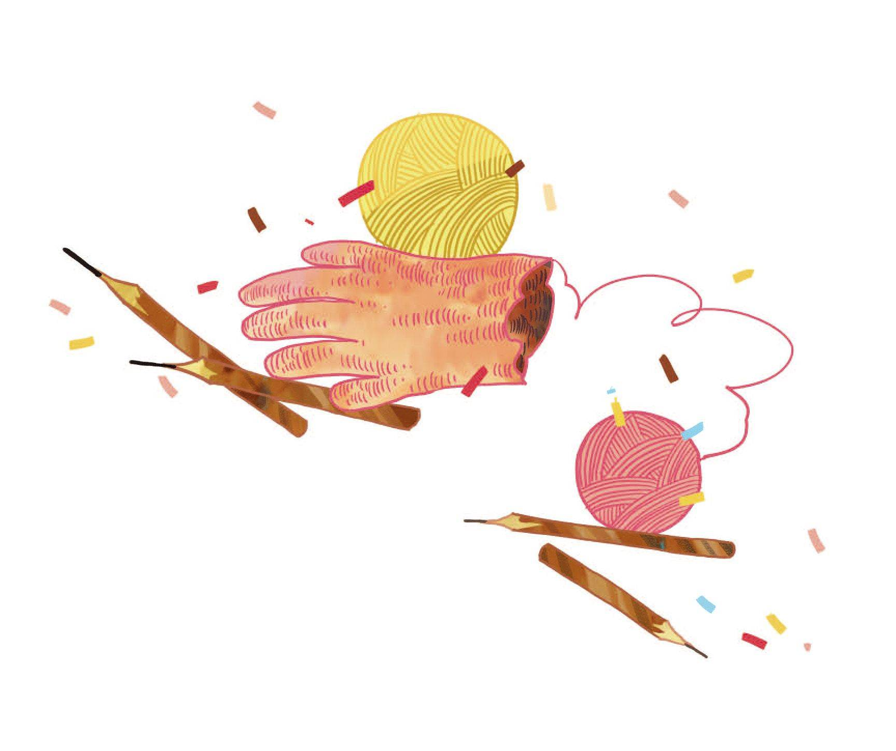
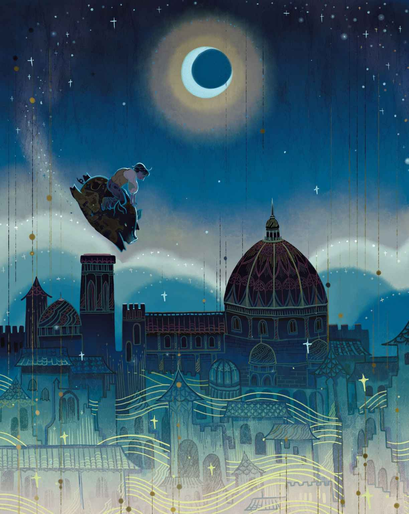
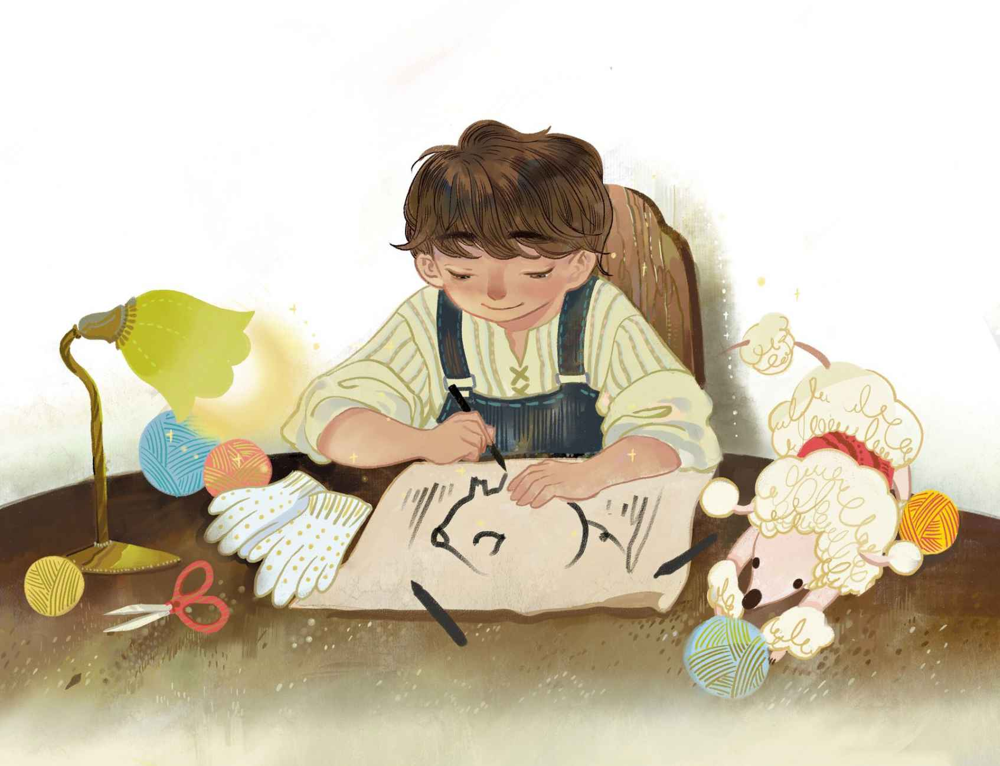

# 铜猪

> **注 18**　铜猪像至今仍在，但它最初是用大理石雕成的，后来才被换成了铜像。

在佛罗伦萨城距离领主广场不远的地方，有一条很小的十字街，我想这就是人们所说的波达·罗萨

> **注 19**　原文Porta Rossa是个意大利名字。这两个词都是意大利语，Porta是“门”，Rossa是“红”。此外，有首叫《在我心里》的意大利歌，歌词里面就唱到了“Porta Rossa”：“Oh my dear daddy／I love him,he is so handsome／I want to go to Porta Rossa／to buy the ring!”——可见Porta Rossa就是一条街名。

每个前往佛罗伦萨的人，无疑都能够找到这个地方。想要知道铜猪的具体位置，只需询问你所遇见的第一个乞丐

> **注 20**　佛罗伦萨街头至今有很多乞丐。作者这么写并没有其他用意，只是借此告诉读者，在那里找到铜猪是多么容易（因为你随时随地都可以碰见一个能为你指路的乞丐）。

那是一个冬夜，群山被积雪所覆盖，而月光却依旧普照。在意大利，月亮制造的光亮程度就跟北欧地带那些阴沉的冬日白昼差不多。是的，甚至还要更加明亮，因为这里的空气是如此干净，雪地上反射出的光耀仿佛要将我们托浮起来。而在北欧的寒冬，屋顶上的那种灰暗和沉重简直要把我们压倒在地。也正是这般的寒冬和潮湿的土地，有朝一日势必会让我们的棺木继续与其为伴。

在公爵的宫廷花园里有个衣衫褴褛的小男孩，他已经在石松下坐了一整天。虽然时值冬季，但这里依然盛开着成千上万的玫瑰花。他是一个典型的意大利男孩，长得那么好看，始终带着欢笑，却正遭受着贫困的折磨。他又饿又渴，却没有人施舍给他一分钱。天黑了，花园关门的时间到了，看守把他赶出门外。很长时间里，他驻足于阿尔诺河

> **注 21**　位于意大利中部，流经佛罗伦萨，全长240公里，中游河水时常泛滥，曾淹没佛罗伦萨城（达·芬奇曾为其设计过防汛工程）。

午夜时分，铜猪动了。男孩清清楚楚地听见它说：“抓紧了，小家伙，因为现在我要跑起来咯！”说完，它真的带着男孩一块儿飞奔了起来！

这是一次奇异的骑行，他们的第一站是领主广场。领主雕像上的青铜马竟对着他们高声嘶鸣起来；老市政厅的彩色纹徽泛出微光，看上去仿佛变成了透明的图景；米开朗基罗的大卫像

> **注 22**　大卫像的首次展出即是在佛罗伦萨（1504年）。

> **注 23**　一种投石器，又称投石带或石弩，用皮制吊带制成，便于携带。大卫像的左手和右手分别紧握着这种武器的两端，而皮带紧贴在他背后，很多人并不知道这其实是一种带状的投石武器。

> **注 24**　这里安徒生所指的是切利尼创作于1545年的青铜雕塑作品《珀耳修斯与美杜莎》。这件作品表现的是宙斯之子珀耳修斯取下女妖美杜莎首级的场景。切利尼（1500～1571）是意大利的著名雕塑家，他多才多艺，精通珠宝工艺、美术理论和写作等多个领域。《珀耳修斯与美杜莎》是他的雕塑品中最为杰出的代表作。

> **注 25**　这里所指的则是文艺复兴时期（后期）雕塑家詹博洛尼亚（1529～1608）的雕塑作品《抢掠萨宾妇女》。雕像塑造的是罗马士兵抢掠邻邦萨宾妇女的场景。这座雕像就位于上文提到的市政厅广场。

> **注 26**　意大利最为庞大恢弘的艺术博物馆，始建于1560～1580年，最初属于美第奇家族，后由家族末代继承人捐赠予佛罗伦萨市政府。

“抓紧了，”铜猪说，“现在就抓紧，因为我这就要上台阶咯！”

男孩半惊半喜，一个字也没来得及说，他们就进入了一条长廊。他对这里很熟悉，因为曾经来过。墙上挂满了画作，雕塑与半身像陈列在如同白昼般明亮的灯光下，而当与此毗邻的展室打开时，他看到了更为华丽惊艳的场景。是啊，那些光彩夺目的艺术简直让男孩过目难忘。今晚，这里的一切看上去尤为瑰丽而美好。

一尊裸体女像立在眼前，她是如此之美，若不是浑然天成便只可能出自最伟大的大理石雕刻家之手。她那漂亮的嘴唇在动，海豚们在她的脚边跃然而起，永恒的光辉在她的眼中闪耀——她就是举世皆知的维纳斯·美第奇

> **注 27**　乌菲齐宫内的很多艺术品都是来自美第奇家族的收藏，因此这座雕像的名字也带上了美第奇家族的族称。

这些不可思议的场面把男孩彻底给迷住了，这里的墙壁变得流光溢彩，所有艺术品都拥有了生命，它们都动了起来。画像上的维纳斯，也就是尘世间的那位维纳斯

> **注 28**　这里的维纳斯，指的是提香的名作《乌尔比诺的维纳斯》中的女模特。这幅画描绘的是一位全躺卧的女人。关于这幅画作，有不同的说法。一说是提香自己的独立作品，另一说是提香在乔尔乔内（1477～1510）的原作基础上完成的作品。提香曾在乔尔乔内的画室学习绘画，一度对乔尔乔内极度仰慕。然而乔尔乔内是个纵情声色的花花公子，在绘画技艺达到巅峰以后，便经常将未完成的画作弃之不顾，而提香长期模仿他的技巧，逐渐达到能够以假乱真的地步，最后代替乔尔乔内完成了这幅《乌尔比诺的维纳斯》。安徒生在这里的写法，显然是认为这幅画全然出自提香一人之手，因为他认为提香见过画中的“维纳斯”模特。乌尔比诺（Urbino）是意大利一处地名。据说乔尔乔内当时即是受到乌尔比诺公爵的委托而开始创作《维纳斯》。

> **注 29**　意大利文艺复兴时期画家（1490～1576），出生于威尼斯，曾师从乔尔乔内，代表作有《乌尔比诺的维纳斯》等。

> **注 30**　安徒生在这里所描写的是达·芬奇的名作《岩间圣母》，画中圣母的左下方坐着还是婴儿的耶稣，而画中位于圣母右侧的是同样还是婴儿的圣约翰。

男孩和铜猪穿过一条又一条的长廊，所经之处全是令人称奇的华丽与绝美之作！多亏有铜猪带着他漫步于这些辉煌的巨幅艺术作品间，男孩才得以欣赏到这一切。艺术品不断映入眼帘，简直叫人目不暇接。其中一幅画作牢牢地吸引住了男孩，这主要是因为画中有一群快乐的孩子。白天的时候，男孩曾向他们点头致意。

或许有很多人就这么经过这幅画作，并没有多作留意，而它实际上却蕴含着诗一般的精髓。画中描绘的是耶稣基督之死，站在人群外围的并不是其他受难者。不是的，那是几个异教徒。这幅画出自佛罗伦萨画家阿尼奥洛·布伦齐诺

> **注 31**　阿尼奥洛·布伦齐诺（1503～1572）是佛罗伦萨的宫廷画家。“布伦齐诺”并不是他的真名，而是绰号。安徒生在这里提及的画作，应该是《基督被解下十字架》。这个题材有很多画家画过。在阿尼奥洛·布伦齐诺的版本中，画面上方有一群孩子模样的天使（安徒生此处所说的“孩子”，指的其实就是天使）。正如安徒生所描写的，那些孩子模样的天使脸庞，看上去十分善良和美好。

> **注 32**　这里安徒生可能是把阿尼奥洛·布伦齐诺的两幅不同的画作混淆了。布伦齐诺还有一幅叫《牧羊人们的敬意》的作品，这幅作品的构图跟《基督被接下十字架》几乎完全一样，下方都是围着一群人，但位于人群当中的不是耶稣，而是个婴儿，人群的上方是一群飞舞的小天使。然一手指着下面的人，一手指着自己的小天使，并非出现在《基督被接下十字架》中，而是出现在《牧羊人们的敬意》里。安徒生确实曾到佛罗伦萨旅游，也应该见过原画的收藏品，但是他对不同画作的记忆，事后可能产生了某种误差。

男孩凝视着这幅画，时间之久远胜过其他画作。当铜猪在这幅画前驻足的时候，一声柔和的叹息传入耳际。那声音是来自画中还是来自铜猪的胸口？男孩朝着画中那些微笑的孩子们伸出手去，这时铜猪却带着他跑开了，他们一路穿过长廊飞奔而去。

“感谢你，祝福你，我的好铜猪！”男孩轻拍着他，对他说道。与此同时，铜猪带着他嗵、嗵、嗵地跑下阶梯。

“也感谢你，祝福你！”铜猪说，“我帮助了你，而你也帮助了我。因为只有当我背上天真的孩子，才会拥有奔跑起来的力量！你瞧，现在的我居然能在圣母玛利亚画像前的灯光下漫步。除了教堂以外，我可以带着你去任何地方。不过，只要你和我在一起，我倒是可以站在外面通过敞开的门朝里张望。请别从我的背上下来！如果你离开了我，我就会失去生命，再次变成你每天在波达·罗萨街上看到的那个样子！”

“我会和你在一起的，我的好铜猪。”男孩说。接着，他们疾步穿过佛罗伦萨的大街小巷，来到了位于广场上的圣十字教堂

> **注 33**　位于佛罗伦萨，始建于1294年，1443年初步建成，后又于1863年增建，内设米开朗基罗、伽利略、但丁等名人之墓。

左侧的通道里，一块带有刻纹的墓碑上闪耀着奇异的光，成千上万颗闪烁的星星围绕着它，形成了一道光环。墓碑上有一块盾形纹章，红色的阶梯连接在蓝色的基座上，明艳得如同火焰，这便是伽利略之墓。这里的纪念堂十分朴素，但是蓝色基座上的红色阶梯却彰显出了艺术的魅力，它意味着通往荣誉的道路正是由这种火焰般的阶梯铺就的。所有的天才都会升入天堂，就如同先知以利亚

> **注 34**　《圣经》中的先知。

教堂右侧通道里摆放着昂贵的石棺，石棺上的雕像看上去全都被注入了生命。这是米开朗基罗像和但丁像，但丁的前额戴着桂冠。而阿尔菲耶里

> **注 35**　意大利剧作家（1749～1803），代表作有《腓力》《维吉尼娅》等。

> **注 36**　意大利政治家、思想家和历史学家（1469～1527），生于佛罗伦萨，近代政治思想主要奠基人之一，代表作有《君主论》等。

那些大理石雕像的衣服似乎在动，仿佛是这些伟大的人物在这个夜晚，在午夜时分的圣乐与歌声中，再次苏醒了。他们朝圣坛上的无数烛火凝望过去，那里，身穿白色长袍的男孩们摇晃着金色的香炉，芬芳的香气充满了整个教堂，飘散到了外面的广场上。

男孩朝着烛光伸出手去，可就在这个时候，铜猪再次飞奔了起来，他不得不紧紧抓住铜猪。风在耳边呼啸，教堂的大门正在关上，他听见门的铰链咯吱作响。紧接着，他似乎失去了意识，只感觉到一股冰冷的凉意——然后他睁开了眼睛。

眼下已经是早晨了，他的半个身子滑了下去，铜猪又回到了波达·罗萨街的原处。他想起那个被自己喊作妈妈的女人，立刻陷入了惊恐和害怕之中。昨天她让他出去要钱，可是他什么也没有要到。现在他感到又饥又渴，便又像以往那样搂住铜猪的脖子，吻了吻猪鼻子，向它点头致意，然后朝那些最为狭窄的街道走去，那些街道的宽度顶多只能容下一头驮着货物的驴子。一扇钉满铁皮的大门半开着，男孩走了进去，然后爬上砖块铺成的楼梯间。从这里到上面的走廊口，整个墙壁都脏兮兮的，只有一根油腻腻的绳子充当扶手。再走一段台阶，便进入了一个院子，院子里有一眼泉水，泉水通过粗实的铁索以及挂在铁索上的成排的水桶，牵引向不同的楼层。间或，铁索上的滑轮会猝然转动，于是水桶们便在半空中跳起舞来，把水花溅得满院子都是。这里还有一段年久失修的砖梯逐步通向更高的楼层，两个俄罗斯水手兴冲冲地从那上面跑下来，几乎把那可怜的男孩撞翻在地。他们身后有一个虎背熊腰的黑发女人，尽管她已不再年轻，却仍在追逐那两个水手。

“你有带什么东西回家吗？”她对男孩说。

“请别生气！”男孩央求起来。他捏着她的裙摆，仿佛就要吻上去了，“我什么也没要到！一无所获！”

他们转而进了里屋。我们根本无需对屋子本身加以描述，只需说明一点：屋子里有只带把儿的陶罐，陶罐里头放有木炭，这东西叫“马瑞多”

> **注 37**　原文直译为“老公”，是个很有意思的物品名。

男孩开始抽泣，女人却用脚踢他，弄得他哭得更厉害了。“给我安静点儿，要不然我这就敲破你这哭丧的脑袋！”说着，她举起了手里的陶罐。男孩尖叫着朝地上躲去。

这当口儿，一个女邻居进来了，她的手里也有个马瑞多。“菲丽琦妲！”她说，“你在对这孩子做什么？”

“这孩子是属于我的！”菲丽琦妲说，“只要我愿意，杀了他都可以。我还可以杀了你，吉雅妮娜！”

说着，她又举起了她的陶罐，对方也举起了陶罐应战。两只罐子撞在了一起，顿时碎得四分五裂，一时间屋子里火星四射，到处都是灰烬。

男孩趁机夺门而逃，他穿过院子跑出了这个地方。可怜的男孩，直到跑得快没气了才终于停下脚步。最后，他驻足于圣十字教堂前。昨天晚上，这里的大门曾向他敞开，于是他走了进去。这里的一切都是明亮的，他跪在第一块墓碑面前——那是米开朗基罗之墓，然后大声哭泣起来。人们来来去去，教堂里正在举行弥撒。没有人留意到男孩的存在，除了一位上了年纪的佛罗伦萨人。然而他也只是停下来朝男孩瞧了片刻，便像其他人那样走开了。可怜的男孩，他已经精疲力竭、困苦难耐，饥饿和干渴彻底摧垮了他。最后，他爬去了大理石碑后面的角落，然后昏睡了过去。

黄昏时分，有人把他摇醒了。醒来之际，他又看到之前那个年迈的佛罗伦萨人正站在自己面前，“你生病了吗？你的家在哪儿？你在这儿待了一整天？”老先生问了他一些问题。

他回答了这些问题，然后老先生把他带去了一间小屋。这间小屋就在附近的街边，是一家手套制造商店。店里头坐着一个女人正在忙着做针线活儿，一只白色的小鬈毛狗

> **注 38**　即贵宾犬。

“天真的小家伙们，很快就要交上朋友了嘛！”女人说着，拍了拍男孩和小狗。

这对好心的夫妇给了男孩一些吃的和喝的，告诉他可以在这里过夜。第二天早上，杰塞比伯伯

> **注 39**　即这家手套商店的主人。原文是“Father”，但是鉴于中国人的习惯，我译成了伯伯。

翌日早晨，杰塞比伯伯出门去了，可怜的男孩却感到那么失落，因为他明白，只要杰塞比伯伯找到他妈妈，他就不得不回家去了。他哭着亲吻了可爱的小狗，而女主人对着他们点了点头。

那么，杰塞比伯伯带回来了什么消息呢？他和妻子讨论了很久，只见女主人点着头然后伸手摸了摸男孩。

“他是个好孩子，”她说，“他会成为一名技艺上乘的手套匠，就跟你一样。瞧瞧他的手指，如此地纤细和灵活！这是圣母玛利亚的旨意，他会成为一名手套匠的！”

这么着，男孩便在他们家住下了。女主人教他做针线活儿，他终于能吃饱睡好了。他从未像这样生活过。不过有一天，他戏弄了“小美人”——也就是那只小狗的名字。女主人对此大为光火，不仅责骂了他，还朝着他指指点点。这件事令男孩十分在意，他坐在自己的小房间里陷入了沉思。房间面朝街道，窗外装着铁栏杆，栏杆上晾着皮革。这天夜里他失眠了，脑袋瓜里全是铜猪。忽然之间，他听见外面传来“咵嗒，咵嗒！”的声音。没错，那一定是铜猪。它从窗户那儿飞奔而过，然后消失得无影无踪。

“帮这位先生拿一下他的颜料盒。”第二天早上，女主人说。他们的邻居是一位年轻画家，正带着颜料盒和一大卷画布下楼。男孩赶紧接过颜料盒，然后跟了上去。

他们一起去了画廊。上台阶的时候，男孩想起了铜猪，骑着铜猪的情景历历在目。他还记得那些雕像，美丽的维纳斯大理石像，还有那些彩色的绘画。他再一次凝视着圣母玛利亚、圣约翰以及年幼的耶稣基督，他们在布伦齐诺的一幅画作前停了下来。画中的基督置身于凡界，孩子们围绕在他身边，他们微笑着，因为即将升入天堂。这个穷男孩也微笑了，因为他仿佛也找到了自己的归宿。

“现在你可以回家了。”画家对男孩说。他架好了画板，可是男孩却留着不走。

“我能留下来看您画画吗？”男孩说，“我能看着您在空白的画布上作画吗？”

“我还没准备开始画呢。”画家回答说。说着，他拿出了一支炭笔，手迅速地挥舞起来，眼睛则在画板上游走，飞快地构思着笔下的画作。寥寥数笔，基督的形象就已经跃然纸上，丝毫不逊色于那些已经上过色的绘画。

“现在你必须走了。”画家说。

于是男孩默不作声地走回了家，然后坐到桌前继续学习制作手套。然而，他的思绪整天都留在画廊里，以至于一时疏忽扎到了自己的手指。他也没有再去戏弄小美人。夜幕降临，他发现房门开着，于是悄悄溜了出去。外面虽然很冷，却有着熠熠的星光，整个世界看上去美丽而清亮。一切都是那么安静，他在街道上游荡着，不知不觉就来到了铜猪面前。他朝它弯下身，亲吻了发亮的猪鼻子，然后骑上了它的后背。

“我的好铜猪！”男孩说，“我是多么想念你啊！今晚，让我们再次出发吧！”

可是铜猪仍旧纹丝不动，唯有泉水源源不绝地涌出它的嘴巴。男孩依然骑在它身上，这时他感到有什么东西正在扯他的裤腿儿。他朝下面一看，原来是剪过毛的、光溜溜的小美人呀！原来小狗也偷偷溜出了屋子，一直跟着他呢，他完全没有察觉到。小美人叫了起来，仿佛在说：“你为什么要坐在那上面呢？你不知道我一直跟着你吗？”

此时此刻，小狗给男孩带来的惊讶程度简直不亚于一条喷火龙。“小美人上了街，却没穿衣服！”女主人一定会这么说，“这会落得什么下场哟？”

小狗有一件专门为她量身定制的小羊皮外套，冬天不穿外套就出门，这还是头一遭。皮外套上有根带子，可以用来裹紧脖颈和身子，还配有红色的蝴蝶结以及丁零作响的铃铛。冬天出门的时候，她总是轻盈地踢着小步跟在女主人身旁，活泼得像个小孩子。眼下也是在室外，可是她没有穿小外套——这会导致什么后果呢？男孩原先关于骑行的念头立即打消了，他再次亲吻了铜猪，然后爬下来把小美人抱进怀里。小狗冷得瑟瑟发抖，男孩想尽可能跑得快一些。

“你干吗要跑得那么快？手里拿的什么？”两个宪兵拦住了他，然后对他盘问起来。这当口儿，小美人叫出了声。“是只漂亮的小狗，你从哪儿偷来的？”他们又问，同时把小美人抢了过去。

“噢，请你们把她还给我！”男孩喊道。

“如果真不是偷来的，你可以告诉你的家里人，让他们来警察局领狗。”他们给了他一个地址，然后带走了小美人。

这下事态不妙了！他不知道是该一头跳进阿尔诺河呢，还是回家把一切都坦白了。他们一定会宰了我的，他心想。“不过我倒是宁愿他们把我给宰了，这样，我死后就能去基督和圣母玛利亚那儿了！”于是他急匆匆地赶回家，几乎认定自己必死无疑了。

家门上了锁。他够不到门环，街上又空无一人，没有谁可以过来帮他一把。不过，在他身后的地上有一块松动的石头

> **注 40**　佛罗伦萨的街道地面都是由石块或石板铺就的，这里“松动的石头”指的应该是地板上的碎石。

“是我！”男孩说，“我把小美人弄丢了！让我进去，然后要了我的命吧！”

这实在是太可怕了，尤其是对女主人而言，她是那么喜欢小美人。她立即朝墙壁看去，想确认一下小狗的外套是否还挂在那儿，那件小皮外套确实还在那儿。

“小美人在警察局里！”她大叫起来，“你这个坏心眼的孩子！为什么要带她出去？她会冻死的！竟然让那么弱不禁风的小动物跟那些粗野的大兵待在一块儿。”

这么着，杰塞比伯伯立刻赶了过去，女主人在哭喊，男孩也在哭泣。整栋房子里的人都来了，大家都想弄明白是怎么回事儿。那个画家也来了，他把男孩抱到自己的膝盖上，然后问了事情的经过，就这样一点点地，他终于知道了关于铜猪的故事还有在夜晚的画廊里发生的故事。这一切很难叫人相信，但是画家还是安慰了男孩，同时让女主人镇定下来。不过在杰塞比伯伯从那些士兵那儿把小美人领回来之前，女主人始终闷闷不乐的。现在气氛又好起来了，画家轻轻拍了拍男孩的脑袋，然后送了他几幅画作。

噢，这些画可真漂亮。上面画了好多滑稽的脑袋，但顶顶重要的是，画里头有铜猪！再也没什么能比这个更棒了！虽然只是寥寥数笔，却连同铜猪身后的建筑都一并勾勒得活灵活现。

“噢，如果我也会画画和上色就好了！那样我就可以把整个世界都画出来啦！”

第二天，才刚醒过来，男孩就找出了一支铅笔。他在那些画的空白面上临摹起了铜猪，而且还真的做到了！他画得有些歪歪扭扭，一边大一边小，一条腿粗一条腿细，不过至少看得出画的是什么，这让他感到欢欣鼓舞。他意识到，自己对铅笔的把控显然还不够得心应手。又过了一天，之前的那只铜猪画旁边又多出了另一只，这只已经比上次那只画得要好上一百倍了。画到第三只的时候，效果已经非常不错，任凭谁都能看出他画的是什么。

另一方面，手套生意变得冷清起来了，他要办的事也随之变少。通过对铜猪的临摹，他领悟到这么一点：任何事物都可以在纸上画出来，而整座佛罗伦萨城本身，就是一本内容丰富的图画书。自己所要做的，就是亲手去翻阅那些纸页。

在天主圣三一广场

> **注 41**　位于佛罗伦萨，呈三角形，得名于天主圣三圣殿。

可是小美人就是静不下来，于是他只好把她给捆起来。他捆住了她的脑袋和尾巴，这么一来，小美人又叫又跳拼命挣扎个不停。然后女主人来了。

“你这个坏心眼的孩子！我可怜的小狗！”她劈头盖脸地说了这么一通，然后猛地把男孩推开，还踢了他一脚。她说他是个忘恩负义、一文不值、坏心眼的孩子，他被赶出了那个家，而她只顾哭着亲吻那只差点被绳子勒死的小狗。

也就在这个时候，那位画家上楼来了——这便成了整个故事的转折点。

1834年，佛罗伦萨美术学院举办了一场展览，有两幅画被挂在了一起，颇为吸引民众的目光。较小的那幅中有一个快乐的小男孩，男孩正坐在桌前作画，画的是一只剪过毛的白色小鬈毛狗。不过小狗不愿安静下来，于是它的脑袋和尾巴都被绳子捆住了。这幅画是如此的活灵活现、栩栩如生，观赏者们无不被其所吸引。据说，这幅画的作者是一位年轻的佛罗伦萨人，在他还是个小孩子时被人在街边发现，后来由一位年迈的手套匠收养，尔后自学成才。他为了画好小狗，把女主人的爱犬给捆了起来，这件事导致他被女主人扫地出门。恰恰就是在那个时候，一位大名鼎鼎的画家看出了他的天赋。此后，这个曾被手套匠收养的男孩成为了一位了不起的画家，如今展示在世人眼前的这些画作就是最好的证明。至于较大的那幅画作，更是印证了他的杰出天赋。画中只有一个人物形象，那是一个衣衫褴褛的漂亮男孩，斜靠在波达·罗萨街的铜猪身上沉入了梦乡。所有参观者都很熟悉画中的场景。那孩子的手臂垂靠在铜猪的脑袋上，他睡得那么香甜。就在他附近，圣母玛利亚像前的灯盏释放出一道强烈的亮光照在了男孩那张苍白却美丽的脸蛋上。这真是一幅美丽的画作，它由镀金的巨幅画框装裱起来，一角还佩上了桂冠。然而在那桂冠花圈的绿色叶片之间缠绕着黑色的绸带，垂挂着黑色的长幔——这位年轻的画家，已经与世长辞了！
