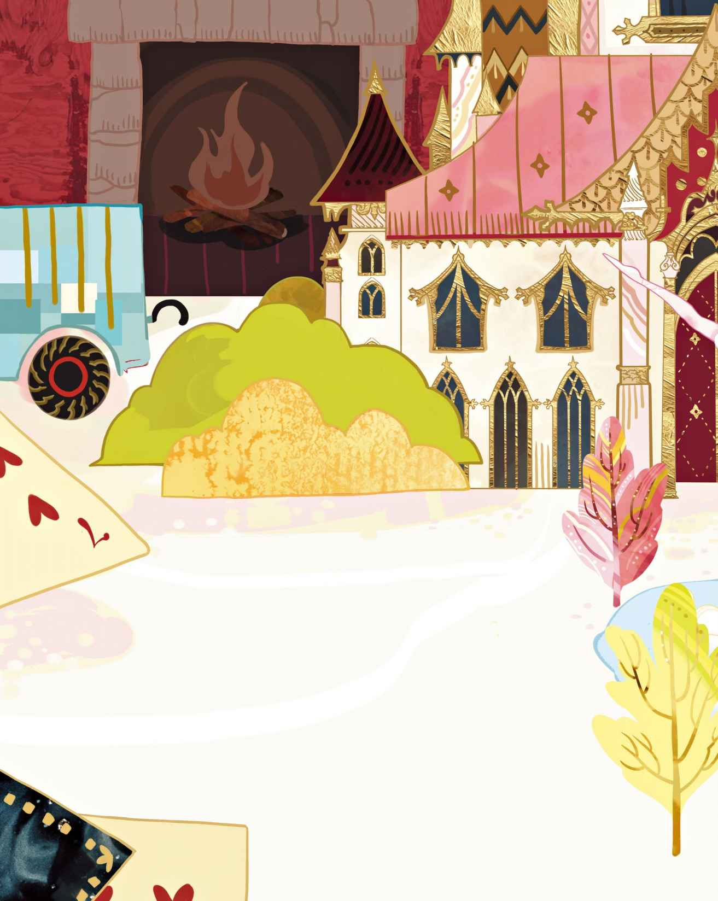
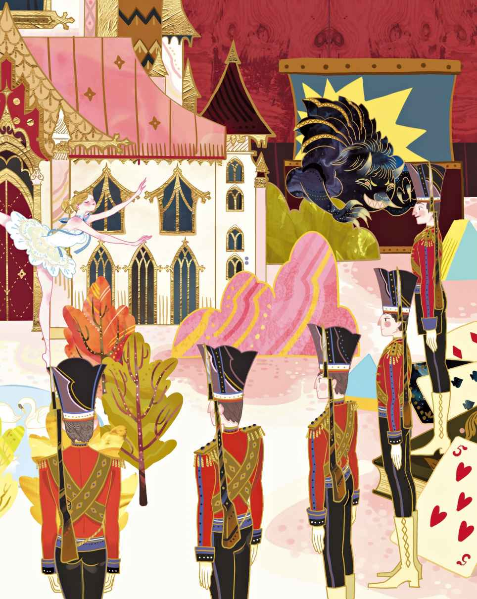
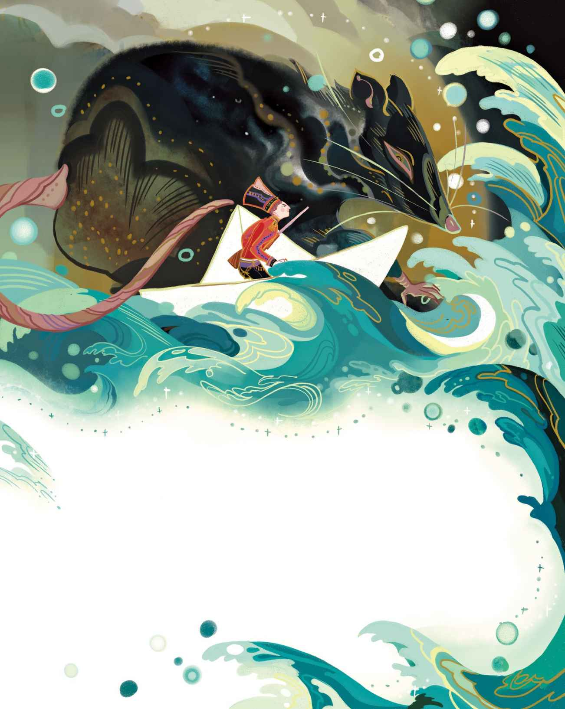
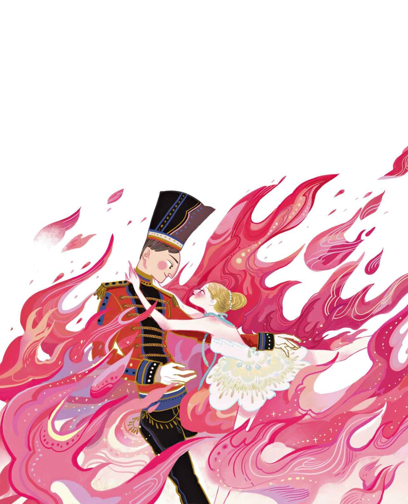

# 坚定的锡兵

从前有二十五个锡兵。他们都是兄弟，出自同一只旧锡勺。他们肩扛火枪，注视着前方，身穿华丽的军装，军装的红色与蓝色搭配得相得益彰。

在这个世界上，他们听到的头一个词便是：“锡兵！”那天有个小男孩过生日，掀开盒盖的时候他当即喊出了这个词。他迫不及待地将他们放到桌上站好。

锡兵们看起来都一个样，只有一个除外。那个锡兵看上去有点不同，因为他是最后一个被铸造出来的。最后锡不够用了，所以他只有一条腿，不过他还是站得挺好，用一条腿也站得稳稳的，跟用两条腿站立的那些锡兵一样稳当。不过，正如你所见，他注定会是最为与众不同的那一个。

桌上除了锡兵以外还有很多其他玩具，其中最吸引眼球的是那个用纸板制成的不可思议的城堡。纸城堡上开着小窗，可以清楚地看到里面的模样。城堡的前面有一圈迷你的树，那些树围绕着一面小镜子，而那面镜子就如同一片湖泊。蜡制的天鹅在镜湖上游泳，身下还有逼真的倒影。这些玩具都漂亮极了，不过要说最美的话，还要属那位姑娘，她就站在敞开的城堡大门那儿。尽管她是个纸人，身上穿的却是蓬松的纱裙，蓝色的缎带绕过她的肩头，成了一条迷你的围巾。围巾的中间有一块亮闪闪的饰片，跟她的脸盘一般大。姑娘端着双臂，因为她是一位芭蕾舞者。她的一条腿在身后跷得那么高，以至于锡兵根本都没法看到。他还以为她也只有一条腿呢，就跟他自己一样。

“她可以做我的妻子，”他心想，“可是她太高贵了。她住的是城堡，我却只有区区一个盒子，而且还和二十四个室友挤在一起，根本就没地方腾出来给她。不过我还是要跟她认识一下。”虽然仍旧保持着坚定的立正姿势，但这会儿他在桌上横躺了下来，就躺在一只鼻烟壶后面。从这里，他可以继续欣赏优雅的跳舞姑娘。姑娘依然单腿而立，始终没有失去平衡。

夜晚来临，其他锡兵都被放回了盒子，屋子里的人都去睡觉了。与此同时，玩具们的活动时间到了。他们有的互相拜访，有的打起仗来，还有的在举行舞会。锡兵们在盒子里闹个不休，因为他们也想出来玩，却打不开盒盖。胡桃夹子翻着跟头，滑石笔

> **注 42**　用滑石块切成，属于矿物，但是硬度极低，一般用于制造业，也可制成笔状，在石板上写字。

> **注 43**　译本说明：这里的原文看上去是指锡兵站立着，但是这种理解会和前面说他已经躺下产生明显的矛盾。这里他并没有站着，他还是躺着，只是姿势仍然是立正的——玩具无论怎么摆放，本身姿势还是一样——而且他是坚定的锡兵，后文中他到了纸船上，也是这个意思，不管他在什么环境，倒着还是横着，本身姿势是始终不变的。

这当口儿，钟敲响了十二下——咔啦！鼻烟壶的盖子突然打开了，不过壶里头并没有鼻烟，根本没有——倒是蹦出一只黑色的小妖怪，原来这是一只玩偶盒

> **注 44**　常见的经典款玩具，在很多玩具店和电影中均能找到—— 一般为木质盒子，只要打开盒盖，里面的玩偶就会弹出来。

“锡兵，”妖怪说道，“拜托你管好自己的眼睛好吧？”锡兵假装没听见。

妖怪又说：“明天早上，你等着瞧吧。”

第二天早晨到了，孩子们都起床了，锡兵被放到了窗台边上。不知是妖怪作祟还是来了一阵风，窗户忽然被吹开，锡兵一头从三楼跌了下去。他飞速地向下坠落，军帽先着地，刺刀插在铺路石之间，而那条孤零零的腿倒竖着。女仆和小男孩下来找他，他们差不多已经走到了他身边，却没有发现他，就那么走了过去。如果锡兵喊一声：“我在这儿哪！”他们一定会找到他的。可是他觉得大喊大叫是有损自己尊严的，毕竟身上还穿着军装呢。

不一会儿，天空下起雨来。雨愈下愈急，很快就成了倾盆大雨。雨势渐弱的时候，来了两个坏孩子。“嘿，瞧啊！”其中一个说，“这儿有个锡兵。让我们送他去乘船吧。”

他们用报纸做了一只纸船，然后把锡兵放到船当中，接着让纸船沿排水沟一路航行。那两个坏孩子一边在旁边跟着跑，一边还拍着手。老天哪！水面是那样激荡，水流又是那样湍急。可别忘了，这里刚才下过一场倾盆大雨啊。纸船上下颠簸，时而飞快地打旋儿，锡兵被弄得晕头转向，然而他始终坚定地保持着立正姿势，一如以往。他从未退缩过，眼睛始终注视前方，火枪始终扛在肩上。突然，纸船冲进了一处狭长的下水口，整条排水沟被遮蔽起来，一下子黑得跟锡兵住的盒子内部似的。

“我会漂去哪里呢？”锡兵心想，“这一定是那只黑妖怪的报复。噢！如果那位姑娘能在我身边就好了，这样就算让我承受双倍的黑暗也在所不辞。”

一只硕大的河鼠冒了出来，他就住在下水道里。

“你有通行证吗？”河鼠说，“把通行证交出来。”

锡兵一声不吭，把枪柄握得更紧了

> **注 45**　锡兵的姿势是扛着枪——枪杆搁在肩膀上，手托着枪柄。这里安徒生描写的其实是他因为紧张而把枪柄握得更紧了，并不是说他改变了姿势。

水流愈来愈急，锡兵已经能看到前面的光亮了，下水道已经到了尽头。不过他还是听见了一声咆哮，看来我们的这位勇士还不能掉以轻心。再坚持一会儿！只要到了下水道口，排水沟里的水就会灌入下面的大水渠。但这非常危险，因为这对他而言简直无异于瀑布。

已经离得很近了，可是他没有办法停下来，纸船冲入了漩涡。可怜的锡兵，他依然坚定不移地保持着立正姿势，而不可否认的是，他甚至连眼睛也没有眨过一下。纸船三番两次地卷入漩涡，已经浸满了水——它就要沉没了。水淹到了锡兵的脖子，纸船不断地下沉，越来越深，越来越深，纸被水泡得又松又软。终于，锡兵的脑袋被淹没了，他想起了跳舞的姑娘，他再也见不到她了，他的耳畔响起一首古老的歌谣：

“别了，别了，噢，勇敢的战士，

人终有一死。”

身下的纸船破开，他旋即开始下沉。也就在此时，一条极为巨大的鱼游过来，把他给吞了下去。老天！这鱼肚子里可真黑，比下水道里还黑，而且狭窄得不行。尽管如此，锡兵还是一如既往地坚定，依然保持着原有的姿势，军装在身，火枪在肩。

不知何故，鱼突然开始挣扎起来，不过它最后消停下来，不再动弹了。不一会儿，有什么东西朝他涌了过来，那似乎是一道亮光。锡兵再次见到了光，他还听到有个声音在说：“是那个锡兵！”原来，这条鱼被抓住了，然后被带去市场卖了，买它的人又把它拿到厨房，继而由这里的女佣用刀把它给切开了。

女佣用两根手指夹起锡兵的身子，然后带他上了楼。所有人都想瞧瞧这位了不起的旅行者，他竟然乘在鱼肚子里旅行了一番，不过锡兵自己觉得这并不值得引以为傲。他们把他放到桌上瞧了又瞧，这世上竟有如此奇异的事情——他回来了，这就是他原来住的那个屋子。他又看到了那些孩子还有那些玩具。玩具们都在桌上，好看的纸城堡也在，跳舞的姑娘也在。她依然用单腿站立着，另一条腿高高地向后跷起，她也是那么的坚定不移。这一幕深深地触动了锡兵，他快要流下锡眼泪了，可是战士不能哭泣。他看着她，她也看着他，谁也没有说话。对他们而言，一切都是那么美好。这时有个小男孩抓起锡兵，把他扔到了火炉里。男孩的行为实在无缘无故，一定是鼻烟壶里的那只黑妖怪，是他在暗中作祟，让男孩这么做的。

火炉里的锡兵身披火焰，他感到一阵剧烈的灼热，那究竟是来自火焰还是来自他的爱情，他不知道。身上的华丽色彩开始褪去，那是因为旅途的艰辛还是因为悲伤，没有人会知道。

他望着跳舞的姑娘，姑娘也望着他。他感到自己开始熔化，然而依旧坚定地保持着立正的姿势，火枪依然牢牢地扛在肩上。

就在这时，炉门被吹开了。一阵风向姑娘袭来，她如同风精灵

> **注 46**　又称空气精灵或风精，常见于西方奇幻文学作品和奇幻类电影。

