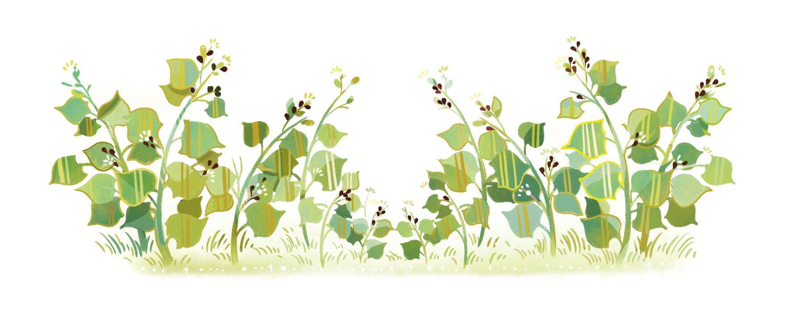

# 荞麦

暴风雨过后，当你走过一片长着荞麦的田野，你通常会发现荞麦总是黑乎乎的，仿佛是被火燎烧了一通。农夫会告诉你：“他是被闪电点着的。”可他为什么会被闪电点着呢？

我把麻雀告诉我的故事，也讲给你听听好了。这个故事，是麻雀从一棵老柳树那里听来的，那棵树就立在荞麦所在的那片田野旁边。他始终立在那儿，还有谁能比他知道得更清楚呢？他可是一棵非常值得尊敬、气度高贵的树，不过他很老了，身上还有点伤残。他当中裂开的树身里已经长出了野草和荆棘，他佝偻着身躯，枝条垂到地上仿佛是一头绿色的长发。

柳树身边的田野里生长着玉米、黑麦、大麦和燕麦——噢，燕麦长得可好了，当他们成熟的时候看上去就像是一群停在树枝上的小金丝雀。玉米则在田里长得密密实实，越是饱满的就越是谦逊地弯下身子。

就在老柳树的对面，还有一片荞麦田。荞麦不愿像其他谷物那样卑躬屈膝，他高傲、顽固地做昂首挺胸状。“我和那些老玉米一样饱满富足，”他说，“而且我比他们英俊得多。我开出的花和苹果花一样美丽。看着我和我的家族就是一种享受，你还能说得出有谁比我们家族更杰出吗，老柳树？”

老柳树点了点头，仿佛在说：“是的，我当然能说得出。”

然而荞麦带着荒唐可笑的自傲，趾高气扬地说道：“那棵愚蠢的树，老得肚子里都长草了！”

突然，一阵可怕的强风来袭。风经过的时候，田野里的所有花儿都收起了自己的花瓣，低下了他们那纤柔的脑袋，只有荞麦仍然傲慢地保持着趾高气扬的姿态。

“快低下头呀，像我们这样！”花儿们喊道。

“我不需要低头！”荞麦答道。

“低下头吧！”其他谷物都喊了起来，“风暴天使正朝我们飞来！他的翅膀从云端一直鞭及地面，在你哭着求饶之前，他就能把你劈成两半！”

“嗯，但我是不会低头的。”荞麦不依不饶地说道，“你们这些花儿还是闭嘴吧，你们就卑躬屈膝好了。”这时老柳树开腔了：“随你怎样吧，只是在雷云翻滚的时候，别抬头去看闪电就行了！就算是人类也不敢那么做，因为闪电直通天国，那种强烈的耀光可以把人眼都变瞎！所以啊，要是远比人类还要不起眼得多的我们也胆敢那么做的话，恐怕无法想象会有何等下场啊！”

“那我偏偏要盯着天空看！”荞麦刚愎自用、自以为是地说道。闪电刺目地掣动，看上去仿佛整个世界都燃烧了起来。

风暴终于过去了，花儿和谷物们再次在纯净清新的空气中挺立起来。经过雨水的洗刷，他们变得焕然一新。然而荞麦被闪电烧成了煤黑色，他已经死去了，在田野里变成一文不值的杂碎。老柳树的枝条在微风中颤抖着，许许多多的水滴从他的绿叶上滚落下来，仿佛是在哭泣。“你怎么哭了？”麻雀问他，“这里的一切都那么美。瞧那明媚的阳光，还有天空中飘浮的朵朵白云。你难道没有闻到花儿与灌木的芬芳吗？为什么要哭呢，老柳树？”

于是老柳树告诉麻雀们，荞麦如何刚愎自用、自以为是，又是如何遭到了必然的惩罚。

我现在给你讲的这个故事，就是从麻雀们那儿听来的。某天晚上，我请他们讲一个故事，于是他们就给我讲了这个故事。
