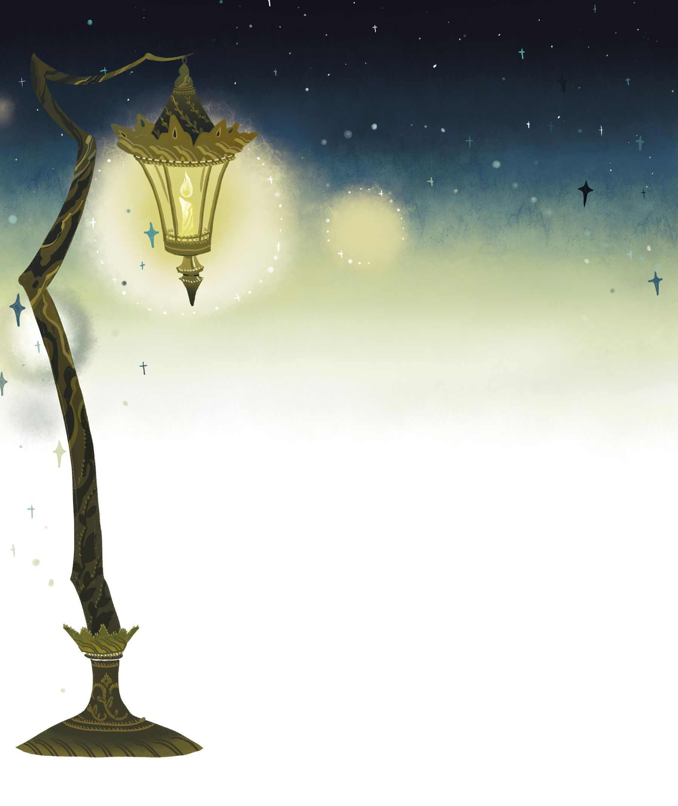
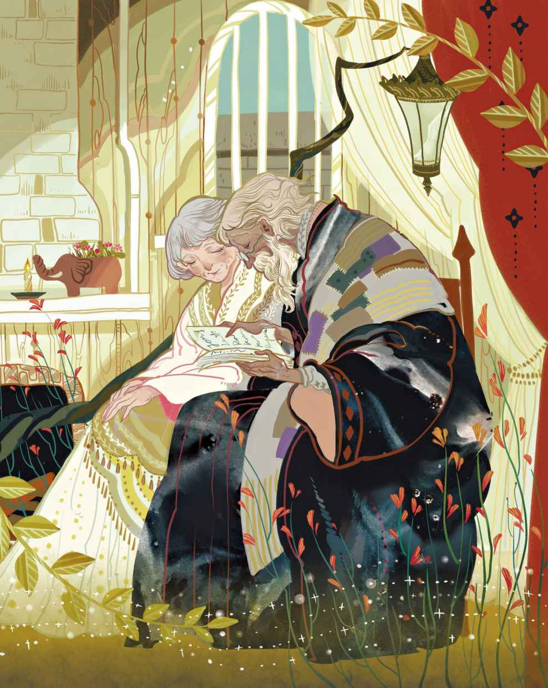

# 老路灯

你听过老路灯的故事吗？确实，这个故事算不上多么有趣，但你或许还是应该听上一回。

那是一盏忠诚的路灯，他忠于职守多年，如今却将被废弃，这是他挂在灯柱上给下方的街道送去光亮的最后一晚。老路灯觉得自己俨然成了一个上了年纪的芭蕾舞演员，这位演员很清楚，明天自己就会被送去冷冰冰的阁楼里。明天让老路灯感到害怕，因为到时他会置身于市政厅里，由三十六位议员进行审查，看他是否还能继续工作下去。

议员们将会裁定，在接下来的日子里，老路灯到底是去给郊区的住户照明，还是被送去乡下的制造厂。届时他很可能会在铸铁厂里被直接熔掉！如果是那样的话，老路灯将有可能被重铸成任何东西，而不管他会变成什么，都让眼下的他感到惶恐不安。因为他不知道被重铸之后，是否还会记得自己曾是一盏路灯。无论如何，他都要与巡夜人以及他的妻子分别了，而他早已视他们为家人。当他刚成为一盏路灯的时候，巡夜人也是第一次走上岗位。

那些日子里，巡夜人的妻子有点傲慢，她只在夜间经过路灯底下的时候才会朝他瞥上一眼——白天的时候，她从不会瞧他。然而在后来的那些岁月里，随着巡夜人、巡夜人的妻子以及路灯一起慢慢地变老，巡夜人的妻子开始照料路灯，帮他擦洗，替他添油。这对老夫妻极为忠诚，从没在老路灯身上榨取过一滴油。

此刻是他在这条街上的最后一晚了，明天就要去市政厅，这着实叫人心里倍感灰暗，也难怪他的灯火不再那么明亮了。不过他的心里还有其他念头闪过。他曾经照见多少世间百态，又曾经目睹多少众生万相啊！弄不好跟那三十六位议员的所有见闻加在一块儿都差不多呢。然而他从不挑明这点，因为他是一盏明事理的、忠诚的老路灯，不愿触犯任何人——尤其是那些当权者。他回忆着往事，火苗时不时会扑闪一下，仿佛在述说他的心事：“是啊，我也会成为别人的回忆。”

“曾经有个英俊的年轻人——天呐，那是很久以前的事了！年轻人出现的时候带着一封信，信的内容写在粉色的纸上。那纸张非常漂亮，还饰有金边，字迹也是那么的秀美，出自一位女士之手。他把信读了两遍，然后吻了上去，当他抬起头面朝着我的时候，眼睛仿佛在说：‘我是全世界最幸福的人！’是啊，只有他和我知道，那封恋人的来信上写了什么。”

“我还记得另一双眼睛——好奇怪，我的思绪开始变得漫无边际了！也是在这条街上，那时这里正在举行一场盛大的葬礼，铺着天鹅绒的灵车上有位美丽的少女躺在棺木里。到处都是花圈和鲜花，还有数量众多的火把，它们把我的灯火都给盖过去了。人行道上挤满了送葬的人群。而当那些火把从我跟前经过的时候，我四下观望，发现有个人正靠在我的灯杆上哭泣。那双仰望着我的眼睛，我永远也不会忘记！”

千丝万缕的回忆轻轻地掠过老路灯的脑海，今晚是他在这里发光的最后一晚了。

一个哨兵被解除职务之后，至少还能知道谁是自己的接班人，至少还能跟对方说说话，可是老路灯却不知道谁会来接替自己。要是有人接班的话，他可以提供一些有用的建议，比如关于下雨和起雾，关于月光在人行道上的光照范围，还有关于风向的变化。

下水道的排水口那儿站着三位“东西”，它们向老路灯进行了自我介绍，因为它们觉得，老路灯可以选择它们作为接班人。头一位是鲱鱼脑袋，它可以在黑暗中发光，而且要是把它挂到灯杆上，完全不需要耗油。第二位是一截朽木，它也会发光，而且无疑要比鲱鱼脑袋更为出色，至少它自己是这么说的。不仅如此，它还是一株老树根的最后传人，那可一度是整片森林的骄傲啊。第三位是萤火虫，它究竟是打哪儿来的，老路灯根本无从想象。不过它确实来了，而且也能发光。可是鲱鱼脑袋和朽木赌誓说，萤火虫只能在某些特定时间发光，因此不应将它纳入考虑范围。

然而老路灯说，以它们的发光能力，没有一个足以履行好作为路灯的职责，但它们就是不相信。而当它们得知老路灯自己对于接班人的选择也爱莫能助的时候，反倒是松了口气。它们说，老路灯实在是太老了，对于甄选接班人这种事也已经有心无力了。

就在这时，街角那儿卷起一股风，呼啸着钻入老路灯的气孔，然后对他说：“我都听见了些什么？你明天就要走了吗？是不是过了今晚我就再也见不到你了？这样的话，我一定要送你一份告别礼物。我会吹进你的脑袋瓜里，让你不仅能够记住曾经的所见所闻，还能让你燃起别样的灯火。凡是人们在你面前阅读的东西，抑或是正在说的话，你都能够看到和听到。”

“噢，这份礼物实在是太棒了！”老路灯说，“真感谢你呀！我只希望自己别被熔掉就好了！”

“不会马上就被熔掉的啦，”风说，“现在我就给你吹送一段记忆进来。像这样的礼物你要是能多收到几件，那你可就能欢度晚年咯。”

“前提是我不会被熔掉！”老路灯说，“或许，即使在我被熔掉之后，我还是能保留住记忆，你能确保这点吗？”

“别傻了，老路灯！”风说完便吹了起来。这么一吹，月亮便冒了出来。

> **注 47**　原文直译应该是“与此同时，月亮出来了”，但考虑到前后形象的逻辑关系——正因为风吹，吹散了云雾，月亮才会冒出来（后文也提到“它又溜回了云层背后”）——故译作“这么一吹，月亮便冒了出来”。

“你准备送点什么呢？”风问道。

“什么也不送。”月亮回答说，“我自己正亏损着呐

> **注 48**　这里是一语双关，既是指月亮自身的阴晴圆缺，又是承接后文，拟人化地表现出月亮自觉吃亏的语气。

这时，一滴水落到了路灯身上，看样子它是从屋顶上滴落下来的。不过它声明了，自己是乌云送来的礼物——这大概是人家能送出手的、最好的礼物了。“我会彻头彻尾地渗入你的体内，这样你就能——假如你愿意的话，就能在一夜之间被锈蚀，继而土崩瓦解化作尘埃。”

不过老路灯觉得，这是一份糟糕的礼物。风也这么认为。

“就没有人能拿出更好的礼物了吗？”风使劲儿吹着说道。

也就在这个时候，一颗闪亮的星星坠落下来，身后带着一条炽热而明亮的长尾巴。

“那是什么啊？”鲱鱼脑袋喊道，“那不是一颗流星吗？哇，我看它正好飞到灯盏里去了！好了，要是这种出身显赫的人物都来竞争岗位，那我们看样子还是弃权回家得啦！”说罢，它便真的走了，其他“东西”也都走了。而老路灯变得熠熠生辉，远比以往要明亮得多。

“这真是一件绝妙的礼物！”他说，“一直以来我都十分钦慕那些闪亮的星星，它们是那么闪耀，发出的光远比我要明亮得多，那是我无论怎么追求和努力也永远不可能企及的。它们终于注意到了我——一盏落魄的老路灯，并为我送来了这份礼物！它们赐予我一种力量，让我能把自己记得的和看到过的一切事物都清晰如初地再现给那些我爱的人！这件礼物蕴含着真正的幸福，因为我们平时并不能与他人分享自己的幸福，而那，恐怕只能算作一半的幸福吧。”

“你的所思所想真是令人心生敬意。”风说，“然而要办到以上的事情，你还需要蜡烛才行。要是你的灯罩里没有蜡烛来点亮，那么你那不可思议的能力对别人还是起不了作用啊。星星们并没有考虑到这点！它们还以为所有发光的东西，里头至少总会有根蜡烛来点燃呢。现在我累了！我要去休息咯。”言罢，风便休息去了。

第二天白天——得得，还是让我们直接略过白天吧

> **注 49**　这里的原文是“The next day”，但是根据后文意思，可以看出这里其实是个文字游戏，这里的“day”不仅指的是“日子”，更是特指“白天”——与后面“第二天晚上”对应。

这位老人向那三十六位议员求情，看在自己多年来对这座城市尽忠职守的份上，求他们手下留情，这才获许把老路灯作为奖赏保留了下来。当他提出请求的时候，他们对着他大肆嘲笑，但最终还是把路灯留给了他。

现在老路灯躺在这张宽适的扶手椅上，紧靠着温暖的火炉，看上去变大了很多，几乎快要填满整张椅子了。巡夜人夫妇俩坐下来吃晚餐的时候亲切地看着老路灯，他们很乐意在餐桌边给老路灯也腾出一个位子。

其实，他们的家不过是一间比人行道还要低两码

> **注 50**　1码等于3英尺。

> **注 51**　原文为“Christian”，安徒生的中间名就是“Christian”。这个词还有基督教信徒的意思，而安徒生本人正是忠诚的基督教信徒。

> **注 52**　历史上的著名会议，召开时间是1814年9月至1815年6月，由当时的欧洲列强召开，会议目的是重新划分拿破仑战败后的欧洲政治地图，但实际上只是一场形式上的会议，甚至可以说是一场闹剧。安徒生在篇末再次以讽刺的口气提到了维也纳会议。

> **注 53**　即伯恩霍尔姆岛，位于哥本哈根以东的波罗的海，被称为“波罗的海明珠”，早前曾是海盗据点，1658年归属丹麦。

他们吃着晚餐，而老路灯则躺着，正如你所知，就在那个暖乎乎的火炉旁边的大扶手椅上。老路灯昏昏沉沉，整个世界在他眼里变得颠倒错乱起来。不过老巡夜人看着他，对他说起那些共同经历过的时光，那些雨天和雾天，那些短暂而明亮的夏夜，还有那些大雪纷飞、想念地下室里的家的日子。听着这些，老路灯的感觉才又好了起来。一切仿佛又回到眼前，变得清晰可见了，是啊，这正是风赠送给他的奇异之光。

老夫妇俩总是那么乐观勤劳，从不让一个钟头因懒惰而浪费掉。每到星期天的下午，老巡夜人都会找来一些书，或者讲点别的——比如丛林故事，故事里有在野外跑来跑去的大象。老妇人总是听得很入神，她会对着黏土做的大象花盆凝视起来，“我几乎都能看见那些画面啦。”她总是这么说。

老路灯特别希望能有一支蜡烛在自己身体里点燃，这样，老妇人就能把一切看得更为详尽了，就像老路灯自己看到的——高高的树木上茂密的枝叶相互盘绕，黑人们光着身子骑着马，还有大群的大象，用它们那巨大的脚丫子踩过芦苇丛和灌木林。

> **注 54**　依前文所述，只有蜡烛在老路灯身子里点燃的时候，它才能发挥出流星赠予它的能力，把自己看到的事物呈现给他人。

“要是我无法弄到蜡烛的火光，那么我的特殊能力又怎么可能起作用呢？”老路灯叹息道，“他们这儿只有油和牛油烛

> **注 55**　据考证，安徒生早年确实写过一篇名为《牛油烛》的童话习作，手稿目前已被发现。

一天，老巡夜人带了好多蜡烛头回地下室。稍大一些的蜡烛头可以用来点火，稍小一些的则给老妇人穿针引线时用来打蜡。眼下他们有了足够的蜡烛，不过谁也没有想到去放一根蜡烛头到老路灯的灯罩里。

“这下我有戏了，我的特殊能力终于可以派上用场啦！”老路灯说，“我身子里一切皆有，只可惜无法同这些我爱的人分享。他们不知道我可以在空无一物的墙壁上变幻出华丽的挂毯，还可以让他们置身于丛林，抑或让他们看到任何想要看到的东西！我有这样的能力，他们还不知道呢！”

老路灯立在墙角，被擦得又亮又干净。在这儿，他可以捕捉到许多来访者的眼睛。在这些人眼中，老路灯不过是一块废品，但巡夜人夫妇对此并不在意，他们爱着老路灯。

某一天——这天是老巡夜人的生日——老妇人来到老路灯跟前，情不自禁地微笑着。“今天我要把他点亮，给他留个纪念。”她说。

于是老路灯的灯罩咯吱作响起来，因为他正在想：“他们总算是冒出好主意了呀！”然而他只有油，并没有蜡烛。那天晚上，老路灯彻夜点燃着，可是他现在已经明白，到最后，星星赠予他的这份礼物——这份最好的礼物和珍宝——将会成为他终身的遗憾。

那天晚上，老路灯做了个梦。因为有了那些特殊的能力，梦很容易变得逼真。他仿佛看到年迈的巡夜人夫妇离开了人世，而他自己被送去铸铁厂熔化。老路灯感到害怕极了，就好像又回到了那个可怕的日子，那天他身处市政厅，面临着三十六位议会成员的审查。

虽然他有着让自己土崩瓦解，自行化为灰烬的能力，但是他并没有运用这项特殊能力。他被扔进了熔炉，然后被铸成了一座美丽的烛台，正如你们希望看到的——一座专门用来放蜡烛的烛台！他的外形变成了手持花束的天使，而蜡烛就插在花束的中央。

在一张绿色的写字桌上，烛台有了自己的一席之地。这个房间是如此舒适，墙上摆满了书籍，挂着美丽的绘画——这是一位诗人的房间。诗人总喜欢书写那些在他身边出现的事物，于是房间里幻化出了茂密而幽深的森林，鹳鸟们在美丽的草地牧场上漫步，泛着泡沫的海面上，还有一艘船正在乘风破浪。

“我身体里的那种特殊力量真是了得！”从梦中醒来的时候，老路灯说，“我几乎已经愿意被熔掉了！可是不行，只要老巡夜人夫妇还活着，我就不能去被熔掉，他们爱的是身为路灯的我。他们把我擦得干干净净，他们给我添油，我就是他们的孩子啊。现在的我，快活就跟整个维也纳会议似的，这才叫真正的妙不可言。”

于是，从那天起，老路灯一直安享着内心的平静。而这，也正是这盏善良的老路灯应得的。
