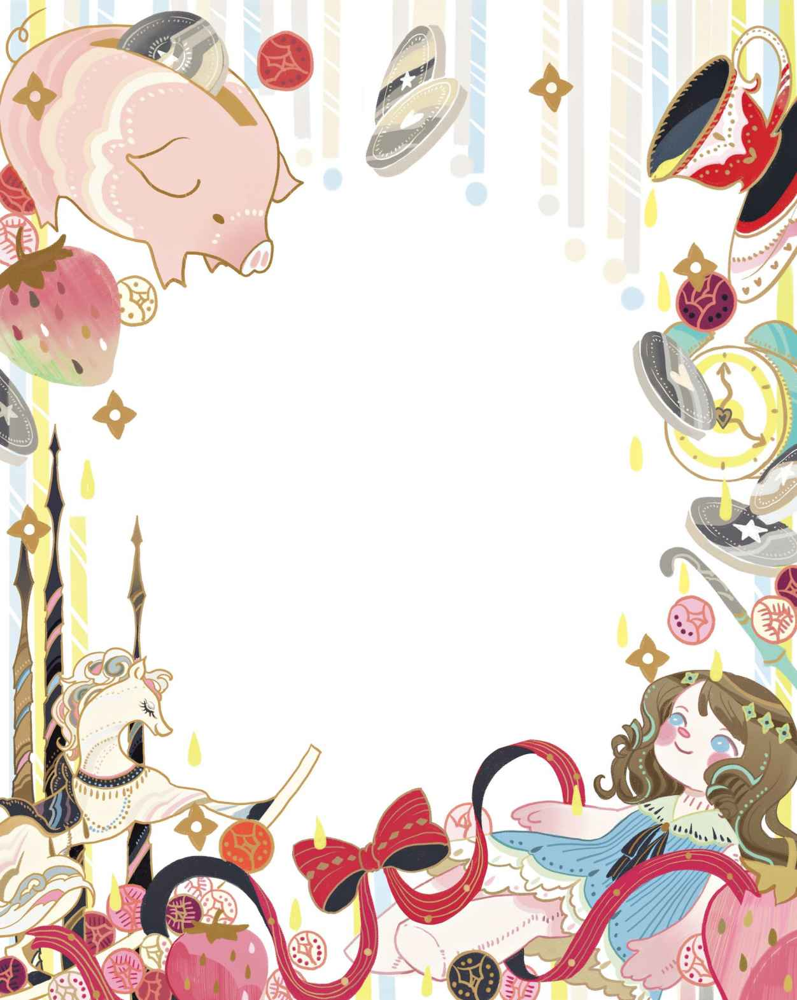

# 猪扑满

育儿房里有很多玩具。橱柜的顶上放着一只存零钱的扑满，这只扑满用黏土制成，外形是一只小猪的模样。

当然了，小猪的后背上有一条缝。为了把更大面额的银币也塞进去，这条缝后来又被人用刀扩大了一些。如今里头已经有了两枚银币，此外还有一大堆零钱。他被塞得满满的，满得都没法晃出声响。对于一只猪扑满来说，这可是至高无上的荣誉。于是他高高地站在橱柜上，居高临下地审视着房间里的其他玩具。他很清楚，自己肚子里装着的这些钱，多得足以将这些玩具全都买下来，这种感觉，也就是我们所说的“自鸣得意”吧。

玩具们也都很清楚这点，但是他们没说什么，因为值得探讨的东西还有很多呐。橱柜的抽屉半开着，里头有一个大玩偶，她是个很旧的玩偶，脖子那儿用铆钉补过。她从抽屉里探出来，说：“我们现在来扮人玩吧，一定会很好玩的啦！”

这下子，育儿房里彻底闹腾开了。就连挂在墙上的画作们也纷纷转过身来，好让大家瞧瞧，他们也是有屁股的

> **注 56**　跟竖中指一样，属于“特殊动作”。背过身对着别人拍屁股，表示鄙视、反对、抗议或不屑。

已经是午夜时分，月光穿过窗户变成室内的免费照明。玩具们准备开始游戏了，所有玩具都参加，就连婴儿车这种露天作业的“粗人”也受到了邀请。

“每个人都有自己的特殊价值，”婴儿车说，“我们不可能全都当贵族，总得有人去干活儿，人们常这么说。”

猪扑满是唯一收到书面邀请函的。他的地位如此之高，大家都觉得他应该会忽略口信。到底来还是不来，他没明确答复。若是来的话，他要大家为他做出特别安排，让他在壁橱上进行观赏。所有人都得为他调整计划，大家都答应了。

玩具们的小剧场马上就搭建好了，舞台正对着猪扑满所在的位置。他们计划先演一场滑稽戏，然后上茶点，举行知识座谈会。他们迫不及待地先进入了这个环节，摇摆木马谈的是赛马训练和良驹血统方面的知识；婴儿车谈的是火车和蒸汽机，话题都跟他们自己的专长有关，所以都谈得头头是道。闹钟谈论的是政治——嘀、嗒！——他每天都能报时，但人家都说他走得不太准。竹手杖一语不发，只是站在那儿，他身上镶着黄铜，手柄是银制的，浑身上下都披金戴银。沙发上则摆着两只绣花垫子，他们很漂亮但是肚子里没什么墨水。这会儿，滑稽戏要开演了。

大家都坐下来观看。观众被要求学着鼓掌，于是他们在自己觉得好笑的时候又是拍掌又是跺脚，只有马鞭说他从不为老掉牙的东西鼓掌——他只为未婚的年轻人鼓掌。

“我愿意为任何人鼓掌。”烟花说道。

“人还是应该摆正自己的位置。”痰盂罐心想。看戏的时候，他们就这样源源不断地冒出各自的想法。

这出戏毫无价值可言，但是演得倒是不错。所有演员都把化了妆的那一面对着观众，因为他们只有这一面可以示人，另一面可不行。他们的演出很精彩。谢幕的时候，他们全都站到了舞台的脚光

> **注 57**　设置在舞台幕布前的专用灯光。

大家玩得很开心，这会儿又准备开始茶歇，继续展开知识座谈。这就是他们的游戏，扮演男人也好，扮演女人也罢，反正都无伤大雅，因为只是在玩游戏罢了。每个人都挖空心思想要讲点什么知识，他们还在猜测，猪扑满会在想什么。猪扑满其实想得可远了，他正在想着自己的遗嘱和葬礼呢。那么他什么时候会死呢？

绝对比你想象的要快得多。哗啦！他从橱柜上掉下来了，摔在地板上变得支离破碎。里头的零钱全都蹦蹦跳跳地散开了，最小的零钱就跟陀螺似的打着转儿，大一些的则滚走了。最大的银币打算去外面的世界走一走、看一看。于是银币就那么走了，而其他零钱也都离开了猪扑满。

猪扑满的碎片被扫进了垃圾箱。第二天，橱柜顶上又出现了一只新的猪扑满。这只猪扑满里头空空如也，晃不出任何声响，所以至少就这点而言，他跟原来那只猪扑满是一样的。

这只是个开头——不过我们还是收尾为妙。
