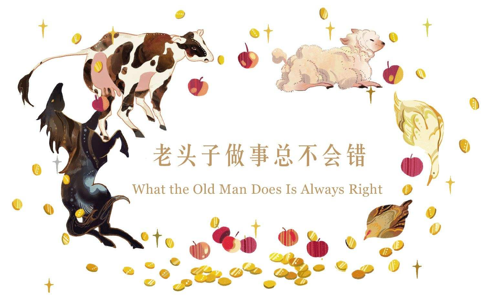

# 老头子做事总不会错

现在我要给你讲个故事。最初听到这个故事的时候，我还是个小鬼头。而在那之后，我对这个故事的喜爱就一直在与日俱增。故事和人一样，越是老就越是有味儿，这真是妙不可言。

你肯定去过乡下。当然了，在乡下你肯定会看到真正的老农舍，就是那种有个茅草屋顶的农舍。苔藓和杂草自说自话地到处生长，鹳鸟的巢装点着烟囱（你还真少不了它们）。墙壁总是歪歪斜斜，窗户总是低低的（事实上，通常只有一扇能打开）。鼓出来的炉灶活像是肥嘟嘟的小肚皮，接骨木树丛则覆盖在门上。在那儿，你还能看见一个小池塘，池塘里有一只大鸭子和一群小鸭子，它们就在那棵盘根错节的柳树下面。没错，然后嘛，当然了，还有一只看门狗，不管它见了什么，都要对之咆哮一通。

好了，像这样的老农舍，乡下真有那么一间。那里头住着两个人，一个农夫还有他的妻子。他们的财产少得可怜，不过仍有一样东西是用不着的。那是一匹马，专门沿着路边的水沟吃草过活。老农夫平时要么骑着它去镇上，要么就把它借给邻居。作为回报，邻居总会给他们帮点小忙。不过，要是去把马卖掉的话显然会有多得多的回报，或者，至少可以拿它换些什么，换些对他们而言更有用的东西。

可是，他们究竟要怎么做呢，是卖掉还是去换东西呢？

“你总能知道怎么做才最好，老头子。”农夫的妻子说道，“今天正好是赶集的日子。快去吧，骑着它去镇上，用它卖钱或者做笔交易。你做事总不会错的。就这样，出门赶集去吧！”

言罢，她给他系上围巾——这方面她算是懂得比他多——打了个双蝴蝶结，让他看上去气派一些。她用掌心擦拭他的帽子，然后吻了他一下。接着他便骑着那匹要么会被卖掉、要么会被换走的马出门去了。当然啦，他会知道该怎么办的。

烈日当头，天空中一朵云也没有。马路上尘土飞扬，被赶集的人群挤得水泄不通。他们有的驾着马车，有的骑着马，还有的就用自己的两条腿走路。没错，这太阳实在是炙热，而且一路上根本就没有阴凉地。

这会儿有个人过来了。他牵着一头奶牛，那可是你能指望瞧见的最漂亮的奶牛。“她肯定是个产奶大户，”农夫心想，“要是我把它弄到手，那肯定是一笔不错的交易。嘿，牵牛的！”他说道，“让我们来谈谈。瞧这儿，我相信一匹马肯定比一头牛值钱，不过这对我来说已经不重要了，因为我更需要一头牛。我们做个交易怎么样？”

“好极了。”牵牛的那人说。于是他们便达成了交易。

现在，农夫应该直接回家为好，因为他已经把事情办妥了。不过他原本就打算好了要去集市，所以还是准备去走一趟，哪怕就随便看看也好。于是他带着他的牛继续赶起路来。他走得很快，他的牛也是，不一会儿就赶上了一个牵着绵羊的人。那可真是一只好看的绵羊，它的状态极佳，羊毛密布全身。

“我一定要把那只羊弄到手。”农夫心想，“我们那儿的路沟边有足够的草给羊吃。到了冬天，我们可以让它住进我们的屋子。比起供养一头牛，供养一只羊确实要明智得多。我们交换一下如何？”

好啊，羊的主人一口答应，于是交易便做成了。现在，农夫带着他的羊沿着马路继续赶路。在路口的门栅附近，他又遇见一个人，那人的胳膊下面夹着一只大鹅。

“好家伙，你这可真是身负重担！”农夫说，“这鹅的羽毛真多，长得也够肥！要是能把它拴养在我们家的小池塘边上，那该有多好啊。还有啊，这下我家老伴的剩饭剩菜可派得上用场了。她总是说，‘要是咱们有只鹅就好了。’现在她真能有一只了——她应该如愿以偿的！你愿意交换吗？我想用我的羊外加我的感谢，来换你的鹅。”

对方没有任何异议，于是他们达成了交易，农夫得到了那只鹅。眼下他已经快到镇上了，马路上越来越拥堵，人群和牲畜从他身边挤过，在马路上、在路沟里挤作一团。他一路走到收税员的土豆田跟前，看到了人家的母鸡。收费员把它拴在了那儿，以免它受到惊吓而跑丢了。那是一只短尾母鸡，一侧的眼睛眨巴着，看上去挺不错的。

“咯咯，咯咯。”鸡说。它在说些什么，我可不知道。不过农夫见此，他是这么想的：“这是我见过的最漂亮的母鸡——比我们那儿的牧师养的抱蛋

> **注 58**　即孵蛋。

“交换？”对方说，“行啊，这主意倒是不坏！”于是他们进行了交易。收税员得到了鹅，而农夫得到了母鸡。

从他动身去镇上赶集开始，一路上已经做了一连串交易。天气真热，他感到有些疲乏了。现在他需要喝点儿什么，还要吃点儿东西。

他来到一家小客栈，正打算进去，却在店门口撞见了掌柜的伙计，对方正扛着满满一袋东西。

“你拿的是什么？”农夫问道。

“烂掉的苹果。”对方答道，“整整一麻袋，拿回去喂猪。”

“真够多的！我家老伴肯定乐意看到这么多东西！哎呦，去年我们家泥炭棚旁边的那棵老树上只结出一只孤零零的苹果，那只苹果到现在还留着呢，就放在抽屉柜里，最后都开裂了。‘那通常是丰收的好兆头。’我家老伴说。现在，她真的可以有所丰收了！没错，我真心希望她能拥有这些苹果！”

“好吧，那你准备用什么跟我换呢？”那位伙计问道。

“用什么换？嗨，用我的母鸡呗！”说着，他交出了母鸡，拿到了苹果，然后进了客栈，径直走向酒吧间。他把麻袋放在火炉上面，根本没留意到炉子里正生着火。眼下，这地方聚集着一伙陌生客人，有马贩子，有牛贩子，还有两个阔绰的英国人，他们的衣袋被金币撑得鼓鼓囊囊的。这两个人很喜欢打赌，故事里的英国人总是这样。

“嗞嘶！嗞嘶！嗞嘶！”火炉上传来了什么声音？是那些苹果渐渐地被火烤着了！

“那是什么东西？”所有人都在问，不过他们很快就弄明白了。他们听了整个故事，起初是用马换了一头牛，最后换成了一麻袋烂苹果。

“好了，这下你回到家之后，你家老伴可要好好赏你一顿揍了！”那两个英国人说，“你麻烦大啦。”

“我得到会是吻，而不是拳打脚踢。”农夫说道，“我家老伴时常说：‘老头子做事总不会错。’”

“我们打个赌怎么样？”那两个英国人又说，“我们用一桶金子作为赌注！一百英镑对一百磅如何？ ”

> **注 59**　这里的意思是如果英国人赌输了，那么农夫能得到价值一百英镑的金子；而如果农夫赌输了，那么英国人会得到重一百磅的苹果。

“一蒲式耳

> **注 60**　蒲式耳是一种计量单位，不同国家有不同换算法。在英国，1蒲式耳相当于8加仑，也就是36.268升。

“那就这么说定了！”两个英国人嚷道，于是赌注就算是下好了！客栈掌柜的马车驶出，两个英国人钻进了车子，农夫也坐了进去，那些烂苹果也跟着上了车。然后他们便出发了，车子朝农夫的农舍驶去。

“晚上好啊，老伴。”

“晚上好，老头子。”

“喏，我把交易搞定了。”

“那是，你一向都知道怎么做生意。”老伴说着，给了他一个大大的拥抱，把麻袋和两个陌生人都撇在了一旁。

“我用马换了一头奶牛。”

“感谢上帝，我们有了牛奶！”老伴说，“如今我们的餐桌上有了牛奶、黄油和奶酪！多么棒的交易啊！”

“是啊，不过我又用奶牛换了一只绵羊。”

“那可就更好啦！”老伴叫道，“你总是那么有想法，我们有足够的草地喂羊。这下子，我们能有羊奶和羊奶酪了，还能有羊毛袜子呢，没错，羊毛睡衣也能有了。一头奶牛可带来不了这些，它的毛发只会白白掉光。多亏了老头子你，总是那么深思熟虑。”

“不过我又把羊换成了鹅。”

“哇！那我们今年的米迦勒节

> **注 61**　为纪念天使米迦勒而设的西方节日。米迦勒节的传统食物就是鹅。

“可是，我又用鹅换了一只母鸡。”农夫继续说道。

“一只母鸡？好吧，这个交易也不坏！”老伴说，“母鸡能下蛋和孵蛋，这样我们就会有很多小鸡。想象一下，满满一院子的小鸡！这一直就是我最想要的！”

“是啊，可是我又用母鸡换了一麻袋烂苹果。”

“那我可要给你来上一个吻了！”老伴说，“感谢你，我的丈夫。现在我有些事要告诉你。你走了之后，我本打算给你准备一顿可口的晚餐——就做香葱鸡蛋饼。我已经有了鸡蛋，却没有香葱，于是我就去了教师们的住处，因为我知道他们那儿有香葱。可是那表面亲切的女人实际上却很小气，要我拿东西跟她换。我能给她什么呢？我们的院子里寸草不生，连一只烂苹果也没有。我连一只烂苹果也给不了人家，不过现在，我能给她十只烂苹果了，甚至整整一麻袋的烂苹果！这难道不有趣吗，老头子！”她说着，嘴对嘴地吻了他。

“我喜欢你们这样！”两个英国人异口同声地说道，“生活每况愈下，却始终乐观快活。光凭这一点，就值得这些钱！”于是他们心甘情愿地向农夫兑现了承诺过的金子，因为他所做的交易换来的确实是吻，而不是一顿拳打脚踢。

是啊，只要妻子认定丈夫是全世界最聪明的人，相信丈夫无论做什么总不会错，那么一切就都值啦。

好了，这就是我要讲的故事。初次听到这个故事的时候，我还是个小孩子。现在你也听了这个故事，所以你也该知道了，老头子做事总不会错。
