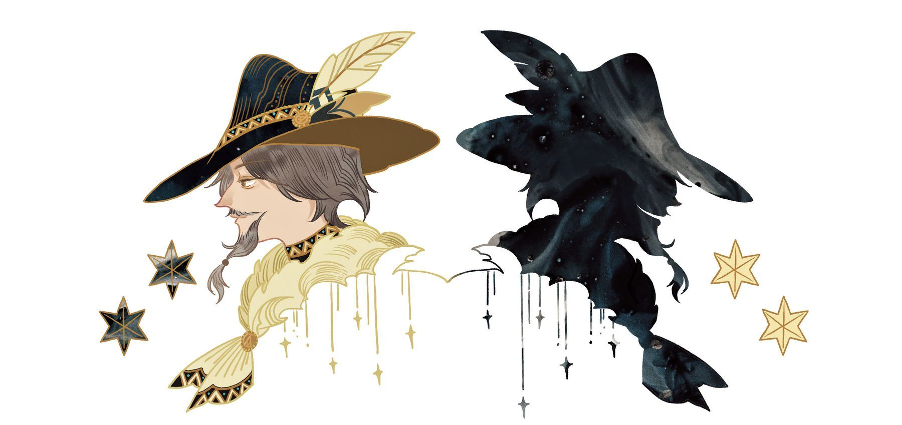
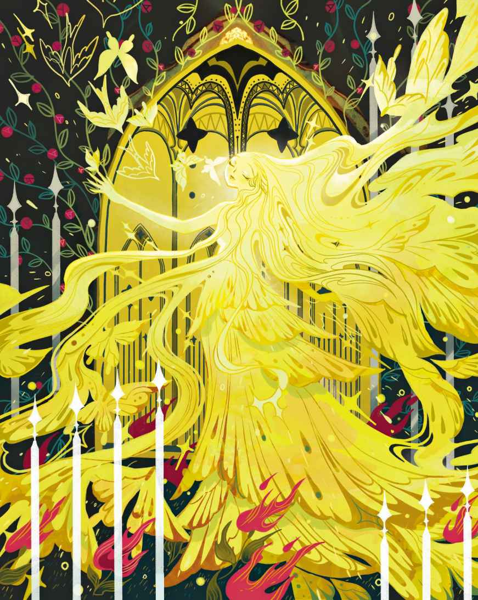
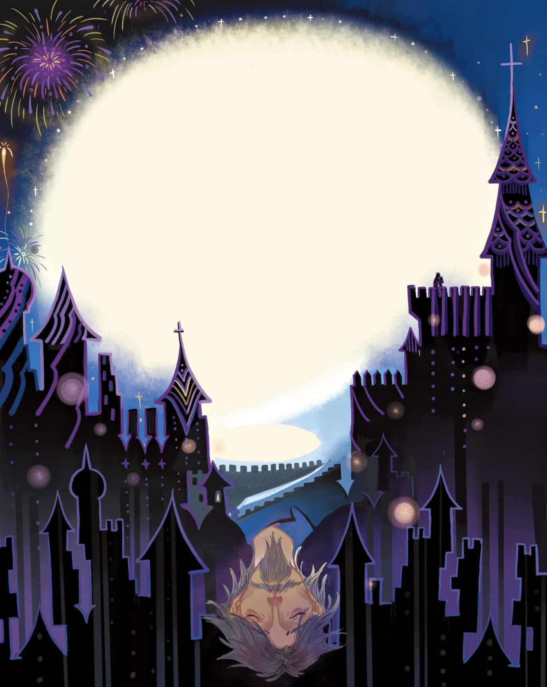

# 影子

在那些炎热

> **注 62**　译成炎热比较准确，因为并不是气候热的国家就是热带国家，比如非洲，它也有亚热带地区，而非洲这个词的本义就是“日光灼热”的意思，所以还是译成炎热。

对于这位年轻聪明、来自寒冷北方的学者而言，这感觉活像是坐在炽热的烤炉里。他被折磨得近乎虚脱，人也因此变得极度消瘦，甚至连影子都萎缩了，比原先在家乡时小了很多。只有到了晚上，太阳下山之后，这位异乡客和他的影子才有机会舒展一下。

这可真成了一出喜剧。蜡烛才刚被拿进屋，影子就开始变长，它要恢复成原有的尺寸。它一直伸展到墙上，没错，接着甚至蔓延到了天花板上，它变得可真高。为了舒展身子，学者来到外面的阳台上。夜空美丽而明朗，星星一出来，他便立刻感到自己又恢复了生气。

在这种气候炎热的国家，每家每户的窗外都设有阳台。整条街上充斥着阳台。只要想呼吸新鲜空气，人们就会来到阳台上，哪怕已经被晒得一脸棕红。不管是楼上还是楼下，到处都是一派生活气息。裁缝、鞋匠——不管什么人——这会儿都来到了街上，椅子和桌子被搬了出来，蜡烛也被点了起来。没错，足有上千根蜡烛呢。有人在说话，有人在唱歌，人们四处溜达，街上车水马龙。驴子小跑着，发出“丁零－丁零”的声响，那是因为它们的马具上挂着铃铛。教堂的钟声响起，赞美诗的歌声传来，送葬队伍开始出殡。男孩们在街上燃放罗马烟火

> **注 63**　一种柱状烟火棒，最早起源于意大利。

唯有一栋房子仍是安静的——那栋房子，就在学者住处的正对面。那里头应该是有人住的，因为阳台上的花儿们在烈日下依然蓬勃生长，而它们不可能有这样的生命力，除非有人灌溉。所以，一定有人给花浇水，房子里一定有人住着。说起来，到了晚上，对面那栋房子的门真的打开了。不过里面一片漆黑，至少门厅那儿是黑洞洞的。从房内的某个地方，应该是更里面的房间，传来了音乐声。这位学者心想，这音乐真是棒极了，不过这很可能是他的幻觉，因为在这种气候炎热的国家，一切都是很棒的——除了太阳。学者的房东说，街对面的那栋房子究竟是什么人租下的，他也不知道。从来就没人留意那栋房子。至于那音乐声，他觉得非常乏味。他说：“听上去就像是有人坐在那儿，不厌其烦地重复练习着同一段曲子，一段他怎么也上不了手的曲子——而且永远就是那段一模一样的曲子。‘我迟早能学会的。’他搞不好会这么说。可是他学不会的，不管他练习了多久。”

一天晚上，学者醒了过来。他依窗而睡，窗就对着阳台，微风拂起身旁的窗帘，于是他开始幻想。街对面的阳台那儿射来一道奇异的光芒，花儿们的色泽全都变得如同火焰般明亮。而在它们中间伫立着一位少女，纤柔而美丽，那光芒仿佛就是从她身上散发出来的。光亮刺痛他的眼睛，因为他惊醒之际，把眼睛睁得太大了。

他从床上一跃而下，悄无声息地透过窗帘朝外望去。然而少女已经消失了，花儿们也不再发光，尽管它们依然盛放得那么鲜艳，一如既往地美好。房门半开着，里面流淌出曼妙而柔和的音乐声，充满了浪漫的气息，简直就像魔法一样。到底是谁住在那里呢？平时又是怎么出入的？这屋子面朝街道，楼梯下面全是成排的商铺，不可能随意出入啊。

又一天晚上，学者来到阳台上坐着。蜡烛在他身后的房间里燃烧，影子投射在街对面的墙上。唔，影子坐在了那些花儿中间，只要他移动，影子也跟着动。

“看来我的影子是对面唯一的活物。”学者兀自想道，“瞧他在花儿们中间多么怡然自得。对面的房门半开着，我的影子要是够聪明就应该进去一探究竟，然后回来告诉我看到了什么。”

“没错，”他开玩笑似的说，“你得让自己派上用场。帮个忙，进去看看吧。如何，去还是不去？”他对影子扬了扬脑袋，影子回之以点头。“现在就去，不过一定要回来哦。”

学者起身，他在街对面的影子也随之起身。学者转身，他的影子也跟着转身。若是有人在近处观摩，他就会看到，影子已经钻入那扇半开的阳台门进入了屋内，而与此同时，学者也转身进入了他的房间，窗帘旋即在他身后落下。

第二天早晨，学者到阳台上喝咖啡、看报纸的时候，他说：“这是怎么回事儿？”此刻他正在阳光底下。“我的影子不见了！看来昨晚他真的走了，而且不回来了。这下岂不是麻烦了？”

最让他感到头痛的倒不只是影子的出走，而是一个传闻，一个关于没有影子的人的故事。在他的家乡，所有人都知道这个故事。他要是回去把自己的故事告诉大家，他们一定会说他只是在戏仿前人的故事。他可不想被人说成戏仿者，于是决定对这件事只字不提，这么做恐怕才是最明智的。

这天夜里，他又来到阳台上，把蜡烛放在自己背后，因为他知道，影子总喜欢把自己的主人当成投影板。然而他并没能把影子投射出来。他一会儿蹲下，一会儿又站起来，可就是不见影子的踪迹，看来它是不会出现了。他叽叽歪歪地抱怨了一通，但是丝毫没有任何作用。

这件事真够恼人，不过在这种炎热的国家，任何东西都生长得很快。才一个星期工夫，他便惊喜地发现，当自己来到阳光底下的时候，脚边又长出一个新的影子，原先的那个影子看来已经彻底离开他了。过了三个星期，他又有了一个像模像样的影子，而在他返回北方家乡的途中，影子变得愈来愈长，最后它变得又长又大，足有正常尺寸的两倍那么大。

学者回到家后把自己游走世界时的所见所闻，把亲身经历的所有真、善、美，全都记录下来，撰写成书。

时间荏苒，很多年过去了。确切地说，真是过去了许许多多个年头。某天晚上，学者正在自家房间里坐着，忽然听见轻轻的敲门声。“请进。”他说，然而并没有人进来。他打开门，眼前是一个非常瘦的男子。这个男人给他一种十分古怪的感觉，不过，他的着装打扮倒是无可挑剔，看上去像是挺有身份的人。

“敢问阁下是？”学者问道。

“啊，”这位气宇不凡的来访者说，“我想你是不会认出我来了。如今我有了血肉之躯，而且衣冠楚楚。我猜你绝对不会想到，我竟以这般光鲜的模样再次与你相逢。你不认得自己曾经的影子了吗？你一定是以为，我再也不会回来了吧。自从与你分离以后，我就走了好运，各方面都发达了。哪怕是用钱买自由，如今的我也能办到。”他晃动着挂在手表上的贵重饰品，指了指脖子上戴着的、粗重的金项链。嚯！他的手指上还闪着好几枚钻石戒指呢——全都是货真价实的首饰。

“不，我有点搞不明白了！”学者说，“这一切到底是怎么回事？”

“不同寻常的事，你自己心里有数。”影子说，“你本来就不是什么凡夫俗子。至于我嘛，正如你所知，我从孩提时代起就一直跟随着你的脚步，当你觉得我已经有能力自己出去走天下的时候，我便兀自上路了。我已经变得非常成功。不过在你死之前，我有种想要再见见你的渴望，因为我想，你总有一天会死去的，而我也想再次回到这个国家看看。你知道，人总是热爱他的故土。我知道你已经又有了一个新影子，对于你和你的新影子，我有欠你们什么吗？有的话劳驾让我知道一下。”

“好极了！真的是你对吧？”学者说，“嗬，这可真是怪事一桩！我还从来没想过，我自己的影子回来时居然会变成真的人。”

“只要告诉我还欠你什么就好了。”影子说，“因为我不喜欢欠谁。”

“何必要这么说呢？”学者说，“你哪有欠我什么？好好地享受自由吧。听你说你走了好运，我感到非常高兴！请坐吧，我的老朋友，跟我说说到底发生了什么，说说在那个炎热的国度，在街对面的那栋房子里，你到底发现了什么。”

“好啊，我会把一切都告诉你的。”影子说着，坐了下来，“不过你可得保证，假如你在哪里遇到我，别向城里的任何人透露我曾经是你的影子。我打算订婚了，因为如今的我已经能够轻松地负担起一个家庭。”

“别担心，”学者说，“我不会把你的真实身份透露给任何人，咱们一言为定。我保证，君子一言，驷马难追。”

“那么影子一言，也是驷马难追。”影子说，因为他似乎没法将自己也算作君子。

他如今真的成了非同小可的人物，身上的一袭黑衣都是最上乘的布料，脚蹬黑色漆皮鞋，头戴男士礼帽——那顶帽子还可以按扁，只露出帽檐和帽顶。这还没算上我们已经见识过的——那些饰品、金项链，以及各种钻戒。影子身上的行头十分讲究，这一切都令他看上去更像是一个真正的人。

“现在我就告诉你一切。”影子说。他穿着漆皮鞋的脚踩在学者的新影子的胳膊上，而新影子在他的脚下显得像一只哈巴狗。这似乎有点气焰嚣张了，不过也可能是他想要让新影子粘到他脚下。地板上的那个影子一动不动，默不作声，俯首帖耳，也许它也想学会如何获取自由，如何成为自己的主人。

“你知道街对面的那栋房子里住着什么人吗？”那个曾经的影子说，“她是所有生灵中最美好的存在——她就是诗灵的化身。我在那儿住了三个星期，却感觉像是度过了三千年，每天以读诗度日，读尽了这世上的诗篇。这就是我要告诉你的，而且这些全都是真的！我亲眼所见，亲身体验了这一切。”

“诗灵！”学者叫了起来，“是啊，她确实如此，总是隐居在大城市。诗灵！没错，我也曾看到过她，虽然只是短短的一瞬，而且我的眼睛睡意蒙眬。她就站在阳台上，亮丽得宛若北极光。告诉我吧！告诉我！因为你曾经站上过那个阳台。你进入了门内，然后——”

“然后我便置身于前厅，”影子说，“就是那个你经常在对面凝望的房间。房间里没有蜡烛，一片昏暗，然而一扇接一扇的门后是一连串灯火通明的厅堂。那炫目的光彩让我快要窒息，不过我不断地深入，终于来到了诗灵姑娘所在的房间，然后表现得小心谨慎——我静观其变 。”

“接着你看到了什么，我的老朋友？”学者问道。

“什么都看见了，我会把一切都告诉你的，不过——你的口气让我有点不敢恭维——我毕竟已经是个自由人，而且有着良好的教养，且不提我的显赫名望以及数目可观的财富，我只希望你别再把我喊作老朋友了。”

“请你原谅！”学者说，“老习惯嘛，很难改的。你说得完全没错，我亲爱的先生，我会记住这点的。不过现在，我亲爱的先生，把你所目睹的一切都告诉我吧。”

“一切？”影子说，“我是目睹了一切，我确实知道一切。”

“最深处的房间是什么样的？”学者又问道，“是否宛若绿色的森林？抑或像是神圣的庙宇？那些房间里的景象是否就如同站在高山之巅仰望漫天灿然的繁星一般？”

“那里一切皆有。”影子说，“我没有特别深入。我驻足于黑乎乎的前厅，然而我所在的位置可谓无懈可击。我目睹一切，洞悉一切，我曾经置身于诗灵的宫殿前厅。”

“那你到底看到了什么？是不是有古老的神灵穿墙而过？是不是有古代的英雄们在那里上演激战？是不是有漂亮的孩子们在那里游玩嬉戏，述说他们的梦境？”

“我就在那里，让我来告诉你吧，这样你就能明白我接下来会在那里看到什么了。假如你也身临其境，它不会让你改头换面，然而它却让我焕然一新。此外，我还认清了内在的自己，了解了与生俱来的特质以及我与诗灵之间的联系。是的，当我跟你在一起的时候，我从未思考过这些。不过你一定还记得，我总是随着日升、日落巧妙地变幻着自身的形状。而在月光下，我看上去甚至比你还要真实。于是我不再怀疑自己的存在了，在那个前厅里，我慢慢领会了自身的真正本质，我是个真正的人！当我出来的时候已经焕然一新，而你也已经离开那个炎热的国度。要成为人类，我当时的样子是羞于见人的。我需要鞋子、衣服，以及一切人之为人的衣着装扮。”

“我开始四处躲藏——这些都是秘密，你不许写进任何书里。我躲到了卖蛋糕的女人裙子底下，而她对此浑然不知，我一直躲到晚上才冒险钻出来。我跑过月光下的街道，然后在墙壁上舒展了一下身子。挠蹭后背的感觉可真舒服啊。我跑上跑下，窥视那些高窗、客厅和阁楼。我窥视别人无法窥视的，目睹别人不可能目睹、也不该目睹的。我目睹了这一切的一切，这真是个罪恶的世界。若不是人这东西可以受到尊敬和欢迎，我都快不想变成人类了。我目睹了各种最不堪入目的行径，男女之间的，父母们之间的，还有那些受百般宠爱的小孩子之间的。我目睹了那些没有人知道、但每个人都想知道的事，也就是那种邻居之间频频上演的卑劣勾当。如果我把这些都写给报纸，噢，那该会有多少人看到啊！不过取而代之的是我直接写给那些当事人自己看，这么一来，不管我去哪个城镇都会在那里引起恐慌。人们都非常害怕我，继而又变得极度拥戴我。教授们安排我当教授；裁缝为我缝制新衣——我的衣橱都给塞满了；铸币厂的厂长为我铸造了很多崭新的钱币；而在女人们嘴里，我成了英俊的男子。就这样，我成为了现在的我。眼下我必须告辞了，这是我的名片。我住在街道向阳的那一侧，只要是下雨天，我通常都在家。”影子告辞离去。

“真够不可思议的。”学者说。

日子就这么过去，一天又一天，一年又一年。影子再度前来拜访，“近来过得如何？”他问道。

“哎，”学者说，“还是在写东西呗，写自己的所见所闻，写那些真、善、美的事物，然而没有人愿意读这些。我感到很是沮丧，对此难以释怀。”

“我倒不像你这么痛苦。”影子说，“我变胖了，显而易见。你对这个世界不够了解，所以你才会觉得痛苦。你应该去旅行。今年夏天我要外出旅行，不妨跟我一起去吧？我很乐意有一位旅伴。你愿意作为我的影子一同出行吗？能有你在身边将会是我莫大的荣幸，我会支付一切费用的。”

“不行，这样似乎有点过头。”学者说。

“这取决于你如何看待这件事。”影子说，“旅行对你来说会有很多好处，你愿意成为我的影子吗？此次旅行，你一分钱也不用出哦。”

“真是越来越夸张了！”学者说。

“那好吧，反正这个世界就是如此，”影子对他说，“而且它会继续一如既往地这样运转下去。”说罢，他便离开了。

学者感觉很不好，痛苦和麻烦始终折磨着他。他诉诸笔端的那些真、善、美，对大多数人而言，顶多也就跟玫瑰花在牛眼里的分量差不多。最后他终于因此陷入重病。

“你看上去简直就像个影子。”人们对他说。他为此感到不寒而栗。

“你一定要去海滨的疗养胜地。”影子说。他又前来看望他了，“不要紧的，念着我们过去的交情，我会带你前去。我会支付旅费，你大可以就此写上一笔。除此以外，路上你要尽可能地让我高兴。我自己之所以也要去那个海滨疗养胜地，是因为我的胡子老是长不出来，这怎么也说不过去，算是一种病吧。人可不能没有胡子。现在，放清醒点，接受我的提议吧。让我们一起出游，就像朋友一样！”

就这样，他们启程了。影子现在成了主子，而主子成了影子。他们一同驾车，一同骑马，一同走路，肩并着肩，甚至还随着日照的位置，前后交替彼此的位置。影子小心翼翼地扮演着主人的角色，而学者也不太介意，因为他的内心十分单纯，而且他这个人很好相处，总是那么友好。

一天，他对影子说：“现在我们成了同路人，一路共同成长，是否可以不要再直呼对方的名字，就像真正的好搭档一样呢？这样才更亲密嘛。”

“真是个好主意！”影子说，他现在已经彻头彻尾地成了主人，“你这么说，实属心扉敞开，真是太友善了。我也要像你一样友善，也要对你敞开心扉。作为学者，你应该已经很了解人生来的天性能有多么奇怪。有些人碰不得那种灰色的纸

> **注 64**　安徒生在这里所指的应该就是报纸。用于印刷报纸的纸张吸墨性较好，因此油墨味也较重。

> **注 65**　这里指的是西方人的“first name”，即排在姓氏（last name）和中间名（middle name）最前面的那个名字。西方人只对最受尊敬的人称呼姓氏，一般人都是直呼其名。

“越来越不像话了。”学者心想，“我只能喊他的姓氏，他却要对我直呼其名！”不过他还是选择忍气吞声。

最后，他们终于抵达了海滨的疗养胜地。在人群中间有一位美丽的公主，她身上有一种怪病，她看东西的目光总是异乎寻常的透彻，这对她造成了很大的困扰。比方说现在吧，别人尚未看出任何端倪，她却已经看出眼前的来访者并非寻常之人了。

“人们说，他到这儿来是为了让胡子长出来。不过依我看，真正的病根是他没有影子。”

她的好奇心被就此唤起。沿着海滨的散步道，她与陌生的来客攀谈起来。作为国王的女儿，她不必拘泥于礼数，于是她对他直言相告：“你的问题是，你无法投射出影子。”

“尊贵的殿下，您的话真是切中要害。”影子答道，“据我所知，您也有着怪病，您看东西的目光总是异乎寻常的透彻，不过您的情况已经好转了。诚如您所见，我有了一个影子，也是异乎寻常之物。与我紧密为伴的这个影子您应该已经看到了吧？对于其他人而言，大家都有着寻常意义上的影子，而我对于所谓的寻常完全不在乎，就好比我们允许仆人穿上上好的制服，所用的衣料比我们身上的衣服还要高档，相应地，我也把我的影子装扮得像个真正的人。唔，你瞧啊，我甚至还给他配置了一个专属于他自己的影子。我不得不承认，这是一笔昂贵的开销，不过我就是喜欢不同寻常的东西。”

“哎呀！”公主心想，“难不成我的病真能好？这里可是世界第一的海滨胜地，近来这里的水带有某种神奇的疗效。趁这地方越发灵验，我不应该离开。更何况我跟这位来客很是投缘，我但愿他的胡子别长出来，否则他就会离开这里了。”

这天晚上，公主和影子在豪华的舞厅里共舞。她身姿轻盈，而他更为轻盈，她从未同这样一位舞伴共舞。她告诉他自己来自哪个国家，而他对此了然于胸——因为曾经去过那儿，只是那段时间她并不在。他窥视过所有的窗户，无论是高窗还是低户；他见多识广，早已谙熟一切；他能答出公主的任何问题，还能提出建议，令公主惊愕不已。公主已经深信不疑，他一定是全世界最聪明的人。他的学识给她留下了深刻的印象。于是，当他们一起跳舞的时候，她爱上了他。影子对此心知肚明，因为她的眼睛死死地盯着他，几乎要将他洞穿。他们再次共舞，她贴近告诉他，自己已经爱上了他。然而此事不能就这样轻率定下，她必须考虑到自己的国家、王位，以及王权统治下的人民。

“他是个聪明人，”她对自己说，“这是优点之一。他跳起舞来很有魅力，这也是他的优点。不过，他的学识会不会只是流于表面呢？这很重要，我必须考验考验他。”

她很巧妙地问了一些极难的问题，全都是她自己无法解答的问题。影子做了个鬼脸。

“你答不上来了？”公主说。

“这种问题，我还是小孩子时就能答上来。”影子说，“唔，我相信就连我的影子都能回答你，他就在门口。”

“你的影子！”公主说，“真是不得了呀！”

“当然我也不能十分确定，”影子说，“不过我确确实实正是这么觉得，因为他一直跟随着我，多年来我说什么，他便听什么。是的，我觉得应该没问题。不过，尊贵的殿下，您必须允许我向您坦言，对于被误当成人类这件事，他自己颇为自豪。所以，要是他的心智真的足以回答您的问题，那么他得到同等于人类的待遇也就顺理成章了。”

“我赞成！”公主说。

于是她走向站在门口的学者，然后同他谈论太阳和月亮，谈论人民，谈论他们内心的真实想法，以及他们表面上所呈现出来的态度。他回答得充满智慧，令人满意。

“他究竟是何方神圣，居然有一个如此睿智的影子！”公主心想，“如果选他作为自己的夫君，那么对于我的人民和国家来说，简直就是天赐福祉。我一定不能错过！”

于是公主和影子定下誓约，而在她回到自己的王国之前，没有人会知道这件事。

“不能让任何人知道。就连我的影子也不行！”影子说。对此他有自己的考虑。

最后，影子和学者来到了公主统治的那个国家，此时公主已经归位。

“听着，我的好朋友，”影子对学者说道，“如今我将登上高位，尽享荣华富贵，所以我会特别为你做点什么的。你会跟我一起住在我的王宫里，跟我一起坐进皇家马车，每年可以领取十万元俸禄。不过，你必须让所有人都把你当成影子，永远也不得说起你曾经是人类。每年，我都会选一个晴朗的日子，在阳台上坐浴阳光，届时你必须伏在我的脚下，老老实实地扮演影子。告诉你，我就要和公主结婚了，今晚就将举办婚宴。”

“不行！这也太过分了，”学者说，“我不答应，也不会照办的。这样等于欺瞒了整个国家，也背叛了公主。我会把一切公之于众——我是个真正的人，你才是假扮成人的影子。”

“没有人会相信的。”影子说，“给我理智一点，不然我就喊卫兵了。”

“我这就去见公主。”学者说。

“可惜我比你先一步。”影子说，“你会被关进大牢。”

学者果真被关进了大牢，因为卫兵们只服从那个即将同公主成婚的人。他们认的便是这个。

“咦，你怎么在发抖，”影子走进她房间的时候，公主说，“发生什么了？今晚你可不能病倒，我们就要成婚了。”

“我刚才的遭遇，简直可怕至极，谁也不可能有这样的遭遇。”影子说，“你想想！作为一个可悲的影子，抬不起头是理所当然的。可是你想想！我的影子居然为此发疯了，他居然以为自己是个真人——你想象一下好了！他要把我当成他的影子！”

“太可怕了！”公主说，“我希望他已经被关起来了！”

“噢，那是当然的。我恐怕他再也不会有机可乘了。”

“可怜的影子，”公主说，“他真是太不幸了，让他那仅有的、渺小的生命得以解脱，应该也是一种善行吧。经过一番深思熟虑，我认为将他处死是很有必要的。”

“真是遗憾，他曾经是个忠诚的仆人。”影子说着，假装叹息起来。

“你有着高尚的灵魂。”公主对他说。

那天晚上，整座都城灯火通明，礼炮轰鸣，士兵们举枪庆祝。他们的婚礼便是这般规模！公主和影子来到阳台上，面对民众享受着源源不绝的欢呼喝彩。

对于这一切，那位学者浑然不知，因为他们已经把他处决了。
