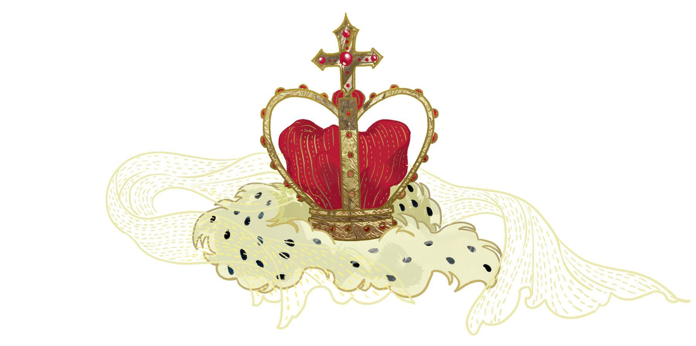
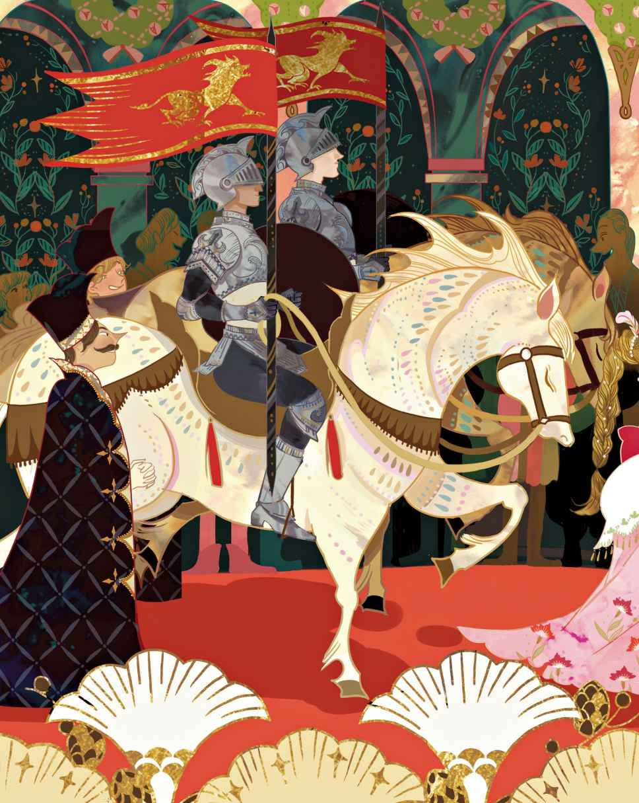
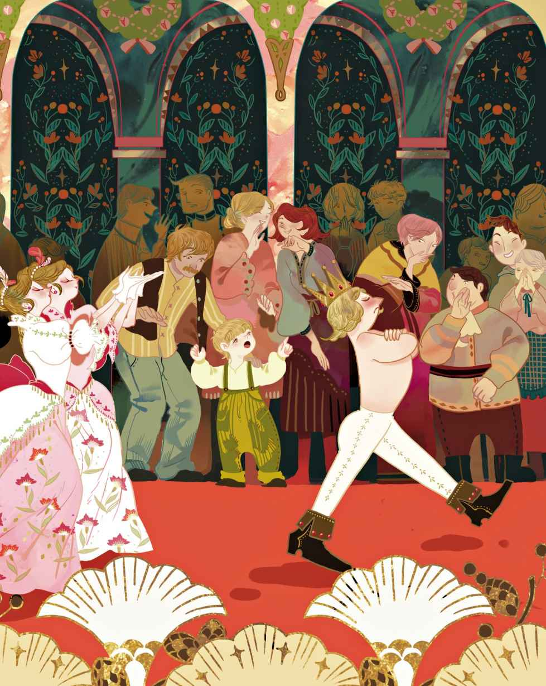

# 国王的新衣

很多年以前有位国王对穿衣打扮极为讲究，为了添置新衣，他将钱财挥霍一空。他对军队漠不关心，对戏院也毫无兴趣，马车通常闲置不用，只有在显摆自己的新衣服时才会出行。每天的每个钟头，他都要穿不同的外衣。当人们谈起国王的时候，不管是什么国王，大家通常会说：“国王在会议室里。”然而这里的人们可不这么说，他们通常说的是：“国王在他的更衣室里。”

在他所居住的庞大城邦，生活总是那么愉快而奢华。每天都有外来者进城，而这些外来者当中混入了两个骗子。他们谎称自己是织布工，而且还让人们信以为真了。这两个人还声称他们能织出最为华贵的衣裳，只要你能想象得到，他们就能办到。他们织出的衣服不仅颜色和纹案异乎寻常地好，还有一种奇特的功能：对于那些不称职的人，抑或傻得不可思议的人，这种衣服是看不见的。

“那种衣服一定很适合我。”国王心想，“只要我穿上那种衣服，我就能看出朝中哪些人并不称职，还能明辨智者和傻瓜。没错，我势必要尽快把这样的衣服弄到手。”他向那两个骗子支付了一大笔钱，让他们立即展开工作。

那两人架起两台织布机，装模作样地织起布来，实际上织布机上什么也没有。他们要来最上等的蚕丝和最纯的金丝，然后全部塞进了自己的行囊，转而在空无一物的织布机上工作至深夜。

“我想知道一下，那两个织布工的进展如何。”国王心想。不过，但凡是不称职的人，都会看不见那种织物。一想到这点，他便感到有点不自在。他固然还没到自我怀疑的地步，不过他认为还是先派其他人前去打探一番比较好。所有臣民都听说了那种衣服的奇异功能，每个人都兴致勃勃，想要瞧瞧别人究竟能有多愚蠢。

“我要派出我最忠诚的大臣。”国王下了决定，“他会是最佳人选，一定能告诉我那些织物究竟是个什么模样，因为他是明察秋毫之人，没有谁会比他更称职。”

于是，忠诚的老臣前去工作间探查，而那两个骗子正坐在里头，对着空荡荡的织布机劳作个不停。

“老天，快帮帮我，”老臣心想，他的眼睛瞪得老大，“我完全没看见任何东西。”不过他没在嘴上这么说。

两个骗子大方地请他靠近一些，以便看清那些精美绝伦的纹案和美丽的色彩。他们指着空的织布机，而那可怜的老臣拼命地盯着那东西，却还是什么也看不到，因为那里压根儿就没有任何东西。“老天，发发慈悲吧，”他心想，“难不成我是个傻瓜吗？我可从没怀疑过自己啊。这事千万不能被人知道，难道我作为大臣并不称职？我绝不能让这事走漏出去，绝不能承认自己看不见那件衣服。”

“告诉我们，你觉得这件衣服如何？千万别有所保留。”两个骗子中的一个说道。

“噢，它太美了——简直迷人极了。”老臣透过他的眼镜假装凝视起来，“何等美丽的纹案，何等美丽的色彩！毫无疑问，我一定会向国王禀报，这件衣服是多么令人欣喜。”

“听到您这么说，我们实在太高兴了。”骗子们说。他们继而就所有色彩介绍了一番，还对那些错综复杂的纹理进行了详解。老臣可谓全神贯注，这样他才能把一切转达给国王。他也是这么做的。

很快，骗子们又要了更多的钱、更多的蚕丝和金丝，说是为了继续织衣服。可实际上，那些东西全都进了他们的腰包，没有一根金丝用在织布机上，虽然他们看上去总是在不辞辛劳地工作。

不久后，国王又派出另一位信得过的官员前去查看工作进程，看还要多久才能完工。这位官员重蹈覆辙，他看了又看，始终没能从织布机上看出任何东西。

“这件东西简直妙不可言，对吧？”骗子们问他。他们假装展示和形容着那件并不存在的衣服。

“我知道自己并不傻。”官员心想，“照这么看的话，多半是因为我当官当得不好。这可真诡异。既然如此，就绝对不能让任何人知道。”于是他对着那件看不见的衣服称赞了一番，声称自己为这美丽的色彩和精致的纹案而感到欣喜。他是这么告诉国王的：“那件衣服简直把我迷住了。”

全城都在议论这件美轮美奂的衣服。国王也想亲自见识一番，尽管它仍在织布机上。他找来一众随行人员，其中包括那两位深得信任的老官员——他们已经见过两位织布工——一起去见那两个骗子。他看见两人正在全力以赴地工作，可是织布机上却没有任何丝线。

“简直精美绝伦，”两位自欺欺人的官员说道，“快瞧瞧啊，陛下，多么好看的色彩！多么精细的做工！”他们指着那台空无一物的织布机，心想别人应该都能看见那匹衣料。

“这是怎么回事？”国王心想，“我什么也看不见嘛。这真是太可怕了！难道我是个傻瓜？难道我配不上这个王位吗？简直是史无前例的怪事一桩！”“——噢！美极了，”他说，“我致以最高的赞誉。”说着，他还对着空无一物的织布机点头表示赞许。尽管他什么也没看见，但他是不会承认的。

他的随行官员们看了又看，谁也没看出个所以然，不过他们纷纷附和国王的说法，众口一词地说道：“噢！简直漂亮极了。”他们还建议，国王应该为即将举行的盛大游行，穿上用这种精美绝伦的布匹织就的服装。“美轮美奂！惊艳至极！无与伦比！”随行官员们你一言我一语，每个人都极力装出欢欣雀跃的样子。国王给骗子们颁发了勋章，让他们戴在纽扣眼上，还赐封他们为“织布爵士”。

游行前夕，为了完成国王的新衣，两个骗子彻夜劳作，点燃的蜡烛足有六根都不止，捣腾出一幅十分忙碌的赶工景象。他们装模作样地从织布机上取下衣服，举起硕大的剪刀在空气里又剪又裁。最后他们说：“现在，国王的新衣终于完工了。”

之后，国王亲自带着他的皇室成员和其他贵族前来了。两个骗子各自抬起一条胳膊，仿佛正托着什么东西。他们说：“这是裤子，这是上衣，这是披风。”他们言之凿凿，对每件衣服都如数家珍。“所有的衣服都如同蜘蛛网一般轻盈，穿上它们的人会觉得自己根本就没穿衣服，而这恰恰是因为它们的轻柔舒适。”

“说得对极了。”所有的皇亲国戚统统表示赞同，其实他们什么也没看见，因为那儿根本就没有任何衣服。

“尊贵的陛下，您要是愿意屈尊在此宽衣解带，”骗子们说，“那我们这就帮您在长镜跟前换上新衣。”

国王把自己脱了个精光。于是两个骗子假装为他穿上新衣，一件接着一件。他们围着他的腰际忙得团团转，就好像在给他扎紧什么东西——那想必是他的拖裾——国王不停地转身，对着镜子照了又照。

“陛下的新衣看上去真是棒极了，多么合身哟！”他听见所有人都这么说，“那纹案，实在太美了！那色彩，真是恰如其分！这是一身高贵华丽的装束。”

接着，负责游行事务的大臣宣布：“陛下的天篷已在外恭候。”

“好的，我想我已经准备好了。”国王说,他又对着镜子转了一次身。“这身衣服相当合身，难道不是吗？”他仿佛在兴致盎然地打量着自己的服装。

那些帮国王托拖裾的皇家人员全都弯着腰，伸手触及地板，就好像他们真的都摸到了他的裾摆。然后他们便假装高高地举起、托住那裾摆。他们根本就不敢承认，自己的手里其实空无一物。

就这样，国王在他那豪华的天篷底下开始了他的公开游行。街上的人们，以及在窗口观看的人们都说：“噢，国王的新衣多么好看啊！织布工为他量身定制的衣服是不是完美极了？快看他那长长的拖裾！”没有人承认自己其实没看见任何衣服，因为那只会证明自己要么是个不称职的人，要么是个傻瓜。而在此之前，国王穿过的所有衣服，都没有获得过如此彻底的成功。

“可是他身上什么也没穿呀。”有个小孩子说道。

“大家可有听到过如此纯洁的天真话？”孩子的父亲说。于是人们交头接耳起来，把孩子说的话传开了：“他什么也没穿。有个孩子说他什么也没穿。”

“他身上什么也没穿！”最后，所有的臣民都喊了出来。

国王开始哆嗦了，因为他心想大家应该是对的。不过他又想：“游行还是得继续。”于是他走得更加昂首阔步了，而他的皇家人员仍然高高地托着那根本就不存在的拖裾。
