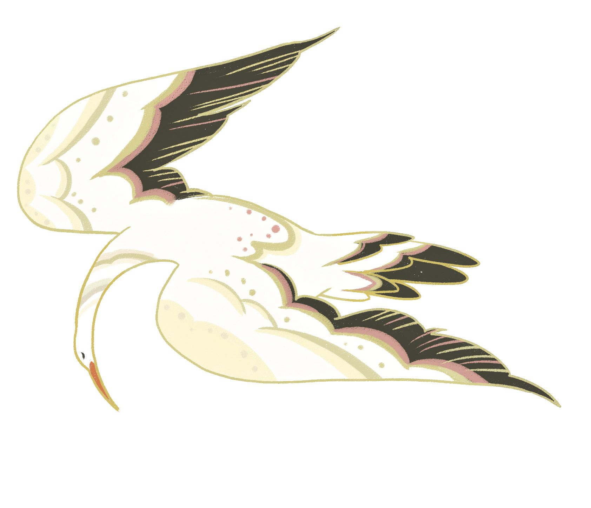
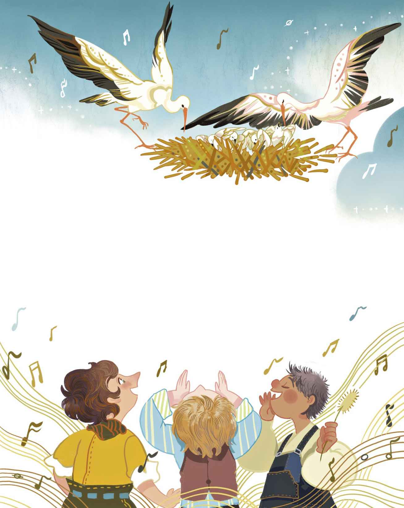
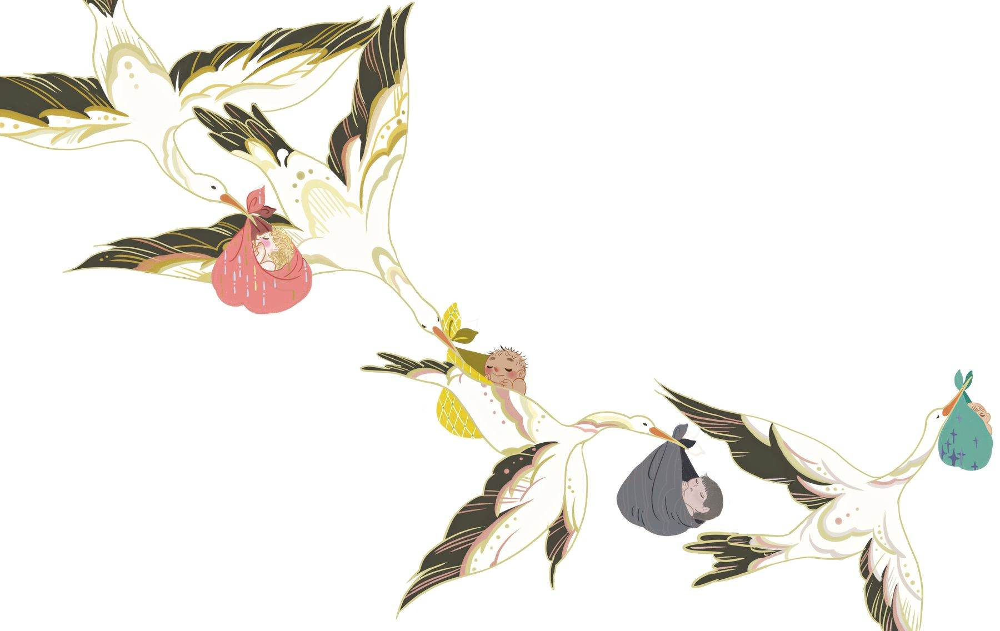

# 鹳鸟

在一座小村庄的最里头有一栋房子，房子的屋顶上筑有鹳鸟的巢，鹳鸟妈妈和她的四个孩子就住在里面。孩子们伸着脑袋和小小的、黑色的喙（你瞧，孩子们的喙尚未变成红色，不过那也是迟早的事）。就在不远处，鹳鸟爸爸独自站在屋脊上，身姿笔挺又硬朗。他用单腿站立，俨然是一个站岗的哨兵，没有丝毫松懈。老天，他看上去是多么英姿飒爽，只用一条腿站在那儿！他这么纹丝不动的，你搞不好会以为他是用木头雕刻出来的！

“我这架势一定很不赖吧，我的妻子在鸟巢旁边有了一个哨兵呢！”他心想，“人家并不知道我是她丈夫，他们只会以为我是受命于此，在这儿站岗的公务人员。不得不说，我这活儿干得可真漂亮。”

于是他继续用单腿站立着。

一群孩子正在街上玩耍，此时他们看到了鹳鸟，其中胆子最大的男孩开始唱起关于鹳鸟的歌，其他人则跟着一起唱。他们跟领头的一样，只唱了自己记得的那部分：

“鹳鸟，鹳鸟，长腿的鹳鸟，

你还是飞去妻子身边为妙。

她正等候着你，她就在鸟巢，

摇着四个宝宝，哄它们睡觉。

“老大会被吊死，

老二会被啄死，

老三会被烧死，

而老四会被压死！”

“听听他们都在唱些什么！”小鹳鸟们嚷道，“他们说我们会被吊死和烧死！”

“别理会那些，”鹳鸟妈妈没好气地答道，“别去听他们的，这样就不会有什么事的。”

然而那些男孩仍在继续唱，用手指嘲讽地指着鹳鸟一家。只有一个男孩，那个名叫彼得的男孩，他说这样取笑鸟儿是可耻的，就没有参与。

鹳鸟妈妈试着安抚孩子们。“完全不必放在心上。”她说，“看看你们的父亲，他照样那么平静自如地站着，而且照样只用一条腿！”

“可是我们吓得不轻呀！”小鹳鸟们坚称，他们把脑袋深深地缩进了鸟巢里。

第二天，那些孩子又出来玩耍，见到鹳鸟一家的时候，他们又唱了起来：

“老大会被吊死，

老二会被烧死。

> **注 66**　前文说的是老二被啄死，老三被烧死，不知何故第二次唱的时候变成了老二被烧死。

“我们真的会被吊死和烧死吗？”小鹳鸟们问道。

“不，当然不会，”鹳鸟妈妈回答说，“你们将学会飞翔！我会教你们的。然后我们就能飞过牧场，去拜访青蛙们了。它们会在水里对我们卑躬屈膝，唱着：‘呱！呱！’然后我们就把它们全吃掉。那肯定会很带劲儿的哟！”

“再然后呢？”小鹳鸟们问道。

“再然后，整个国境之内的所有鹳鸟，会集结起来为秋季的迁徙进行演习。”鹳鸟妈妈继续说道，“所以你们也该知道，学会如何飞翔届时会有多么重要，假如你们没能学会，那么领队的就会用他的喙把你们统统啄死。所以啊，当我开始教你们的时候，你们可得集中注意力，好好学着才行哦。”

“噢，我们会被啄死，就跟那些男孩说的一样！听啊，他们又来了，又唱起来了！”

“别理会他们，把注意力集中到我这儿来，”鹳鸟妈妈说，“在大规模演习结束后，我们将会飞去气候温暖的国度。噢，那儿离这地方很远，要越过重重的山脉和森林。届时我们会抵达埃及，那里有四个角的石头房子，上头还有个顶点，高得直入云霄。他们把那些房子称为金字塔。那些房子极为古老，远远超出我们鹳鸟的想象范畴。他们那儿还有一条河

> **注 67**　即尼罗河。

“噢！”小鹳鸟们喊了起来。

“是的，千真万确。那里棒极了，你们什么都不用做，只管成天吃东西便可。而当我们在那里享乐的时候，这里的树上连一片绿叶都不会剩下，会变得异常寒冷，云朵都会冻成片状，然后变成白色的碎片坠落下来。”

当然了，她说的其实是雪花，只是她不知道还有什么别的办法，能向小鹳鸟们解释雪花这种东西。

“那么那些淘气的男孩也会冻成碎片吗？”小鹳鸟们问道。

“不会，他们不会变成那样的，”鹳鸟妈妈答道，“不过他们也好不到哪儿去，只能郁闷地枯坐在阴暗的屋子里。而我们，那可就不一样啦，我们会在外国的土地上，在花丛间，在温煦的阳光中飞翔。”

一段时间以后，小鹳鸟们长大了一些，他们已经能够从鸟巢里站立起来观察自己身处的这个宽广世界了。每天，鹳鸟爸爸都会给他们带来色味俱佳的青蛙、鲜美的小蛇，还有各种各样鹳鸟喜欢的山珍海味。他耍把戏逗弄他们的时候，他们笑得多么开心呀！他会把脑袋整个儿向后枕在尾巴上，然后把喙咬得嘎嘎作响，如同打击乐器一般。然后他会给他们讲故事，内容不外乎都是关于他们有朝一日将会亲眼看到的湿地。

终于有那么一天，鹳鸟妈妈让他们出了巢，来到了屋脊上面。

“现在，”她说，“是时候让你们学习飞翔了。”噢，他们是那么摇摇晃晃、步履蹒跚，想利用翅膀找到平衡，可还是差点就跌下了屋顶！

“现在看着我，”鹳鸟妈妈招呼道，“像这样把持住你们的脑袋！像这样把腿迈开！一，二！一，二！只有这样，你们才能学有所成！”

说着，她从屋顶飞起一小段距离，小鹳鸟们笨拙地跟着尝试。砰的一声！他们摔到了地上。他们的身子还是太沉了。

“我不要飞了。”最小的那只小鹳鸟一边抱怨，一边爬回了鸟巢，“去什么气候温暖的国家，我才不在乎呢！”

“噢，那看来你是想等到冬天到来的时候留在这儿活活冻死，是吧？”鹳鸟妈妈质问道，“你想要那些男孩跑来吊死你们、打死你们、烧死你们，对吧？行啊，我这就把他们叫来！”

“噢，不！别去叫他们！”那只小鹳鸟喊道，他再次跳出鸟巢来到屋脊上，跟其他小鹳鸟待在了一块儿。

到了第三天，他们终于能飞起来一点儿了，于是他们觉得自己应该已经可以高飞至空中，然后不挥动翅膀，在天空中盘旋，然而——当他们真的尝试的时候——砰的一声！——他们又摔下来了！他们这才发现，想要停留在空中，还是要挥动翅膀才行。

有一天，那些男孩又来了，他们又唱起了那首歌：

“鹳鸟，鹳鸟，长腿的鹳鸟！”

“我们可不可以飞下去，把他们的眼珠子啄出来？”小鹳鸟们气急败坏地问道。

“当然不可以，”鹳鸟妈妈毫不迟疑地回答说，“不要理会他们。把注意力放到我身上。这才是更为重要的事情。一，二，三！现在我们朝右边飞。一，二，三！现在朝左边飞，飞去烟囱那儿。好极了。最后那次飞得太完美了，看来你们明天就可以跟着我飞去湿地了。有几家很不错的鹳雀也会带着他们的孩子去那里，我要让他们瞧瞧，我的孩子是最棒的。记得要趾高气扬一点儿，那样会让你们看上去状态更佳，令你们变得引人注目。”

“可是那些粗鲁的男孩，我们就不能先去报复一下吗？”小鹳鸟们问道。

“噢，他们要是喜欢瞎嚷，就让他们去嚷好了。”鹳鸟妈妈回答道，“你们将乘着云朵飞翔，飞去那片有金字塔的温暖国土，而他们将在寒冬中瑟瑟发抖。到那时，他们那儿连一片绿叶也没有，连一只甜苹果也不会有。”

“但我们还是要报复！”小鹳鸟们交头接耳，然后继续练习飞行。

这会儿，在街上的男孩们当中，最坏的就是领头唱歌的那个男孩。他还是个很小的男孩，应该还未满六岁，不过小鹳鸟们觉得，他至少已经有一百岁了，因为他的个头比他们的爸爸妈妈大得多。他们又怎么弄得清小孩和大人的岁数呢？

小鹳鸟们决计向这个男孩复仇，因为就是他最先开始唱那首歌的，而且他总是这样。现在小鹳鸟们长得更大了，他们下定决心要采取行动。最后，为了让他们安静下来，鹳鸟妈妈不得不向他们保证，那些男孩一定会受到报复，不过在他们离开这个国度的那天到来之前，他们不可以动手。

“首先，在大规模迁徙演习期间，我们会观察你们的表现如何。”她告诫他们，“如果你们表现得不好，惹得领队用他的喙来啄死你们，那就说明那些男孩唱得没错，至少把你们啄死是被说中了。让我们拭目以待吧。”

“好的，你们等着瞧吧。”小鹳鸟们回答说。老天！他们变得多么努力！他们每天都在练习，练出了那么灵巧和轻盈的飞行技艺，光是看着他们飞翔就是一种享受。

最后，冬季来临，所有鹳鸟开始集结演习，他们即将飞往气候温暖的国度，摆脱这里的寒冬。那景象是何等的壮观！所有的小鹳鸟必须飞越森林和村庄，展示出他们所学的本领，因为他们将要面临的会是一段极为漫长的征途。小鹳鸟们表现得很好，他们的成绩单上的评语是：“极为出色，善于捕捉青蛙和蛇！”这可是最高的评价，意味着他们可以将捕获的青蛙和蛇作为奖品吃掉。于是他们大快朵颐！

“现在我们要开始复仇了！”他们对着鹳鸟妈妈嚷道。

“好吧，”鹳鸟妈妈同意了，“我有了个主意，应该会是比较好的做法。我知道有个池塘，人类的孩子都躺在那里面，直到鹳鸟们出现，把他们带去他们的父母身边。躺在那个池塘里的漂亮孩子们做着甜美的梦，那是他们以后都不会再有的美梦。所有父母都想有个小孩子，而每个小孩子又都想有个小妹妹或小弟弟。现在，我们要去那个池塘，带上一个小孩子，妹妹或弟弟都行，把他们带给那些不唱恶劣的歌曲、不嘲笑我们的孩子。而那些坏孩子，他们将一无所有。”

“那么，那个顽劣、丑陋、带头唱歌的男孩呢？”小鹳鸟们很想知道，“我们要如何处置他？”

“在那个池塘里，”鹳鸟妈妈不紧不慢地说道，“还有一个小孩子，他已经在睡梦中死去。我们把他带给那个男孩。他会因此哭泣，因为我们给了他一个死去的弟弟。而那个好孩子，他曾对取笑我们感到羞愧！我们会给他送去一个弟弟或妹妹！而且，鉴于他的名字叫彼得，你们以后也都将被称为彼得！”

事情正如鹳鸟妈妈所说的那样。所有的小鹳鸟，都被取名为彼得。直至今日，所有的鹳鸟都被称为彼得。
