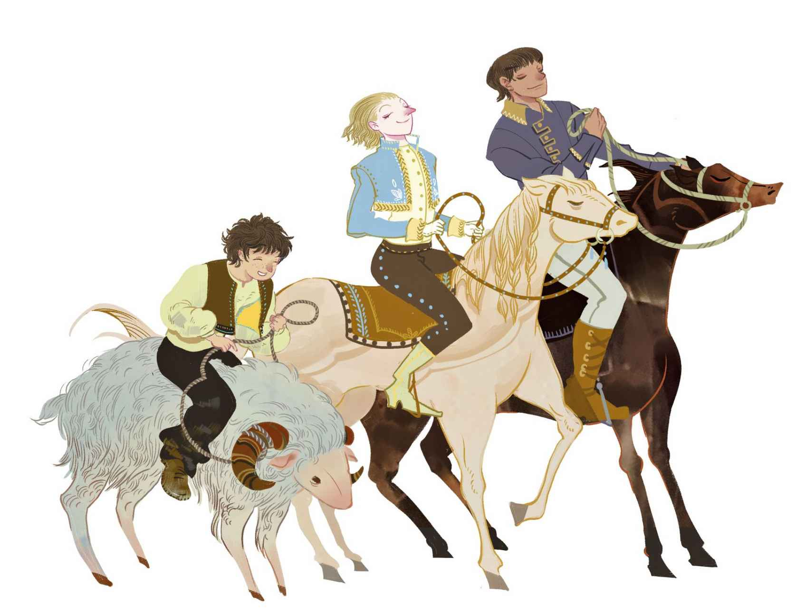

# 笨汉斯

乡间有一栋老旧的宅邸，里头住着老乡绅和他的两个儿子。这两个儿子都机智过人，他们认为自己已经聪明到了难以形容的地步。他们决定前去向国王的女儿求婚。他们有权这么做，因为公主已经向公众宣布，谁展现出的口才最好，谁就能成为她的丈夫。

兄弟俩预先做了八天准备。他们的时间有限，不过这也已经足够了，因为他们本来就很有能耐，每个人都知道他俩多有本事：其中一人把整本拉丁语词典记得烂熟于心，还把近三年的报刊内容全部背了下来——背得滚瓜烂熟，正着背、倒着背都不在话下。另一人通晓法律条文，但凡是市议员必须知道的条款，他全都牢牢地掌握了下来。理所当然地，他很确信自己在政务方面一定能应对自如。此外，他还会在裤子的背带上绣图案——他不仅是个博学的正经人，手艺也十分了得。

“我会得到公主的！”他俩都这么说。他们的父亲给了他们一人一匹漂亮的马。能背诵词典和报纸的那个儿子分得一匹煤黑色的马；精通政务和刺绣手艺的那个儿子分得一匹奶白色的马。然后他们在嘴角上抹了些鱼肝油，好让嘴皮子变得更溜。

仆人们全都聚集在院子里送他们上马出行，也就在此时，第三个兄弟出现了。确实还有一个兄弟，虽然从来就没人正眼瞧过他，因为他并不像那两个兄弟一样有学问。事实上，大家都管他叫“笨汉斯”。

“你们穿着最好的衣服是要上哪儿去啊？”笨汉斯问道。

“我们要去国王的宫殿向公主求婚，国王的部下已经在全国正式发布了消息，你难道没有听说吗？”于是他们把事情告诉了汉斯。

“老天哟，”笨汉斯说，“我觉得我也得去！”然而他的兄弟们爆发出一阵大笑，骑上马便离开了。

“父亲，”笨汉斯喊道，“也给我一匹马吧，我也想要结婚。如果公主接受我，那我就跟她结婚；如果她不接受我，那我还是要跟她结婚。”

“一派胡言！”老乡绅答道，“在我这儿，你一匹马也别想要到。啧啧，你连怎么得体地讲话都不知道。你的两个兄弟才是有脑子的人。”

“如果马不行的话，那我就用公羊吧。”笨汉斯说，“那只羊是我自己的，它驮着我上路没问题。”于是他骑上公羊，用鞋跟戳了戳羊肚子，一路飞奔起来。

“哟呼！真够快的！我来啦！”笨汉斯吆喝着，唱起歌来。他的嗓门儿很大，声音传得老远。

不过他的两个兄弟仍遥遥领先。他俩互相不置一词，因为都在琢磨着如何来一场了不起的演讲。那是自然的，这种事确实得仔细准备一番，把说辞记熟了才能有备无患。

“嗨哈！”笨汉斯喊道，“我来啦！瞧我在路上发现了什么！”他把自己捡到的死乌鸦拿给他们看。

“蠢货！”他的兄弟们说，“你捡那种东西干什么？”

“哈哈，我要把它送给公主！”

“行啊，你去送吧。”他们一边骑着马，一边大笑道。

“嗨哈！我又来啦！瞧瞧这回我发现了什么！这种东西，可不是每天都能在路上捡到的哟！”他的两个兄弟又转过头来，想看看汉斯这回又捡了什么。

“蠢货！”他们说，“那不过是一双旧木鞋，而且鞋帮子都破成那样了。这也要拿去送给公主啊？”

“那是当然的啦。”笨汉斯回答道。他的兄弟们再次在马背上大笑起来，他们仍然跑在他前面。

“嗨哈！我又来啦，”笨汉斯又喊道，“捡到的东西越来越好啦！这一回可真是好东西呀！”

“嗯，这回你又捡到了什么呢？”兄弟们问道。

“噢，我还真不能告诉你们，”笨汉斯说，“公主该多么喜欢这东西哟！”

“呃！”兄弟俩说，“得了吧，那不过是一摊沟里的烂泥！”

“是啊，没错，”笨汉斯说，“可这是最棒的烂泥。瞧，它正在从指缝间溜走呢。”于是他赶紧把烂泥装进了口袋。

他的兄弟们仍在他前头以最快的速度疾驶着，如此这般，他们抵达城门的时间足足比汉斯早了一个钟头。在大门口，每个跑来求婚的应征者都拿到了一张号码票。他们一到场就开始排队，六人一排，挤作一团，连胳膊都抬不起来。这招可真聪明，若不是如此，他们肯定会把排在前面的人撕成碎片，因为每个人前面都排着一个人。全城的居民都围在城堡边上，想要透过窗户看看公主是怎么对付应征者的，只见那些进去后的年轻人全都变得张口结舌。

“这个不行！”公主说，“让他出去！”

眼下，轮到那个背过词典的兄弟上场了，可是他在排队的时候已经把背过的内容忘得一干二净。地板在他的脚下咯吱作响，而天花板由许许多多的镜面组成，弄得他只看到自己站在自己的脑袋上。每扇窗户那儿都站着三个书记员外加一个市议员，他们会把应征者讲的每个字都记录下来，以便这些内容能在第一时间登上报纸，然后去街角售卖，两便士一份。

这真是一种可怕的考验。旁边还有好几个烈火熊熊的火炉，连排烟管

> **注 68**　老式火炉上面接有金属排烟管。

“这地方真是热得要命。”眼下这位兄弟说道。

“这是因为父王今天在这儿烤鸡。”公主说。

“坏了！”

> **注 69**　这里是心理活动，并不是实际讲出口的话。

“这个不行！”公主说，“让他出去！”于是他不得不离场。

现在，轮到第二个兄弟上场了。

“这里真是暖和得要命。”他说。

“是啊，我们今天在烤鸡。”公主答道。

“什么——你说什么——呃——什么来着？”他开始结巴了，这些全被书记员们记录了下来，“什么——你说什么——呃——什么？”

“这个不行，”于是公主又说，“把他带出去！”

现在轮到笨汉斯了，他直接骑着公羊就进去了。

“这里真是热得要命啊。”他说。

“我在烤小鸡呢。”公主答道。

“哇，那太好了！”笨汉斯说，“我想把我的乌鸦也烤烤可以吗？”

“请便。”公主说，“对了，你有用来烧烤的工具吗？我既没有蒸煮锅也没有平底锅。”

“我有。”笨汉斯接过话来，“这是我的蒸煮锅，上面还有个小把手呢！”说着，他取出那只旧木鞋，然后把乌鸦塞了进去。

“哇，这样就能有一顿美味佳肴了！”公主说，“可是我们要怎么才能弄到调味酱呢？”

“我口袋里就有。”笨汉斯又接过话来，“其实啊，我这儿多得不行呢，倒出来一点也不碍事。”说着，他从口袋里倒出一点烂泥来。

“我喜欢这位！”公主说，“不管问什么，你总有办法解决，而且你的口才很好。我要选你做我丈夫。不过，我们所有讲过的话和正在讲的话，都被记录下来了，明天就会在报纸上刊登出来，这点你知道吗？你看那边，每扇窗户那儿都有三个书记员外加一个老市议员。那位市议员可是所有人里面最靠不住的，他什么都不懂！”

她说这些，只是想吓唬吓唬他，但所有书记员都幸灾乐祸地咯咯偷笑起来，把墨水滴子都洒在了地板上。

“噢，这些都是正派人！”笨汉斯说，“至于那位议员，我一定要把我身上最好的东西送给他。”说着，他翻出口袋，把湿漉漉的烂泥扔在了议员的脸上。

“聪明之举！”公主说，“我从没这么干过，不过这下我算是学到一手啦！”

就这样，笨汉斯当上了国王，拥有了妻子和王冠，坐上了王座。这个故事，就是从那位市议员捣腾出来的报纸上读到的——不过这并不可靠，你们可别当真哦。
