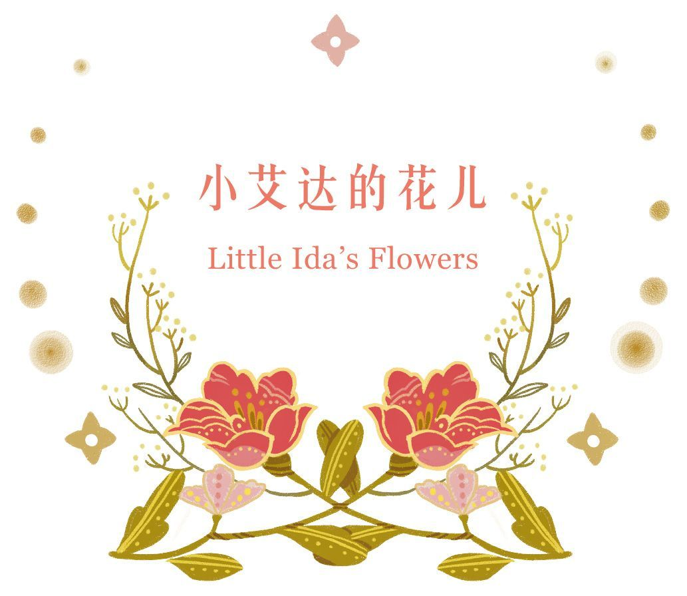
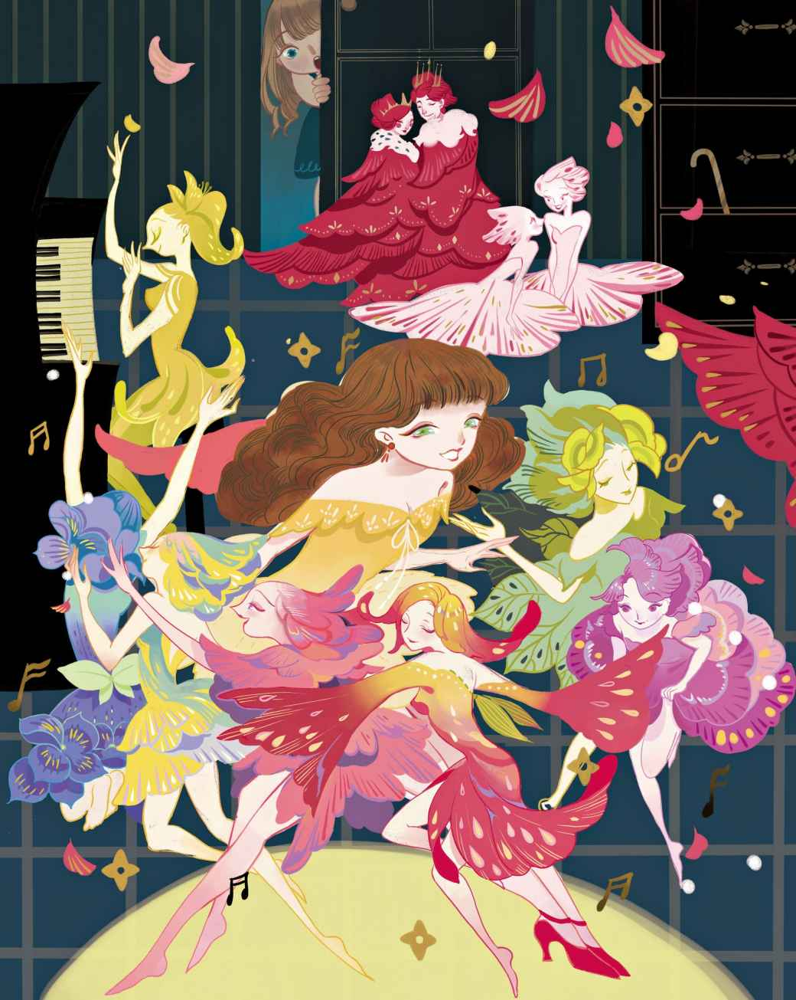

# 小艾达的花儿

“我可怜的花儿们，就要这么死去了。”小艾达说，“昨晚它们还很漂亮呢，可是现在，每片叶子都枯萎、凋谢了。它们为什么会这样呢？”她问那位学生，他正坐在沙发上。

她很喜欢他，因为他会讲那么多好听的故事，还会在纸上剪裁出曼妙的图案，比如在心形的轮廓里藏着跳舞的小妇人，还有各式各样的花朵，各种带有可开关门扇的城堡。他是一个快乐的男生。

“今天我的花儿看上去病恹恹的，这是为什么呢？”她又问道。说着，她把枯萎的花束拿给他看。

“它们身上发生了什么，你不知道吗？”学生说，“昨天夜里，它们参加了一场舞会，所以这会儿累得撑不起脑袋啦。”

“花儿们可不会跳舞。”小艾达说。

“噢，其实它们会跳的。”学生说，“只要等到夜幕降临，我们去睡觉的时候，花儿们就会穿上精致的衣裳，举行欢闹的舞会派对。差不多每个夜晚，它们都会举行这样的舞会。”

“花儿中的小孩子不能参加这样的舞会吗？”

“小雏菊们可以参加，来自山谷的小百合们也可以参加。”

“这些顶漂亮的花儿，它们在哪里跳舞呢？”小艾达又问道。

“你有去过那座美丽的花园吗？它就在城外，在国王消夏时居住的城堡附近。记着——在那里，只要撒上一些面包屑，天鹅们就会向你游来。相信我吧！那就是最漂亮的花儿们跳舞的地方。”

“昨天我就在那儿，跟我妈妈一起，”小艾达说，“可是那儿的树上连一片叶子都没有，花儿也一朵不剩。它们都到哪里去了呀？去年夏天我还看到过很多呢。”

“它们都在城堡里呐，那是当然的。”学生说，“等国王和他的官员们回城，花儿们就悄悄地从花园跑进城堡，然后在那儿寻欢作乐。你真该看看它们。两朵最可爱的玫瑰花分别攀上了国王和王后的宝座，成了花国王和花王后。所有的红色鸡冠花都在两侧列队成排，它们站直身子，弯腰鞠躬，看上去就像是皇室寝宫里的侍从。接着登场的是各种盛装打扮的花朵，盛大的舞会就此开场。蓝色的紫罗兰们是海军学员，风信子和藏红花是它们的舞伴，它们用‘女士’称呼‘她们’。而郁金香和卷丹百合是年长的现场看护，会确保舞会妥善进行，监督大家的言行举止是否得体。”

“可是，”小艾达又说，“花儿们在国王的城堡里跳舞，难道就没有人来惩罚它们吗？”

“没有任何人知道这件事，”学生说，“诚然，城堡里有个老看守，他在那儿看管着一切。有时他会带着大串的钥匙进行夜巡，但是花儿们只要一听到钥匙的声音就会立即保持安静，纷纷躲藏起来。它们只从窗帘后面探出脑袋来偷看，然后老看守就要说了：‘我在这里闻到了花儿的味道。’可是他什么也没能瞧见。”

“多好玩呀！”小艾达拍起手来，“那我会不会也看不到那些花儿呢？”

“噢，那很容易。”学生说，“下回你再去那儿的时候记得从窗户朝里偷看，就能看到它们了，我就是这么做的。我看到一朵修长的黄色百合花躺在沙发上，把自己扮作了宫女。”

“那植物园里的花儿们可以去城堡吗？它们能走这么远吗？”

“当然能啦。只要它们愿意，就能一路飞翔。你可有看到过美丽的蝴蝶——白色的、黄色的，还有红色的？它们看上去几乎就像花儿一样，而且，它们过去真的就是花儿呢。它们就是花儿，脱离花茎，跃至高空，在空气中扇动花瓣，仿佛那些花瓣全都变成了小翅膀。于是它们就这样飞了起来，如果表现得够好，那么就能获许飞上一整天，而不用回家端坐在花茎上。久而久之，它们的花瓣就真的变成了翅膀。你其实早已亲眼目睹，不过嘛，植物园里的花儿们很可能还没有去过国王的城堡，也不知道每晚到那里去会是多么有趣。所以啊，我来告诉你如何给那位植物学教授一个惊喜。你知道我说的哪位——他住得离这儿很近。没错，下回你去植物园的时候，告诉他那儿的一朵花，就说城堡里正在举办一场盛大的舞会。花儿们会交头接耳，然后齐齐飞走。等到教授来到植物园，他就会发现花儿们全都不见了，而他无论如何也不会想到它们都去了哪儿。”

“花儿们怎么交头接耳呢？你知道花儿是不会说话的。”

“它们确实不会说话，”学生表示同意，“但是它们能传递暗号啊。你可有留意过，不管在什么时候，只要有微风拂过，花儿们就会互相点头，还会用叶片做手势。它们这样，就是为了互相交流呢。”

“那教授能读懂这种花语吗？”

“他当然能啦。有一天早上他来到植物园，瞧见一株大荨麻正在用它的叶片朝一朵靓丽的康乃馨巧言搭讪，‘你看上去真漂亮，我是多么爱你哟。’教授不怎么喜欢这种勾当，于是压住了大荨麻的那些叶子，因为那就是它的手指。结果他被狠狠地蜇了一下，此后他就再也没敢把手放在荨麻叶上咯。”

“噢，这多有趣呀！”小艾达开怀大笑起来。

“怎么会有人朝小孩子的脑袋瓜里灌输如此荒谬的东西？”这时一位来访的议员说道。他看上去颇为严肃，这会儿也坐到了沙发上。他一点也不喜欢这个学生，每当他看到学生裁剪出那些奇怪、有趣的图案，他就会嘟嘟囔囔——有时是悬挂在绞刑架上的人手里拿着一颗心，意思是此人偷走了人们的心；有时是骑着扫帚的女巫用鼻子顶着自己的丈夫。对于这些东西，议员极为不赞成，他总是会像眼下这么说道：“怎么会有人朝小孩子的脑袋瓜里灌输如此荒谬的东西——如此愚蠢的幻想？”

然而对小艾达来说，学生告诉她的有关花儿的一切都是那么的不可思议、妙趣横生，她还在想着那些东西呢。她的花儿们之所以抬不起脑袋，是因为它们彻夜欢舞，疲惫不堪。嗨呀，它们肯定是累出病来了。她给它们带去了一张漂亮的小桌子，平时她总是把玩具放在上面。这张桌子的抽屉里装满了最好玩的东西，她的娃娃索菲正躺在娃娃床上睡觉，不过小艾达对她说：“索菲，你真的可以起床啦，晚上再到抽屉里睡个够吧。我可怜的花儿们都病啦，今晚，要是我能让它们睡在你的床上，那它们也许会再次好起来的。”

她把娃娃拿起来的时候，索菲看上去气得要命。她一语不发地绷着脸，因为不能睡自己的床了。小艾达把花儿们放到了床上，然后给它们盖上小被子。她对它们说，一定要好起来，一定要好好躺着。说着，她又去给它们泡茶，这样它们明天就会好起来，就能起来活动了。她小心翼翼地放下娃娃床的床帘，这样早晨的阳光就不会晒到它们的脸蛋。

一整夜，她都想着学生所说的那些。爬到床上之前，她透过窗帘偷看着妈妈种的那些葱郁的盆栽——有风信子，还有郁金香。她轻声低语着：“我知道你们今晚会去参加舞会的哦。”

然而，花儿们假装没有听懂她的话，连一片叶子也没有动弹。不过小艾达早就知道了它们的秘密。

躺到床上以后，她久久地想象着花儿们在国王的城堡里跳舞的情景。看到那样的场景，该会是多么快乐啊。“我的花儿们真的会在那里吗？”她好想知道，接着便睡着了。夜里，当她再次醒来的时候，已经梦见过那些花儿，梦见了那个学生，还有那位议员。梦里，议员斥责了那个学生，他说那些东西简直愚蠢、荒谬至极。小艾达的睡房里阒然无声。夜灯的柔光铺洒在桌面上，小艾达的爸爸妈妈都睡着了。

“我的花儿们还在索菲的娃娃床上睡觉吗？”小艾达心想，“我真想知道一下。”

她从枕头上微微抬起头朝着半掩的门望去，她的花儿和玩具都在那儿。她侧耳倾听，好像有谁在弹奏钢琴。钢琴的声音那么细柔，比她听过的任何一次都要动听。

“我绝对敢确信，花儿们都在跳舞呐。”她自言自语道，“噢，我的天呐，我真想瞧瞧它们呀。”然而她不敢起身，因为那样可能会把爸爸妈妈给吵醒了。

“我好希望花儿们能到这里来！”她心想。可是它们不会。音乐声还在继续，是那么好听，她再也无法待在床上了。她踮起脚尖走到了门口，然后朝隔壁的房间悄悄看去。噢，多么奇妙——她在那儿看到了多么奇妙的景象！

隔壁房间里没有夜灯，却如同点了灯似的通明。月光透过窗户流淌到地板中央，看上去几乎就跟白昼一般明亮。风信子和郁金香在地板上连成长长的两排，没有一朵花儿留在窗台上。花盆变得空空如也，花儿们在房间里优美地起舞，它们旋转、摇曳，用修长的绿叶相互联结，组成了一条完整的花链。

钢琴旁边，坐着一朵高高的黄百合。小艾达记得它，因为去年夏天，那位学生说过：“百合花看上去是不是很像莱恩小姐？”那时所有人都笑了，而此时此刻她才明白，她们之间确实有一种动人的相似，百合花弹奏着钢琴的身姿真的跟那位年轻的女士像极了。它时而久久地屈身，把黄色的脸侧向一旁；时而又侧向另一旁，和着动听的音乐微微颔首。

谁也没有觉察到小艾达的存在。她看到有一朵身手灵活的蓝色番红花跳上了放玩具的桌子，然后径直来到娃娃床前，把床帘向后一撩，病了的花儿们就在里面，然而它们一下子就起身了。它们互相点头示意，也要去跳舞。那个破旧的扫烟囱工娃娃，它的下嘴唇已经破损，但也站了起来，向美丽的花儿们躬身致意。而花儿们看上去又恢复如初，它们跃下桌子融入了舞群，欢度夜晚的好时光。

似乎有什么东西从桌子上掉了下来。小艾达一瞧，原来是狂欢节过后留下来的桦木魔术棒。它跳下桌子，仿佛觉得自己也是一朵花儿。这根魔术棒还真的用纸玫瑰把自己打扮成了花儿的模样，而在它的脑袋上还顶着一尊小蜡像，蜡像小人头戴宽边帽，就跟议员戴的那种如出一辙。

魔术棒跳起了玛祖卡舞

> **注 70**　一种节奏轻快的波兰舞蹈。

忽然之间，蜡像小人变成了又高大、又权威的模样。他绕着身边的纸花飞快地转起圈子，还说道：“怎么会有人朝小孩子的脑袋瓜里灌输如此荒谬的东西——如此愚蠢的幻想？”那一刻，他活脱脱成了那位戴着宽边帽的议员，脸色蜡黄，脾气坏得不得了。不过纸花们予以了反击，它们朝着他那细瘦的小腿儿发动攻击，直到他瑟缩回去，再次变回了蜡质的小人。这场突如其来的变化是如此的荒唐而有趣，小艾达忍不住笑了起来。

那根权杖似的魔术棒舞到哪儿，上面的那位“议员”也不得不跟着舞到哪儿，不管他是变成又高大、又权威的模样，还是保持着戴黑色宽边帽的小蜡人形象。花儿们替他说了些好话，尤其是那些在娃娃床上休息过的、生过病的花儿。魔术棒这才消停下来，让他休息休息。

也就在这个时候，它们听到抽屉里传来一记响亮的撞击声。那里面放着小艾达的娃娃索菲，她正跟玩具们躺在一起。扫烟囱工赶紧跑到桌子边缘，然后用肚子贴住桌面，趴在那儿试图把抽屉给拉开一点儿。接着索菲便坐了起来，她看了看自己周围，然后露出一脸的惊讶。

“哇，大家正在举行舞会！”她说，“怎么就没人告诉我呢？”

“你愿意跟我跳舞吗？”扫烟囱工问她。

“你会是个不错的舞伴！”她说道，却转身背对着他。

她坐到了抽屉的边缘，希望会有一朵花儿来邀请她共舞。然而根本就没有花儿过来，于是她假装干咳起来：“咳，咳，咳！”可是，仍然没有花儿过来邀请她。更让她不舒服的是，扫烟囱工这会儿已经自己下去跳舞了，而且他跳得好极了。

没有一朵花留意到索菲的存在，哪怕一星半点的留意也没有。于是她让自己从桌子猛地摔到了地板上。这下子，花儿们都跑过来询长问短了，“你没伤着自己吧？”它们对她亲切极了，尤其是睡过她的娃娃床的那些花儿。好在她毫发无伤。小艾达的花儿们向她致谢，因为它们借用了那张漂亮的娃娃床，而娃娃床让它们好了起来。它们把她领到地板中央，那儿铺洒着明亮的月光，它们和她一起跳舞，而其他花儿们连成一圈，将它们围拢在里面。现在索菲一点儿也不气恼了，她说，大家可以继续睡她的娃娃床。对于自己睡在抽屉里面，她压根儿就不介意。

不过花儿们说：“谢谢你，可是我们用不上了。我们活不了太久，不可能继续睡你的娃娃床了。明天我们就会死去。请告诉小艾达，在花园里将我们埋葬，就埋在金丝雀之墓旁边。这样，等到来年夏天，我们又会再度生长，长得比过去更加美丽。”

“噢，你们不能就这么死去。”索菲说着，亲吻了所有的花儿们。

接着，画室的门打开了，更多的花儿们跳着舞一拥而入。小艾达简直无法想象，它们究竟是来自何处，莫非——嗨呀，它们一定是从国王的城堡那儿直接过来的。先是进来两朵高贵的玫瑰，它们戴着金质的小皇冠。这两位是花国王和花王后。接着是迷人的紫罗兰和康乃馨，它们向每一个人致意。它们还带来了随行乐队，身高马大的罂粟花和牡丹花吹奏着豌豆荚，吹得脸都憋红了。蓝色风信子和雪莲花摇晃出叮铃声响。那是一种多么奇异的音乐。其他花儿都跟着它们，大家一块儿翩翩起舞。蓝色的紫罗兰和粉色的报春花做了舞伴，而雏菊和山谷百合也做了舞伴。

所有的花儿都互相亲吻了对方，那场面看上去简直美极了。到了说晚安的时候，小艾达也悄悄回到了床上。睡着之后，她又梦见了所有目睹过的一切。

翌日天一亮，她就迫不及待地来到小桌子跟前，想看看那些花儿们是否还在。她掀开了罩在娃娃床周围的床帘。是的，它们还在那儿，可是它们凋谢得比昨天越发厉害了。索菲躺在抽屉里面，仍旧在小艾达所放的地方，看上去是那么困倦。

“你记得要跟我说什么吗？”小艾达问道。

可是索菲看上去呆愣愣的，她始终默不作声。

“你可真不好，”小艾达对她说，“想想它们对你多好呀，它们全都陪你一起跳舞呢。”

她打开一只小巧的纸盒，一只绘有鸟儿图案的纸盒，然后把死去的花儿们放了进去。

“这就是你们的美丽纸棺，”她对它们说道，“等到我的表兄们从挪威过来探望我们，他们可以帮着我一起把你们埋葬到花园里。这样，到了明年夏天，你们就会再次复苏，变得比以前更美了。”

她的挪威表兄是两个快活的男孩，他们分别叫做乔纳斯和阿道夫。他们的父亲给了他们两把新石弓，而他们正要拿给小艾达瞧瞧。小艾达告诉他们，可怜的花儿们死去了。于是他们许下诺言，要为花儿举办一场葬礼。两个男孩走在前面，肩上扛着石弓。小艾达跟在后面，手捧美丽的纸盒，里面安置着死去的花儿。在花园里，他们掘了一座小小的坟墓。小艾达亲吻了花儿们，然后合上纸盒，将它葬入了泥土。阿道夫和乔纳斯没有枪，也没有礼炮，但是他们拿起石弓，在花之墓的上空射击致敬。
