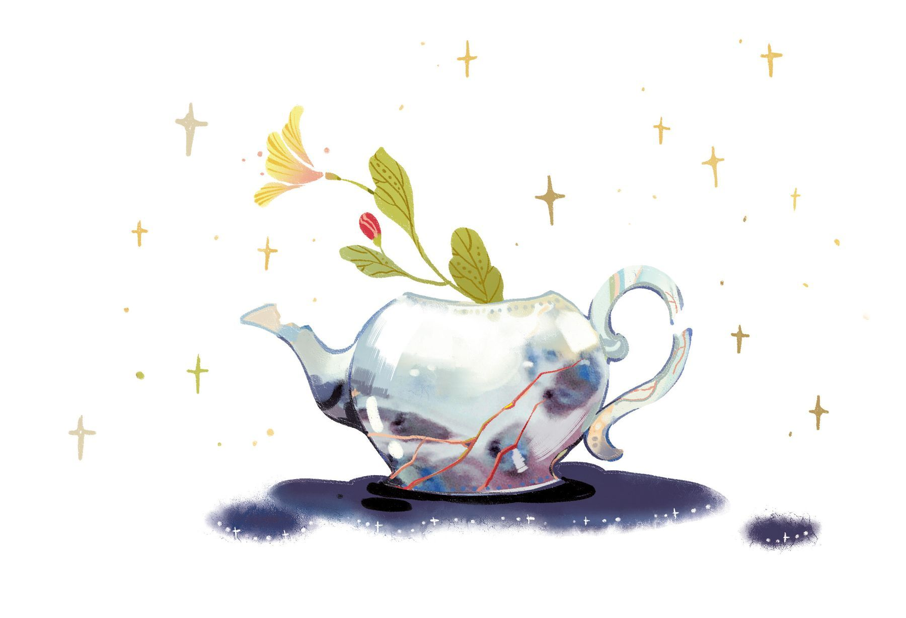

# 茶壶

从前有一只骄傲的茶壶。瓷器的出身让它感到很是骄傲，修长的壶嘴和惹眼的壶把手也让它倍感自豪。不管是前面还是后面，它都很有料。前面有壶嘴，后面有壶把手，这便是它最引以为傲的两件东西。不过它从不提它的壶盖，因为壶盖摔坏过，经过铆接修补后还是千疮百孔。人们总是避开自己的缺点不谈——但别人会谈。杯子、奶酪罐、糖罐——确切地说，也就是其他茶具们——它们老是盯着壶盖的缺陷。比起那只完好无损的壶嘴和用来显摆的壶把手，它们更喜欢谈论壶盖。茶壶对它们的勾当清楚得很。

“我太了解它们了，”它自言自语道，“我也很清楚自己身上的缺陷。不过这恰好体现出了我的谦逊和质朴。每个人都有缺陷，但每个人也都有优点。杯子只有把手，糖罐只有盖子，而我两样都有。我还比它们多一样东西，这样东西它们永远也不会有。我比它们多一个壶嘴，这让我在茶桌上傲视群芳。糖罐和奶酪罐都不过是打下手的，我才是真正要上台面的人物。是我把芳香洒向口渴难耐的人们，是我肚子里的中国茶叶给寡淡的开水增添了味道。”

这些话都是茶壶年轻气盛时说的。彼时它常驻于茶桌给人提供茶水，时不时地被那些纤纤玉手提起来使用。不过那种纤纤玉手可难伺候了，它终于被失手摔在地上，壶嘴和壶把手都摔断了。于是关于壶盖的话题从此打住，因为再说就没什么意思了。茶壶奄奄一息地躺在地板上，肚子里的开水汩汩地流出。这对它是一个巨大的打击，而最令它痛心的莫过于其他茶具们对它的嘲笑——它们倒是不去嘲笑那个失手把它摔坏的人。

“有些回忆我永远也不会忘记！”后来，当茶壶回顾自己的人生时，它说道，“人们说我已经没用了，于是把我丢在墙角，第二天就被送给一个要饭的女人。我变得穷困潦倒，不管到哪里都是一言不发。不过也正因为如此，我才迎来了更好的新人生。山穷水复疑无路，柳暗花明又一村。有人在我肚子里填了土，对于一只茶壶而言，这简直就等同于被人埋葬了。然而那人又在土里种下一根花茎。是谁种的，又是谁把它送给了我，我根本就不知道。花茎的存在代替了中国茶叶和开水，弥补了壶把手和壶嘴的破损。它长在土里，也为我带来了新生，它变成了我的心，于是我有了鲜活的心，那是我从未拥有过的。我从此有了生命，有了力量，有了跳动的脉搏。花茎开始发芽，蔓延出意识和知觉，然后将其注入花儿。我看着花儿，看得真真切切，然后在它的美丽中变得忘我。可以因为其他事物而忘我，这真是一种幸事啊！

“花儿并没有感谢我，它甚至没有意识到我的存在——但所有人都羡慕它，称赞它。这让我感到很快乐。而花儿所感受到的快乐，应该比我还要多得多吧！

“某天，我听见有人说它需要一只更好的花盆。于是我被摔成了两半——我真的很疼——花儿被移入了更好的花盆，而我被扔去了院子。虽然我躺在地上，变成了残片，但我已经拥有了一段永远不会忘怀的回忆！”
