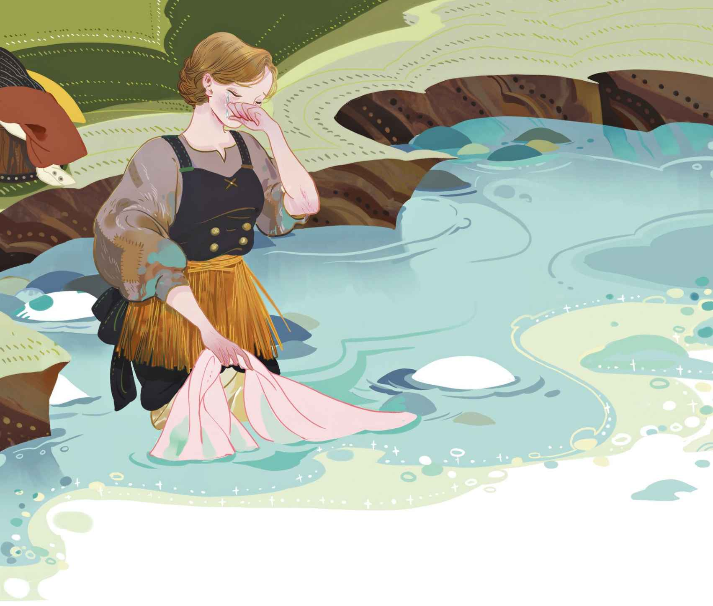

# 她真是一塌糊涂

市长站在敞开的窗前。他身穿礼服衬衫，佩戴精致讲究的胸针。脸刮得很干净，这是他自己动手刮的，不过他不小心刮伤了自己。他在伤口上贴了一小片报纸。

“听好了，小子！”他粗声粗气地喊道。

他口中的“小子”正是洗衣妇的儿子，这会儿他正好经过，便恭恭敬敬地摘下帽子。这顶帽子的帽檐坏了，因此可以直接团起来塞进口袋里。男孩身上的衣服虽然破旧，却非常干净、修补整齐，他穿着沉重的木鞋毕恭毕敬地站着，就好像是站在国王面前。

“你是个好孩子，举止得体的好小伙！”市长说道，“我猜你母亲正在河边洗衣服吧。显然，你是要把口袋里的那东西带给你母亲。你母亲的嗜好真是一塌糊涂！你弄了多少来着？”

“半品脱。”男孩低声说道，他的声音在发抖。

“今儿早上她还要来上半品脱？”市长继续问道。

“没有，那是昨天！”男孩答道。

“两个半品脱，不就是一整品脱嘛！她真是一塌糊涂！有这样的人存在，真是一种悲哀啊。告诉你母亲，她应该为自己感到羞耻。你可别也变成酒鬼——不过我猜你也快了！可怜的孩子！你现在可以走了。”

于是男孩走了。他的手里依然拿着帽子，风把他的金发吹成了涟漪。他沿着街道一路走，穿过小巷来到河边。那里，他的母亲正忙着在搁脚凳上洗衣服，她正用一块木板拍打着亚麻衣物。水势很急，磨坊的水闸开着，床单被水流冲刷着，都快把她手中的木板卷走了，她好不容易才稳住身子。

“我都快被冲走了。”她说，“你来了真好，我正好需要喝点什么补充一下。水里冷极了，我已经在里头站了六个钟头。你给我带什么来了？”

男孩把酒瓶子递了过去。他母亲张嘴喝了一小口。

“噢，这下感觉好多了！我又暖和起来咯！这东西好比热腾腾的饭菜，却不像饭菜那么贵！喝吧，我的儿子！你的脸色看上去那么苍白，你身上的衣服太薄，一定很冷吧。别忘了这是秋天。噢，河水好冰冷啊！我可千万别病倒了！我不会的。再给我来一小口吧，然后你自己也喝一点儿，但是只能喝一点点哦，因为你不能染上酒瘾，我亲爱的可怜的孩子！”

她从水里走出来，来到男孩所在的桥上。她的腰间围着草席，水沿着草席和衬裙滴落而下。“我干活、做苦工，做得手指甲鲜血直流，但是只要能凭自己的双手把你养大，我就心甘情愿，我亲爱的孩子！”

就在此时，一个上了年纪的女人走了过来。她衣衫褴褛，瘸了一条腿。一缕浓密的假发垂挂下来，遮住了她的一只眼睛，那只眼睛是瞎的。这缕假发或许是为了遮住那只瞎眼，然而它却恰恰彰显了她的这个缺陷。这一带的人们都管她叫“戴假发的玛伦”，是洗衣妇的老朋友。

“你这个可怜人呐，”她叫了起来，“在冰冷的河水里干这种苦活，当然需要喝点什么暖暖身子啦！可是那些喜欢说三道四的人，就连你喝的那几口酒也不放过！”于是男孩把市长对他讲过的那番话又跟他母亲说了一遍。玛伦碰巧亲耳听到了那些话，她当时听到市长在一个孩子面前那样说他的母亲酗酒，实在感到恼火得很，因为就在同一天，市长自己大摆晚宴，不知上了多少瓶酒。

“都是些上好的酒啊，烈性酒！不少人喝得酩酊大醉，但他们却不管那叫酗酒。反正他们总是对的，你却被说成一塌糊涂！”

“什么！市长真是那么说的吗，孩子？”洗衣妇问道，她的嘴唇在颤抖，“照他的说法，你母亲成了个一塌糊涂的人！也许他是对的，尽管他不应该对一个孩子说这些。然而我绝不会抱怨，因为他们家以前待我不薄。”

“哎，也是，你在市长家做过事，当时他的父母还健在呢。那是很多年以前的事了。从那时起，人们吃了不知多少蒲式耳的盐，所以现在嘴巴都干了吧！”玛伦大笑道，“今晚的大型晚宴要延期举办了，如果一切还没有准备就绪的话。我从杂务工那儿听说，一小时前他们收到一封信，信里说，市长那个在哥本哈根的弟弟死了。”

“死了！”洗衣妇喊道，脸色煞白得如同死人。

“这跟你有什么关系？”玛伦说，“当然了，你肯定认识他，因为你在他们家做过事。”

“是真的死了吗？他可是最好、最善良的人啊——真的，很少有像他那样的人！”泪珠沿着她的脸颊滚落而下。“噢，我的上帝啊！我感到天旋地转起来了！一定是因为我喝了一整瓶酒。我快站不住了，我感觉糟透了！”说着，她倚在篱笆上，以防自己倒下。

“老天，你病了，肯定是病了！”玛伦说，“一定要撑住呀！不好，你真是病了！我看还是带你回家比较好！”

“可是我要洗的东西还在那儿！”

“我会处理的。来，把你的胳膊给我。孩子可以留在这儿，看着那些衣服等我回来。我会把剩下的也洗掉的，只剩下几件啦。”

可怜的洗衣妇，她的双腿在身子下面打颤。“我在冰冷的河水里站得太久，从昨天起就没吃过任何东西！我发起高烧来了。噢，我主基督啊，帮帮我，带我回家吧！噢，我可怜的孩子呀！”她哭泣起来。

男孩也哭了，他独自坐在河边看着那些湿漉漉的衣物。两个女人走得很慢，洗衣妇拖着她那虚弱的肢体穿过小巷，走过市长居住的那条街道。当她走到市长家门前的时候，终于无力地瘫坐在了鹅卵石地上。一群人立即在她四周围观起来。

玛伦一瘸一拐地跑到院子里找人帮忙。市长和他的宾客们则出现在了窗口。

“是那个洗衣妇！”他说，“她有点喝多了，真是一塌糊涂啊！那个俊俏的男孩有这样一个母亲，真是令人同情，我倒是很喜欢那孩子，可惜他的母亲真是一塌糊涂。”

洗衣妇被带去了她自己的陋室，然后被安置在了床上。好心的玛伦赶紧给她准备一杯热乎乎的麦芽酒，还在里面放了黄油和糖——在这种情况下，她实在想不出更管用的药方了——然后她便回到了河边。在河边，她本想把衣服好好地洗了，不过眼下也只能草草了事。她直接把那些衣服从水里捞起来，然后放进了篮子里。

那天夜里，她又出现在了洗衣妇那间寒碜的陋室里。她问市长的厨子讨来两只烤马铃薯和一大块火腿肉，要给这个生病的女人吃。然而洗衣妇说她只要闻着香味就够了，让玛伦和孩子吃了那些食物。“香味也是很有营养的嘛。”她说。

男孩被抱到了床上和他的母亲睡在了一起，他斜枕在母亲的脚上，身上则盖着一条毯子。那条毯子是用一蓝一红、两条不同地毯的残骸缝接起来的。

现在洗衣妇感觉好些了。热乎乎的麦芽酒让她又有了力气，美食的香味也给了她滋养。

“谢谢你，我好心的朋友，”她对玛伦说道，“趁这孩子睡着的时候，我想跟你讲一件事。他已经睡着了。瞧他闭起眼睛，睡得多甜啊。他不会知道他母亲所受的苦。但愿上帝不要让他也受那样的苦！哎，当时我在议员家里做事——也就是市长的父亲。那会儿，他们家最小的儿子正好学期结束回家。那时我还是个天真无邪的年轻姑娘，是个正派姑娘——我敢对天发誓。还是学生的他是那么讨人喜欢、那么风趣，在他身上流淌的每一滴血都是正直、真诚的。不会有比他再好的年轻人了。虽然他是议员家的儿子，而我只是一个用人，但我们还是相爱了——这一切都是纯洁的。不管怎么说，只要人们真心相爱，那么一个吻就算不得是罪过。于是他告诉他的母亲，他爱上了我。在他的眼睛里仿佛有一位天使，一位精明、善良而诚实的天使。当他再次动身要去学校的时候，为我戴上了一枚金戒指。

“他走后，女主人把我叫去谈话。她看上去非常严肃，但还是很和善，说起话来精明得就像一个天使。她指出了我俩之间的差距，不管是在精神层面还是物质层面，我和她儿子之间都有一道鸿沟。‘现在他只是被你的美貌所吸引，但是美貌会随着时间而褪色凋零。你没有他那样的学历，你的层次不可能及得上他的水准。我很尊重穷人，’她继续说道，‘我也知道，很多穷人死后会在天国享有很高的地位。他们的地位会比很多富人都高。然而在这个世界，这道鸿沟是不可逾越的。如果放任你们不管，你俩同乘的马车将会一路磕磕绊绊，最终会连同你俩一起翻车的。我认识一个叫埃里克的手套匠，是个老实善良的手艺人，他会娶你的。他的收入条件很不错，而且没有小孩。你好好考虑一下吧！’

“女主人说的每个字都像尖刀一般戳着我的心。但是我明白，她是对的。她的那些话对我造成了很大的影响。我吻了她的手，苦涩的眼泪也滴落到了她的手上。当我躺回自己房间的床上时，眼泪变得比之前还要苦涩。噢，漫长而沉闷的夜晚随之而来——只有上帝知道我有多么痛苦！

“直到星期天去教堂做礼拜，我才感到伤痛逐渐平息，取而代之的是一种平静。也许是天意，就在离开教堂的时候，我遇到了埃里克。那一刻我明白了，我们很适合对方。我们属于同一阶层，非常相配。况且他的收入条件很不错。于是我直接朝他走过去，拉起他的手，问他：‘你还想娶我吗？’

“‘想的，我是永远不会变心的。’他说。

“‘你愿意娶一个喜欢你、尊敬你，但是并不爱你的姑娘吗？’

“‘我相信你会爱上我的。’他说。于是我们就那么携手了。

“我回去找到了女主人。她儿子送给我的那枚金戒指，那枚我每天都紧紧系在心上，每晚都戴在指间的戒指，如今被我摘了下来。我吻住它，吻得嘴唇流下鲜血。然后把它交还给了女主人，并告诉她，下星期教堂就会发布我和手套匠的结婚喜讯。

“女主人抱住我，吻了我，她没有说我是个一塌糊涂的人，也许在那个时候，我确实要比现在好得多，因为当时我还不曾领教这世上的不幸。婚礼在圣烛节

> **注 71**　圣烛节代表春天的开始，在这里预示幸福的开始。

“噢，你当时是个多么好的女主人啊！”玛伦说，“你和你的丈夫对我那么好，我永远也不会忘记的！”

“啊，你和我们一起度过了那些好时光！那时我们还没有孩子，我再也没见过那个学生。噢，好吧，我见到过他一次，但是他没有看到我。他出席了他母亲的葬礼，我看到他就站在墓旁，看上去脸色苍白，那么悲伤——但那完全是因为他母亲的离世。此后，当他父亲去世的时候，他身在国外，没有回来出席葬礼。他再也没有回来。听说他成了一名律师，一直没有结婚。但是他不会再想起我了，就算见到了我，也不可能再认出我—— 现在的我已经变丑了。这样或许对谁都好！”

她接着述说那些苦难的日子，后来不幸降临到了他们头上。那时他们的积蓄已有五百元，而隔壁的一栋房子售价两百元。经过考虑，他们觉得可以把它买下来，拆掉后再重建一栋新的，这会是一项不错的投资，于是他们买了那栋房子。经砖瓦匠和木匠们评估，造一栋新房子需要一千两百元。于是埃里克去了哥本哈根，通过信用贷款借到了全额钱款，然而运送钱款的船只失事了，钱也跟着没了。

“也就在那个时候，我亲爱的孩子出生了。现在他就睡在这儿。此后他父亲陷入漫长的病痛折磨，整整九个月的时间里，我每天照料着他的起居。然而我们的厄运还没有结束。我们借的钱越来越多，财产一件接着一件变卖。最后埃里克死了。从那时起，我为了养活孩子开始做苦工，去擦地板、洗衣服，不管做得好还是做不好，我都会尽可能地去做。然而我已经好不起来了，这是上天的旨意啊！他就要带我走了，他会给我的孩子更好的安排的。”说完，她便昏睡了过去。

到了早上，她看上去好多了。她觉得自己已经复原，于是便决定马上回去工作。然而就在她碰到那冰冷的河水时，突然一阵颤抖。她的双手开始抽筋，向前踉跄了一步，然后倒了下去。她的脑袋搁在岸上，可是双脚却浸泡在河水里，两只塞了稻草的木鞋都被水流给冲走了。

玛伦发现了她。她正好过来给她送咖啡。

有人到她的陋室捎来消息，说市长要见她，因为他有话要告诉她。可是已经太迟了。医生告诉大家，可怜的洗衣妇已经死了。

“她是因为酗酒过度才死的。”市长说。

那封带来市长弟弟死讯的信还附带着一份遗嘱，这份遗嘱里有一笔六百元的遗产，是他弟弟留给手套匠遗孀的，也就是曾经为他父母做事的那个姑娘！这笔钱必须无条件地以任何面额形式支付给那个姑娘和她的孩子。

“有人谣传，我弟弟和那女人一直相爱着，”市长说，“幸好她已经死了。现在这笔钱就留给她的孩子了。我会安排他和正经人一起过日子，好让他以后成为一个不错的工匠。”我们的主为这些话送上了祝福。

市长派人去接男孩，承诺会照管他。他还对男孩说，他母亲死了是一件好事，因为她真是一塌糊涂。

他们把洗衣妇安置在了教堂墓园的穷人区。玛伦在她的墓地上种下一棵玫瑰树，而男孩就陪同在她身旁。

“我亲爱的妈妈，”说话的时候，他的眼睛里泛出了泪花，“她是个一塌糊涂的人，这难道是真的吗？”

“不，那不是真的！”年迈的玛伦说道，她朝天空望去，“这么多年来，我一直知道那不是真的，尤其是在她去世前的那个晚上，我更加对此确信无疑。我告诉你吧，她是个善良的好女人，我们的主也会这么说的。所以，像‘她真是一塌糊涂’这样的胡话，就让别人去说好了！”

