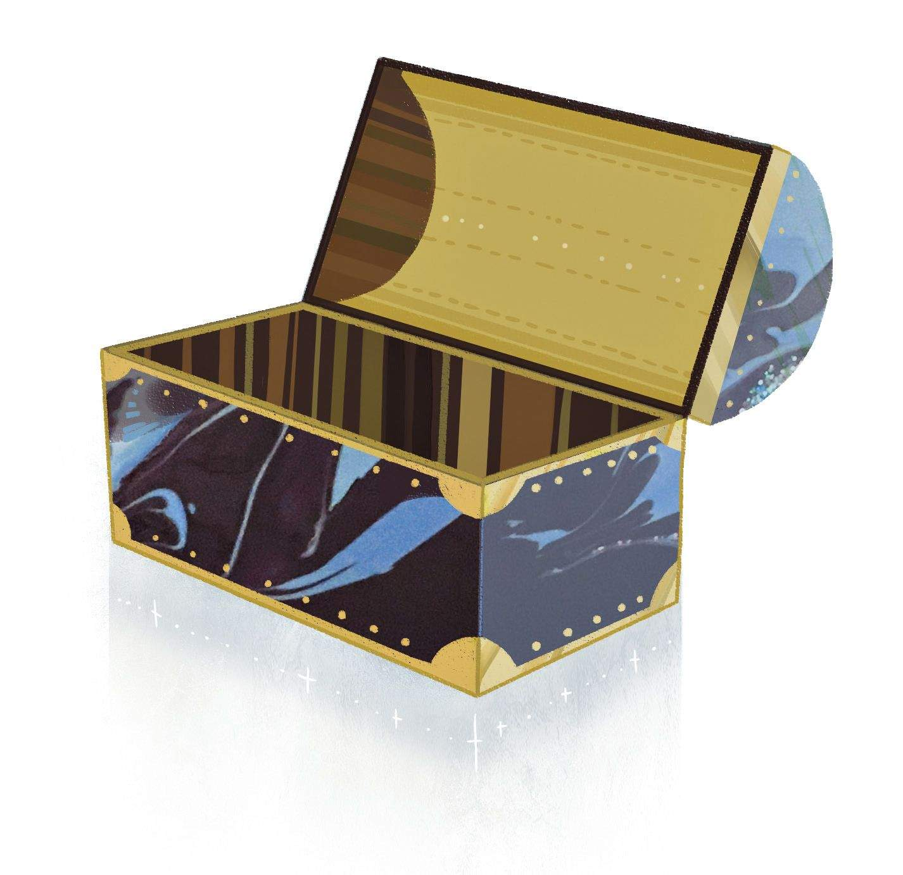
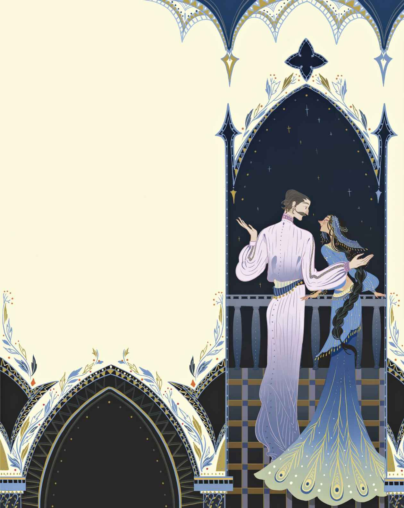

# 飞箱

从前有个极为富裕的商人，富得可以用银子铺满一整条街，而且剩余下来的银子还能再铺满一条小巷。不过他是不会去干那种勾当的，他知道钱应该用对地方。从他身上出去的若是便士，那么回来的一定得是克朗

> **注 72**　克朗是比便士更大的货币单位，此处意指这位商人做生意从不吃亏。

如今他的儿子继承了所有钱财，从此过上了优越的生活。他每晚都去参加化装舞会，用纸钞折叠成纸偶，在湖边拿金币代替鹅卵石片打水漂玩。钱就这么付之东流，这笔遗产很快便挥霍殆尽。最后他只剩下四便士，以及一双拖鞋和一件睡衣可穿。

曾经的那些朋友如今对他都漠不关心，因为他再也无法同他们一起抛头露面了。不过在这些人当中，还是有一位不错的仁兄，此君给他送来一只老旧的箱子，并留下口信，告诉他可以装点什么进去，然后便告辞离开了。这倒是好事一桩，可是他根本就没什么东西可以装进箱子，于是就自个儿坐了进去。

这可不是一只普通的箱子。只要按住箱锁，它就会飞起来。可不是吗，它真的飞起来了。咻！它飞上烟囱，飞入云端，飞向了天际。箱底咯吱作响得厉害，他害怕自己会穿过箱底坠落下去，这样的话，他迟早会摔个大跟头的！老天哟！不过最后他总算是安全着陆了，降落在了土耳其人的岛上。他把箱子藏进了树林，用枯树叶掩盖起来，然后出发去了最近的城市。他真是来对了地方，因为土耳其人全都穿着睡衣和拖鞋，跟他的行头完全是一个路子。

他路遇一位带着孩子的保姆，于是他说：“你好啊，土耳其保姆。告诉我，位于城市边缘的那座宏伟而巨大的宫殿究竟是什么来着？就是布满了高窗的那座。”

“那是苏丹王

> **注 73**　旧时土耳其统治者称号。

“谢谢你。”商人的儿子说。他回到树林，坐进飞箱，咻地飞去了宫殿的屋顶。从那儿，他爬到了公主的窗前。

公主正躺在沙发上熟睡，她看上去那么漂亮，商人的儿子忍不住亲吻了她。公主醒了过来，大惊失色，不过商人的儿子对她说，他是一位土耳其先知，他不远千里飞过天空，只为前来见她一面。这让公主听了很是欢欣。

他们坐在一起，肩并着肩，他就她的双眸讲起故事。他说它们是那么乌黑亮丽，宛如深邃的湖泊，而她的思绪就如同美人鱼一般从那里游过。他还说起她的前额，说它就像是覆盖着白雪的山坡，上面还有着许许多多的厅廊和绘画。接着他又对她说起鹳鸟，说它们带着可爱的小孩子飞越大海。噢，这些故事实在太美妙了！于是他向她求婚，而她立刻就答应了。

“不过，你必须等到星期六再来。”她对他说，“那天我的父母亲会和我一起喝茶。当我告诉他们我就要跟一位土耳其先知结婚的时候，他们一定会感到骄傲的。而你所要确保的，就是给他们讲一个真正的好故事，因为我的父母都很喜欢听故事。我母亲喜欢那种教人进步、蕴含道德的故事，不过我父亲喜欢那种富有趣味、能把他逗笑的故事。”

“那么我带来的结婚贺礼，会是一个美妙的故事。”他对她说，此后他们便要分别了。公主先将一把镶满金币的马刀作为礼物送给了他，这件礼物很有用。

他飞走了，去给自己买了一件新睡衣，然后到树林里编故事。这事儿可不容易。不过到了星期六，他好歹是及时完成了。苏丹王、王后以及满朝官员一起在公主的茶会上恭候着他，对他的接待规格极为隆重。

“你会给我们讲个故事对吗？”王后说，“一个带有教育意义、发人深省的故事。”

“同时也是一个能把我们逗笑的故事。”苏丹王说。

“诚如诸位所愿。”商人的儿子说。然后他便开始讲故事了。现在就请仔细听吧。

“从前有一捆柴火，他们对自己的尊贵出身颇感自豪。他们的家族之树——确切地说，那是一棵高大巍峨的松树，他们都是那棵树上的小木片——是森林里寿命最长的老树。柴火们躺在厨房的架子上，对身边的打火盒和旧铁罐聊起了他们年轻时的日子。

“‘当时我们还是那些绿色树枝的一部分，’他们说，‘说起来，我们确确实实曾是树枝的一部分哟！每个早晨、每个夜晚，我们享用晶钻茶，这种茶也被称为露珠。我们终日享受着阳光，还有小鸟们会给我们讲故事。显而易见的是，我们那时是多么幸福安康，因为其他树木的外衣只能维系于夏季，而我们家族能够终年披持常绿的外衣。可是后来伐木工们来了，一切都发生了翻天覆地的变化，我们的家族从此分崩离析。家族的主干变成了一艘大船的主桅，只要情况需要，就会在全世界航行。其他树枝则去向各处。而如今我们的工作，是给下层社会的人们带去光明，这就是我们这些曾经高贵的人之所以会来到这间厨房的原因。’

“‘我的命运截然不同。’铁罐说，他就在柴火们旁边，‘打从我来到这个世界的那一刻起，我就对其他事情一无所知，我只晓得烹饪啊刷洗啊，就那么日复一日，始终没完没了的。我干的都是实打实的糙活儿，而这实际上正是厨房里最要紧的活计。我仅有的放松时间要到晚餐过后才开始，那种时候我总是又干净又整洁，在厨房里跟我的伙伴们开口聊天。只有洒水壶不参与，他时不时要到院子里去做短途旅行，而我们总是待在屋内。我们唯一的新闻来源是菜篮子，他一讲起话来别提有多么忧国忧民了。唔，就在前些日子，一只支持保守党的罐子由于忧虑过度，跌下去摔碎了。我告诉你哦，菜篮子那家伙是自由党支持者！’

“‘你说得太多啦。’打火盒的打火石冒出了火星子，‘还是让这个夜晚轻松愉快一点吧。’

“‘是呀，来聊聊我们当中最有贵族气派的人吧。’柴火们说。

“‘别，我可不想谈论我自己。’瓦罐说道，‘今晚还是让我们来找点乐子吧。我先开个头好了。我会给你们讲讲我们熟知的事物。这不需要费什么想象力，而且很有意思。在波罗的海边，在丹麦的山毛榉树

> **注 74**　波罗的海四面为陆地所环绕。这些陆地共包括九个国家。丹麦是其中之一。

“‘这个开头好极了。’碟子们喋喋不休道，‘这个故事正是我们喜欢的。’

“‘在那里，我度过了自己的年轻时代。那里的人们把家具擦得亮堂堂的，把地板扫得干干净净的，每个月的第十四天他们还会换上新的窗帘！’

“‘你这故事讲得多好呀！’扫帚说，‘一下子就能听出来，这是一位女士讲的故事，不带任何不雅的字眼。’

“‘是啊，能感觉得出来。’洒水壶说。他来了个欢快的小跳，水洒在了地板上。

“瓦罐继续讲她的故事，故事的结尾和开头一样好。

“碟子们又高兴地喋喋不休起来。扫帚则用西芹做成花冠戴在了瓦罐的头上，她知道这会把其他人惹恼，不过她是这么想的：‘今晚我给她戴上花冠，明天她也会给我戴上花冠。’

“‘现在我要跳一支舞。’火钳说，说着她便跳了起来。哎哟，老天爷，她居然把腿踢到了半空中！就连角落里那张被盖起来的老椅子都忍不住拨开一道口子来偷看她跳舞。‘你们能给我也戴上花冠吗？’火钳说。于是大家也给了她一顶花冠。

“‘真是一群疯疯癫癫的乌合之众。’柴火们说道。

“‘大家让茶壶唱歌，不过眼下她喉咙里的水是凉的

> **注 75**　此处一语双关，既可以理解为茶壶里的水是凉的，又可以拟人化地理解为茶壶得了伤寒。

“窗台上有一支佣人用的旧羽毛笔。除了曾经深深地插进过墨水瓶以外，他就没有任何值得称道的地方了，不过这也算是他唯一值得自豪的特色。

“‘茶壶唱还是不唱，随她的便。’他说，‘我这儿的窗户外面有只笼子，笼子里有只夜莺，他能给我们唱歌。虽然他还没为这种场合事先演练过，但是今晚我们不会太挑剔的。’

“‘我要发火啦，’菜篮子说，‘你们谁也无法想象我现在有多么恼火，你们打算就这样度过今晚？把这屋子里弄得更有秩序不是更好吗？所有人都到指定的位置去，我来安排整个游戏。绝对会很不一样的。’

“‘好嘞，让我们闹起来。’大家闹腾着。

“就在这时候，女佣把门打开了。大家全都静止不动，谁也不说话了。尽管如此，他们还是觉得自己很有一套，并且都认为自己有那么点斤两。‘只要我乐意，’每个人都这么想，‘我们就会有个欢快的夜晚。这完全不成问题！’

“‘女佣拿起柴火，然后点燃了他们。老天，他们烧得火星四射，真够耀眼的！

“‘现在，’柴火们想道，‘大家都瞧见了吧，我们可是第一等的。我们是多么闪耀

> **注 76**　此处原文一语双关，既是因燃烧而耀眼的意思，又是优秀、杰出的意思。

“这真是个好故事，”女王说道，“我觉得自己仿佛置身于厨房，正和柴火们在一块儿呢。我亲爱的先知，你当然可以和我的女儿成婚。”

“确实如此。”苏丹王说，“这个星期六，你

> **注 77**　原文为古代用语，相当于中文古语中的“汝”“尔”。

就这样，举行婚礼的日子定下了。婚礼的前一晚，整座城里灯火通明，饼干和蛋糕被分发给群众。孩子们在街上踮着脚尖，喊着“万岁”，用手指吹着口哨。真是一派热闹非凡的场面。

“我觉得我也应该做点什么才是。”商人的儿子说。这么着，他买来了鞭炮、火箭筒以及各式各样的烟花爆竹，然后把它们装进飞箱，飞到了城市上空。

嘭！鞭炮炸开了，哗哗直响！火箭筒也发射了。土耳其人兴奋地跳得老高，拖鞋都拍到了他们的耳朵上。这般流光溢彩的火星，他们还从未见过呢。现在他们总算明白了，即将迎娶他们的公主的人，真的就是土耳其的先知圣人啊。

商人的儿子一飞回树林，就心想：“我这就要去城里，瞧瞧我这一手的反响如何。”这也确实合乎情理。

噢，瞧他们是怎么说的！他问过的每一个人，都有不同的说法，不过他们一致觉得很棒。简直棒极了！

“我看到了先知圣人本尊，”有人这么说，“他的眼睛闪烁，如同星星；他的胡须起伏，宛若水波。”

“他裹身于炽烈的烟火，”另有人说，“烟火里冒出了好多天使的脑袋呢。”

没错，他听到了很多奇思妙语，而他的婚礼即将于明晚举行。他又回到树林里，打算在飞箱里休息一下——等等，飞箱这是怎么了？飞箱着火了！一道烟火的火星引燃了飞箱，此时飞箱已经烧成了灰烬。他再也不能飞了，再也无法去他的新娘那儿了。她在屋顶上等候着他，等了整整一天，很可能会一直等下去。而他只能在世间游荡，到处讲故事给人听，只是那些故事的精彩程度还不及那个柴火故事的一半。
