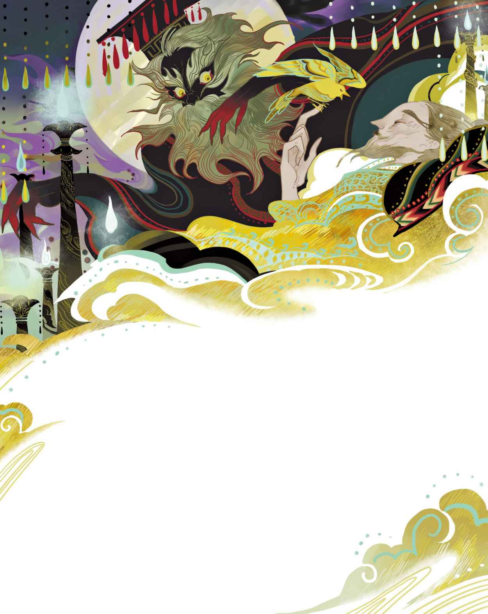

# 夜莺

中国的国王是个中国人，您多半已经有所耳闻，而国王身边的那些人，也都是些中国人。这个故事就发生在中国，不过那已经是很久以前的事了。所以，在它被遗忘之前，还是再说上一遍为妙。

那座王宫简直无异于世界奇观，它完完全全地用细瓷打造，极尽奢华又非常脆弱，触摸的时候必须十分小心翼翼才行。花园里盛开着奇花异蕊，那些最美的花朵均系有银质的小铃铛，只要有人经过，它们就会叮当作响，因此谁也不会错过这些花儿们。是的，正是这一切构成了国王花园的盛大规模。至于它究竟延伸到多远的地方，恐怕就连园艺师也弄不清楚。假如你一直走，一直走，就会来到一片茂盛的森林，那里的树长得很高，湖泊很深。森林与蓝色的深海为邻，它们是如此靠近，以至于高桅船经过的时候几乎就等于是在那些树枝底下航行。在这片森林里生活着一只夜莺，他的歌声是那么动听，就连那总有活儿要忙的穷渔夫每晚外出撒网的时候，也忍不住要停下来聆听他的歌声。

“多么美妙啊。”渔夫说。不过他还得继续忙活，一旦忙活起来也就不再留意了。然而到了第二天晚上，当他再次听到歌声的时候，他又会说：“多么美妙啊。”

世界各地的访客纷纷来到国王的都城，对这座城赞不绝口。他们赞叹这里的宫殿，赞叹这里的花园，可当他们听到夜莺的歌声时，他们说：“这才是最美的。”

访客们回去后到处传播关于夜莺的事迹。学者们写了很多书，有关于那座城的，有关于那里的宫殿的，还有关于那座花园的。当然，他们是不会忘了夜莺的。他们将他奉若至宝。诗人们写下华丽的诗篇，内容不外乎都是关于海边的森林，以及生活在森林里的那只夜莺。

这些书传遍了整个世界，有些甚至还传到了中国国王的手里。国王坐在自己的宝座里，读着这些书，高兴地点着头，因为这些书中关于他的都城、宫殿和花园的描写都是那么辉煌。不过夜莺才是最美的。白纸黑字，他读到了这句话。

“这是怎么回事？”他大声说道，“我从没听说过什么夜莺。在我的王国——就在我的花园里，居然还有着这样的鸟儿——我却根本不知道？在看这本书之前，我就应该知道才对啊。”

这么着，他唤来了阁臣

> **注 78**　安徒生的原文并没有详细说明国王身边的这位“侍臣”身份，但是根据故事里的情节，这里应译作“阁臣”。“阁臣”也是学士，跟文中与国王讨论书中夜莺的情节相符，也与下文代国王宣布“钦此”的情节相符，因为中国古代阁臣拥有这种职权。

“人们说，我们这儿有只了不得的鸟儿，名叫夜莺。”国王说，“他们都说他是我的王国之最。我怎么就从没听说过他呢？”

“我也从没听人说起过这个名字。”阁臣说，“他还没到宫里来表演过呢。”

“那我命令他今晚就到我面前来，然后给我表演唱歌。”国王说，“他可是我的财产。现在搞得全世界都知道了，就我还蒙在鼓里！”

“我以前也没听说过他。”阁臣说，“不过我会去找他。我会找到他的。”

可是上哪儿去找呢？阁臣跑上跑下，跑遍了所有的房间和走廊。然而他碰到的那些人，没有一个听说过关于夜莺的事。于是他又跑回国王面前，说那肯定不过是个故事，是那些写书的家伙杜撰出来的。“尊贵的陛下，您不必相信那些书上的东西，那都是胡编乱造的，要不然就是彻头彻尾的妖术。”

“我读的那本书可是地位显赫的日本国王送给我的啊，”国王说，“所以那不可能是一派胡言。我一定要听听夜莺的歌声，我还是要他今晚就来这儿。他会得到最高的知遇之荣，但如果他来不了，那么我就要让宫里的所有人都给我尝尝肚子被揍的滋味，而且就选在晚餐过后揍。”

“遵旨

> **注 79**　中国古代宫廷用语，即“圣上的旨意在此”。

关于这只非凡的夜莺的下落，眼下仍然毫无头绪。全世界都已经对他了如指掌，唯独他的老家除外。最后，他们终于在厨房里找到一个穷苦的小女工，小女工说：“夜莺？我对他很熟悉。是啊，他真的非常能唱。每天晚上，我都要把餐桌上的剩饭拿去给我那生病的母亲，她就住在海边。每次回来的路上我都会感到很累，于是就会在森林里休息一会儿。也正是在那种时候，我能听见夜莺的歌唱。他的歌声总是让我热泪盈眶，因为那就好像是母亲在亲吻着我。”

“小女工，”阁臣说，“我会给你在厨房安排一个终身的管事职位。如果你能带我们找到夜莺，我甚至还会批准你亲临国王的晚宴。我们已经接到命令，那只夜莺必须在今晚出现在王宫里。”

就这样，他们一起去了那片夜莺经常唱歌的森林，半个王宫的人都出动了。在前往森林的路上，一头母牛哞哞叫了起来。

“噢，”一位大臣叫道，“那一定就是夜莺了。那么小的动物，居然有着如此铿锵有力的大嗓门，我敢说我以前就听过她的歌声。”

“不对，那是母牛在哞哞叫。”小女工说，“我们还有很长的路要走呢。”

这当儿，青蛙又在湿地里呱呱叫了起来。

“真动听！”随行的宫廷人士说道，“现在我算是领教了——简直就像是教堂的钟声。”

“不对，那是青蛙。”小女工说，“不过，我想我们应该很快就能听见他的歌声了。”

这当儿，夜莺开始歌唱。

“这才是夜莺的歌声。”小女工说，“听，听呐！他就停在那边。”她朝一只灰色的小鸟指去，他就在高高的树枝上。

“不会弄错吧？”阁臣嚷道，“好吧，我真是没有料到，原来他是长这副模样，真够平淡无奇的。可能是他看到这么多达官显贵围着自己，一下子有些惶恐失色吧。”

“小夜莺，”小女工对他喊道，“我们仁慈的国王想要听你唱歌。”

“荣幸之至。”夜莺回答说，说完便引吭高歌起来。

“听上去如同玻璃钟铃作响，”阁臣说，“瞧瞧他的小喉咙，颤动得多么厉害。我真是深受震撼，我们从未听过这样的歌声。我敢确信，他一定会在我们王宫里大放异彩。”

“我还要为国王再唱一曲吗？”夜莺问道。他还以为眼下国王就在场呢。

“我漂亮的小夜莺，”阁臣说，“我要非常荣幸地恭请你莅临今晚的王宫盛会。在那里，你尽可以用你那动人的歌声，为陛下带去快乐。”

“我的歌声，只有在森林里才会动听。”夜莺说。然而当他得知那是国王的心愿时，他还是心甘情愿地跟他们走了。

王宫里早已扫榻以待。瓷墙和瓷地板在灯光下显得亮晶晶的。那些系着铃铛的花朵，眼下都被布置到了厅堂和走廊里。人们走来走去的时候，那些铃铛就会不停地叮咚作响，弄得大家几乎连自己讲话的声音都听不见了。

国王正坐在庞大而辉煌的宫殿当中，殿内还给夜莺准备了一根金质的栖木。满朝官员都到了场，他们让小女工站在门背后，现在她已经被任命为“皇家厨房领班

> **注 80**　原文为“Pot-Walloper”，也写作“Potwaller”“Potwalloper”“Potwalloner”或“Householder”，根据文中情节，这里译作“领班”，亦即厨房小女工在完成找到夜莺的任务后，晋升为了皇家厨房领班。

夜莺的歌声是那么美妙动听，国王的眼眶里涌出热泪，泪珠沿着他的脸颊滚落而下。接着，夜莺的歌声变得更动听了。国王的心都快要融化了，他深受感动，于是想把自己的金拖鞋挂到夜莺的脖子上，然而夜莺婉言谢绝了这份奖赏。能为国王献唱，他觉得已经足够了。

“我看到了陛下眼中的泪水，”他说，“再也没有比这更好的奖赏了。帝王的眼泪是弥足珍贵的，这就是我所得到的奖赏。”说完，他又歌唱起来，歌声无比动听。

“这是我们听过的最迷人、最富有魅力的歌声。”在场的女士们说。她们把水含在嘴里，谁要是跟她们说话，她们就发出咕噜声，因为她们也想与夜莺媲美。就连男侍和婢女们也说这是一种享受。要知道，这是很难能可贵的，因为他们一向就不太懂得欣赏这方面的东西。毫无疑问，夜莺大获成功。他将会留在王宫里，还会有自己专属的鸟笼。他获得批准，白天可以外出溜达两回，晚上则可以外出一回。十二名男侍负责照看着他，他们每人都在夜莺的腿上牢牢地系上了一根丝带，这样的外出方式实在是毫无乐趣可言。

整座城里的人都在谈论这只不可思议的鸟儿。如果有两人照面，其中一个没来得及说“夜”，那么另一个多半已经把“莺”脱口而出了，然后他们还会不约而同地感叹一番，连话都不用讲。有十一个猪肉铺的屠夫给自己的儿子取名为“夜莺”，不过他们一个也不会唱歌。

有一天，国王收到一只大号的包裹，包裹上标有“夜莺”的字样。

“我的夜莺负有盛名，这肯定又是一本关于他的书。”国王说。然而那并不是一本书，包裹盒里装的是一件艺术品，是一只极为逼真的人造夜莺，不同的是，这只夜莺的外表镶满了钻石、红宝石和蓝宝石。只要上了发条，这只人造的鸟儿就会唱一曲夜莺的歌，同时还会摆动它那披金戴银的亮晶晶的尾巴。它的脖子上有一条丝带标签，上面写着：“日本国王之夜莺，不敢与中国国王之夜莺相提并论，自愧弗如是也。”

“这东西不是很漂亮吗？”所有人都这么说。那个把这台装置送过来的人还因此获封了“皇家首席夜莺大使”。

“现在，我们让他们一起唱歌好了。那将会是何等美妙的二重奏啊。”大臣们说道。

如此这般，两只夜莺不得不一起唱歌，然而效果似乎并不怎么样，因为真的夜莺总是即兴发挥，而人造夜莺只会唱固有的调子。

“这不能怪新来的夜莺，”乐师说道，“它把控得很好，我正是这么教它的。”

于是他们又让人造夜莺独唱。它不仅唱得和真的夜莺一样动听，而且模样比真的夜莺更漂亮，如同浑身戴满了手镯和胸针一般光彩夺目。它不厌其烦地把同样的曲调唱了三十三遍，大臣们还想再听上一遍，不过国王说，现在该轮到真的夜莺上场了。可是他到哪里去了？没有人注意到，他已经从敞开的窗户飞走，飞回了绿林里的家。

“他为什么要飞走呢？”国王说。

满朝官员都开始对夜莺诋毁中伤起来，纷纷说他是忘恩负义的坏东西。“好在我们已经有了最灵的鸟儿。”说着，他们又让那只人造鸟唱了一遍。这已经是他们听到的第三十四遍了，还是同样的曲调，不过他们都没怎么记住，因为这首曲调非常复杂。对于这只人造鸟，乐师给予了极高的评价。没错，他说这台奇妙的装置远比真的夜莺要好得多，不仅好在镶满了钻石的外表，就连由机械构造的内在也极为出色。

“你们瞧，女士们先生们，尤其是尊贵的陛下，如果是真夜莺的话，你永远也不可能料到他会唱什么，但是人造的夜莺就不一样了，一切尽在掌控之中，绝不会有任何闪失。我可以把它拆开来解析一番，让各位看看里头的机械齿轮是如何设置、如何旋转，又是如何连带运作的。”

“我们也正是这么想的。”所有人都说。这么着，乐师受命于下个星期天安排人造夜莺举办一场公开音乐会。国王说了，他的臣民都应该听一听。于是人们真的去听了，他们全都沉迷得如同喝了茶一般（茶在中国很受欢迎）。所有人都说：“好。”纷纷竖起大拇指，连连称赞，频频点头。不过，那个听过真夜莺唱歌的穷渔夫说：“这听起来很美，而且很接近货真价实的夜莺的歌声，然而我总感觉缺少了点什么。究竟少了什么呢，我也说不清楚。”

真的夜莺已被驱逐出国土。在他曾经待过的王宫里，人造夜莺如今就坐在国王床边的垫子上，身边摆满了或纯金或镶钻的赏礼。现在它的标签成了“皇家大歌唱家——国王助眠专属”。就等级而言，它的称谓甚至优先排在了“国王”二字左边，难不成是国王自愿让给它的？之所以能让它彰显在左，原因在于心脏。就算是国王，心脏也是在左边的嘛。

关于人造夜莺，乐师写了一部二十五卷的书。那真可谓满纸经纶、卷帙浩繁，充斥着艰涩难懂的中国语言。不过人们都扬言自己读过，而且都读懂了，免得让自己显得很无知，落到被揍肚子的地步。

一年后，国王和他的满朝官员以及所有的中国民众，都已经把人造夜莺的歌记得烂熟于心。现在他们倒是更喜欢这首曲子了，因为自己也会唱了。他们还真都唱过。街上的顽童们唱道：“嗞嗞嗞！咕噜，咕噜，咕噜。”国王也这么唱，简直流行得不得了。

然而有天晚上，人造夜莺正在卖力地为国王献唱时，它身子里有什么东西突然崩裂，传出砰的一声。咯吱咯吱，所有齿轮都停止了转动，音乐声也停了。国王从床上跳下来，然后派人去找医生，可是医生又能做什么呢？于是他又派人找来一个钟表匠。钟表匠又是询问，又是检查，最后总算是勉强修理了一番。不过他还是说，这只鸟的使用寿命恐怕已经到了，齿轮已经严重磨损，如果要替换这些齿轮，势必会破坏它原有的音调。这真是太可怕了。以后他们每年只能让它唱一次，而光是这么一次，搞不好也会超出它的负荷极限。尽管如此，乐师还是来了一段不怎么长的演讲，演讲中又充斥着那套晦涩难懂的中国话，意思不外乎就是这鸟没问题，跟以前一样出色。这么一来，人们又都当真了。

五年过去了，一件真正令人悲痛的事降临到了整个国家头上。中国人所爱戴的国王，如今病倒了。据说他病入膏肓，已然无药可救了。新国王已经选出，随时准备即位。人们站在王宫外的大街上，向阁臣询问国王的情况到底如何。

“去。”阁臣摇着头说。

国王躺在他那豪华的大床上，浑身发冷，脸色苍白。大臣们都以为他已经死了，全都跑去向新国王致敬。流言蜚语在男侍之间传开，婢女们则聚在一起喝茶，眼下正值非常时期。所有房间和走廊都铺上了厚厚的垫子，用以消除人们走动时发出的脚步声。王宫里变得安静起来，死一般地安静。可是国王还没死呢，他只是脸色惨白、身体僵硬地躺在豪华的床上，床的四周围挂着天鹅绒的帘幕以及厚实的金丝流苏。高高的墙顶上开了一扇窗，月光从那儿流泻进来，照在国王和他的人造夜莺身上。

可怜的国王呼吸困难，仿佛有什么东西压在胸口。睁开双眼，才发现那是死神坐在自己胸口。死神戴着国王的王冠，手持国王的黄金宝剑，身上还披着国王的锦旗。层层叠叠的天鹅绒帘幕之间，诡异地冒出了好多张熟悉的脸。他们有的很可怕，有的却是温和、善良的。他们全都出自国王曾经的所作所为，有好的也有坏的。现在死神坐在他的心口，所以他们都回来找他了。

“你是否还记得——？”他们一个接一个地低语着，“你是否还记得——？”他们述说的那些事情，让他的额头上直冒冷汗。

“不，我不愿旧事重提！”国王说，“音乐，音乐，把我们的中国大鼓都敲响，我不要再听到那些述说声了！”可是他们仍在低语。对于他们的每一言每一语，死神都报以中国式的点头。

“音乐，音乐！”国王喊道，“唱歌啊，我的宝贝小金鸟，唱啊！我给你黄金，给你各种宝贝。我把我的金拖鞋挂到你脖子上。唱啊，我求求你了，唱啊！”

然而这只鸟儿始终无动于衷。没有人来给它上发条，没有任何办法让它歌唱。死神用他那空洞的厉眼一刻不停地凝视着国王，周遭一片寂静，死一般地寂静。

突然，窗外传来了歌声。是那只真的小夜莺，他就停在外面的细枝上。他听闻国王面临绝境，特意前来献唱，为他带来慰藉与希望。随着他的歌声，那些鬼魂的幻影逐渐消退了下去，变得愈来愈淡；血液再次在国王那虚弱的身体里流动起来，流得越来越通畅。就连死神听了也说：“继续唱，夜莺，继续唱吧！”

“那，”小夜莺说，“你会归还宝剑、锦旗和国王的王冠吗？”

死神提出交换，条件是再唱一曲。于是夜莺照做了，他歌唱安静的教堂墓园，那里生长着白色玫瑰，那里的接骨木花让空气带上了芳香，那里的草地常绿，总会被那些仍然在世的人的泪水潸然打湿。死神想念起了他的墓园，窗外旋即飘起一股冷飕飕的灰雾，死神随雾而去。

“谢谢你，谢谢你！”国王说，“来自天堂的小鸟，我从前就认识你。我曾经把你逐出我的国土，你却用歌声为我从床畔驱走那些可怕的鬼魂，为我从心口驱走死神。我要怎么做才能报答你呢？”

“你早已报答过我。”夜莺说，“就在我第一次为你歌唱，而你流下眼泪的时候。对于一位歌者而言，这样发自内心的感动远比任何宝石都要弥足珍贵。现在睡吧，在我的歌声中重获新生，康复起来吧。”他唱着歌，直到国王呼呼地酣然入睡，彻底沉入香甜、安宁的睡梦。

国王醒来的时候，太阳已经在窗外高照。他已经恢复如初，感觉好多了。侍从们一个也没有回来，因为大家都以为他已经死了。而夜莺仍在歌唱。

“你一定要永远留在我身边，”国王说，“只在你乐意的时候为我献唱便可。我会把那只人造的鸟儿摔得粉碎。”

“不必，”夜莺说，“毕竟它也尽力了。把它留在身边吧，我无法在这里筑巢，也无法入住王宫，还是让我来去自由为好。我会停在你窗外的树枝上，唱一些既会为你带来快乐，又会为你带来沉思的歌曲。我会歌唱快乐，也会歌唱悲伤。我的歌声会为你揭开那些隐藏在你身边的善与恶。我是为你唱歌的鸟儿，现在我要飞去辽阔的远方，飞去渔夫的棚屋，飞去农夫的家，飞去许许多多其他的地方，那些地方离你和你的宫廷很远很远。王冠所彰显的一切固然重要，然而比起你的王冠，我更爱你的心。我还会来为你歌唱的，只求你答应我一件事。”

“如你所愿。”国王大声宣布道。他亲自穿上龙袍，然后把沉重的黄金宝剑置于心口。

“只用答应一件事就行了。”夜莺提出他的请求，“你不可以让任何人知道，你有一只能让你洞悉一切的小鸟。只要做到这点，一切就会蒸蒸日上。”说完，他便飞走了。

侍从们前来打理死去的国王的后事——结果他们全都僵在了原地。

国王说：“早上好。”
