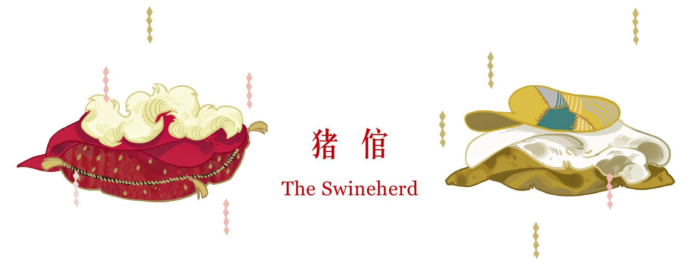
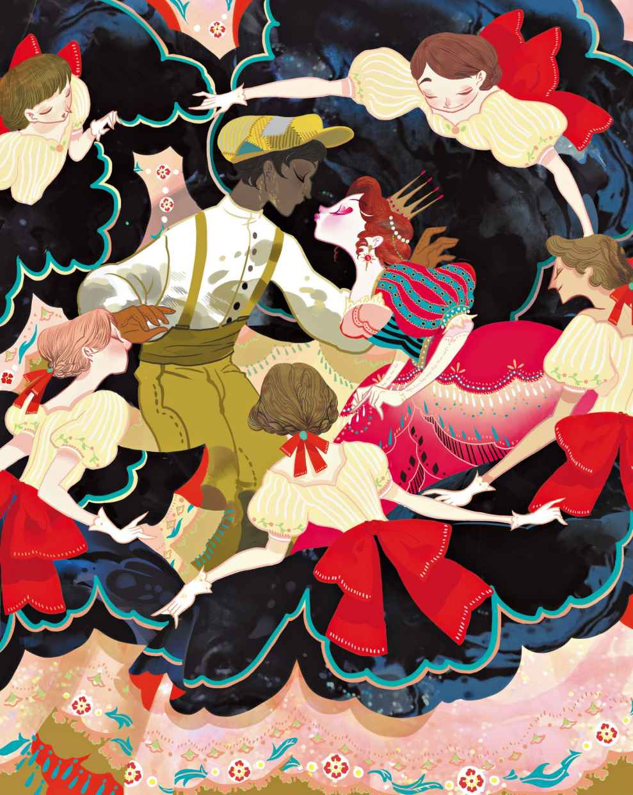

# 猪倌

从前有个穷王子，他拥有一个王国。尽管这个王国非常小，但是筹办婚礼还是绰绰有余的。王子已经下定决心，要解决自己的终身大事。

眼下他真是胆大包天，居然说：“你愿意嫁给我吗？”说话的对象是某位国王的亲生女儿。他真的这么说了，因为他名声在外，响彻四方，数以百计的公主都会说，“我愿意！”以及“谢谢你！”不过那位国王的女儿，到底会怎么说呢？唔，我们很快就会知道了。

王子父亲的墓上长了一棵玫瑰树，那真是一棵美丽的树，每过五年才开一次花，而且每次只开一朵。噢，那可是一朵玫瑰花哦！它的芳香能够让人忘掉所有的伤痛与烦恼。王子还有一只夜莺，它唱起歌来，仿佛全世界最美妙的歌曲都被装进了它那小小的嗓门儿里。夜莺与玫瑰即将被作为礼物送给公主，它们被分别装进两只大盒子，然后送去了公主那里。

国王下令把盒子呈到他面前。也就是在那个豪华的大厅内，公主正在和她的侍女们玩“来访者”游戏。她们几乎不干别的事情。公主一看见那两只装有礼物的大盒子，便高兴得直拍手。“噢，”她说，“我真希望我能得到一只小猫咪。”她打开一只盒子，里面是一枝美丽的玫瑰。

“噢，它多么漂亮呀。”侍女们众口一词。

“岂止漂亮，”国王说，“简直是超凡脱俗。”

然而公主用手指戳了戳玫瑰，几乎快要哭出来了。“呸！”她说，“这不是人造的花，这是真花。”

“噢，呸，”侍女们又众口一词，“这不过是朵真花。”

“好了，”国王说，“在我们恼火和发脾气前，不如先看看另一只盒子里装了什么吧。”他打开了那只盒子，里头飞出来一只夜莺。夜莺唱了一小会儿，歌声无比美妙，谁也无法想象还有谁能与其相比。

“无与伦比！”“魅力无穷！”侍女们用一知半解的法语

> **注 81**　说法语是为了彰显自己的品位。

“这鸟的歌声让我想起了已故王后的音乐盒。”一位老臣说道，“那只音乐盒有着同样的调子，那鸣啭的腔调也实在是像极了。”

国王像个孩子似的哭泣起来。“唉，是啊。”他说。

“鸟？”公主说，“你的意思是说，这是一只真的鸟？”

“一只活生生的鸟。”把夜莺带来的那个人向她保证。

“那就让它飞走，滚蛋吧。”公主说。她一个字也不想听王子讲

> **注 82**　指的是上文中王子斗胆说出的那句“你愿意嫁给我吗”。

不过，要让王子气馁也不是件容易事儿。他把脸涂得又黄又黑，把帽子拉下来遮住眼睛，然后开始敲门了。

“你好啊，国王。”他说，“你好你好，你能给我在王宫里安排一份工作吗？”

“唔，”国王说，“人们总是在找工作，让我想想。我倒是需要一个专门照料猪的人，因为我们的猪已经多到不行了。”

就这样，王子被任命为“皇家猪倌”。他被指派到一间简陋的小屋，就在猪圈旁边，他必须住在那儿。他整日地在岗位上工作，忙得一塌糊涂。到了晚上，他拿出事先做好的小汽锅，这只汽锅做工精巧，边缘布满了小铃铛。煮沸之后，铃铛就会叮当作响，演奏出一支老曲儿：

“噢，亲爱的奥古斯丁，

一切都完了，完了，完了。”

> **注 83**　一首维也纳民谣，原名为Oh du Lieber Augustin，作曲时间大约是1679年，作者Marx Augustin是一位民谣歌手和风笛手。

这还不算什么。谁要是把手指伸进这只汽锅的蒸汽里，他就能立即闻到来自城里的任何锅子里的任何晚餐的味道。玫瑰可没这本事！

这当儿，公主恰好和她的侍女们打这儿经过。她听到了那支曲子，于是停下脚步，看上去一副挺高兴的样子，因为她知道怎么弹“噢，亲爱的奥古斯丁”。这是她唯一会弹的曲子，而且她只会用一根手指弹。

“哟嗬，这跟我会弹的那支曲子一模一样嘛。这个猪倌，难道不是很有一手吗？照我吩咐的做，”她命令道，“去问问他，那只乐器锅卖多少钱。”

于是一位侍女受命前去，走进了猪圈里面，不过她事先穿上了套鞋。

“这只锅子，你要怎样才肯卖？”她问道。

“我要十个公主的吻。”猪倌说。

“乖乖，吓死人了！”侍女说。

“而且一个也不能少。”猪倌说。

“喂，那人怎么说？”公主很想知道。

“我都没法告诉你。”侍女说，“他实在太吓人了。”

“那就到我耳边小声告诉我。”于是侍女说了，她也听了。“乖乖，这人也太下流了吧！”公主说。说着，她便离开了那地方。不过才没走出多远，她便再次听到了那些漂亮铃铛的演奏：

“噢，亲爱的奥古斯丁，

一切都完了，完了，完了。”

“照我说的做，”公主又下令道，“去问问他，我的侍女的十个吻，他愿不愿意接受。”

“不接受，我谢谢你了。”猪倌说，“十个公主的吻，否则锅子我是不卖的。”

“真是令人作呕！”公主说，“那你们至少得把我围起来，这样就不会被别人看见了。”

于是她的侍女们将她团团围住，然后把裙子撑得老大，而与此同时，王子得到了那十个吻。公主这才得到了那只锅子。

接下来，狂欢开始了。这只锅子还从没被这么折腾过呢，她们不停地拿它煮东西，从早到晚，从王臣的宴会到鞋匠的早餐。整座城里，但凡是她们认识的人，全都用过这只锅子了。为此，侍女们又是欢舞，又是拍手。

“现在我们知道谁有美味的羹汤和烙饼了，还知道谁有粥和肉排。是不是很有趣呀？”

“有趣极了。”卧房的领班说道。

“好了，不管怎么说，我是国王的女儿，”公主提醒她们，“我是怎么得到这只锅子的，你们不许对任何人说起。”

“看在老天的份上，绝不会说的！”大家都这么说。

不过猪倌——也就是王子，目前没人知道他不是真的猪倌——还是一如既往地忙碌不堪。这次他做了一只发声玩具。只要把它摇来转去，它就会发出华尔兹舞曲、快步舞曲，以及各种人们耳熟能详的舞曲乐声。

“这东西真是无与伦比！”公主经过的时候说道，“我还从没听过这么好听的音乐呢。照我吩咐的做，去问问他，那乐器卖什么价钱。不过记好了——吻是肯定不会再有了！”

“他要一百个公主的吻。”侍女问过之后，告诉她说。

“我觉得他肯定是疯了。”公主说，说完便从那儿走开了。然而她才没走出多远，就说：“不过话说回来，我可是国王的女儿，我有责任去鼓励一下艺术行业。告诉他，他可以得到十个吻，就跟昨天一样。其他的，就找我的侍女们去要吧。”

“噢，我们可不想吻他。”侍女们说。

“别瞎扯，”公主说，“他要是可以吻我，当然也可以吻你们啦。别忘了，我可是让你们有饭吃，给你们发工资的人。”如此，侍女只好再次回去找猪倌。

“一百个公主的吻，”猪倌对侍女说，“不然这交易就免谈。”

“把我围起来。”公主说。于是她的侍女们围成一圈，把她挡在了里面，而与此同时，猪倌开始和公主接吻。

“那么一大群人挤在猪圈旁，这是怎么回事儿？”国王从他的阳台朝下望的时候，感到很是好奇。他擦了擦眼睛，然后戴上他的眼镜。“我的妈呀，那些侍女该不会又在瞎折腾什么吧。我最好还是过去看看，她们这会儿到底在搞什么玩意儿。”

他穿上便鞋，然后把脚后跟套好，换作以往，他一般都是把脚往里随便一塞，然后啪啦啪啦拖着就走了。然后，好家伙！他简直是疾步如飞。快到围栏那儿的时候，他把脚步放得很轻。侍女们正忙着数吻呢，完全没留意到国王就在她们身后。国王都踮起脚尖了。

“真是一塌糊涂！”当他看到他们正在接吻的时候，他说。他拿起便鞋抽她们的耳朵，而这当儿猪倌正进行到第八十六个吻。

“全都给我滚！”国王怒气冲冲地说。公主和猪倌被逐出国土。公主站在那儿哭，猪倌则挨了骂，接着大雨倾盆而下。

“我也太倒霉了，”公主说，“当初我要是嫁给那个有名的王子就好了！噢，我真是太不幸了！”

猪倌溜到一棵树后，把他脸上的黄黑污渍擦得一干二净。然后他迅速脱掉身上的破烂衣服，再次换上王子的服装示人。公主见了，不禁屈膝行礼。

“对于你，我只感到鄙夷。”他对她说，“你拒绝王子诚心诚意的求婚，不懂得珍惜夜莺与玫瑰，但是为了一件叮咚作响、供人消遣的玩具，倒是甘愿去吻一个猪倌。你实在是自作自受。”

说完，王子回到自己的王国，关门上锁。而公主只能站在外面，痛彻心扉地唱道：

“噢，亲爱的奥古斯丁，

一切都完了，完了，完了。”
