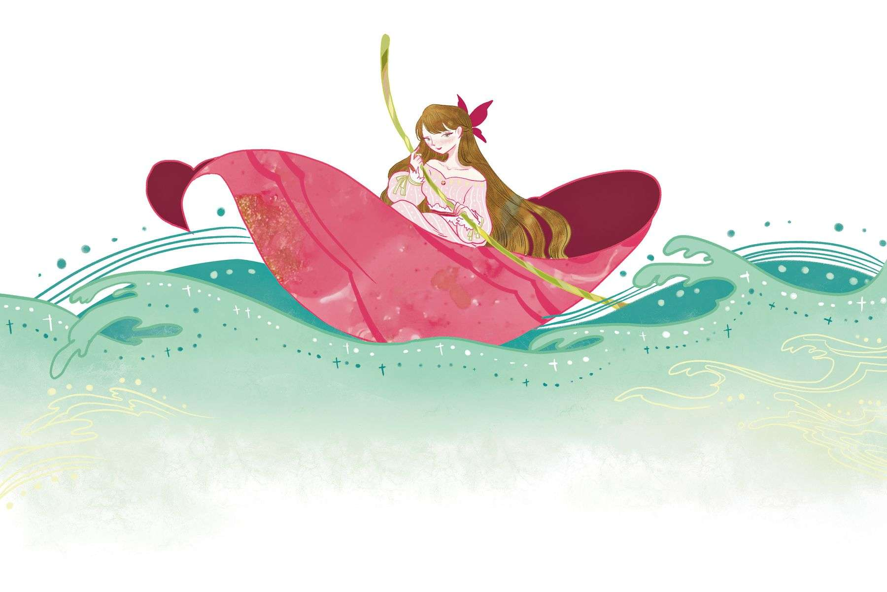
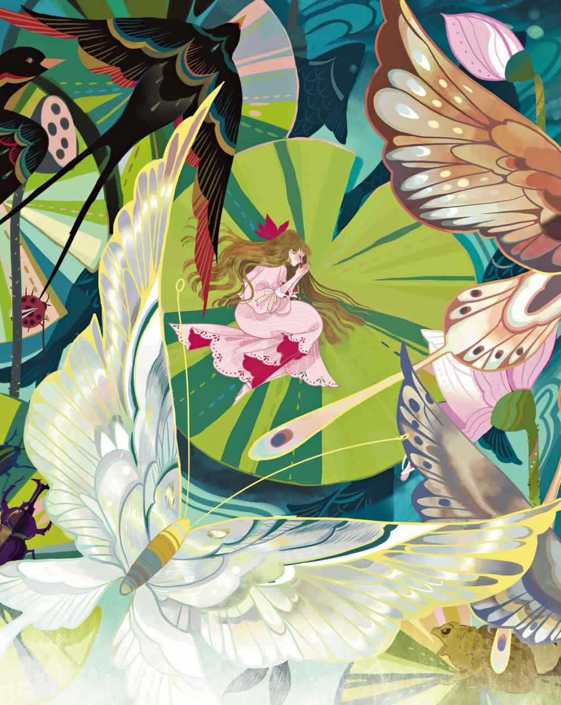
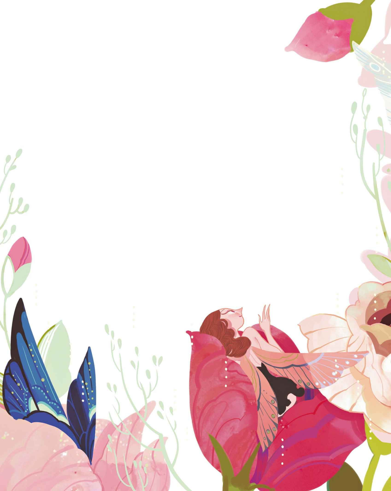
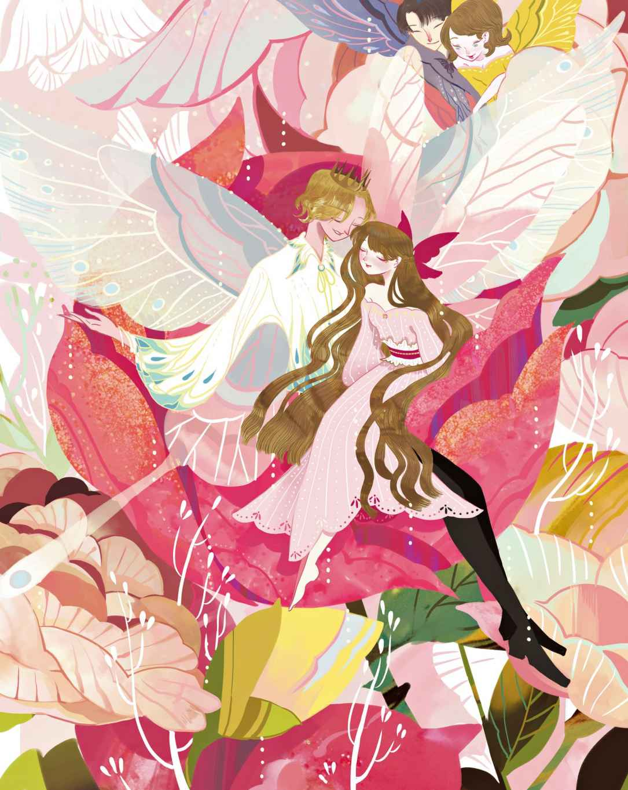

# 拇指姑娘

从前有个女人，她渴望有个丁点儿小的小孩，可是不知道上哪儿去找这么小的孩子。于是她前去拜见了老女巫。她说：“我无论如何都想有个丁点儿小的小孩。请你告诉我，上哪儿才能找到这样的小孩呢？”

“嗨哟，那还不容易。”女巫说，“我给你一颗大麦的麦粒。不是农民种在田里的那种麦粒，也不是专门用来喂鸡的那种麦粒。把它放到花盆里就行了。你所渴望的，自然会出现在你眼前。”

“噢，谢谢你！”女人说。她给了女巫十二便士，然后一回家就把麦粒种在了花盆里。这东西很快就长成一朵又大又漂亮的花儿，而且看上去很像郁金香。不过它的花瓣紧紧闭拢着，目前还只是一只花骨朵儿。

“这真是一朵美丽的花儿。”女人说。她吻了吻那红黄相间的花瓣。正当她吻上去的时候，花儿意外地发出“扑”的一声，突然就绽放了。果真是一朵郁金香呢，就在花中央的绿色蕊心上，坐着一个丁点儿小的小姑娘。她是如此的精致娇小，看上去非常美丽。不过她的个头还不及一根拇指高，于是就被叫做“拇指姑娘”了。

她的摇篮是一块磨得很光滑的漂亮胡桃壳，床垫是蓝紫色的紫罗兰花瓣，盖在她身上的则是一片玫瑰花瓣，晚上她就睡在里面。白天的时候，她在桌上玩耍。女人在桌上放了一只盘子，盘子上围了一圈花环。花茎浸在水里，而水上浮着一片宽大的郁金香花瓣。拇指姑娘把这片花瓣当作小船，再用一对白色的马鬃毛作为双桨，就这样，她在盘子里划起船来了——那景象真是别有趣味。她还会唱歌呢，嗓音无比柔和又甜美，谁也没有听过那样的嗓音。

有天晚上，她正在摇篮里躺着，一只可怕的蟾蜍突然从窗外跳了进来——有扇玻璃窗破了。这只又大又丑又黏滑的蟾蜍正好跳在了桌子上，而拇指姑娘正在红玫瑰被子下睡觉。

“正好可以给我儿子当老婆嘛！”蟾蜍大声说道。她拿起了胡桃壳，而拇指姑娘还在里面睡觉。然后她带着胡桃壳从窗户跳进了花园里，那里有一片河塘

> **注 84**　原文“stream”其实既有河流又有溪水的意思，但是后文有睡莲出现，我还是选择译为“河塘”（蟾蜍生活在池塘也更加合情合理），因为睡莲只有在相对较为平静的水中才能生长，在快速流动的河流或溪流中，不可能有睡莲，也不可能有大片睡莲叶子浮着不动。虽然原文“a big broad stream ran through it”感觉就是有河流或溪水流过花园，但是我反复考虑之后，觉得应该还是河塘，因为对于拇指姑娘来说，河塘确实很“big”很“broad”，但搜寻河塘照片，我发现河塘和湖泊不一样，它当中会有很多东西（连续草丛等），这样被草丛等东西隔开的地方，对于迷你的拇指姑娘来说正相当于一条条的河流（但它整体是一片池塘）。综上，译作河塘。

“别这么大声，你会吵醒她的。”老蟾蜍对他说，“她搞不好会从咱们这儿逃走的，因为她就跟天鹅羽毛一般轻盈。我们必须把她放到那些浮在水面上的、宽大的睡莲叶子上才行。她那么小，那么轻，睡莲叶子对她来说就跟小岛似的。这样，我们在泥巴底下给你俩造婚房的时候她就跑不了啦，以后你俩可是要住进去的。”

池水里生长着许多睡莲的大绿叶，它们看上去仿佛是漂浮在水面上的

> **注 85**　实际上睡莲的每片叶子底下都有根茎，并非凭空浮生。

第二天一早，可怜的拇指姑娘醒了。当她明白自己的处境后，便开始难过地哭泣起来。硕大的绿叶周遭都是水，她根本就没法靠岸。老蟾蜍坐在泥巴里，正在用绿色的芦苇和黄色的睡莲装点新房。为了她的新儿媳，可得把这房子给弄得漂亮点儿。完事之后，她和她那丑陋的儿子便游到了睡莲叶子那儿，拇指姑娘就站在上面。他们过来是要拿走她那只漂亮的胡桃壳，他们要把它放到婚房的卧室里去，之后他们还会把她也带过去。

老蟾蜍在拇指姑娘跟前行了个深深的屈膝礼，然后说：“见见我儿子吧，他将会成为你的丈夫，你会和他一起住进泥巴里的舒适新房。”

“咳——嗌，咳——嗌，吧呱——吧咳——嗌咳——咳嗌。”从她儿子嘴里吐出来的话，只有这么些。

然后他们就带着她那只漂亮的小胡桃壳游走了，拇指姑娘被孤零零地留在了睡莲叶子上。她坐下来哭了起来，她不想住到黏糊糊的蟾蜍家里去，也不想让老蟾蜍那吓人的儿子成为自己的丈夫。在睡莲叶下面的水里，有一些小鱼儿正在游来游去，他们刚才瞧见了老蟾蜍，也听见了她说的话。于是他们把脑袋伸出水面，朝拇指姑娘看去。他们一看到她的样子就觉得难过得不行，因为这样一个美丽的人儿，居然要被迫到水下去跟丑恶的蟾蜍生活。不，绝不能让那样的事发生！于是他们来到她所在的叶子下面，在根茎周围聚集起来，用牙齿把叶茎啃成了两段。叶子旋即随着水流漂走，而拇指姑娘也随着叶子一起漂走了。她漂得远远的，蟾蜍再也逮不着她了。

她从许多地方漂流而过。当灌木丛里的鸟儿们见到她时，他们唱道：“多么惹人喜爱的小姑娘呀。”叶子载着她漂得愈来愈远，拇指姑娘就这样成了旅行者。

有只好看的白蝴蝶一直在她身边飞来飞去，最后飞落到了叶子上，因为他非常钦慕她。现在蟾蜍不会逮住她了，于是她又成了快乐的小姑娘。沿途漂流的风景十分宜人，阳光照射在水面上，看上去就像是闪光的金子。她解下腰带，一端系在蝴蝶身上，另一端系在叶子上。现在叶子漂得更快了，拇指姑娘也跟着移动得更快了，当然，这是因为她就站在叶子上。

这会儿，一只大金龟子飞过。他瞥见了拇指姑娘，于是用爪子在她纤细的腰部抓牢，带着她飞到了一棵树上。睡莲叶子继续顺水漂流，蝴蝶也随它而去，因为他被系在叶子上，没有办法松开。

老天！当金龟子把她带到树上去的时候，她简直吓坏了。不过她更为那只好看的白蝴蝶感到难过，因为她把他系在了叶子上，他自己不可能挣脱。这样的话，他会活活饿死的，可是金龟子才不会为这种事情操心呢。他让她在树上最大的绿叶上坐好，然后给她吃了花蜜，还说她漂亮极了，只是看上去一点儿也不像金龟子。过了一会儿，住在树上的其他金龟子都过来了。他们盯着拇指姑娘打量着，然后互相碰触触须，交流起来：“嚯，她只有两条腿——多么可悲的模样啊！”

“她连触须也没有。”有只金龟子叫了起来。

“她的腰那么细——真丢人啊！她看上去像是人类——实在太丑了！”所有金龟子女士都这么说。

然而拇指姑娘还是那么漂亮，一如以往，那只把她抓来的金龟子很清楚这点。只是，所有的金龟子都不停地说她丑，到最后他也加入了大家的阵营，不愿再搭理她了——让她想去哪儿就去哪儿好了。他们带着她飞到了树下，然后把她丢在了一朵雏菊上面。她坐在那儿哭了起来，因为她是那么丑，金龟子们都不愿跟她扯上关系。

尽管如此，拇指姑娘还是你所能想象的最可爱的小姑娘，她就如同玫瑰花瓣一般纤柔而美丽。

一整个夏天，可怜的拇指姑娘就这么孤身一人地在树林里生活。她用青草为自己编织了一张吊床，然后把它吊在一片硕大的牛蒡叶下，这样她就不会被雨淋到了。她采来花蜜作为食物，每天早晨在叶子上面找露水喝，就这样度过了整个夏天。接着，冬天来了，一个漫长又寒冷的冬季。曾经为她带来过甜美歌声的鸟儿们如今全都飞走了，树木与花朵相继枯萎凋零。那片硕大的牛蒡叶也开始萎缩，最后只剩下一根干枯、发黄的茎。她感到极度的寒冷，身上的衣服早已磨得破破烂烂，而她又是那么的纤瘦和脆弱。可怜的拇指姑娘，她会被冻死的！开始下雪了。每当有雪花砸落到她身上，对她而言简直都无异于一整铲雪的重击，因为我们都长得很高，而她个头只有一英寸。她身上裹着一片枯叶，却根本暖和不起来，被冻得瑟瑟发抖。

现在她来到了靠近树林边缘的地方，这里有一大片麦田，可是麦子早就被收割了。冰冷的地面上，唯有光秃秃的麦秆兀立着。对她而言，这等于是再次迷失在了一片巨大的树林里。噢，她因为寒冷而颤抖得多么厉害啊！此后她又来到田鼠的家门口，那是麦秆间的一个小洞口，田鼠就住在这儿。这地方暖和又舒适，仓库里堆满了麦粒，还有一间豪华的厨房和食品储藏室。可怜的拇指姑娘站在门口就像个行乞的小孩，只想讨一点麦粒吃，因为她已经有两天没吃过任何东西了。

“哎，可怜的小东西。”田鼠说。看样子，她是个热心肠的老好人。“我屋里可暖和了，你一定要进来，咱们一块儿吃晚饭吧。”她一眼就喜欢上了拇指姑娘。“你要是愿意的话，这个冬天就跟我一起住吧。只要你能保持好房间的整洁，然后给我讲点故事就行了。我最喜欢听故事了。”对于这位善良的老田鼠提出的要求，拇指姑娘照单全收，她也因此过上了舒坦的日子。

“不久，我们会迎来一位客人。”田鼠说，“他是我的邻居，每个礼拜都会过来看望我一次。他的为人比我还要好呢，而且他的屋子更大，身上穿的是漂亮得不行的黑天鹅绒外套。你要是能嫁给他，那可就有好日子过啦。不过他看不见东西，你得把你知道的最好的故事都讲给他听才行。”

拇指姑娘不怎么喜欢这项提议，她不会考虑嫁给那家伙的，因为对方是一只鼹鼠。那家伙前来拜访时，果然穿着一身黑天鹅绒外套。田鼠一个劲地说他是多么富有，又是多么博学，还说他的屋子比她的要大上二十倍都不止。他是有着一肚子的学识，可是对于阳光和花朵却一无所知，因为他从没见过它们。

无奈，拇指姑娘得为他唱歌。她唱了“金龟子，金龟子，飞回家乡吧”和“去往远方的修道士”。鼹鼠倾心于她的歌声，爱上了她，可是并没有说出口，因为他是那种极为小心谨慎的人。

他从自家地板上打了一条地道一直通到田鼠家，以供田鼠和拇指姑娘随意使用。他提醒她们，这条地道里躺着一只死鸟，但是用不着害怕。这只鸟的羽毛和喙完好无损，死去的时间应该离现在很近，应该就是冬天到来的时候吧。它被掩埋的位置，正好就在地道当中。

鼹鼠嘴里衔了一根朽木做成的火把，黑暗中，这东西就跟真正的火把一样亮。他走在最前面，用火把照亮这条黑暗而幽长的地道。当他们来到死鸟所在的位置时，鼹鼠抬起他的宽鼻子在地道顶部打了个大洞。阳光照射进来，只见地面的正当中躺着一只死去的燕子。他那漂亮的双翅折缩在身体两侧，脑袋也缩在羽毛里面。可怜的鸟儿，他肯定是被冻死的。拇指姑娘为他感到难过。她爱所有的小鸟，因为正是鸟儿们为她歌唱，用美妙悦耳的声音对着她叽叽喳喳地说话陪伴她度过了一整个夏天。鼹鼠用他那短腿踢了踢燕子的身体，说：“现在他再也唱不出声儿了。不知这东西作了什么孽，居然投胎成了一只鸟儿。感谢老天，幸亏我的孩子天生就不是鸟儿。除了‘啁啁啾啾’的歌声，鸟儿简直一无是处。一旦冬天到来，他们就只能活活地饿死。”

“没错，你说到点子上了，你真是个聪明人。”田鼠表示同意，“对于鸟儿而言，一旦冬天到来，一旦陷入饥寒交迫的境地，‘啁啁啾啾’地唱歌又能顶什么用呢？不过，人家大概觉得这样很有尊严吧，我猜。”

拇指姑娘始终沉默不语。等他们转过身去的时候，她弯下身来，把遮住燕子脑袋的羽毛抚开，然后吻了他那紧闭的双眼。

“也许在夏天的时候，就是他为我带来了美妙动听的歌声。”她兀自想道，“他曾为我带来那样的快乐，亲爱的、美丽的燕子。”

鼹鼠堵上了那个进光的洞，然后把田鼠和拇指姑娘领回了家。那天晚上，拇指姑娘睡意全无。她干脆起来，用干草编织了一张厚实的大被单。然后她带着被单来到死去的鸟儿身边，给他盖了上去。这么一来，在这个冰冷的世界里，他也就有了一丝温暖。她还用柔软的蓟花

> **注 86**　蓟花带有悲苦的象征意义。

“再见啦，美丽的燕子。”她说，“再见，谢谢你曾经为我带来美妙的歌声。那时还是夏天，树林里一片绿荫，温暖的阳光晒在我们身上。”她把头贴在他的胸口，继而惊讶地发现，自己居然感觉到了一记微弱的搏动，仿佛有什么正在里面跳动。那是心脏的跳动，他还没有死——只是被冻僵了。现在他暖和起来，开始复苏了。

每到秋季，燕子们就会飞去气候温暖的国度。然而有只燕子启程太晚，受了冻，他坠落下来，如同死了一般。他就躺在坠落的地方，任凭积雪将其掩埋。

由于吃惊，拇指姑娘有些发颤。毕竟，相对于她一英寸的个头，这只鸟是那么的巨大。不过她还是鼓起勇气，用棉花紧贴着塞在这只可怜的燕子身体周围。她还拿来了薄荷叶，那可是她自己睡觉时用的被子，现在她把它盖在了燕子的脑袋上。

接下来的那个晚上，她又踮起脚尖溜出去找他。现在他已经活过来了，不过仍然十分虚弱。他勉强把眼睛睁开片刻，看了看拇指姑娘。拇指姑娘就站在他身旁，手里拿着一片火绒

> **注 87**　一种野生植物，晒干后可作生火材料。

“谢谢你，美丽的小人儿，”这只虚弱的燕子说道，“我的体温恢复得好极了。很快，我就能恢复如初，再次在温暖的阳光中飞翔了。”

“噢，”拇指姑娘说，“外面可冷了，冰天雪地的。这里比较暖和，你就好好休息吧，我会照顾你的。”

之后她又用花瓣给他盛了些水。燕子喝了水，然后告诉她，自己是如何在荆棘丛中弄伤了一只翅膀。正是由于那次负伤，导致当其他燕子一起飞往远方的温暖国度时，他没能赶上，最后坠落到了地上。他能记起的就只有这些了，至于拇指姑娘发现他的时候，他为什么会在地道里，他自己也全然弄不明白。

一整个冬天燕子都留在那里，拇指姑娘对他很好，一直悉心照料着他。她没有对田鼠和鼹鼠提起这件事，因为他们并不喜欢这只可怜又不幸的燕子。

等到春天来临，阳光开始温暖整个世界的时候，燕子对拇指姑娘说，告别的时候到了。于是拇指姑娘把鼹鼠在地道顶上打的那个洞再次凿开，让灿烂的阳光铺洒在他们身上。燕子想让拇指姑娘跟他一起走，她可以坐在他的背上，一起飞越那片绿色的森林。然而拇指姑娘很清楚，如果她就这么走了，那么老田鼠一定会感到很难过的。于是她说：“不行，我不能走。”

“那么再见了，再见，我美丽的好姑娘。”燕子说。说着，他飞进了阳光里。看着他离去，拇指姑娘的眼睛里涌起了泪水，因为她是那么喜欢燕子。

“啾啾，啾啾！”飞向绿林之际，燕子唱道。

拇指姑娘的心情低落极了。未经许可，她不能出去接触阳光，而且田鼠家门口外面的麦子现在已经在田里长得很高了。对于只有一英寸高的拇指姑娘来说，那简直无异于一片茂密的森林。

“这个夏天，你必须把嫁妆都准备好。”田鼠说。他们的邻居，那位令人讨厌的、穿黑天鹅绒外套的鼹鼠，已经来提过亲了。“你要当人家的妻子，就得准备好毛织品和亚麻织品，还得有寝具和衣柜才行。”

于是拇指姑娘不得不摇起纺锤，田鼠则雇了四只蜘蛛给她当帮手，他们就这样一起没日没夜地忙着纺织。每天晚上，鼹鼠都会前来拜访。他最喜欢把太阳挂在嘴上。他说，现在太阳把地面烤得跟石头一样硬，不过等到夏天结束，它就不会这么热力十足了。是啊，只要夏天一过去，他就能来迎娶拇指姑娘啦。拇指姑娘却一点也高兴不起来，因为对于令人生厌的鼹鼠，她实在是连半点喜欢也谈不上。每个日出的清晨和每个日落的黄昏，她都悄悄地溜出门。微风徐徐，外面的世界是那么明亮和晴朗，她多么希望可以再次见到燕子啊。可是他不会回来了，他无疑已经去了远方，已经飞去了那片美丽的绿林。

秋天来了，拇指姑娘所有的嫁妆都已备好。

“再过四个礼拜，就是你们举办婚礼的日子啦。”田鼠告诉她。可是拇指姑娘哭了起来，她说她不愿让令人讨厌的鼹鼠成为自己的丈夫。

“你胡说什么呢，”田鼠说，“别犟头倔脑了。否则我就用我的大白牙咬你。哎唷，你就要有一位好丈夫啦。他的黑天鹅绒外套那么棒，就连女王都不可能拥有。他的厨房和地窖里简直就是堆金积玉啊，你应该感谢老天，因为你就要嫁给这样的人了。”

结婚的日子到了。鼹鼠前来迎娶拇指姑娘，准备把她领回家去。一旦去了他家，拇指姑娘就得从此生活在深深的地下，永远也别想再出去沐浴温暖的阳光了。鼹鼠很不喜欢阳光。可怜的拇指姑娘，她感到很悲伤，因为就要告别灿烂的太阳了。田鼠至少还肯让她站在门口朝外面看看太阳呢。

“再见了，明亮的太阳！”她说。从田鼠家走出一小段距离后，她张开双臂，迎向太阳。此时麦子已经收割，田野里只剩下干枯的麦秆。“再见，再见了！”她再次大声喊道，然后用她那小小的手臂，紧紧地抱住一朵仍未凋谢的小红花。“如果你见到燕子，请代我告诉他，我喜欢他。”

“啾啾，啾啾！啾啾，啾啾！”她突然听见，头上传来燕子的叫声。她抬起头，然后看到燕子飞过。见到拇指姑娘，燕子好高兴。而当拇指姑娘告诉燕子，自己是多么不愿意嫁给鼹鼠，又是多么讨厌那暗无天日的、深深的地下世界时，她再也无法自已，终于流下了眼泪。

“寒冬将至，”燕子对她说，“我要飞去遥远的温暖国度，你愿意跟我一起去吗？你可以骑在我的背上，用腰带把自己系紧，然后我们一起远走高飞，从此远离丑陋的鼹鼠和他那黑暗的洞穴——我们要去很远很远的地方，飞越群山，去往温暖的国度。那里的阳光远比这里要明媚得多，那里永远都是夏天，永远开满了鲜花。请跟我一起离开这里吧，亲爱的拇指姑娘。当我躺在黑暗的地洞里，被彻底冻僵的时候，是你救了我。”

“我愿意，我愿意跟你一起去！”拇指姑娘说。她坐到他背上，两腿置于他张开的双翅间，然后把腰带系在最坚韧的那根羽毛上。接着，燕子凌空而起，飞过森林，飞过湖泊，飞越那些长年积雪的山脉。寒气来袭的时候，她就躲进燕子温暖的羽毛里，只露出她那小小的脑袋望着下面壮观的景象。

终于，他们抵达了那个温暖的国度。那里的阳光远比先前的地方要明媚得多，天空看上去也有原先的两倍那么高。沿着渠道和篱墙生长着美丽的蓝葡萄和绿葡萄，树上挂着柠檬和橘子，空气闻起来有一种香桃木和百里香的味道。路边，可爱的孩子们到处跑来跑去，和那些色彩亮丽的蝴蝶一起嬉戏。

燕子仍在继续飞行，景色变得愈来愈美。在那些参天的绿树下，在那片蓝色的湖岸边，伫立着一座用白色大理石建成的古老宫殿。巍峨的石柱上藤蔓缭绕，石柱的顶上有很多燕子筑的巢，其中的一个，就是载着拇指姑娘的那只燕子的巢。

“这就是我的家。”燕子对拇指姑娘说，“你要是愿意的话，可以在下面那些盛开的鲜花中任选一朵，我会安排你住进去。你可以从此过上称心如意的生活。”

“那可真好呀。”拇指姑娘欢呼起来，拍着她那丁点儿小的小手。

一根巨大的白色大理石柱倒塌在地，断成了三截，在这三截断柱之间长出了美丽无比的硕大白色花朵。燕子带着拇指姑娘飞了下去，然后把她放到了最大的那片花瓣上。拇指姑娘惊异地发现，花儿的中央有一位拇指小人，他身上泛着光，如同玻璃制造一般晶莹剔透。他的脑袋上有一只精致的小金冠，肩上长着闪闪发光的翅膀，而个头也丝毫不比拇指姑娘大。他就是花之精灵，每一朵花儿里面都住着一位像他这样的拇指先生或女士。不过，他是所有花精灵的国王。

“噢，他的样子很英俊，不是吗？”拇指姑娘对燕子柔声说道。花精灵的国王似乎有点害怕燕子。对于像他这么丁点儿小的小人儿来说，燕子简直就是巨人了。不过当他看到拇指姑娘的时候，心中充满了喜悦，因为在他所有见过的拇指女士当中，她是最美的。于是他摘下金冠放在了拇指姑娘头上，然后问她，是否可以知道她的名字。他还问她，是否愿意成为他的妻子。她将会成为所有花儿的女王。他确实与众不同，和蟾蜍的儿子，和穿黑天鹅绒外套的鼹鼠很不一样。于是她对这位英俊的国王说了“愿意”，所有住在花朵里的拇指先生和拇指女士全都走出来见证了这一刻。他们每人送了一件礼物给拇指姑娘，其中最棒的礼物是一对翅膀，它曾经属于一只银白色的大飞蝇。把这对翅膀紧紧地安在她背上，她就能在花丛间自由飞翔了。所有人都欢呼雀跃，而燕子在上面的巢中用最美的歌声为他们献唱，虽然在他的内心深处还是感到有些难过。毕竟，他是那么喜欢拇指姑娘，他永远也不想失去她。

“你不必再叫拇指姑娘了。”花精灵对她说，“那样的名字对于你这么美丽的人儿来说，实在太不合适了。我们将称呼你为玛雅

> **注 88**　希腊神话中赫耳墨斯的母亲，即花神。

“再见了，再见了。”燕子说。他再次离开这个温暖的国度，飞回了遥远的丹麦。在那里，燕子有一个小小的巢，就筑在某人的窗户上。那个人会讲童话故事。燕子对他唱着：“啾啾，啾啾！啾啾，啾啾！”于是就有了我们听到的这个故事。

