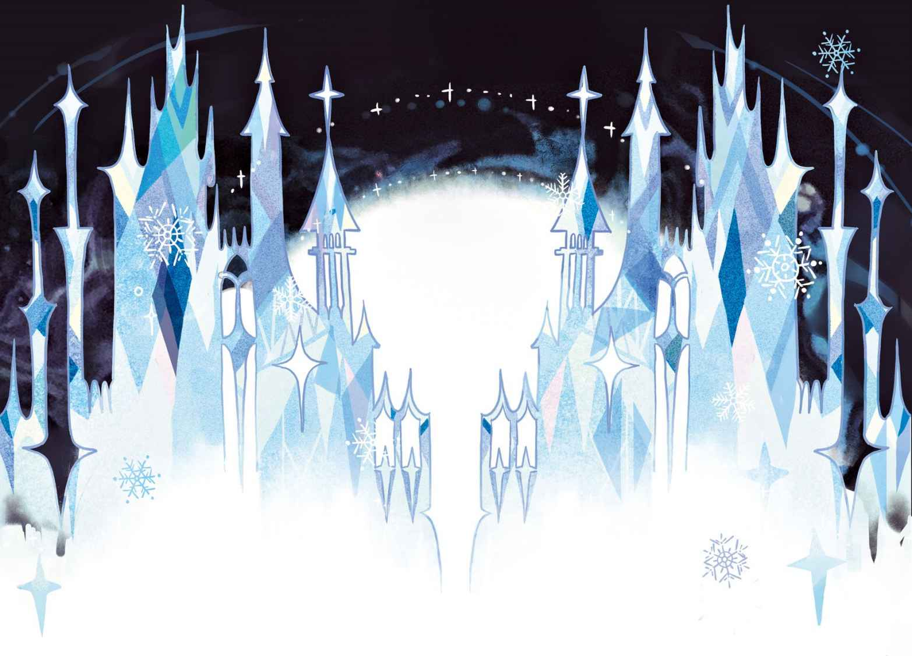
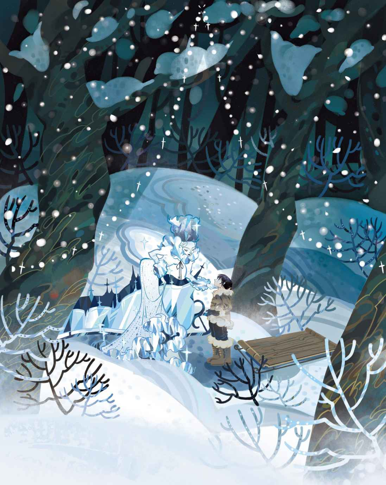
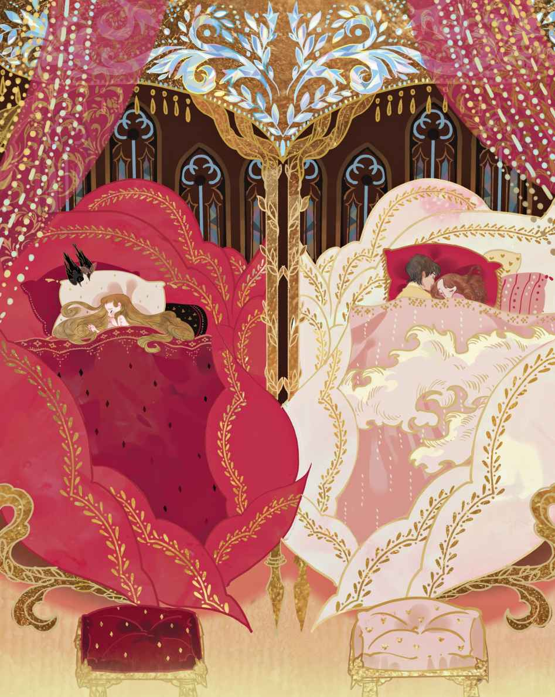
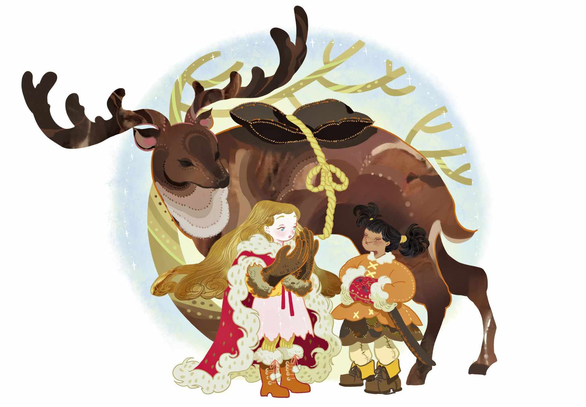
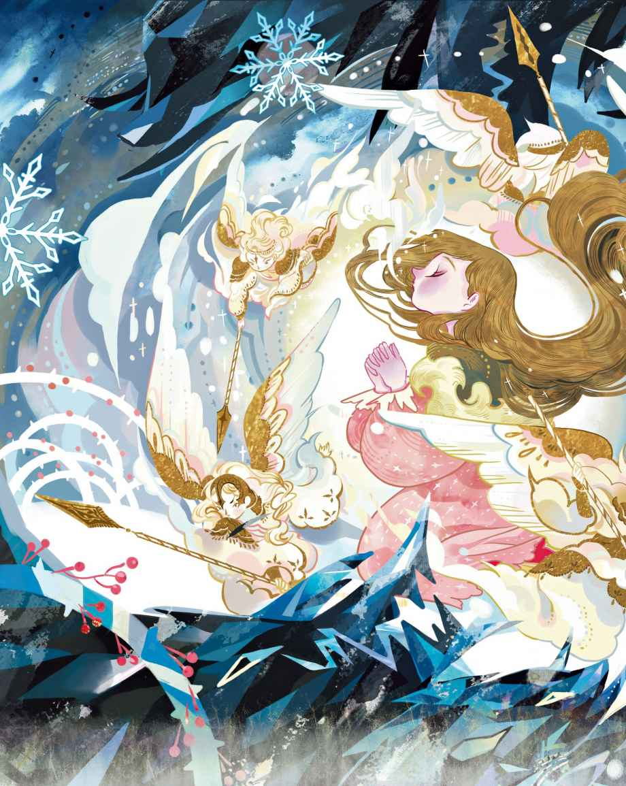
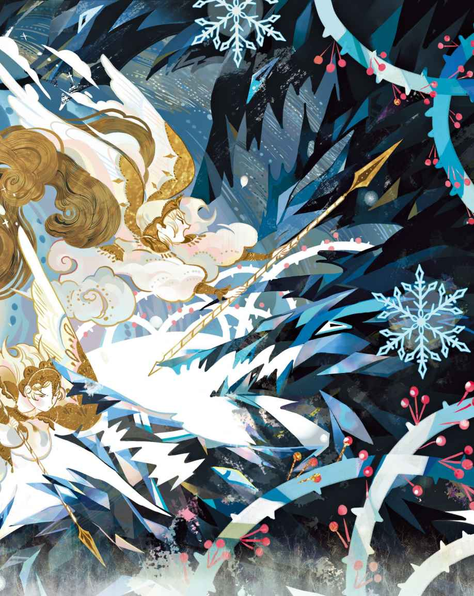
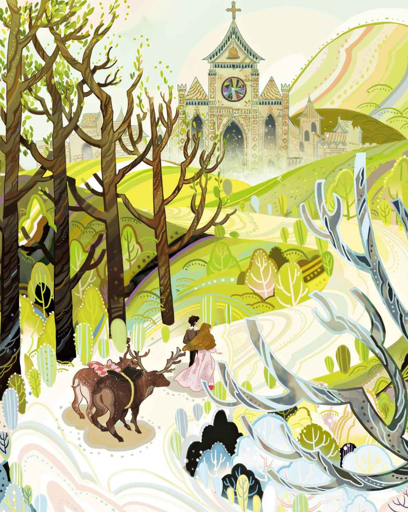

# 冰雪女王

好吧！故事这就开始。当这个故事结束的时候，你会知道很多自己不曾知晓的事情。

那真是个坏透了的妖精，他可是妖精中最为邪恶的那种，说白了，他就是个恶魔。这天，恶魔的心情很不错，因为他做成了一面镜子。这面镜子被注入了奇异的魔力：万物美好的那一面都会在镜中被抹除殆尽；而万物卑微、丑陋的那一面都会在镜子中变得极为惹眼，甚至远比原来的模样还要丑恶得多。在这面镜子里，那些最美丽的风景看上去全都如同煮烂的菠菜；而那些最善良的人全都会变得丑陋不堪，不是用脑袋倒立着，就是连肚子也没有了。他们的脸庞都被扭曲到无法识别的地步。假如谁的脸上有块雀斑，那么这块雀斑就会在镜子中膨胀，胀得把鼻子和嘴巴都给遮住。

“真是太有意思了！”恶魔说。谁要是有个善良、好心的念头从脑海中闪过，那么这个念头在镜子里呈现出来的，将会是一个下流的贼笑。恶魔对着他那鬼斧神工的发明放声大笑。

所有在妖精学校上过学的人——恶魔拥有一所属于自己的学校——都说奇迹已然诞生。现在，他们宣称，这是史无前例的第一次，大家终于可以看到整个世界，以及这个世界里的人们的真面目了。他们带着镜子到处奔走，把这世上的每一个活人、每一寸土地，全都扭曲了个遍。

接着他们打算飞去天堂，把天使们和基督也戏弄一番。随着他们越飞越高，镜子开始咧出一种邪笑，他们已经控制不住它了。他们越飞越高，越飞越高，距离天堂和天使们越来越近。也就在这时，正在邪笑的镜子猛烈地颤动起来，它滑出他们的双手朝着地面坠落下去，最后摔成了不计其数的小碎片，数量多得超乎想象。如此一来，它能惹出的麻烦可就比摔碎以前还要多了，因为有些碎片比一粒沙子还要细小，它们飞去了世界的各个角落。一旦它们钻进人们的眼睛，就会一直待着不走。这些镜子碎片会扭曲人们的所见，让人们只看到事物丑陋的那一面，因为这些细小的碎片依然具有摔碎以前的那种魔力。

甚至有些人的心里也被附上了镜子碎片，这是极为可怕的事情，因为那些碎片会把他们的心变成冰块。有些很大的碎片被制成了窗玻璃——你可千万别透过这种窗户去看你的朋友们。还有些碎片被制成了眼镜，人们戴上眼镜是想要看得更清楚，希望看到公平正义，可是他们看到的却是邪恶的存在。这一切都让恶魔乐不可支、大笑不止，一直笑到身子发痛才作罢。而与此同时，还有很多碎片正在空中飞行。那么现在，你不如来听听看接下来到底发生了什么。

在一座拥挤的大城市里，房子挤房子，人挤人，很少有谁能找到带有小花园的房子，大多数人只能用花盆聊以自慰。不过，这座城市里生活着两个穷苦的孩子，他们倒是拥有一座花园，虽然它只比花盆大上一丁点儿。这两个孩子并不是兄妹，但他们就像兄妹一样相亲相爱。他们的父母住得很近，就住在两栋毗邻的房子的阁楼上。这两栋房子的屋顶碰在一块儿，雨水槽在当中牵线搭桥，两家的小窗也面面相对。只要抬脚跨过雨水槽，便能在两家的窗户之间进出自如。

就在这些窗户里面，他们的父母分别安置了一只大盒子，盒子里种了些用作食材的蔬菜，另外还种了小丛的玫瑰花。两只盒子里都种了玫瑰，而且都长得郁郁葱葱。眼下，父母们把这些盒子架在了排水槽上，这样，两扇窗户就几乎连在一块儿了，看上去简直就像两面花墙。豌豆藤沿着盒子垂挂下来，玫瑰花丛则抛出细长的小花枝，它们将窗户框裱起来，互相蜿蜒缠绕，使得窗户仿佛成了由绿树与花丛编织而成的凯旋门。两只盒子架得很高，孩子们知道他们不可能上去乱爬，不过他们时常能获得许可带上自己的小凳子来到屋顶

> **注 89**　这里指的应该是阁楼以下的屋顶，而不是阁楼本身的屋顶。孩子们从阁楼的窗户爬出去玩，把凳子放在下层的屋顶上，因此装有玫瑰花的盒子是在他们的上方。

到了冬天，当然咯，这样的愉快时光势必会告一段落。窗户总是被冰霜覆盖着，不过他们会把铜便士放在火炉上加热，然后把这些热乎乎的硬币贴在结满了冰霜的玻璃窗上。接着嘛，他们就找一个最佳的“窗洞”，圆圆的，就像一枚戒指，于是在这些窗洞的里面会出现一只明亮而友善的眼睛，两扇窗户里面各有一只这样的眼睛——那是一个小男孩，还有一个小女孩，他们正透过“窗洞”互相对着看呢。男孩的名字叫凯，女孩的名字叫格尔达。夏天的时候，他们只要轻轻一跳就能在一块儿了；可是在冬季，他们若是想要见到对方就不得不从这栋房子下楼梯，再从那栋房子上楼梯。此时外面大雪纷飞。

“瞧啊，那些雪白的蜜蜂正在成群纷飞。”老祖母说。

“它们也有女王吗？”小男孩问，因为他知道，真正的蜜蜂是有女王的。

“有的，它们确实有女王，”祖母说，“她平时就隐藏在蜂群的最密集处，是所有蜜蜂中最大的。在这个世界上，她永远都不会甘于静默，不过总还是会飞回那乌云般的蜂群。冬夜里，她会在街道上飞来飞去，透过窗户朝里头窥视。那种时候，窗户上就会凝结出一层形状奇异的冰霜，看上去仿佛被冰花所覆盖。”

“噢，对呀，我们看见过那种冰花。”两个孩子说道。现在他们明白了，冰雪女王是真实存在的。

“那冰雪女王能进到这里来吗？”小女孩问道。

“行啊，让她来好了！”男孩喊道，“我会把她按到热火炉上，把她融化掉。”

然而祖母摇了摇脑袋，给他们讲起了别的故事。

这天晚上，小凯待在家里，差不多已经准备睡觉了。他爬上窗边的椅子，透过小窗洞朝外看去。他看到了几片飘落的雪花，其中最大的一片，就飘落在种玫瑰花的盒子上。这片雪花变得愈来愈大，最后变成了一个女人。她身穿华丽至极的白色纱衣，那衣服看上去仿佛是由数以百万计的星形雪花织就的。美丽而优雅的她，身体却如同冰雪一般泛着光，那是泛着光亮的冰雪。而即便如此，她仍是个活生生的人，眼睛闪烁，如同两颗冷亮的星星。可就是在这样的眼睛里，既看不到宁静，也找不到平和。她朝着窗户点头，并伸手示意。小男孩害怕极了，他跳下椅子的时候，好像看见有一只巨鸟从窗外飞过。

翌日，天气晴朗而寒冷。雪开始融化，春天来了。阳光照耀，绿草抽芽，燕子们开始筑巢，两扇窗户又豁然敞开，孩子们又在他们的屋顶小花园里玩耍了——正是那个高高地架在屋顶雨水槽上的“花园”。

这年夏天，玫瑰花盛开得尤为鲜艳烂漫。小女孩学了一首赞美诗，诗里面有一行正是关于玫瑰花的，这让她想起了他们的玫瑰花。于是她把这一句唱给男孩听，而男孩也跟着她一起唱道：

“山谷里，玫瑰花盛开得如此美丽，

在那里，找到圣婴，你一定可以。”

两个孩子手拉着手亲吻玫瑰花，仰望神圣的阳光，他们对着阳光说话，就好像圣婴存在于阳光里。那些夏日多么美好，室外的玫瑰花丛芳香四溢，这一切都是那么美丽，它们仿佛永远也不会停止盛放。

一天，凯和格尔达正在看关于鸟兽的图画书，突然之间——就在教堂塔楼的钟敲响五次的时候——凯叫了起来：“噢！有什么东西刺中了我的心脏。我的眼睛里也好像混入了什么东西。”

小女孩伸手搂住他的脖子，而他只是眨巴着眼睛。不，她在他的眼睛里面，看不到任何东西。

“我想那东西已经走了。”他说。然而它并没有走。它来自那面魔镜，正是那些尖锐的碎片之一。你还记得妖精的镜子吧——就是能够把所有伟大、美好的事物都映照得渺小、丑陋，把所有邪恶的事物都放大，并且让所有的缺点瑕疵都凸显出来的那面镜子。可怜的凯！镜子碎片已经扎进了他的心，很快，他的心就会变成一块冰。疼痛感已经消退，然而那碎片还留在里面。

“你为什么要哭喊？”他问道，“这让你看上去丑极了。我一点儿事也没有。”他突然又说：“呃！玫瑰花都被虫给蛀了。瞧，这朵已经耷拉下来了。还有这些，它们真是丑得要命啊，看上去就跟种它们的盒子一样。”他朝着盒子踢了一脚，把玫瑰花给折断了。

“凯！你这是干什么？”小女孩喊道。而当他看到她为此难过的时候，便又折断一枝玫瑰花，然后从自家的窗户跳进家里，把亲爱的小格尔达独自一人留在了原处。

此后，当格尔达拿出图画书的时候，他就会说，这种东西只适合给躺在摇篮里的婴儿看。而每当祖母讲故事的时候，他总是会插进来说一句“不对”。一旦逮到机会，他就偷偷跟在她身后，在鼻梁上架一副眼镜，戏仿她的模样。他扮得惟妙惟肖，惹得旁人都不禁大笑。没过多久，住在这条街上的每一个人的言行举止他都能模仿了。凡是人们表现出来的一切古怪、丑陋的言行，他都能模仿得如出一辙，于是人们都说：“这孩子肯定有个聪明的脑袋瓜！”然而，其实这是他眼睛里和心里的玻璃碎片在作祟，甚至就连全身心地爱着他的小格尔达，也没能逃过他的戏弄。

现在他的游戏已经跟之前很不一样，越发得寸进尺了。一个大雪纷飞的冬日，他拿着一大块放大镜来到外面，然后拉开蓝色外衣的下摆，让雪片飘落到衣服上。

“现在，透过放大镜看看。”他对格尔达说。只见雪片变得很大，看上去像是瑰丽的花儿，又像是长有十个尖角的星星。总之看起来美极了。

“看啊，多么富有美感！”凯说，“看这样的东西，比看真正的花儿有意思多了，因为它们美到了极致。在它们开始融化之前，身上不会有任何瑕疵。”

又过了一会儿，凯戴着大手套，背着雪橇下楼来了。他对着格尔达的耳朵大声喊道：“我已经得到同意，可以去大广场玩了，那儿有很多男孩子！”说完，他便跑开了。

广场上，那些爱冒险的男孩们把小雪橇系在农夫的马车后面，一路让马车拉着跑，这个游戏真是充满了乐趣。正当大家玩得起劲的时候，一只大雪橇

> **注 90**　这里的“大雪橇”和“小雪橇”虽然名字相近，但实际上有着很大的不同。前者一般是指那种由动物拉动的大型雪橇（类似圣诞老人的雪橇），可以乘载较多、较重的货物；后者特指专门给小孩子在冬天玩的小型雪橇，小孩子徒手便可拉动。

随着雪橇的飞驰，大雪的来势变得越发猛烈，男孩连自己伸在面前的手也看不见了。他突然松开手中的绳子，想要摆脱前面的大雪橇，可是这根本就不起作用。他的小雪橇已经牢牢地跟大雪橇系在一起，如风一般疾驶着。他大喊一声，然而没人能听见他的声音。风雪呼啸，雪橇依旧一路飞驰。它时不时地向上跃起，仿佛是在避开树篱和沟渠。男孩惊恐万分，他试着做祷告，可是眼下能记起的却只有乘法表。

雪花变得愈来愈大，看上去活像是白色的大母鸡。突然之间，大雪之中拉开一道帷幕，大雪橇停了下来，驾雪橇的人站起身来。那件皮外套和帽子原来都是冰雪做的，而把它们穿戴在身上的，是一个女人，一个高大、纤瘦、身上泛着白光的女人——她就是冰雪女王。

“刚才我们滑得不错。”她说，“你在发抖，是不是因为怕冷？钻到我的熊皮大衣里来吧。”于是她把他抱上大雪橇，让他坐在自己身边，而当她用皮大衣裹住他的时候，他感到自己仿佛沉入了雪堆。

“你还觉得冷吗？”她问道，然后在他的前额上吻了一下。嗞啦——嗞啦——那个吻比冰还要冰冷。他感受到这种冰冷，就在自己的心房，就在那一半已经变成冰块的心上。他觉得自己就快死了，但这种感觉只持续了一小会儿。接着他便感到舒服多了，再也没有留意那种冰冷的感觉。

“我的小雪橇！别忘了我的小雪橇！”他只惦记着这个。小雪橇被绑在了一只白色的母鸡身上，那只母鸡背着小雪橇飞在他们后面。冰雪女王又吻了凯，这一吻让他把小格尔达、祖母以及关于家里的一切，全都彻底遗忘了。

“现在你不会再得到吻了。”冰雪女王说，“再得到一个吻，你就会死去。”凯看着她，她是那么美丽！他简直无法想象还有比这更精巧、更完美的脸庞。她看上去不再是冰雪之身了，虽然凯在家透过窗看到她的时候，以及她点头召唤他的时候，她确实像是冰雪的化身。在他眼中她是那么完美，现在他一点也不觉得害怕了。他告诉她，自己有心算的本事，哪怕是分数也不成问题，他还知道所有国家的国土大小和人口数量。而她始终只是微笑，于是他又开始担心自己知道的或许并不像自以为的那么多。她带着他穿过乌云，高飞至天际，而他抬头仰望上方巨大、开阔的天空。风呼啸着，咆哮着，仿佛唱着古老的歌谣。

他们飞过森林和湖泊，飞过许许多多的陆地与海洋。在他们的下方，冷风吹袭，狼嚎阵阵，黑压压的鸦群飞过泛着光的雪原，发出尖声怪叫。不过在他们的上方，月亮释放着明亮而庞大的光芒。整个漫长的冬夜，凯的眼睛始终没有离开过那片月光。天亮的时候，他在冰雪女王的脚边睡着了。

凯没有回来的这段时间里，小格尔达是怎么过的呢？他会到哪里去呢？没有人知道。没有人捎来任何关于他的消息。那些男孩们能讲得出来的，顶多也就是他们看到凯把他的小雪橇钩在了一只好看的大雪橇上，然后一路沿街滑行，最后出了城门。没人知道凯后来怎么样了。这世上很多人都流过眼泪，但是小格尔达这次是哭得最伤心的。人们说凯已经死了——肯定是在离城外不远的河里淹死了。噢，这些漫长的冬日是多么灰暗啊！

不过，春日和暖阳到底还是来了。

“凯已经死了，他离开了这个世界。”小格尔达说。

“我不相信。”阳光说。

“他已经死了，不在这个世界上了。”她又对燕子们说道。

“我们不相信。”燕子们唱道。最后，小格尔达也变得不怎么确信了。一天早上，她对自己说：“我要穿上新的红鞋子，凯从来没见过的那双，然后我要去沿河打探他的下落。”

这时天还很早，她吻了仍在睡梦中的老祖母，然后穿上红鞋独自一人出了城门，朝那条河走去。

“我的好朋友被你带走了，这是真的吗？如果你能帮我把他带回来，我就把我的红鞋子送给你。”

河里的波浪似乎在用一种奇怪的方式点头，于是她脱下最心爱的红鞋子，把它们丢进了河里。然而它们只是掉在河岸边，小水浪把它们冲还给了她。看来河水无法接受这件她最心爱的礼物，因为它并没有带走小凯。不过，格尔达担心是自己丢得还不够远，于是她爬进一艘停在芦苇丛里的小船，然后走到船头再次把鞋子丢进了水里。然而小船并没有系牢，她刚才的动作使得它漂离了河岸，而且速度一下子变得很快。

小格尔达害怕极了，她开始哭泣，可是没有任何人会听见她的哭声，除了麻雀们。麻雀们无法把她带回岸上，但是它们沿着河岸叽叽喳喳地飞来飞去：“我们在这儿呢！我们在这儿呢！”仿佛这样能让格尔达有所安慰。小船顺着河水快速地漂流着，格尔达一动不动地坐在里头，脚上只穿着长袜子。她的小红鞋就在后面跟着一起漂流，但是它们赶不上她，因为小船的航行速度有增无减。河流两岸的景色很漂亮，岸上有着美丽的花朵、树龄久远的古树，还有放牧着牛羊的山坡。然而格尔达没有看到一个人。

“也许河流是要带我去见小凯吧。”她心想，这让她感觉舒服多了。她站起身，久久地注视着那绿色的河岸。

接着，她来到一片樱桃园。园内有座小房子，房子上开着红色和蓝色的奇怪窗户，此外还有个茅草盖的房顶。房子外面则站着两个木头士兵，无论谁从面前漂流而过，他们都是一副举枪敬礼的姿势。

格尔达以为他们都是活人，便朝着他们大声招呼起来，不过他们自然不会答应她。水流把小船冲向岸边，现在她漂得离他们非常近了，于是格尔达喊得更大声了。房子里出来了一个很老的老妇人。她拄着一根歪歪扭扭的手杖，头戴一顶硕大的太阳帽，帽子上绘有鲜艳的花朵。

“可怜的孩子！”老妇人开口了，“你是如何在这条大河上迷途的，又是如何漂流到这么遥远而陌生地方来的呢？”她蹚到水里，用那根歪歪扭扭的手杖钩住小船，将它拉到河岸边，然后把小格尔达从里头抱了出来。

又能回到陆地上，格尔达感到很高兴。不过对于这位奇怪的老妇人，她还是觉得有点害怕。老妇人对她说：“来，告诉我你是谁，还有你是怎么来到这儿的。”于是格尔达把一切都告诉了她。老妇人摇着头，说着：“嗯，嗯！”当格尔达讲完一切，然后问她是否见到过小凯的时候，老妇人说那孩子没有来过这儿，不过，说不定哪天他真的会来。她还告诉格尔达，别把这件事太放在心上，不如先去尝尝她种的樱桃，看看她养的花儿。它们比任何图画书里的东西还要美，而且每一朵花儿都能讲一个故事。就这样，她牵起格尔达的手，把她带进她的小房子，然后锁上了房门。

这里的窗户全都开在墙壁的高处，阳光穿过那些红、蓝、黄色的窗玻璃流淌进来，把所有的色彩都奇异地糅合在了一起，桌上则摆放着美味可口的樱桃。格兰达不再害怕了，她尽情地吃了个够。在她吃东西的时候，老妇人用一把金梳子替她梳着头发。格尔达那美丽的秀发在温和的小脸蛋两侧被梳成了光滑的金黄色的卷儿，那发卷儿圆得就像盛放的玫瑰花。

“我一直想要一个像你这样的小女孩。”老妇人对她说道，“现在瞧着吧，我们会相处得很好的。”头发一梳完，格尔达便忘掉了关于凯的事，因为这位老妇人精通魔法。不过，她并不是一个坏心眼的女巫，她的魔法浅尝辄止，顶多也就是自娱自乐罢了，然而她真的很想留下小格尔达。于是她来到房子外面，拿起那根歪歪扭扭的手杖指向所有的玫瑰花丛，只见它们带着盛放的美丽一齐沉入了黑色的泥土里，没有留下任何痕迹。老妇人怕格尔达看到它们的时候，会一下子让她想起自己的那些玫瑰花，想起小凯，然后就会离开这里。

格尔达被领去了花园。花园里多么芳香四溢，多么美丽呀！无论是什么品种的花儿，不管它们原先在什么季节开放，眼下全都在这儿盛开着。任何图画书都不可能如此好看、如此鲜艳。格尔达欢快得跳了起来，在这个花园里一直玩到日落时分，直到太阳隐没在高高的樱桃树后。接着，她舒舒服服地钻进了一张美丽的床铺，红色的丝绸床罩下垫满了蓝色的紫罗兰。她就在这样的床上睡着了，然后进入了梦乡，一切都华丽得如同女王的新婚日。

翌日早晨，她又来到外面温暖的阳光下，想要和那些花儿们一起玩耍——这些天来她都是如此。这里的每一朵花儿格尔达都了然于心，虽然它们是那么纷繁锦簇。她总觉得自己似乎遗漏了什么花，至于究竟是什么花儿，她却又说不上来。一天，她坐在床上看着老妇人的太阳帽。那帽子上描绘的所有花儿当中，最美的是一朵玫瑰花。老妇人让那些真的玫瑰花消失掉的时候，忘了自己的帽子上还绘有一朵。这就是那种谁也无法料到的事情。

“为什么这里没有玫瑰花了？”格尔达说道。她从紫罗兰花床上冲了下来，到处寻找玫瑰花，可是连一朵也没有找到。于是她坐下来开始哭泣。当滚烫的眼泪滴落到地上，滴落在玫瑰花丛消失的地方时，那些温暖的泪珠湿润了泥土，曾经消失的花儿们又钻了出来，绽放得同之前一样鲜艳。格尔达拥抱着它们，亲吻着它们。她想起了自己那些好看的玫瑰，想起了小凯。

“噢，我已经耽误太久了。”小格尔达说。“我应该去找凯才对。你们知道他在哪里吗？”她问玫瑰花们，“你们觉得他已经死了，离开这个世界了吗？”

“不，他没有死。”玫瑰花们告诉她，“我们去过地下，到过死人的世界，但是凯不在那里。”

“谢谢你们。”小格尔达说。她来到其他花儿跟前，把嘴唇靠近它们，问道：“你们知道小凯在哪里吗？”

然而花儿们只是伫立在阳光下，梦吟着自己的童话、各自的故事。虽然格尔达倾听了很多很多，可是没有一朵花儿知道凯的下落。

卷丹百合说了什么呢？“你听见过鼓声了吗？咚、咚！就两下，每次都是咚、咚！听，那是女人们的痛哭声。听，那是神父们的诵吟声。印度女人身穿红色长袍站在葬礼的柴火堆上，火焰包围着她和她死去的丈夫。然而印度女人心里想着的，却是围观人群中的某个活生生的人。她就这样想着他，而他的眼睛燃烧得比火焰还要炽烈——那炽热的目光深深地洞穿了她的心，远比火焰烧得还要彻底，尽管火焰很快就会将她的身体焚为灰烬。那心中的火焰，会在火葬柴堆上的火焰里死去吗？

> **注 91**　此处涉及印度旧习。旧时印度女性社会地位低下，一旦丧夫，那么等待她们的命运一般只有四种：要么嫁给亡夫的兄弟，要么和亡夫一同火葬，要么在专门的寡妇院里度过余生，要么去完全无人认识的地方重新生活。今天的印度女性地位仍然有待提高。安徒生在这里是借卷丹百合之口，道出自己对这种陋习的痛心，并寄托了美好的希望。

“我完全听不懂嘛。”小格尔达说。

“这是我的童话故事。

> **注 92**　对应前文所说的“每一朵花儿都能讲一个故事”。

喇叭花说了什么呢？“群山之中的一条窄径上耸立着一座古老的城堡。浓密的常春藤叶子层层叠叠，一路爬到城堡的阳台。阳台上站着一位美丽的少女，她将身子探出栏杆望着下面的小径。任何玫瑰枝上的花朵，都不可能像她这般优雅；任何微风中的苹果花，都不可能如她那般轻盈。听，她身上的丝绸长衣正在沙沙作响，仿佛是在叹息：‘他会来吗？’”

“你说的是凯吗？”小格尔达问道。

“我只是在说我的故事，我自己的梦。”喇叭花回答道。

雪铃花说了什么呢？

“两棵树木之间有一条船，船用两根绳子悬挂着，这就成了一架秋千。两个漂亮的小女孩正在荡秋千，她们身穿雪白的衣裳，帽檐上挂着绿色的长丝带。她们的兄长，那位年龄要大些的哥哥，也在这架秋千上，就站在她们身后，用两条胳膊勾住绳子以便保持住姿势。他一手拿着小杯子一手拿着陶管，正在吹肥皂泡。随着秋千的摇摆，泡泡们变幻着色彩飘浮了起来。最后一只泡泡还贴在陶管口上，在空气中来来回回地晃动着。他们的小黑狗轻得活像是一只泡泡，扑在哥哥的后腿上，也想要爬上秋千。然而秋千没有停下来，而是忽高忽低地晃荡着，最后小狗失去平衡，生气地叫了起来。他们是在逗它呢，这时最后那只泡泡破了。在这只泡泡破掉之前，里面有过一幅秋千船的画面——这就是我的故事。”

“这或许是个好故事，只是你讲得太忧伤了，而且你根本就没有提到凯。”

风信子说了什么呢？

“从前有三个姐妹，她们的模样完全透明，而且非常好看。其中一个穿红衣服，一个穿蓝衣服，还有一个穿白衣服。她们手挽着手，在明朗的月光下和平静的湖边跳舞。她们并不是妖精，都是人类。空气中有种甜甜的香味。接着，三姐妹消失在了森林深处，空气中的香味变得更甜了。三具棺材悄然飘出森林，飘过那片湖，棺材里分别躺着三姐妹。萤火虫在她们身边飞舞，犹如许多细微、闪烁的灯火。跳舞的三姐妹是睡着了，还是已经离开人世了？花儿们用自己的香味说，她们已经离开人世。于是它们敲响晚钟

> **注 93**　这里应该是一种形象的说法，意思是花儿们敲响了自己的钟（很多花朵的形状为钟状），下文风信子的说法也是这个意思。

“你把我弄得很难过。”小格尔达说，“你们的香味太浓烈了，我忍不住要去想那死去的三姐妹。噢，小凯会不会已经死了？那些玫瑰花已经去过地下世界，它们说凯没有死。”

“叮，咚，”风信子们丁零作响道，“我们并不是为小凯敲钟，我们不认识他。我们只是纯粹地唱自己的歌——那是我们唯一会唱的歌。”

这么着，格尔达又转向了毛茛，它正在绿莹莹的叶子当中闪耀着。

“你看上去就像一颗明亮的小太阳。”格尔达说，“告诉我，要到哪里才能找到我的朋友呢？”

毛茛抬头看格尔达，亮晃晃地闪耀着。然而它唱的又会是什么歌呢？肯定不是关于凯的。

“在一座小庭院里，神圣的阳光在春日的头一天里照耀着，光线拂过那户人家的白墙。附近，春天开出的第一片嫩黄的花儿，正在温暖的阳光下如同金子般闪烁着。一位老婆婆坐在外面的椅子上，她孙女是个贫苦的女佣，长得却很漂亮。眼下她回家来看望祖母了，她吻了祖母，那个吻是金色的。她的心也涂满了金色，她的唇是金色的，她的梦境是金色的，头顶上的清晨阳光也是金色的。好了，我的小故事已经讲给你听了。”毛茛说。

“噢，我可怜的老祖母。”格尔达说，“她会很想念我的。她一定在为我而感到难过，就像她为凯感到难过一样。我会回家的，但是我要把凯一起带回家。向花儿们打听他的下落，看样子是不会有什么用了。它们只知道自己的那些歌，除此以外一无所知，提供不了任何消息给我。”

如此，她收起裙摆，想要快些离开，然而就在她抬脚跳过水仙花的时候，水仙拍了拍她的腿。于是她停下来，朝这朵高高的花儿俯下了身子。“也许你是有话要告诉我。”她说。

水仙花说了什么呢？

“我仿佛看到了自己！我仿佛看到了自己！噢，我的香味是多么甜美！在一间狭小的阁楼上，有一个小小舞者，衣服只穿了一半。她先是单腿起舞，接着又换作双腿并用，她踢动脚后跟，将整个世界踩在脚下，仿佛站到了舞台上。她把茶壶里的水倾倒在手中的一件衣服上——那是她的上衣。清洁真是一种美德！她的白裙子挂在钩子上，这条裙子也用茶壶里的水洗过，已经在屋顶上晾干。她穿起裙子，然后在脖子上围了一条橘黄色的围巾，好让裙子显得更加洁白。踮起脚尖，看！她是如何用单腿

> **注 94**　此处双关，原文意为花的茎秆，这里又指舞者的腿。水仙花说的这个故事，其实是在赞美自己，比如强调“清洁”和“洁白”，又比如“衣服只穿了一半”（水仙的花茎很长，看上去就像是衣服穿了一半的样子），“将整个世界踩在脚下”（自我感觉良好），“橘黄色的围巾”（水仙的花瓣为白色，正如同舞者的衣服，而靠近花蕊的部分为橘黄色，就像是一条围巾），这些都符合水仙花的特征。上文也用“高高的”形容水仙，而且水仙花历来就代表着自恋——在上文中，唯独水仙主动要求格尔达听自己的故事，其他花儿都是被动的。

> **注 95**　原文为“保持笔直”，这里也是水仙花在自诩（水仙的花茎虽然很长，但是姿势笔直）。

“我一点也不感兴趣，”格尔达说，“你跟我说的都是些什么呀！”

她跑去了花园尽头。虽然大门上着锁，但她还是想方设法弄开已经生锈的门锁。最后，门锁终于松开了，门也随之洞开，小格尔达光着脚奔向外面的世界。她回头看了三次，没有人跟在后面。最后她再也跑不动了，便坐到一块大石头上休息。她抬起头，这才发现夏天已然过去，眼下已是深秋时节。身在那座美丽的花园的时候，她从未意识到这点，因为那里的太阳总是那么耀眼，而不同季节的花儿们又总是保持着盛放。

“天呐！我已经浪费了太多时间。”格尔达说，“现在已经是秋天。我不能再这么休息下去了。”

于是她站起身想要继续奔跑，可是她的脚好痛，她实在太累了！目力所及之处尽是寒冷和萧瑟的景象！柳树修长的枝叶已经变得枯黄不堪，雾气形成的潮水从叶片上滴落下来，如同雨露一般，而树叶本身也接二连三地掉落到地上。唯有黑刺李依旧结着果实

> **注 96**　黑刺李分布于欧洲，耐寒性极强，果实呈蓝黑色，可酿酒。

当格尔达不得不再次停下来休息的时候，一只大乌鸦正好从她眼前的雪地上蹦过去。他一直盯着她看，脑袋则歪在一边，现在他说话了：“啊，啊！你好啊！”虽然他只有这么点儿口才，但确实对格尔达很有好感。他问她，怎么会孤身一人来到这个陌生的地方。当他说“孤身一人”的时候，格尔达明白了他的话，对于这个词，她可真是深有体会。她对乌鸦述说了自己经历的一切，然后问他有没有看到过凯。乌鸦非常认真地点了点头，叫道：“好像看到过，好像看到过！”

“什么！你真的看到过他？”小格尔达也叫了起来，她使劲儿抱住乌鸦亲了上去，乌鸦都快被她给勒死了。

“轻点儿，轻点儿！”乌鸦说，“我觉得自己看到的应该就是凯，可如果那真的是他，恐怕他已经忘了你，因为他有了一位公主。”

“他跟一位公主生活在一起？”格尔达问道。

“是啊，听着！”乌鸦说，“对我来说，要讲你的语言是很难的事情。你要是能听懂乌鸦的语言，那我讲起来就能轻松多了。”

“我不懂乌鸦的语言，”格尔达说，“我的祖母倒是能听懂，她还能听懂婴儿的话语，我真希望自己也掌握了这种能力。”

“不管了，”乌鸦说，“我就尽我所能讲给你听好了，虽然可能会讲得不太好。”于是他把自己所知的全都告诉了格尔达。

“在我们眼下身处的这个国度里有一位公主，她聪明非凡，无所不晓。她把世界上的所有报纸都读了个遍，然后再把它们忘掉——她已经聪明到了无聊的地步。对了，就在不久前，她登上了王座。然而就跟人们所猜想的一样，这对她而言也没什么意思，于是她哼起一支老歌来，副歌

> **注 97**　副歌的歌词一般都是反复的。

“‘对呀，噢，对呀，我何不结婚呢？’

“‘对呀，这真是个好主意！’她说。于是她下定决心，一旦找到合适人选就立即结婚。前提是该人选在别人跟他讲话时能够有很好的谈吐，只会傻站着的人可不行。光中看不中用，这样的人太无趣了。于是她下令击鼓，唤来侍女们，而当侍女们听闻公主的决定之后，全都欣喜万分。

“‘噢，我们喜欢这个主意！’她们说，‘我们其实也是这么想的。’

“‘相信我，”乌鸦说，“我说的每个字都是真的。我有个已经跟我定了亲的恋人，她去过王宫里头。我这整个故事都是从她那儿听来的。”当然了，他的未婚妻也是一只乌鸦。毕竟物以类聚，鸟以群分嘛。

“报纸上很快就登出了布告，配以花边心形图框，框内是公主的名字首字母。布告的内容说，任何体面的年轻男士均可前往王宫与公主一叙，谁的谈吐最佳，谁看上去和整个王宫最相得益彰，谁就可以成为公主的夫婿。”

“没错，没错。”乌鸦说，“相信我，这绝对属实，就跟我本人坐在那儿亲眼目睹没什么两样。男人们成群地涌向王宫，整个宫殿被挤得水泄不通，不过头两天没有任何人被选上。在外面大街上等待的时候，他们全都能说会道，可是当他们走进王宫的大门，看到卫兵驻守在那儿，身穿纯银织就的制服；当他们爬上台阶，看到男侍沿阶列队，身穿纯金刺绣的制服，乃至抵达金碧辉煌的会客厅之后，他们都已经不会说话了。当他们站在身处王座的公主面前时，顶多只能附和一下公主的言论，而公主对此丝毫没有兴趣。

“每个置身于王宫会客厅的人仿佛都吸了满满一肚子鼻烟

> **注 98**　鼻烟吸入过多可致人昏醉。

“应征者的队伍从城门口一路排到王宫，我亲眼所见的哦。”乌鸦说，“他们又饥又渴，然而王宫并没有提供任何东西——连一杯温水也没有。诚然，一些聪明的应征者自带了点三明治，但是他们可不愿意跟身旁的人分享。每个人都这么想：‘就让那人看上去饥肠辘辘好了，公主肯定看不上他！’”

“可是凯呢，小凯呢，”格尔达打断他道，“他什么时候才会出现？他也在那些应征者里面吗？”

“给我点时间，给我点时间！我们就要说到他了。到了第三天，来了个小人儿，他既没有马匹也没有马车，就那么果敢地信步走向王宫。他的目光明亮，就跟你一样，还有一头帅气的长发，然而他身上的衣服非常破旧。”

“噢，那就是凯！”格尔达说，高兴地拍起手来，“这下我终于找到他了。”

“他身后背着一只小背包。”乌鸦告诉她。

“不是背包，那肯定是他的小雪橇，”格尔达说，“他离开的时候就背着它。”

“也许是的，”乌鸦说，“我没有看得很仔细。不过我那位已经跟我定亲的恋人告诉我，凯走过王宫大门的时候，也看见了身穿银衣的卫兵，以及在台阶上列队的金衣男侍，但是他全然没有发憷，还向他们点头致意，对他们说：‘这么站在台阶上，想必非常乏味。我可要进去了。’

“会客大厅里灯火辉煌。国务大臣们、枢密院

> **注 99**　君主的咨询机构，主要由贵族、教士和重要官员组成，专门为君主提供意见。

“那一定就是凯，”格尔达说，“我知道他穿着一双新靴子。我听到过凯在祖母的房间里走路时，靴子发出的嘎吱声。”

“噢，它们嘎吱得不错。”乌鸦说，“当他径直走向公主时简直毫不畏惧。公主正坐在一颗珍珠上面，那颗珍珠大得跟手纺车轮似的。所有女侍的随从，以及她们的随从的随从；所有侍臣的侍从，以及他们的侍从的侍从，反正每一个带着侍从的人，全都站在了那儿。接着他们站得更近了，直接站在门口，看上去也更傲慢了。那些侍从的侍从的侍从一天到晚穿着便鞋

> **注 100**　所谓的便鞋有点类似拖鞋，但又不是中国常见的那种拖鞋，而是专门在室内配合睡衣穿的那种鞋子。有的便鞋是可以套住脚后跟的，拖鞋则不是这样。

“那场面肯定很吓人！”小格尔达说，“那么凯有没有赢得公主的芳心呢？”

“我要不是一只乌鸦，我都想跟公主结婚了，尽管我已经跟别人订了婚。他们都说，他的口才跟我有得一拼，虽然我讲的是乌鸦语。我那位未婚妻大致就是这么告诉我的，说他很有派头，人又英俊，他到那儿并不是要向公主献殷勤，而是去倾听她的智慧。他很喜欢这样，而公主也喜欢他这样。”

“那绝对就是凯了。”格尔达说，“他非常聪明，不仅会心算，而且连分数也不在话下。噢，请带我去王宫吧。”

“嘴上说是很容易，”乌鸦说，“可我们要怎么去呢？我得跟我那位未婚妻商量一下，也许她能给点建议，不过我还是要先提醒你，像你这样的小女孩，他们是从来不会放行的。”

“噢，我会进去的，”格尔达说，“只要凯听说是我，他就会立刻出来迎接我。”

“在那儿的树篱旁边等着我。”乌鸦说。他摇了摇脑袋，然后飞走了。

他回来的时候，天已经黑了。

“啊，啊！”他说，“我的未婚妻向你送来问候，还让我带了一小片面包给你。这是她在厨房里找到的，人们把面包全都存放在那儿，你一定很饿了吧。你可不能就这样光着脚去王宫，那些银衣卫兵和金衣男侍绝不会放行的。不过你也不用哭鼻子，我们会找到办法的。我的未婚妻听说王宫的后面还有一处通向卧室的楼梯，她还知道他们把钥匙放在哪儿。”

于是他们来到王宫的花园，沿着宽阔的散步道继续走，片片落叶飘落下来。当王宫里的灯火相继熄灭之后，乌鸦领着小格尔达来到了半开着的后门那儿。

噢，她的心跳得多么厉害，充满了胆怯和期盼，就好像她准备要做的是见不得人的勾当。然而她一心想要弄明白，那到底是不是小凯。是的，那一定是凯，她心想。她回忆起了他那明晃晃的目光，还有他的长发。她很清楚地记得他的模样，记得他们一起坐在家里的玫瑰花下的时候，他总是对着她微笑。他一定会很高兴见到她的！他一定会很愿意听她说自己是如何远离家乡，只为找到他；而他离家之后，她和祖母又是多么的难过。她是那么胆怯，却又是那么开心。

眼下他们已经在楼梯上了。壁橱上点着一盏小灯，乌鸦的未婚妻就在那儿，她抬起头来打量着格尔达，格尔达则行了个屈膝礼，这是祖母教她的。

“我的未婚夫把你的那些奇事都讲给我听了，我亲爱的小姑娘。”她说，“你所经历的这一切可以说真是感人极了。请把灯拿好，我来带路吧。我们一直往前走，这条路不会碰见任何人。”

“我总觉得后面的楼梯上似乎有人。”格尔达说。有什么东西与他们擦肩而过，墙上浮现出各种影子，有的看上去像是四肢细长的马，有的则像是飘来飘去的幽灵。马背上还有猎人、女士和绅士的影子。

“那些都是梦影，”乌鸦未婚妻说，“是那些王公贵族们睡觉时飘出来的思绪，他们正在狩猎呢。其实这倒也不坏，因为你可以趁机瞧瞧他们睡着时究竟在想些什么。不过我可以确信的是，假如你登上高位，掌了权，你的梦影一定会是一颗美好的心。”

“啧啧！那还用说嘛。”乌鸦说。

此时他们进入了第一个房间。这个房间里挂着玫瑰色的缎子，上面绣着花朵图案。那些梦影一晃而过，速度如此之快，以至于格尔达根本没看清那些王爵和女士的模样，而鳞次栉比的宏伟厅堂更是令她感到晕头转向，好在最后他们终于来到了王宫的卧室。

卧室的天花板像是一棵大棕榈树的树冠，上面满是用玻璃做成的树叶——非常昂贵的玻璃制品。房间当中，两根黄金藤条吊着两张床，宛如百合花一般。其中一张床是白色的，公主就睡在里面。而另一张床是红色的，格尔达希望自己能在里面找到凯。她掰开一片绯红的花瓣，看见了一片棕黄色的颈背，那是人的脖子。这一定就是凯了。她大声喊出他的名字，把灯盏拿近到他身边。那些骑着马的梦影又跃腾进来了，与此同时，花床里的人也醒了——他转过头来——那根本就不是凯。

王子只有脖子长得像凯，不过他也是个英俊的年轻人。公主从她的白百合床里探出脑袋，问这是出了什么事。小格尔达哭了起来，把自己所经历的一切都告诉了他们，还讲了乌鸦未婚夫妇是怎么帮她溜进来的。

“可怜的小孩子。”王子和公主说道。他们对两只乌鸦表示赞许，还说他们一点儿也不会对此感到气恼，只是以后别再这么干了。此外，他们还觉得乌鸦未婚夫妇应该得到奖赏。

“你们是想要就这么一无所获地飞走呢，”公主说，“还是愿意成为终身制的皇家乌鸦，在厨房里坐享一切多余的饭菜呢？”

两只乌鸦都深深鞠躬，申请成为宫廷的永久性居民，因为他们要考虑到自己的将来。他们说，还是让自己的“晚年”——他们用了这个词——有备无患为妙。

王子从床上起来，让格尔达睡了进去，这是他眼下力所能及的。格尔达紧握着自己的小手，心想：“这些人和乌鸦多好啊。”她闭上眼睛，沉入了安详的睡眠。她的梦影开始飞舞起来，看上去仿佛是天使，他们拉着一只小雪橇，凯就坐在雪橇上。他对着她频频点头，可这只是梦境。她醒来的时候，一切都消失不见了。

第二天，格尔达从头到脚都换上了丝绸和天鹅绒衣服。王子和公主请她留在王宫里好好地静养一段时间，然而她却请求他们，给她配备一辆小马车、一匹小马，以及一双靴子，这样她就能驾车再次去外面的世界寻找凯了。

他们给了她一双靴子，还有一只皮手笼

> **注 101**　冬日保暖物品，呈圆筒形，两端开口，以便将双手塞入保暖。制作材料一般为皮毛或棉花。

车夫、男侍、马夫——还有专门的马夫呢——全都戴着黄金冠冕。王子和公主亲自帮她坐进车里，然后祝福她诸事顺利。那只森林乌鸦现在已经成了已婚人士，在头三英里的路途中一直陪伴着格尔达。他就坐在格尔达旁边，因为朝后坐实在叫他受不了。他的妻子则站在王宫的大门口挥动着翅膀向他们告别。她没有过来陪他们，因为正在犯头痛，这是她到了厨房之后饮食过量所致。马车的车厢内侧布满了甜品，座位上也满是水果和姜饼。

“一路顺风，一路顺风！”王子和公主喊道。在送行的那段路上，小格尔达哭了，乌鸦也哭了。此后乌鸦向她道别，再也没有比这更令人难过的别离了。乌鸦飞到一棵树上挥动着他那又大又黑的翅膀，一直目送着离去的马车。那辆马车泛着光

> **注 102**　因为这辆马车是用纯金打造的。

马车前行，驶入一片黑暗的森林，如同一把燃烧的火炬照亮了强盗们的眼睛。他们是不会放过它的。

“那是金子做的！金子做的！”他们叫了起来。他们蹦到马车跟前，抓住马匹，杀掉小车夫、马夫和男侍，然后把小格尔达从车里拖了出来。

“她看上去真是又胖又嫩，搞不好是吃坚果吃成这样的！”强盗中的一个老女人嚷道。她长着又长又密的胡子，眉毛长得一直垂到眼睛上。“她看上去活像只小肥羊，会是一道可口的美餐！”说着，她亮出了刀子，一把可怕的、闪着光的刀子。

“哎哟！”老女人大叫一声，因为她背在身后的小女儿这时突然咬了她的耳朵。这个小姑娘可是个顽皮的野东西。“你这个小丫头！”她大声说道。这一咬弄得她没能对格尔达下手。

“她应该和我一起玩。”小强盗丫头说，“她得把她的皮手笼还有身上穿的漂亮衣服都给我，还得跟我在同一张床上睡觉。”她又狠狠地咬了她妈妈一口，老女人痛得又是跺脚又是转圈。强盗们都大笑着喊道：“瞧啊，她跟她的小丫头跳起舞来了。”

“我要坐马车。”小强盗丫头说。她说到就要做到，因为她实在太骄纵、太犟头倔脑了，简直没办法用文字形容。她和格尔达爬进马车，然后驾车碾过地上的树枝和石头，进入了森林深处。小强盗丫头长得还没格尔达高，不过她更强壮，肩膀也比格尔达要宽得多。她的皮肤呈棕黄色，眼睛则是煤黑色的——看上去一副愁眉苦脸的样子。她用胳膊勾住格尔达，说：“除非我生你的气，否则他们不可以杀你。我觉得你肯定是个公主。”

“不，我不是的。”小格尔达说。她将自己身上发生的一切和盘托出，还说自己是多么喜欢凯。小强盗丫头表情严肃地看着格尔达，然后对着她点头说道：“就算我生你的气，他们也不能杀你，只有我自己可以动手！”言毕，她擦干了格尔达的眼睛，然后把自己的手伸进了格尔达那只又软又暖的手笼里。

最后，马车停在了强盗城堡的院子里。城堡的墙体从上到下布满裂痕，乌鸦和渡鸦们从破裂的洞口里飞出来。这里的牛头犬可以跳到半空中，个头大得足以吞掉一整个人。不过它们从不叫出声儿，因为吠叫是被禁止的。

烟雾弥漫的老旧大厅里，一大团火正在石头铺筑的地板中央燃烧。火烧出来的烟直冲天花板，那里是排烟的唯一通道。煮沸的汤水在一口大锅里翻滚，而野兔和家兔

> **注 103**　这里的野兔（hares）和家兔（rabbits）是两种不同的动物，前者耳朵和后腿较长，整体较为健硕，体型有点类似小型袋鼠；后者耳朵较短，体型较小，呈圆球形。两者的染色体数量不同，属于不同兔科，而且前者独居，后者群居，生活习性也有所不同。

“今晚你要跟我和我的动物们一起睡觉。”小强盗丫头说。吃饱喝足之后，她们转而来到一处铺着毯子和稻草的墙角。在这张由枝枝杆杆组成的“床”四周，栖息着将近一百只鸽子。看样子它们已经睡着了，不过当这两个小姑娘靠近它们的时候，还是引起了些许骚动。

“它们全都是属于我的。”小强盗丫头说。她逮住离自己最近的那只鸽子，抓着它的腿，把它甩得直拍翅膀。“亲它一口吧。”她嚷嚷着，拿着鸽子朝格尔达脸上戳了戳。“那两位是来自森林的淘气鬼。”她又说，伸手指着墙上的高处，那儿有个墙洞，墙洞上有两根木条儿封着。“这两根木条儿都是淘气鬼，要是不把它们固定住，不出一分钟它们就会飞走。”

“还有，这是我的老宝贝，它就叫‘贝’。”说着，她又扯起一只驯鹿的鹿角来。驯鹿的脖子上系着一只亮闪闪的铜项圈。“我们必须牢牢盯住它才行，不然的话，它也会从我们这儿逃走。每天晚上我都要拿刀刃在脖子上比画两下，叫它知道害怕。”她从一个墙洞里拔出一把长刀，然后用它在驯鹿的脖子上摩挲着。等到这可怜的动物被吓得蹄子乱蹬，小强盗丫头才大笑起来，然后拉着格尔达到床上陪她睡觉。

“你上床睡觉的时候也随身带着刀吗？”格尔达问道，她有点害怕地看着那把刀。

“我总是跟我的刀一起睡，”小强盗丫头说，“你永远不知道会有什么危险找上门来。

> **注 104**　这里原文直译的意思应该是“你永远也不知道会发生什么”，但是这样译看起来会感到莫名其妙。但这句话的意思其实是带着刀睡觉防身，以免夜里有危险。故译作此。

格尔达把所有的故事又对她说了一遍。此时野鸽们在笼子里咕咕地叫，而家鸽都睡着了。小强盗丫头一只手勾住格尔达的脖子，另一只手紧握着刀，也睡着了，只听见她已经冒出了呼噜声。然而格尔达根本无法合眼，她不知道自己接下来究竟是死是活。强盗们围坐在火堆边，唱着歌，喝着酒，而那个老女人正在翻跟头。对于一个小女孩而言，这一切实在太可怕了。

这当儿，斑鸠

> **注 105**　属鸽形目，鸠鸽科，外形和鸽子较为接近，很容易被误以为是鸽子。

“你们说什么？”格尔达喊了起来，“冰雪女王去哪儿了？你们知道她去哪儿了吗？”

“她很可能前往拉普兰德

> **注 106**　靠近北极圈，冬季长达8个月之久。传说圣诞老人每年就是从这里出发，乘坐驯鹿拉的雪橇，为全世界的孩子们送去新年礼物。

“没错，那是个亮晶晶的冰雪世界。”驯鹿告诉她，“你可以在那片泛着光的广袤雪原上来去无阻。冰雪女王在那儿有个夏季帐篷，不过她真正的老巢是靠近北极的一座城堡，那城堡就在一座叫斯匹茨卑尔根

> **注 107**　挪威斯瓦尔巴特群岛（Svalbard）中最大的岛屿。

“噢，凯，小凯呀。”格尔达叹息起来。

“躺着别动，”小强盗丫头说话了，“不然我就拿刀子捅进你的肚子。”

到了早上，格尔达把斑鸠们说的那些全都告诉了她。小强盗丫头左思右想，然后点了点头，说：“这事儿包在我身上了！包在我身上。”

“你知道拉普兰德在哪里吗？”她问驯鹿。

“还有谁比我更清楚？”驯鹿说，他的眼睛都放光了，“我在那儿出生，在那儿长大，我曾经在那里的雪原上来去自如，自由自在。”

“听着！”小强盗丫头对格尔达说，“你都瞧见了，所有男的都走了。我妈还在，这会儿她会一直待着，不过等到早晨过后，她就会喝上一大瓶酒，然后醉醺醺地打个盹儿。一等她打盹儿，我就出手帮你来个大逆转。

> **注 108**　这里其实应该译成“助你一臂之力”比较好（原文是“I will do you a good turn.”），但是考虑到讲话的是个小强盗丫头，不可能使用成语，而是应该讲得较为粗俗才对，故译作此。

她从床里跳出来，然后扑到她妈妈身上，用胳膊抱住她的脖子，扯着她那硬邦邦的胡子，说：“早上好呀，我亲爱的母山羊。”她妈妈把她的鼻子揍得又红又紫，不过这是出于纯粹的疼爱。

一等她妈妈酒后开始打盹儿，小强盗丫头就跑到驯鹿那儿说：“我把你留在这儿，真是留对了。我还用刀子逗弄过你呢，我逗你的时候，你的反应可好玩了，不过这已经不重要了。现在我要解开你身上的绳子，然后领你找到出去的路，这样就能跑回拉普兰德去啦。但是你必须竭尽所能带着这个小姑娘去冰雪女王的宫殿，她的好朋友就在那里。她对我说过的那些，我猜你也该听明白了，因为她说得挺大声的，而你一直在偷听。”

驯鹿高兴坏了，一下子蹦到了半空中。小强盗丫头把小格尔达托到驯鹿背上，然后小心翼翼地用绳子将她系稳，她甚至还给格尔达准备了一块小垫子好让她坐在上面。“帮人帮到底嘛，”她说，“喏，把你的皮靴子拿回去吧，到了那儿会冷得要命的。我会留着你的手笼，因为它太好看了。不过你可别让自己的手指冻着，这是我妈的连指手套，大得可以套到你的胳膊肘那儿。把它们戴上吧，现在你的手看上去就跟我妈那对难看的大爪子一样啦。”

格尔达流下了开心的眼泪。

“我不希望看到你哭哦，”小强盗丫头说，“你现在应该振作起来才对。喏，拿着这两片面包还有这块火腿，这样你就不用挨饿了。”

这些备粮也被系在了驯鹿背上，然后小强盗丫头打开大门，把那些大狗都叫了进来。接着她用刀砍断了驯鹿的系绳，对他说：“现在，跑吧，一定要照顾好小格尔达啊。”

格尔达朝着小强盗丫头挥动戴在手上的大手套，向她告别。驯鹿开始向前跃进，踩过地上的树枝和石头，一路向着庞大的森林跑去，他穿过沼泽，穿过平原，以最快的速度奔跑着。狼群长嚎，渡鸦怪叫，啊——咻，啊——咻！天空中拉扯出一道道红光，声音听上去就像是在打喷嚏。

“那些都是我的老朋友——北极光，”驯鹿说，“瞧它们又闪又晃的。”他继续奔跑，夜以继日，比任何时候跑得都快。面包吃完了，整块火腿也下了肚——如此这般，他们终于抵达了拉普兰德。

他们在一座小棚屋前停了下来，这是一间临时住所。屋顶几乎快要触及地面，门也开得极低，住在里面的人恐怕要把肚子贴在地面上爬行才有可能从里头出来。屋子里没有其他人，只有一个上了年纪的拉普兰德女人，正在一盏鲸油灯上烤鱼。驯鹿把关于格尔达的故事全都告诉了她，不过他先讲了自己的故事，他总觉得自己的故事重要得多。至于格尔达，她已经冻得说不出话来了。

“噢，你这可怜的动物，”拉普兰德女人说，“你还有好长一段路要奔走呢。哎，要到芬马克

> **注 109**　挪威北部的一个郡，与芬兰毗邻。

格尔达驱走寒意，吃了点东西，又喝了点水，拉普兰德女人在烤干的鳕鱼身上写了一些字。她叮嘱格尔达把这东西收好了，然后帮她在驯鹿背上系稳。于是驯鹿又出发了。整夜，美轮美奂的北极光在他们头顶烁动，天空呈散裂状，飒飒作响。他们终于抵达芬马克，敲响了芬兰女人家的烟囱，因为她家似乎连门也没有。芬兰女人家里热得不行，她走来走去的时候几乎光着身子。她长得十分矮小，而且邋遢得要命，不过马上帮格尔达脱下了手套和靴子，帮着她宽衣解带，否则室内的热度恐怕会让格尔达蔫掉。接着，这女人还在驯鹿的脑袋瓜上放了一块冰，然后才开始看那些写在鳕鱼身上的字。她看了三遍，等到完全看明白了，便把这条鱼丢进一壶汤里。她觉得他们还是把它吃掉为好。她从不浪费任何东西。

驯鹿又是先讲自己的故事，然后才讲小格尔达的故事。芬兰女人心领神会地眨着眼睛，但是什么也没说。

“你是个很有能耐的女人，”驯鹿说，“我知道你用区区几根棉线就可以把穿行于世界的风给捆起来，谁要是解开一个线结，就能得到那股风的力量。若是再解开一个，他就会得到更强的风力，而若解开三个、四个，那么他将拥有猛烈的狂风，足以把树木林立的森林夷为平地。你能不能给这个小姑娘喝点什么呢？让她拥有相当于十二个男人的力量，这样她或许就能打败冰雪女王了。”

“十二个壮男，”芬兰女人不以为然地说，“应该能顶得上用场吧。”

她来到架子那儿取下一卷皮纸，然后把它展开。这张皮纸上记满了奇怪的符号，芬兰女人对着它们念叨起来，念得汗珠都从额头上滚落下来了。

驯鹿又求她帮助格尔达，而小格尔达也泪眼汪汪地用哀求的眼神看着她。于是这女人又开始眨眼睛了。她把驯鹿拉到旁边的墙角，给他脑门上换了另一块冰，与此同时，她小声告诉他：“小凯确实在冰雪女王身边，而且那儿的一切都让他感到很舒服。他觉得那是全世界最好的地方，但这都是因为他的心间有一块玻璃碎片，他的眼睛里也有一小片。如果不把这些碎片取出来，他就无法恢复成正常的人类，冰雪女王会用她的力量控制他。”

“那你到底能不能给小格尔达弄点喝的啊？喝下去会使力量倍增的、比什么都管用的那种。”

“她已经拥有了非常强大的力量，我这儿已经没有什么力量可给了。你难道没有看到之前的那些人和动物们是怎么心甘情愿地帮助她的吗？难道不知道她是如何在陌生的世界闯荡，而且还是光着脚出门的吗？她拥有的这些力量，我们不必向她点明。力量就藏在她自己的心里，因为这孩子是如此的善良和纯真。如果她自己都无法找到冰雪女王，无法帮凯摆脱那些碎片，那么我们就更帮不上什么忙了。冰雪女王的花园距离这儿大约有八英里，你可以把她带去那儿，然后把她放在雪地上的一片矮树丛边，那片树丛上长着红色的浆果。完事之后，你别在那儿磨蹭，赶紧回来就行了。”

芬兰女人把小格尔达抱到驯鹿身上，驯鹿旋即以最快的速度飞奔而去。

“噢！”格尔达喊道，“我把我的靴子和手套都忘了。”在如刀割般的寒风中，她这才想起自己很需要那两样东西，然而驯鹿不敢耽搁。他一路疾奔，直到抵达那片长有红色浆果的矮树丛才停下来。他把格尔达放下来，然后亲吻了她的嘴巴，晶莹的大颗泪珠沿着他的脸颊滚落而下，接着便用最快速度离开了。小格尔达站在那儿，没有靴子，没有手套，她已身在冰冷的芬马克。

这会儿她跑得比任何时候都快，大团的雪花正朝她席卷而来，它们并不是从空中飞落下来的，因为天上并没有云，而闪烁的北极光也清晰可见。这些雪花沿着地面汹涌而来，随着距离愈来愈近，它们变得愈来愈大。格尔达想起来了，她在放大镜下看过这样的雪花，它们就是这么大得离奇。不过眼下它们变得更加怪异可怕了。它们都活了起来，有些看上去像是长过头的丑陋豪猪，有些像是探头乱舞的群蛇，还有些则像是鬃毛根根直竖的小肥熊。它们全都泛着白光，因为它们是冰雪的化身。

格尔达感到好冷，她开始祷告。从她嘴里呵出的气凝成了一团烟雾，这团烟雾变得越来越浓密，继而变成了许多小天使的模样，他们落到地上，然后渐渐变大，戴着头盔，手持盾牌和长矛。他们的数量成倍地增加，当小格尔达祷告完毕的时候，她已经被一支天使军队围护了起来。他们用长矛刺向那些可怕的雪花，把它们击碎，变成无数的碎片。于是小格尔达继续前进，她不再踯躅害怕，而是快活起来了。天使们搓着她的手和脚，让她倍感温暖，一路快步朝冰雪女王的宫殿走去。

那么现在，让我们来瞧瞧小凯的情况吧。他早已将小格尔达遗忘，完全不知道她就在宫殿外面。

这座宫殿的墙体由冰雪铸造而成，刀锋般凛冽的风就是它的窗和门。这里有上百间厅堂，状如吹积起来的雪堆，其中最大的一间足足延伸了好几英里。一切都被闪烁的北极光照亮着，所有的厅堂都是如此的巨大而空旷，又是如此的冰冷而辉丽！这里不存在一星半点的快乐，就连北极熊也不情愿来这里跳舞。这里唯有风声飒飒作响，算是伴舞的音乐，而北极熊们只能颤颤巍巍地用它们的后腿勉强维系住尚且拿得出手的舞姿。这里连小型的游戏派对也从未举办过，既没有捉迷藏，没有小孩子玩的藏手帕游戏，甚至连那种可以让雪狐狸女士们好好攀谈一番的午后咖啡时光也从未有过。空荡荡，寂寥寥，冷冰冰，这便是冰雪女王的宫殿。那些忽明忽暗的北极光，它们何时最亮，何时又最暗，规律很容易摸透。在空漠、森寂的冰雪厅堂中央有一片冰冻的湖泊，它破裂成数以千计的碎片，每一块碎片都具有完全一致的形状，整个看上去就如同是一件不可思议的工艺品。冰雪女王在宫殿里的时候就坐在这片冰湖的中心，她总是说自己坐镇的是“真相之镜”。她说这面镜子是独一无二的，是全世界最好的东西。

小凯冻得发紫，是啊，他几乎已经快冻得发黑了。可是他对此浑然不觉，因为冰雪女王已经用她的魔法之吻消除了他对寒冷的知觉，他的心差不多已经变成了冰。

他来来回回地搬弄着一些或尖锐、或平整的冰块，正在想办法把它们组合成某种图形，他想要用它们拼出点什么来。这就像是人们在家里玩的那种中国拼图游戏，用平整的木块组合出各种奇特的图形。凯灵巧地挪动着冰块，沉浸在这个冰雪游戏当中。对他而言，冰雪的形态是至高无上的，它们比什么都重要。这是因为他眼睛里的那块碎片扭曲了他的所见。他用这些冰块拼出很多词语，然而对于自己最渴望拼出的那个词却始终无能为力。那个词是“永恒”。冰雪女王对他说：“假如你能拼出那个词，那么就能获得自由，你想去哪里都可以，此外还能得到一双崭新的冰鞋。”然而凯就是无法拼出那个词。

“现在我要飞去那些温暖的国度了。”冰雪女王又对他说，“我要到那些大黑锅那儿，然后朝里头瞧瞧。”她说的是埃特纳和维苏威的火山。

> **注 110**　埃特纳火山：位于意大利西西里岛东岸的活火山，是欧洲海拔最高的活火山（海拔3200米）。

> **注 111**　埃特纳火山的低海拔地带土壤肥沃，有很多葡萄园和柑橘种植园等各类果园。

不久她便飞走了。凯独自一人坐在空寂、寒冷、没有尽头的宫殿里，苦苦想要拼出那个词，拼得脑袋几欲胀裂。最后他一动不动地僵坐在那儿，看上去简直叫人误以为他已经冻死了。

就在此时，小格尔达朝宫殿走来，她要穿过那如刀锋般凛冽的风之门。格尔达念诵着晚祷，于是风随之止息，她进入了巨大、冰冷而空漠的厅堂。接着她便看到了凯。她立即认出了他，跑过去伸出双臂环抱住他。她紧紧地搂住凯，大声喊道：“凯，我最亲爱的小凯呀！我终于找到你了！”

可是凯只是愣愣地坐着，呆若木鸡，浑身冰冷。格尔达流下热泪，当泪珠滴落到小凯身上的时候，它们径直流向了他的心田。泪珠融化了他心中的冰雪，熔毁了镜子的碎片，他抬头看她，听她唱道：

“山谷里，玫瑰花盛开得如此美丽，

在那里，找到圣婴，你一定可以。”

凯的眼泪夺眶而出，他放声大哭，眼睛里的镜子碎片残骸被眼泪冲刷了出来。“格尔达！”他认出她了，他幸福地哭喊道，“我亲爱的小格尔达，这么久了，你去了哪儿？我这又是在哪儿？”他朝四周看了看，然后说：“这里好冷！又大又空！”他紧紧抱住格尔达，格尔达笑了，幸福的泪水顺着她的脸颊而下。他们的这种幸福是如此的神圣纯洁，就连镜子的碎片也围着他们跳起舞来，一起分享他们的快乐。而当这些碎片跳累了，它们便汇聚成一幅图案，它们所组成的正是冰雪女王提起过的那个词。只要凯做到这点，他就能获得自由，去自己想去的任何地方，他还能得到一双崭新的冰鞋。

格尔达亲吻了他的脸颊，于是他的脸颊重新泛出了血色。她又亲吻了他的眼睛，于是他的眼睛像她一样再度焕发出光亮。她亲吻他的手和脚，于是他又一次拥有了力量，恢复了健康。冰雪女王高兴什么时候回来都可以，因为凯已经获得自由，那些写在晶亮的冰块上的字，就是凭证。

凯和格尔达手牵着手一起漫步走出这座巨大的宫殿。他们谈起祖母，还谈起屋顶上的玫瑰花。不管他们走到哪里，风都会渐渐平息，换之以明媚的阳光。他们来到那片长有红浆果的矮树丛，驯鹿正在那儿恭候着他们。驯鹿带来了他年轻的伴侣，她有给孩子们喝的温热奶水，还亲吻了他们的嘴巴。接着，驯鹿带上格尔达和凯，先去拜访了芬兰女人。他们在她那热乎乎的棚屋里取暖，芬兰女人向他们指引归家的旅途。接着他们又骑着驯鹿去拜访了拉普兰德女人，拉普兰德女人给他们做了新衣服，还准备用她的雪橇送他们一程。

两只驯鹿肩并肩护送他们来到北部的边境，这里，世界已经冒出了绿色的嫩芽。一个年轻的女孩骑着骏马穿过森林朝这边过来了。格尔达认得这匹马，它曾经拉过那辆黄金打造的马车。至于那个女孩，只见她头戴亮红色的帽子，腰带间插着两把手枪，就是那个小强盗丫头！她在家里待得腻味，于是干脆到北方国度旅行来了。就算她不大喜欢这儿，唔，世界还大着呢，还有很多其他地方可以去。她立即认出了格尔达，格尔达也认出了她。这真是个愉快的偶遇。

“你让小格尔达找得好苦啊。”她对小凯说，“我真想知道，你到底是不是值得让人家为了你一直跑到世界尽头。”

然而格尔达只是轻轻拍了拍自己的脸颊，然后向她问起关于王子和公主的事。

“他们正在外国旅行呐。”小强盗丫头告诉她。

“那么乌鸦呢？”

“噢，乌鸦死了。”她回答说，“他的妻子现在成了寡妇，腿上扎了一小截黑纱。她觉得自己太不幸了，一直在胡言乱语。好了，跟我说说你后来的经历吧，说说你是怎么找到凯的。”

于是格尔达和凯把他们的故事告诉了她。

“噼里，啪啦，砰，”小强盗丫头说，“好在一切都好起来啦。”她握着他们的手，担保说如果格尔达以后再经过他们的地盘，她一定会亲自接见他们。说完，她便骑着马走了。

凯和格尔达牵起手来，随着他们的脚步，美丽的春天来临了。大地焕发出绿色，到处点缀着花朵，教堂的钟声敲响，他们看见了高耸的尖塔。那是一座大城镇，正是他们曾经生活的地方。他们来到祖母家的房子，爬上楼梯，走进屋内，一切就跟他们离家时一样。钟摆嘀嗒作响，指针也在转动，而直到他们进门的那一刻，才意识到有一件事变了——现在他们都长高了。屋顶上的玫瑰花正朝窗户里面探头探脑，而他们的那两张小凳子还搁在外面的屋顶上呢，于是他们坐到凳子上握住对方的双手。他们已经忘记了冰雪女王那座冷冰冰、空荡荡的辉丽宫殿，忘得一干二净，仿佛那只不过是一场噩梦。祖母安坐在神圣的阳光下，为他们念诵着《圣经》：

“只有当我们变得像孩子一样纯洁，才有资格进入天国的世界。”

凯和格尔达互相看着对方的眼睛，终于领会了那首古老的赞美诗：

“山谷里，玫瑰花盛开得如此美丽，

在那里，找到圣婴，你一定可以。”

他们就那么坐着，虽然人已长大，但内心依然如同孩童一般。此时已是夏天，一个温暖而明亮的夏天。
