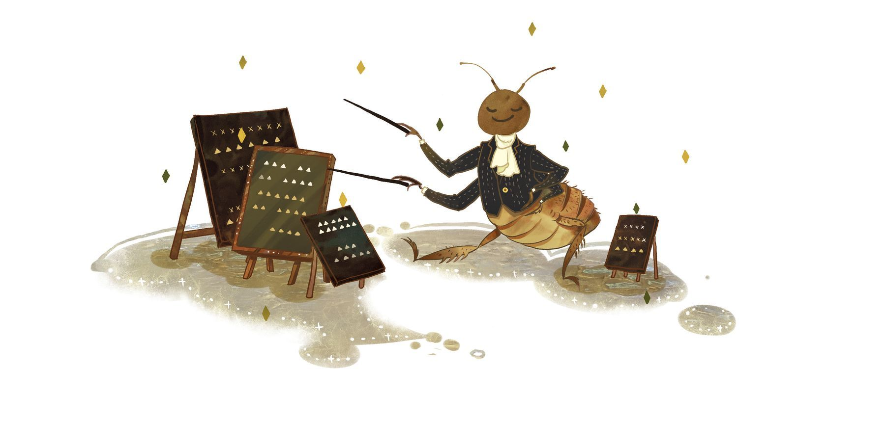
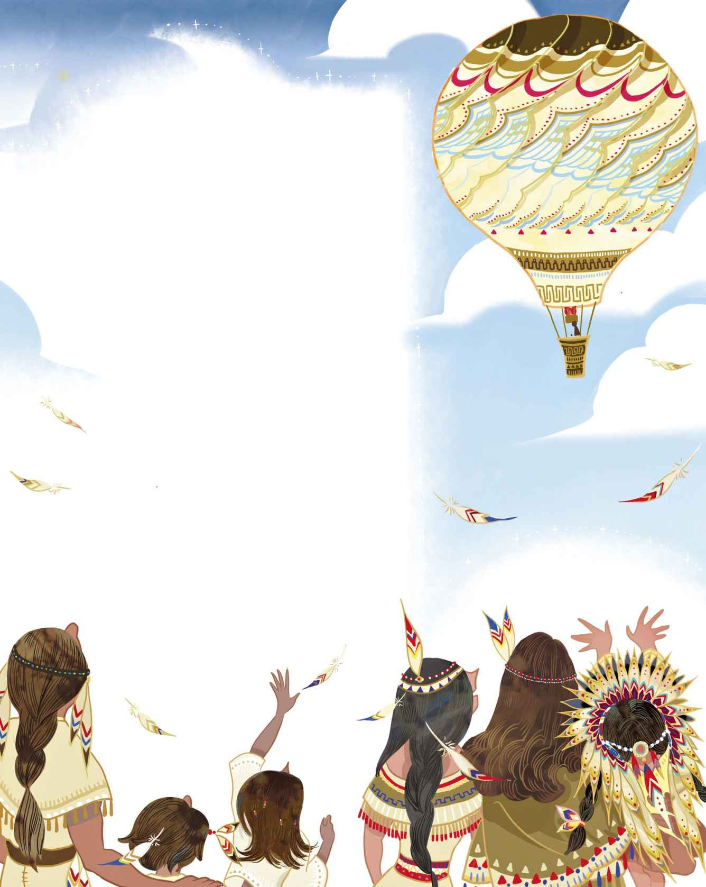

# 跳蚤与教授

从前有个飞行家不幸走了霉运，他的气球爆了，整个人被甩出去，摔了个粉身碎骨。不过就在两分钟前，他用降落伞把自己的儿子送了下去——这孩子可真幸运！他毫发无伤，并且深谙成为飞行家的窍门。不过他既没有气球，也不知道如何才能弄上一只。

他先得活下去。于是他开始以变戏法为生，那是一种声音戏法，他称之为“腹语术”。他很年轻，长得也颇为英俊，要是蓄起胡须，配以上乘的服饰，那肯定会被误以为是贵族少爷。女士们都被他的英俊所吸引，其中有一位更是为他的魅力所俘获，进而跟他私奔去了国外。到了国外，他便开始以“教授”自居——想要谋生，这种程度的名头是最起码的。

他一直在琢磨，如何才能弄到一只气球，这样他就可以带着妻子一起飞行了。然而他始终没有想出办法。

“总会有办法的。”他说。

“噢，但愿会有。”妻子说。

“我们还年轻，”他又说，“更何况我是个教授。”

“面包屑也是面包嘛！”

她尽自己所能帮助着他，替他在门口售卖表演戏法的门票。在寒冬时节，那可是冰冻彻骨的活计。她还替他充当表演时的助手。他会把她装进一只桌子抽屉里——一只很大的抽屉——她则爬到抽屉背面。这样，从前面就无法看到她了，观众们则会认为她消失了。然而有天晚上，当他拉开抽屉的时候，她真的消失了。她既不在抽屉前面，也不在抽屉背面，整间屋子都遍寻不见她的踪迹，完全找不到她的身影，根本听不到她的动静，就这么消失在了抽屉戏法里。

她再也没有回来。她已经厌倦了这一切，而他也开始厌倦了。他变得沮丧起来，再也不会卖笑，再也无力耍宝逗趣了。于是人们也不再前来观看他的表演。他的收入每况愈下，身上的衣服也变得破旧起来。到最后，他只剩下一只大跳蚤了，那算是他妻子留给他的纪念，所以他很喜欢这只跳蚤。他开始训练它，指导它进行操练——操练如何举枪敬礼，以及如何放炮。当然了，那是一门非常小的炮。

教授为跳蚤感到自豪，跳蚤自己也挺满意。他已经学了好几手，而且拥有人类血统。那些最为庞大的城邦他都去过了，王子啦公主啦，统统接见过他，而且都给予他高度的赞扬。他因此登上报纸，成了响当当的人物。他很清楚，自己已经是一只出了名的跳蚤，如今足以养活教授了。没错，养活一整户人家也不在话下。

他很自豪，也很有名。不过，当他和教授外出旅行的时候，总是乘坐四等车厢，反正四等车厢和一等车厢的速度也没什么差别。他们立下誓约，绝不能散伙，谁也不可以结婚，跳蚤必须保持旷夫

> **注 112**　已经成年，但尚未婚娶的男性。

> **注 113**　没有妻子或失去妻子的男性。

“人若是在某个地方走过好运，”教授说，“那么他就不应该再到那儿去第二次。”求学时期，他曾经钻研人性，这东西自有其道理。他把所有国家都游历了一番，除了那些尚未开化的国家，不过他还是决定去那些国家看看。那里的野蛮人会把基督徒给吃了，他已经有所耳闻。不过他自己算不上基督徒，而跳蚤也算不得真正的人，所以他觉得，他们或许可以冒险踏上野蛮人的国土，然后捞上一大笔钱。

他们先是乘坐汽轮

> **注 114**　即蒸汽轮船。

跳蚤又是举枪敬礼，又是放炮，公主一见，立刻喜欢得不得了。她喊道：“非他莫属了！”她疯狂地爱上了跳蚤。在其他事情上面，她也一贯表现得蛮横骄纵。

“我的宝贝儿，我的小囡囡，冷静点儿——”她爸爸说，“至少得想办法把他变成人才行啊。”

“别管我的事，老家伙。”她说。一般的小公主，根本不可能用这种态度跟自己的爸爸说话。说到底，她就是个野蛮人。她把跳蚤放到自己漂亮的胳膊上：“现在你就是个人，你要和我一起统治国家。不过，我要你做什么你就必须照我说的做，不然的话我就把你杀掉，把教授吃掉。”

教授住进一个很大的房间，房间的墙壁全部用甘蔗搭建而成。只要他愿意，随时可以舔上两口，不过他对这些甜滋滋的东西没什么兴趣。他还有张睡觉用的吊床，这东西令他想起了坐在气球上的感觉，那是他一直以来的愿望，他始终对此念念不忘。跳蚤和公主住在一起。他要么坐在她的纤纤玉手上，要么就坐在她那美丽的脖颈上。她从头上取下一根头发，让教授将头发的一端系住跳蚤的腿，另一端系住一只红色的珊瑚大耳坠，这只耳坠就挂在公主的耳垂上。身为公主，这真是一段幸福时光，跳蚤想必也会这么觉得，她心想。

教授可就没这么幸福了。他是个旅行家，喜欢骑着马，在城与城之间游历，还喜欢看人们在报纸上大谈他是如何锲而不舍、如何巧妙地把人类的技能传授给跳蚤。日复一日，他无所事事地躺在吊床上。给他吃的食物倒是很丰富：新鲜的鸟蛋、大象的眼睛，还有烤长颈鹿腿。这些食人的野蛮人吃得并不只是人肉，没错，人肉可是特殊供应的佳肴！

“小孩子的肩膀肉配上辣椒调味酱，”公主的妈妈说，“那可是最美味的佳肴。”

对这一切，教授已经厌烦透顶，他想要离开这个野蛮的国家，然而他必须带上跳蚤一块儿走，因为跳蚤是他亲手发掘的奇迹，是他维持生计的宝贝。可是他要如何让跳蚤重回掌心呢？要怎么做才能把他给弄回来呢？这事儿可不好办呐。为此他绞尽了脑汁，最后他宣称：“有办法了！公主的爸爸，请给我安排一些差事吧。让我教会您的族人如何朝拜自己的君王。众所周知，在当今世界，所有强盛的国家都奉行这种文化。”

“那我也要跟着一起学吗？”公主的爸爸问道。

“您就不必啦。”教授告诉他，“不过，但凡是您族人中已经当爸爸的，我都会教他们如何放炮。轰的一声，空中的目标要么被吓跑，要么就被击落到你跟前。”

“那让我放个炮吧。”公主的爸爸请求道。不过他的国家根本就没有炮，除了跳蚤带来的那门小炮——那也实在太小了。

“我会铸造一门更大的炮。”教授说，“只要为我提供所需的材料便可。我需要上乘的丝绸衣服、针线、绳线、缆索，以及组装气球用的球囊

> **注 115**　这里的原文是“stomach drops”，指的应该是组装水滴状的热气球用的球囊（“stomach”就有肚皮的意思，而肚皮就是“囊”）。

“全都没问题。”凡是他要求的东西，公主的爸爸都提供了。整个首领家族和普通族人全都聚集到一块儿，大家都要看看大炮是如何造出来的。教授始终没有把他们叫来，直到他点火把气球充满，随时可以起飞。跳蚤坐在公主的手上，看着气球被充满。气球鼓胀起来，动静愈来愈剧烈，眼看就要失控了。

“我必须让它升到空中，好让它冷却下来。

> **注 116**　承接上文的意思——热气球已经点火，所以才会有“冷却”一说。这是教授的计谋，而野蛮人只以为发热的是“大炮”。

“不过——我一个人操控不了它，必须有个训练有素的助手帮我才行。除了跳蚤，这里没有任何人能够胜任。”

“我一点儿也不想让他去掺和这事。”公主说。然而她还是伸出手来，把坐在她手腕上的跳蚤交给了教授。

“松开绑线和绳索！”教授吆喝道，“现在，气球就要起飞了。”大家以为他说的是“放炮”。于是气球愈飞愈高，飞入云端，远远地飞离了这个野蛮的国家。

小公主和她的首领家族，以及所有的野蛮族人全都坐在那儿等着。他们现在还在那儿等着呢，你要是不相信，可以去那个野蛮人的国家瞧瞧。那儿的所有小孩都在谈论教授和跳蚤，他们都以为，只要“大炮”一经冷却，教授和跳蚤就会回来。

他们是不会回来啦。他们跟我们一样，眼下就在家里。他们回到了自己的国家。这回他们坐火车，坐的是头等车厢，不再是四等了。因为他们已经获得了巨大的成功，外加一只巨大的气球。没人问起这只气球是怎么弄来的，也没人问是从哪儿弄来的。如今他们成了富有的——噢，真是体面得不得了的——跳蚤与教授。

