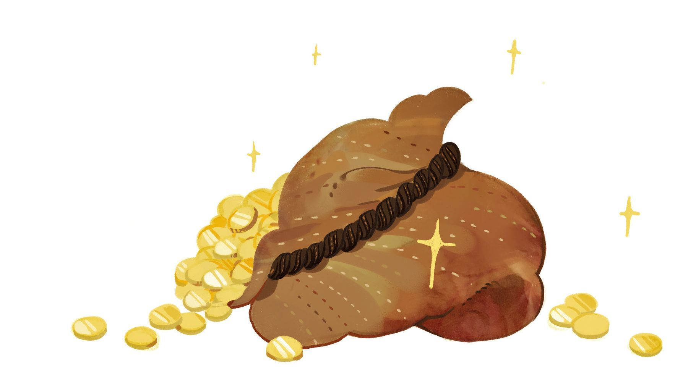
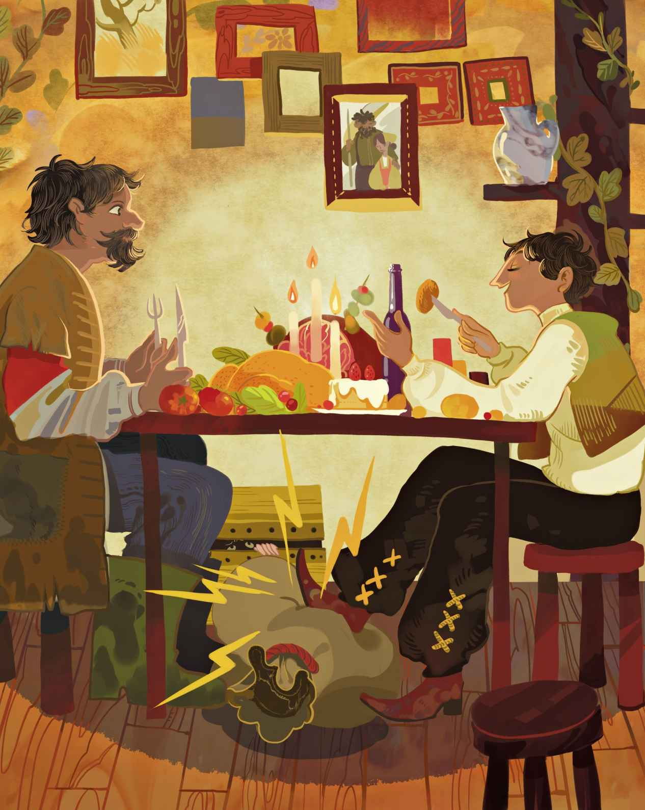
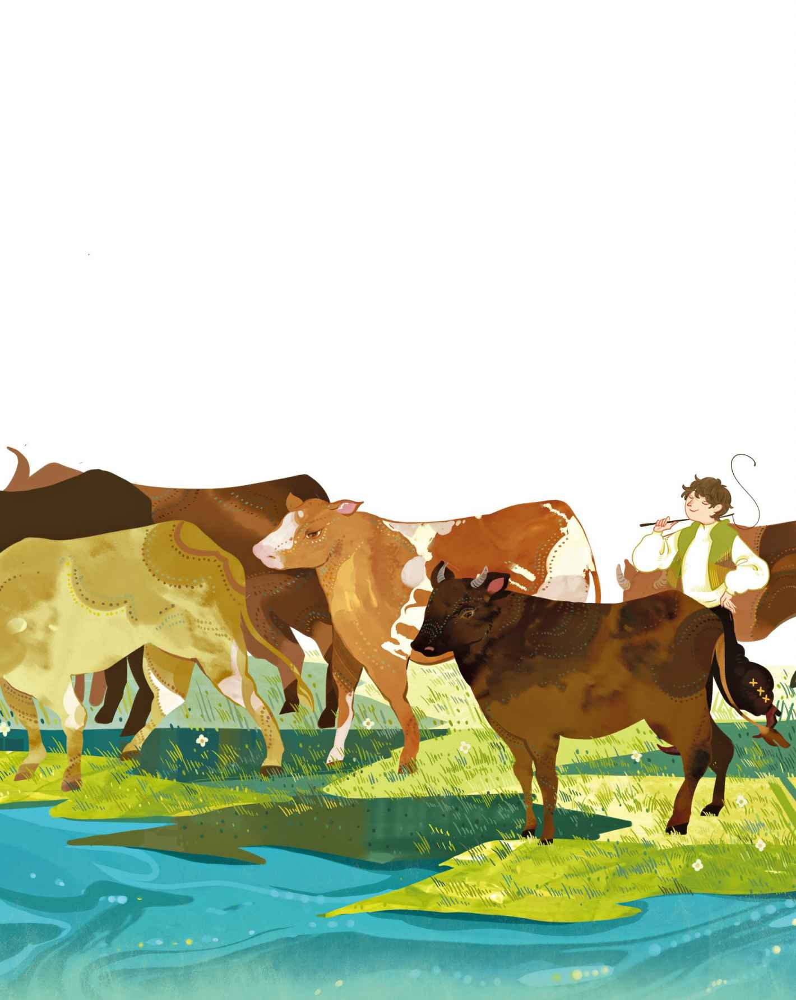

# 小克劳斯与大克劳斯

在一个村庄里生活着两个拥有相同名字的人，他们都叫克劳斯。不过，其中一个有四匹马，另一个只有一匹。这么着，为了区分他俩，人们把有四匹马的那位称作大克劳斯，把只有一匹马的那位称作小克劳斯。现在，我就要给你们讲讲这两位克劳斯的故事。因为这可是一个真实的故事。

一整个礼拜，小克劳斯都把自己仅有的那匹马借给大克劳斯去耕田。作为交换，大克劳斯把他那四匹马借给小克劳斯，但是每个礼拜只借一天，而且还必须是礼拜天。

每到礼拜天，小克劳斯便能有五匹马供他驾驭

> **注 117**　上文所说的“一整个礼拜”，并不包括周末。

“你不能那么说，”大克劳斯对他说，“你和我都很清楚，这些马当中只有一匹是你的。”然而没过多久，另一群去做礼拜的人打这儿经过。小克劳斯忘了自己不能那么说，又吆喝道：“使劲儿走起来哟，我的马儿们。”

“不许你再那么说，”大克劳斯对他说，“如果你再来上一次，我就到田里敲死你那匹马，叫它从此倒下去死掉，再也走不起来。”

“你不会再碰见我那么说了。”小克劳斯保证道。可是当有人打从这儿经过，对他点着头说“早上好”，他便又得意扬扬、忘乎所以起来了。自己的田里有五匹马在耕地，这场面多么了得啊。于是他又吆喝道：“使劲儿走起来哟，我的马儿们！”

“那我来给你的马使点劲儿好了。”大克劳斯说。他猛地拔起一根拴马桩，然后朝小克劳斯仅有的那匹马脑袋上砸去。他砸得如此用力，马立刻倒毙在地。

“现在我连一匹马也没有了。”小克劳斯说着便哭了起来。缓过劲儿来后，他剥下了死马的皮，然后挂起来晾干，继而出发去最近的城里卖马皮。

长路漫漫，他必须穿过一片黑暗而阴沉的森林。忽然之间，可怕的暴风雨来袭，他迷路了。在他找到出路之前，天就黑了下来。城镇离这里还很远，想要赶在天黑以前回家，恐怕也是不可能的了。

在不远的地方，他瞧见了一幢很大的农舍。农舍的百叶窗都拉上了，不过窗顶上的缝隙里还是透出了一抹灯光。“也许他们会让我进去过夜。”小克劳斯心想。于是他走到门前，敲起门来。

农夫的妻子打开门，可是当她明白了小克劳斯的来意之后，便下了逐客令。她说她的丈夫不在家，她不会让任何陌生人进屋子。

“那我就睡在外面好了。”吃了闭门羹后，小克劳斯这么打算。

农舍旁边有一大堆干草，草堆延伸到一间棚屋的屋顶上。这屋顶是用茅草盖的，就在农舍和草堆之间。“我可以睡在那儿。”小克劳斯看到那茅草屋顶之后，便这么想道。“这屋顶就是一张舒适的床。我只希望，鹳鸟别飞下来啄我的腿就行了。”因为屋顶上确实站着一只鹳鸟，它正在那儿守着自己的鸟巢。

就这样，小克劳斯爬上了棚屋的屋顶。正当他调整姿势想要睡得舒服一些的时候，发现农舍的百叶窗并没有遮住窗顶，他的视线可以越过窗顶看到里面。他发现屋内有一张大桌子，桌子上摆满了美酒、烤肉和香喷喷的鱼，农夫的妻子和教堂的司事

> **注 118**　根据原文翻译应是“司事”。司事和牧师不同，司事不主持布道，而是专门在教堂里负责各种杂务的“管事”。

“噢，要是我也能来上几口就好了。”小克劳斯心想。他伸长脖子，朝着窗户探去，然后看到了一只叫人馋涎欲滴的大蛋糕。天呐，他们这是在里头饱享盛宴啊！

就在此时，他听见路上有人骑着马朝这边过来，原来是农夫回来了。他是个很不错的人，唯有一件事令他无法忍受，那就是他看不惯教堂司事，甚而至于光是对哪个司事瞥上一眼，他就会立即火冒三丈、狂怒不已。这就是为什么司事会专门挑农夫不在家的时候前来看他的妻子。而他那好妻子，却把家里所有好吃的东西都拿出来招待那司事了。当她听见农夫回来的时候，因为司事在场而害怕得瑟瑟发抖。她求司事赶快爬进空置的大箱子里，就在墙角那儿。司事也不敢有半点迟疑，因为他实在太清楚了，她那倒霉的丈夫绝对不待见任何司事。这女人飞快地把酒收好，然后把那些美食全都藏进了烤炉。要是让她的丈夫瞧见这些佳肴，准会一个劲儿地刨根问底。

“噢，老天！”小克劳斯在茅草屋上哀叹道，因为他眼睁睁看着那些美食全都消失不见了。

“谁在那上面？”农夫瞅见了小克劳斯，“不管你在上面干什么，现在跟我进屋去吧。”于是小克劳斯爬了下来。他告诉农夫，自己是怎么迷了路，然后又问他是否能收留自己一宿。

“当然可以。”农夫说，“不过，让我们先吃点东西吧。”

农夫的妻子热情地接待了他们。她布置好整张桌子，然后端上来一大碗粥。农夫正饿着，于是胃口大开，吃得津津有味。不过小克劳斯始终惦记着烤炉里那些美味的烤肉、鱼和蛋糕。桌子底下，他脚边正放着装有马皮的麻袋。我们都很清楚，小克劳斯此行就是为了去城里把马皮卖掉。他可一点儿也不喜欢粥。他在麻袋上踩了一脚，里面的干马皮随即发出一记响亮的尖叫声。

“嘘！”小克劳斯对他的麻袋说。说话的当儿，他又在麻袋上狠狠地踩了一脚。如此一来，麻袋里头冒出了更响的声音。

“你究竟在那里头藏了什么？”农夫说道。

“噢，只是一个魔法师罢了。”小克劳斯说，“他跟我说，没必要吃粥，因为他已经施了魔法，给我们变出满满一烤炉的烤肉、鱼和蛋糕。”

“你说什么来着？”农夫说。他赶紧过去打开烤炉。在那里头，他果然发现了一大堆美食。是他的妻子把这些东西藏在了里面，不过他只以为那是麻袋里的魔法师用法术变出来的。他的妻子根本就不敢吭声，只好帮他们把烤肉、鱼和蛋糕给端了上去。

接着，小克劳斯又在麻袋上踩了一下，让它再度发出了尖叫声。

“这回他又说了什么？”农夫问道。

“他说，”小克劳斯答道，“在烤炉的角落里，有三瓶为我们准备的美酒。”

这么一来，女主人只好又去把她藏着的酒给拿了出来。农夫喝了个痛快，旋即也想有一个属于自己的魔法师，就像小克劳斯麻袋里的那个一样。

“他能变出恶魔来吗？”农夫很想知道，“我倒是很有兴趣见识一下恶魔。”

“噢，行啊。”小克劳斯说，“只要是我吩咐的，我的魔法师都能办到。是吧？”他一边问，一边把麻袋踩出尖叫声来。“你听见他的答复了吗？他说‘没问题’。他可以变出恶魔来，不过他担心我们受不了他的模样。”

“噢，我可不怕。他长得像什么？”

“告诉你好了，长得糟糕透了，活像教堂的司事。”

“嚯，”农夫说，“有那么丑？我可受不了司事那种模样。不过咱们别停下。现在我已经知道了，那其实是个恶魔，所以我不会太介意。我还是要见识一下，只要保证他不会靠近我就行了。”

“稍等，我跟我的魔法师说说。”小克劳斯踩了踩麻袋，然后俯下身子听着什么。

“他怎么说？”

“他说，你到墙角那边去，把那儿的大箱子打开，然后就能看到恶魔了，他就蜷缩在里头。不过你得把箱盖给抓紧了，免得他逃出来。”

“那你能帮我抓住箱盖吗？”农夫说着走到箱子跟前。那个被他妻子藏进箱子的司事——这会儿吓得要命，简直惶恐至极。农夫把箱盖抬起一点儿，然后朝里头瞄去。

“嚯！”他立马弹回了身子，“我看见他了，看见他那司事模样的外形了，真是丑陋透顶啊！”此后他俩又开始喝酒，一直畅饮至深夜。

“你可一定要把你的魔法师卖给我。”农夫说，“你自己出个价吧。我这就能付给你一蒲式耳的钱。”

“噢，我不能那么做。”小克劳斯说，“你想想，我的魔法师是那么无所不能。”

“可是我实在太想买下他了。”农夫继续恳求道。

“好吧，”末了，小克劳斯说，“既然你这么厚道，肯让我在此留宿一晚，我是不会拒绝你的。给我一蒲式耳的钱，麻袋就是你的了。不过，钱必须装满了，满得溢出来才行。”

“你会拿到钱的，”农夫说，“不过你得把箱子也带走，我可不能容它再在我屋里待上一个钟头。他搞不好会一直在里面。谁都说不准。”

这么着，小克劳斯把装着干马皮的麻袋卖了，换得一蒲式耳的钱，满得都快溢出来了。农夫还给了他一辆单轮手推车，好让他把钱和箱子一块儿带走。

“那么再见了。”小克劳斯说着便带着他的钱以及装着司事的箱子走了。远在森林的另一端，有条又深又宽的河，河里的水流异常湍急，根本就不可能游过去。不过河上新建了一座大桥。小克劳斯来到桥中央，大声说起话来，故意要让司事听到：“现在，我该怎么处置这只蠢头蠢脑的箱子呢？它笨重得活像石头，实在是把我累坏了，我可没力气继续用手推车推它走了。这么办好了，我把它丢进河里，如果它能漂到我家去，那就太妙了，而如果它沉下去了，那我也没什么损失。”说着，他让箱子稍稍倾斜了一点，感觉好像他马上就要把它翻到河里去似的。

“停下！别！”司事在里面叫起来，“先让我出来！”

“噢，”小克劳斯假装吓了一跳，“难不成恶魔还在里面？看来我还是把他扔进河里，把他给淹死比较好。”

“噢不，别那么对我！”司事大叫起来，“把我放出来，我就给你一蒲式耳的钱。”

“哈，那就另当别论了。”小克劳斯说。他打开了箱子，司事立刻跳了出来。司事把空箱子推进河里，然后赶回家去取了一蒲式耳的钱给小克劳斯。农夫的一蒲式耳加上司事的一蒲式耳，这下小克劳斯的手推车装了个盆丰钵满。

“我算是把我的马卖了个好价钱。”回到家后，他说。他在屋里的地板上把钱倒成了一堆。“我那区区一匹马，就把我变得如此富有，这要是让大克劳斯知道了该多么不高兴啊。不过，关于我是如何办到的，我是不会告诉他的。”于是他让一个小男孩去问大克劳斯借一个蒲式耳量斗。

“那家伙究竟要拿这个装什么？”大克劳斯感到十分好奇。他在蒲式耳量斗的底部涂了一块沥青，这么一来，不管小克劳斯用它装过什么，底下总能粘到一小片儿。

“这是怎么回事？”大克劳斯跑去找小克劳斯，“你从哪儿搞到那么多钱的？”

“噢，昨晚我把我的马皮卖了，于是就得了这些钱。”

“老天啊！马皮也能卖到这种价钱。”大克劳斯回到家，拿了一把斧子，就着马脑袋，把他的那四匹马全都给宰了。完事之后，他把马皮全都剥了下来，然后带着马皮出发去城里了。

“马皮，马皮！谁要买马皮？”他在街上来来回回地大喊大叫着。所有的鞋匠和制革匠，都过来问马皮的价钱。“每张皮售价一蒲式耳的钱。”他这么告诉别人。

“你疯了吧？”大家都问道，“你觉得我们会为这个花上一蒲式耳的钱？”

“马皮，马皮！谁要买马皮？”他继续嚷道。但凡是问价钱的，他都说：“一蒲式耳的钱。”

“他把我们当傻瓜呢。”大伙儿说道。于是鞋匠们拿起皮带，制革匠们取下身上的皮裙，把大克劳斯抽得满城跑。

“马皮，马皮！”他们对他讥笑道，“你要是不滚出城去，我们这就来鞣一鞣你的皮

> **注 119**　皮革加工的过程当中，需要加入有机化合物进行鞣制。

“小克劳斯必须为此付出代价。”回到家后，他说，“就为这事，我非宰了他不可。”

这会儿，小克劳斯的老祖母刚刚过世。她是个刻薄易怒的人——从没对小克劳斯讲过一句好话——不过眼见着她离开人世，小克劳斯还是感到很难过。为了以防万一，他把老祖母的遗体安置在自己暖和的床上，因为她有可能缓过气后又活过来。一整晚，他都让老祖母躺在床上，而他自己在椅子上小睡，以往他也经常这么做。

夜里，他正坐在椅子上小睡。这时门开了，大克劳斯拿着斧子闯了进来。他知道小克劳斯的床在哪儿，于是径直走了过去，抡起斧子朝那已经死去的老祖母砍去，因为他只以为那是小克劳斯。

“这下好了，”他说，“你再也不能愚弄我了。”说完他便回家去了。

“真是个坏家伙。”小克劳斯说，“哎唷，他居然要杀死我。我的老祖母算是走运，因为她已经死了。不然的话，大克劳斯就成了杀人凶手啦。”

他给老祖母换上最好看的衣服，问邻居借了一匹马，然后驾起了他的马车。他把老祖母扶到后座上，把她的身子固定好，以免马车行驶时将她给震落。出发之后不久，他们便穿过了森林。太阳升起的时候，他们来到一家大型旅店。小克劳斯停下来，进去吃了早饭。掌柜的是个阔绰之人，做起事来也够上路，然而他的脾气火爆极了，就好像整个人是用辣椒和鼻烟做成的。

“早上好，”他对小克劳斯说，“你起得真早，这身行头很讲究嘛。”

“是啊，”小克劳斯说，“我要和老祖母一起去城里，她现在正坐在马车上呢。我没法把她弄进来，不过你或许可以过去给她一杯蜂蜜酒。你讲话时得大声点儿，不然她听不见，因为她聋得跟木桩子似的。”

“我能搞定。”掌柜的倒了满满一杯蜂蜜酒，然后给已经是死人的老祖母拿了过去。老祖母依旧僵硬地坐在马车上。

“这是你孙子让我给你的蜂蜜酒。”掌柜的说。然而那已死的女人一言不发，就那么坐在那里。

“你没听见我的话吗？”掌柜的用最大的嗓门儿喊道，“这儿有一杯蜂蜜酒，是你孙子叫的。”

三番两次之后，她仍然纹丝不动。掌柜的开始冒火了，他把玻璃杯摔在了她脸上。于是蜂蜜酒溅了她一身，然后她仰面朝后倒去。要知道，她不过是被扶坐在那儿，并没被什么东西捆住。

“该死的！”小克劳斯冲出门来，一把掐住掌柜的脖子，“你杀了我的祖母。看啊！她脑门上有个大窟窿。”

“噢，真是太倒霉了！”掌柜的两手紧握，“都怪我的暴脾气。亲爱的小克劳斯，我给你一蒲式耳的钱，我还会把她当成自己的祖母一样送葬。你可要帮帮我，别把这事给声张出去，不然我会被砍头的——我不想落到那种下场啊。”

如此这般，小克劳斯又得了一蒲式耳的钱。至于旅店掌柜的，他果真把小克劳斯的老祖母当作自己的祖母一样送葬了。

小克劳斯一回到家，便又让一个小男孩去问大克劳斯借一个蒲式耳量斗。

“小克劳斯又要借这个？”大克劳斯问道，“我不是已经把他给杀了吗？我得去瞧瞧究竟是怎么回事。”这么着，他带上量斗去找小克劳斯了。

“你从哪儿搞来那么多钱的？”当他看到那些钱堆得有多高时，不禁问道。

“那天你本来要杀我，却误杀了我的祖母，”小克劳斯告诉他，“于是我就把她给卖了，换了一蒲式耳的钱。”

“老天啊！那可真是个好价钱。”大克劳斯说。他赶紧回到家里，拿起斧子砍了自家老祖母的脑袋。完事之后，他把老祖母装上马车，然后驾车去了城里，找了一个药剂师，问他要不要买死尸。

“这是什么人的尸体？”药剂师问道，“你从哪儿弄来的？”

“这是我祖母的尸体。我把她给杀了，这样就能换得一蒲式耳的钱了。”大克劳斯对他说。

“上帝啊，”药剂师说，“你这人肯定是疯啦。别再说那样的话了，不然你会被砍头的。”接着他很直截了当地告诉他，他已经犯下罪行，成了可怕的罪人，最严厉的惩罚对他来讲都已经算是轻的了。大克劳斯害怕了，他跳回马车，策马扬鞭，拼命地赶回家去，生怕被人给逮住。药剂师和其他人都觉得他肯定是个恶棍，因此没有谁敢上前挡他的道。

“我要让你付出代价。”马车驶上大道的时候，大克劳斯说道，“噢，我一定要让你付出代价不可，小克劳斯！”一回到家，他就找了一只最大的麻袋，然后找到小克劳斯，说：“你又骗了我。我先是宰了自己的四匹马，接着杀了自己的老祖母，这都是你的错。不过我不会再让你有机会愚弄我了。”说着，他抓住小克劳斯，把他塞进了麻袋，然后甩到背上，继而又对他说：“现在我要把你带走，然后淹死你。”

到河边有很长一段路，而小克劳斯的重量可不轻。沿途要经过教堂，当他们走过的时候，听见了演奏风琴的声音，还听见人们吟唱着动听的歌诗。大克劳斯在教堂门外卸下了麻袋。他觉得在自己走得更远以前，最好进去听一听赞美诗。反正小克劳斯被牢牢地扎在麻袋里，而且所有人都在教堂里。于是大克劳斯也进去了。

“噢天哪，噢天哪！”小克劳斯在麻袋里哀叫着。他扭来扭去，想方设法地挣扎，却始终无法松开绳结。这当儿，有个白发苍苍的赶牛老人打这儿经过，他的牛全都身负重担。从牛群移动的声音来听，正是朝着装小克劳斯的麻袋过来的，它们一定会从他身上碾过的。

“噢天哪，”小克劳斯哀叫道，“我这么年轻就要上天堂了。”

“可是对于我来说，”赶牛人说，“我已经在这个世上活了那么久，天堂的大门却始终没有向我打开。”

“那把麻袋打开好了！”小克劳斯叫道，“到麻袋里来，跟我换一换，这样你就能直接上天堂了。”

“那正是我想去的地方。”赶牛人说。于是他解开了麻袋，小克劳斯立即跳了出来。“你得把我的牛给照顾好了。”赶牛人一边说，一边钻进了麻袋。他一进去，小克劳斯就扎紧了袋子，然后带着所有的公牛和奶牛离开了。

过了一会儿，大克劳斯从教堂里出来。他背起麻袋，然后发现麻袋变轻了。因为老赶牛人的体重，顶多只有小克劳斯的一半而已。

“我的担子变得多么轻啊，这都是因为我听了一首赞美诗。”大克劳斯说。他继续朝那条又深又宽的河走去，然后把装着老赶牛人的麻袋扔进了水里。

“你再也不能戏弄我啦。”大克劳斯说。他还满以为，自己已经亲眼看着小克劳斯扑通掉进水里了。

他开始启程回家。不过，当他来到十字路口的时候又碰到了小克劳斯，此外还有一整群的牛。

“你从哪儿冒出来的？”大克劳斯惊呼道，“我不是已经把你淹死了吗？”

“是啊，”小克劳斯说，“半个小时前，你是把我扔进了河里。”

“那你怎么会又冒出来，而且还有了一群这么好的牛？”大克劳斯太想知道了。

“噢，这些都是海牛。”小克劳斯说，“至于我是怎么把它们弄到手的也自然会告诉你，因为我实在是太感谢你了，多亏了你想要淹死我。现在我变成成功人士啦！我发了多少财，简直都没法跟你形容。

“不过，当时我还在麻袋里。你把我扔下桥，风呼呼地吹过我的耳朵，就要这么掉进冷冰冰的水里时，我实在害怕极了。我一下子就沉到了水底，可是并没有受伤，因为水底有着柔软舒适的草地。有人解开了麻袋，那是一位美丽的少女，她拉起了我的手。她的衣裳洁白如雪，那飘逸的头发上戴着绿色的花环。她说：‘原来是你来了啊，小克劳斯。这群牛是我要送给你的，不过，这些礼物只是个小小的开始。只要再深入一英里，你就会发现，那儿还有一群牛等着你呢。’

“接着我就发现，原来整条河就是供海洋臣民使用的大型通道。他们能在河底行走，赶着他们的海牛，沿着这条通道长驱直入，从海洋世界来到河道尽头的陆地世界。而在他们那儿，水下的花朵芳香四溢，水草柔嫩无比，鱼儿们轻盈地游弋，宛若鸟儿们轻轻飞过。

> **注 120**　这段对海底世界的描写，与《海的女儿》完全一致，可以视作安徒生有意或无意地将两个短篇小说的世界衔接了起来。

“那你为何这么快就回来了？”大克劳斯问道，“如果那儿真的那么美，换作是我的话就干脆住下了。”

“可以啊。”小克劳斯说，“我是个特别聪明的人。你还记得我说的吧，来自海洋的少女告诉我，只要再深入一英里，我就能找到另一群海牛。所谓的英‘里’，其实就是指河‘里’，因为河是他们唯一的通道。不过我也知道，河道有多么的蜿蜒曲折。想抵达那儿，势必还要绕上好长一段路。不过，回陆地上来的时候，我走了一条捷径，这让我少走了半英里。这样，我把海牛带回来就快多啦。”

“你真是个幸运的人。”大克劳斯说，“我要是也跑到河底去，你觉得我也能弄上一群海牛吗？”

“噢，我觉得你肯定行。”小克劳斯说，“不过别指望我会把你装进麻袋，然后把你背到那儿去，因为你对我来说实在太重了。不过，你要是愿意自己走去河边，然后自己爬进麻袋，那我倒是很乐意把你推下去。”

“谢谢你。”大克劳斯说，“不过记着，我要是没在那下面弄到成群的海牛，我一定会痛揍你一顿，相信我。”

“那你准备好了吗？”小克劳斯说。

当他们来到河边的时候，饥渴的牛们一见到水，便立即冲过去豪饮起来。小克劳斯说：“瞧，它们是多么想要回到水底去啊。”

“先帮我下去再说。”大克劳斯喝令道，“不然的话，我现在就痛揍你一顿。”他使劲钻进了大麻袋。那麻袋一直搭在一头牛的背上。“再放块石头进来，我怕我沉不下去。”大克劳斯又说。

“这方面不用操心。”小克劳斯说。他朝麻袋里放了一大块石头，然后紧紧捆住袋口，把它推进了河里。

扑通！水花飞溅起来，大克劳斯沉到水底去了。

“我找到的东西，他恐怕是找不到咯！”说着，小克劳斯赶着他的牛群，回家去了。
