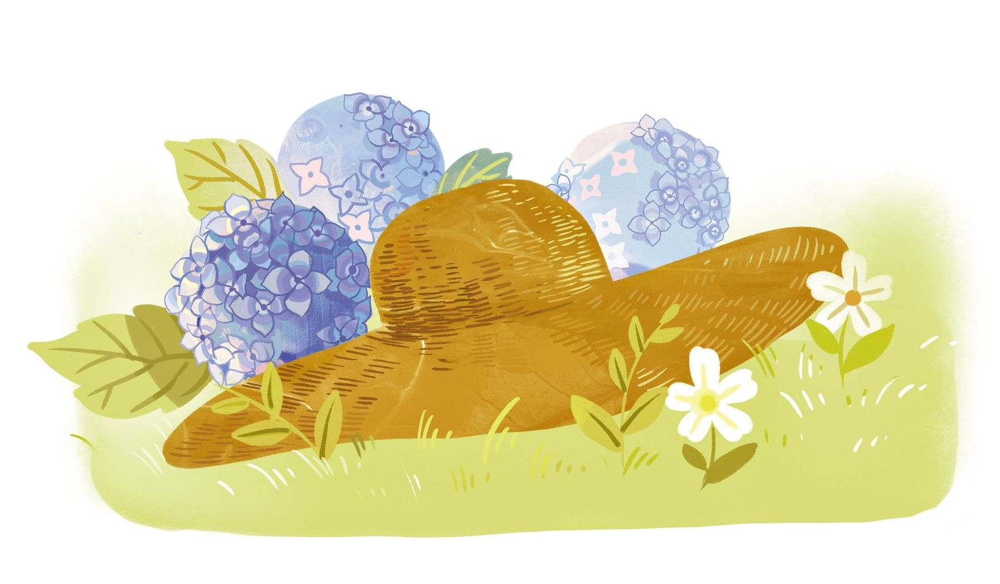
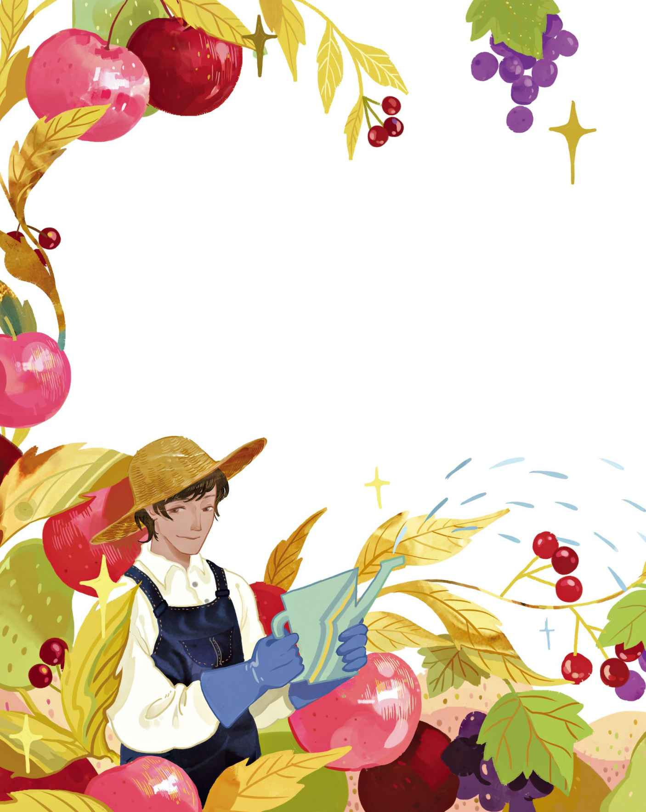

# 园丁与贵族

在距离城市约莫四英里的地方有一座古老的庄园宅邸。这里的墙壁非常厚实，并筑有塔楼和尖尖的山墙。一户富有的贵族人家在此处生活，不过他们只有在夏季才会过来居住。在他们所拥有的各项财产当中，这座庄园是最有档次、最漂亮的。它的外观看上去仿佛刚刚落成，内部则布置得极为安逸和舒适。家族的盾徽装饰在大门上，美丽的玫瑰在门柱和阳台上蔓延，院子里遍布着青草，还长着红色和白色的荆棘。暖房的外面，甚至还长着许许多多稀有的花朵。

这座庄园的主人家，有一位技艺精湛的园丁。这里的花园、果园和蔬菜园都令人看了赏心悦目。宅子的原主人留下一部分旧花园，这个花园由黄杨树篱围成，所有的树篱都被修剪成了王冠和金字塔形。在这些树篱里面有两棵巨大的老树，树已凋零，几乎没有叶子，其中一棵树的树枝上满是成块的污垢，很容易让人误以为那是经受风吹雨打所致，其实那都是些鸟巢。早在很遥远的古老时代，这里就叽叽呱呱、成群结队地飞来了数量庞大的乌鸦和白嘴鸦。这里简直就是一座鸟镇，鸟儿是这里的主人，是这里最古老的家族——真正的领主！树下的那些人类对它们而言简直形同虚设。这家人始终忍受着这些赖在这儿的动物，尽管他们偶尔也会放上几枪，叫那些鸟脊背发颤，把它们吓得全都扑腾起来，叫着：“啊！啊！”

园丁总是对这家人说，应该砍倒这些老树才对。它们看上去早就不行了，只要把这两棵树弄走，他们就能摆脱那些恼人的鸟儿了，它们会去别处找地方栖息。然而这家人既不想砍掉老树也不想赶走鸟群。它们都是庄园的财产，自古以来就是，谁也不能忘了这点。

“哎呀，这些树可是那些鸟儿祖传下来的。时至今日，就让它们留着好了，我亲爱的拉森！”拉森是园丁的名字，不过对于整个故事而言，人名是无关紧要的。

“你用于工作的空间难道还不够吗，小拉森？你不是有花园、暖房、果园和蔬菜园吗？”

是的，他是有，它们都由他负责。他精心打理它们，悉心照料它们。关于这些，这家人都很清楚，不过有件事他们也不讳言，那就是他们时常看到别人家的花卉总是比他们家花园里的好看，别人家的水果也总是比他们家果园里种出来的好吃。这让园丁感到很是沮丧，因为他希望自己能尽一番力，而且他已经尽力了。他是个好心肠、善良又忠诚的园丁。

一天，这家人把他叫来，然后柔声细气地对他说，之前的某天，他们在某位尊贵的朋友家里品尝了苹果和梨，那可真叫味美多汁，口感上佳，他们和其他客人都连连称赞。大家都感到很好奇，这些水果到底是不是本土产的，事实是它们都是进口过来之后再在本土培植的。这里的气候条件正合适。据说这些水果都是从城里最好的水果商那里买到的，于是他们让园丁去跑一趟，先弄清楚这些苹果和梨是从哪儿进口的，然后设法弄点嫁枝回来种植。园丁跟那个水果商很熟，因为只要庄园里产出的水果有所盈余，他总会拿去卖给那个水果商。

于是他跑到城里，去问那个水果商，那些叫人赞不绝口的苹果和梨是从哪儿来的。“哎呀，就是从你的果园里来的呀。”水果商人说。他把那些苹果和梨都拿给他看，他一眼就认出来了。

园丁感到高兴极了，赶紧回去告诉这家人，这些苹果和梨其实就是他们自家果园里种出来的。可是他们居然不相信！“那不可能，拉森！如果真是这样的话，你能从那水果商手里拿到书面证明吗？”

能，他当然能拿到。于是他去把书面证明拿来了。

“这还真是奇了怪了！”这家人说。

现在，餐桌上每天都会摆上满盆满碟的苹果和梨，这些水果全都出自他们自家的果园。他们拿去送给城里城外的友人的，更是多得要以蒲式耳和桶来计算。没错，他们甚至还把这些水果送去了国外，这给他们带来很大的乐趣。另外，这两个夏天还真是对果树的生长格外有利，全国各地的收成也都十分理想。

一些时日过去，这家人受邀去宫廷参加晚宴，第二天他们又把园丁叫来了。他们在皇室的餐桌上吃了西瓜，那西瓜出自陛下的暖房，吃起来味美多汁，口感上佳。

“你一定要去找一下宫廷园丁，我的好拉森，让他给你一些种子，就是那种特别好吃的西瓜种子。”

“宫廷园丁的西瓜种子就是从我们这儿买去的呀！”园丁说，他心里很高兴。

“那么这就说明，宫廷园丁知道怎么把西瓜培育得更好吃！”这家人回答道，“每只西瓜都好吃得不得了。”

“随您们怎么说，反正我是感到很自豪！”园丁说，“我必须告诉您们，尊贵的诸位阁下，宫廷园丁今年的运气很坏，他的西瓜收成很糟糕，但他看到我们的西瓜长得很好，于是在亲自尝过之后就给那天的晚宴订了三只西瓜。”

“拉森，别跟我们胡扯，那些西瓜不是我们果园的。”

“我倒是对此坚信不疑。”园丁说。

于是他去找到宫廷园丁要来了书面证明，那天皇室餐桌上的西瓜，确实就是出自他们果园。这对这家人而言真是一个莫大的惊喜。他们不再坚持自己的说法，而是到处炫耀这张书面证明，到处送西瓜种子，就跟之前到处赠送果树嫁枝一样。

这家人已经获悉，那些送出去的嫁枝如今已经长出上好的果实。这些产物都打上了家族庄园的标签，于是他们在英国、德国和法国都声名远播。对于这点，谁也没有料到。“但愿我们的园丁不要得意忘形了。”这家人说。

园丁采取的倒是另一番态度。现在，作为全国数一数二的园丁，他觉得自己要更加卖力才行。他要求自己每年都要栽培出一些出类拔萃的作物。他还真的做到了。不过他总是听人说，弄了半天，最好的水果还是他最早拿出手的那些苹果和梨，后来捣腾出的水果全都比不上那两样。平心而论，西瓜倒还不错，虽然它们说到底只能算作别的品种。草莓或许能称得上味道可口，但是也没比其他园丁种出来的好多少。到了某一年，他种的萝卜收成不怎么样，于是人们就只谈论那些失败的萝卜，对于其他由他栽培出来的优良作物却矢口不提。

这家人说起这些的时候，似乎试图装出一副安慰的口吻：“这一年的收成不怎么样啊，小拉森！”没错，当他们说着这些的时候，其实是幸灾乐祸的。“这一年的收成不怎么样啊！”

每隔两周，园丁都要给他们的客厅里送去一些鲜花。他总是把鲜花布置得很有艺术品位，连周遭事物的色彩也相映生辉，变得明亮了起来。

“你的品位不错嘛，拉森，”这家人说，“不过，这些都是拜我们所赐，并不是你生来就有的！”

一天，园丁拿来一只水晶碗，碗里漂着一片睡莲叶子，叶子上有一朵美丽的蓝色花儿，大得如同向日葵一般。

“那是印度的莲花！”这家人说。

他们此前从未见过莲花。白天的时候，这朵花儿被放在阳光下；而到了晚上，它又被放在人工的灯光下。每个看到它的人都会发现它的美是那么叫人过目难忘。是啊，不管是这个国家出身最高贵的年轻女士，还是聪慧、善良的公主，都会这么说的。这家人觉得，把这朵花儿作为礼物送给公主会是他们家族的荣誉。于是公主把花儿带回了城堡。公主走后，这家人来到花园，想要再摘一朵相同品种的花儿，可是他们连一朵也没找着。这么着，他们又叫来了园丁，问他是从哪儿弄来这种蓝色莲花的。

“我们找了半天却一无所获，”他们说，“我们还去暖房找过，找遍了整个花园！”

“噢，不对啦，那不是长在花园里的。”园丁说，“那只是蔬菜园里的一朵很普通的花儿罢了。不过，看呐，它真是太美了！它看上去就像一只蓝色的仙人掌，但实际上就是洋蓟开的花儿

> **注 121**　洋蓟开的花呈蓝紫色，和上文描写的睡莲很相似。

“你应该早点告诉我们啊！”这家人说，“我们还以为那是什么稀有的外国花儿呢。你害我们在年轻的公主面前成了笑柄！她在我们家看到那朵花儿，觉得它很美，但并不知道那是什么花儿，尽管她颇有些植物学方面的知识。不过说真的，她应该还不至于能看出那其实是一种蔬菜

> **注 122**　洋蓟的花蕾可以用于煮食用，因此它是种在蔬菜园里的。

如此，这朵来自蔬菜园的灿烂的蓝色花儿被拿出了客厅，因为它不该被摆在这儿。没错，这家人已经向公主道歉，他们告诉她，那其实只是一棵蔬菜，是园丁把它放在那儿的，他已经因为玩忽职守而受到严厉的训斥。

“你们这么做可真丢人，这太不公道了。”公主说，“是他让我们开了眼界，否则我们根本不可能看到这么好看的花儿。他在我们不经意间向我们呈现了美的事物。只要洋蓟还处于花期，我的宫廷园丁就必须每天送一朵到我的私人房间里来！”

于是这事就给照办了。

这家人告诉园丁，他可以再给他们弄一朵洋蓟的鲜花。

“它真是太美了！”他们说，“太有档次了！”这么着，园丁又受到了表扬。

“看来拉森就喜欢这样，”这家人还说，“他就像个被宠坏的小孩。”

到了秋天，风暴肆虐，夜间更是风势剧增，外面很多招风的大树都被连根拔起。那两棵布满了鸟窝的巨树也未能幸免。这给这家人带来了莫大的悲痛——对他们而言是悲痛——对园丁来说却是高兴事儿。透过风声，可以听见那些乌鸦和白嘴鸦的尖叫，它们正朝着这家人的窗户扑打着翅膀。

“这下你该高兴了，拉森！”这家人说，“暴风吹倒了那两棵树，那些鸟儿全都飞去了森林。过往时代遗留下来的东西现在全都没了，所有的遗迹和相关的印记都消失了。这让我们感到很悲哀！”

园丁嘴上什么也没说，不过心里正在琢磨着长久以来的打算，他在想如何利用这块阳光充足的位置，因为现在可以放手去干了。这将会变成庄园里的得意之作，还会给这家人带来乐趣。

那两棵巨树已经倒下，那些年代久远、精心修剪过的黄杨树篱也全都跟着遭了殃。园丁移植来数目众多的植物、原生植物和树木。凡是其他园丁从没想过能在庄园里种植的他都种了，还根据不同植物的需求分别配以相应的土壤、光照或荫翳。他把它们照料得非常到位，所有作物的生长势头都出奇的好。

来自日德兰半岛

> **注 123**　位于北欧，涵盖丹麦大部分国土。

> **注 124**　即维纳斯捕蝇草，叶片上长有细小的触角，可以迅速合拢。

在前面排成行的是用钢丝固定起来的小株法国梨树，它们吸收了充足的阳光，得到了悉心的照料，很快就结出了硕大、多汁的果实，跟在原产地种植出来的没什么区别。原来那两棵凋零的老树所在的位置，现在由一杆高高的丹纳布罗格

> **注 125**　丹麦国旗的别称。丹麦国旗是目前使用时间最长、最古老的国旗，因此在这里替代两棵古树很合适。

> **注 126**　即啤酒花。

> **注 127**　忽布开出的花呈椭球形。

“我们的好拉森，年纪一大，人也变得多愁善感起来了。”这家人说，“不过他这人很实在，对我们很忠诚！”

到了新年，城里的一家画报刊登出一幅古老的庄园图片。画面中有一根旗杆，还有专门在佳节期间为鸟儿们准备的燕麦秆。这家画报评论道，这真是一幅美好的画面，此举是对传统的继承和致敬，与这座古老的庄园颇为相衬。

“那都是出自拉森之手，”这家人说，“他得到了人们的一片叫好，真是个幸运的人。连我们也快要为拥有他这样的园丁而感到自豪了！”

然而他们并没感到什么自豪。他们知道，自己才是这座庄园的主人，还可以随时解雇拉森，不过他们不会那么做的。他们还算是好人，这世上还是有很多这样的好人的——因此所有像拉森这样的人，也还都算是幸运的。

好了，这就是园丁与贵族的故事。现在，你或许可以就这个故事思考一番！
