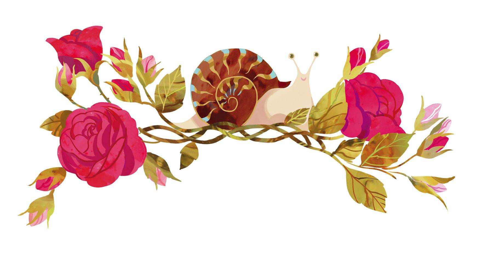

# 蜗牛与玫瑰树

花园的四周环绕着榛子树连成的树篱，外面是放牧牛羊的田野和草场，而花园的正中间长着一棵正值花期的玫瑰树。树下坐着一只蜗牛，蜗牛的壳里有一团东西——那正是它自己。

“等着瞧我的好戏吧。”蜗牛说，“我势必要大干一场，绝对不会只是开开玫瑰花，结结榛果子，或者像那些牛羊一样只会产奶而已！”

“我一直等着你的好戏呢。”玫瑰树说，“但是容我问一句，你的好戏要到何时才能上演呢？”

“我自有打算，”蜗牛说，“你总是那么着急！心急吃不了热豆腐啊！”

第二年，蜗牛又坐在玫瑰树下晒太阳，位置和去年几乎一模一样。玫瑰树上长出了花骨朵，正要开出新一轮的鲜花。蜗牛从壳里探出半截身子，朝外伸了伸触须，然后又缩了回去。

“一切看起来和去年没什么两样嘛，没有任何推陈出新的地方。弄了半天，玫瑰树还是只会开玫瑰花。”

夏天过去，冬天来了。在大雪下来以前，玫瑰树一直冒着花骨朵，开着花。天气变得湿冷起来，玫瑰树的枝条垂向了地面，蜗牛则钻进了地里。

接着，新的一年到来了，玫瑰花再次盛开，蜗牛却故伎重演。

“现在你已经是一棵老玫瑰树了。”它说，“抓紧时间吧，你的死期不远了。你仅有的那些东西已经被掏空了。那些东西到底有没有意义还是个问题呢，不过我可没工夫去思考那种问题，有件事倒是很清楚——你对自己的内在没有任何提升，不然的话，你早就开出别的什么东西了。对此你还有什么话说吗？你很快就会从这世上消失掉，最后顶多被人做成一根木杖。我说的这些，你可听懂了？”

“你把我吓到了！”玫瑰树说，“我根本就没想过那些呀。”

“是啊，你从来就没花工夫思考过任何东西。你为什么能开花，开花背后的道理是什么，为什么这样开，而不是那样开，对于这些，你怎么就没好好思考过呢？”

“确实没思考过，”玫瑰树说，“我只是乐于开花，别的我什么也不会。我只知道阳光是多么温暖，空气是多么清新。我饮用纯净的露水，吸纳大雨的水分，我呼吸着，生存着，大地和天空赋予我生命的力量，我能感受到源源不断的幸福，生命永远是鲜活、伟大的，于是我周而复始地开出鲜花，因为这就是我的人生。除此以外，我别的什么也做不了。”

“你的人生过于单调了。”蜗牛说。

“你可以这么说。因为我被赋予的东西只有这些而已，”玫瑰树说，“但是你被赋予的东西太多了。你拥有深层次的思考能力，你天赋异禀，可以让整个世界都震惊。”

“我可没兴趣干那种事！”蜗牛说，“世界对我而言根本一文不值。我干嘛要跟这个世界耗上？我独善其身，自给自足就可以了。”

“可是我们存在于这个世界，难道不应该把自己最好的东西奉献给别人，尽自己所能为这个世界出力吗？是啊，我只会开玫瑰花，但你呢？你有那么高的天赋——你为这个世界增添了什么呢？你能为这个世界做些什么呢？”

“我能增添什么？我能做什么？我呸，有什么大不了的！那跟我有什么关系。你只管开玫瑰花吧，你也就那点能耐了！榛子树就继续结榛果子吧，牛羊就继续产奶好了。我只管我自己，这就是我的立场。这世界跟我没有任何关系。”说着，蜗牛缩回了自己的壳里，还把口给堵上了。

“想来也是悲哀，”玫瑰树说，“我没有地方可躲，哪怕想躲也不行。我只能继续开玫瑰花。玫瑰花的花瓣终会飘落，最后被风吹走。不过有一回我看到一位母亲，她把一朵玫瑰放在了赞美诗集上。我还看到过自己开出的玫瑰花被一位可爱的姑娘佩戴在了胸前。这些都是多么美好的事情啊，这就是我所有的回忆——我的人生！”

就这样，玫瑰树继续心无旁骛地开花，而蜗牛继续在它的壳里虚掷光阴——反正这个世界跟他一点关系也没有。

漫长的岁月过去了。

蜗牛和玫瑰树都已归于尘土。记忆中那朵放在赞美诗集上的玫瑰花也已枯萎。然而在花园里，新生的玫瑰树们依然开着花，而蜗牛们也依旧躲在自己的壳里，唾弃着这个世界，因为它们觉得这个世界与自己毫无关系。

还用得着把这个故事再读一遍吗？有些东西是永远也不会改变的。
