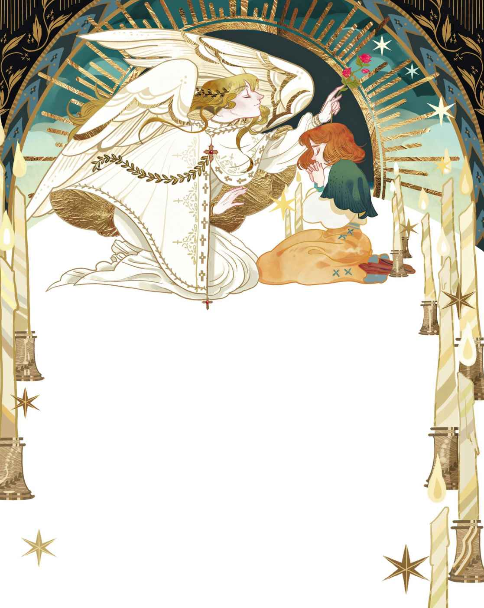

# 红鞋子

从前有个小姑娘，长得可爱又漂亮。可是她太穷了，整个夏天都只能光着脚走路。到了冬天，她又只能穿沉重的木鞋，脚踝都被磨得发红了。噢，简直是红得不得了呀。

在村子的正中间住着一位“老妈妈鞋匠”。她搜集了一些红衣服的碎布，然后用自己最好的手艺做成了一双小红鞋。鞋子虽然有点粗糙，却是出自一片好意，因为她要把这双鞋送给那个小姑娘。小姑娘的名字叫卡伦。

妈妈下葬的那天，卡伦第一次穿上那双崭新的红鞋子。当然了，在服丧期穿它们不太合适，但她也只有它们可穿了。于是她穿着红鞋子，光着腿，在柳条编成的简陋灵柩后头跟着。

就在那时，一辆大个头老马车打这儿经过，马车里坐着一位大个头老太太。老太太看着小卡伦，对她产生了怜悯之心。于是她来到牧师面前，说：“让这个小姑娘跟我走吧，我会好好照顾她的。”

卡伦很确信，之所以会发生这样的事，全是因为自己穿了红鞋子。不过那位女士说了，这双鞋子有点吓人，还吩咐要把它们烧掉。现在卡伦有了合身的新衣服，还有人教她读书和做针线活。人们都说她很漂亮，但是她的镜子对她说：“你远不止是漂亮，你是美丽的。”

女王正巧带着身为公主的小女儿到这个国家旅行，卡伦跟着人群一起去城堡下观望。那位小公主穿着一袭白衣，来到窗口那儿以便众人瞻仰。她没有穿裙裾，也没有戴金冠，不过她穿着一双亮丽的红色摩洛哥皮鞋

> **注 128**　皮革业是摩洛哥的特色之一。

等卡伦再长大一些，可以受坚信礼

> **注 129**　基督教仪式。孩子在十三岁以后才可受坚信礼，成为正式的基督教徒。

“这双鞋这么亮眼，一定是漆皮的吧。”老太太说。

“是啊，它们确实很亮眼。”卡伦说。鞋的尺码正合脚，于是老太太买下了这双鞋。不过她并不知道它们是红色的。如果她的眼睛能看得清的话，她绝不会让卡伦穿着它们去受坚信礼。但卡伦恰恰穿着它们去了。

所有人的目光都注视着卡伦的脚。当她沿着教堂的通道，走向圣坛的时候，她仿佛看见，肖像画里那些扎着硬邦邦的衣领、穿着黑色长袍的牧师和牧师夫人们——就连他们的目光也注视着她的红鞋子。牧师把手放在她头上，开始对她施洗，为她讲述神与她同在的道理，传授作为基督徒要遵守的教义，然而她的脑袋瓜里满是那双红鞋子，除此以外什么也听不进去。庄严的风琴声响起，孩子们用悦耳的声音唱起圣歌，上了年纪的唱诗班指挥也在一起唱，然而卡伦只想着自己那双红鞋子。这天下午还没过去，老太太就听到教区的每个人都在说，卡伦脚上的那双鞋子是红色的。她告诉卡伦，穿红鞋子去教堂极为不妥。这样非常不合适！于是她后来总是穿黑鞋子去教堂，哪怕那都是些旧鞋子。

下个星期天要举行圣餐礼。卡伦看了看自己的黑鞋子，又看了看那双红鞋子。她的视线停在了红鞋子身上，最后还是把它们穿到了脚上。

这是一个晴朗的日子，卡伦和老太太一起穿过玉米田，田里满是灰尘。在教堂门口，她们遇见一个老兵。老兵拄着拐杖，留着一把奇怪的长胡须。这胡须白里透红。得了，它就是红色的。他把身子弯得很低，低得都快碰到地上了，然后问老太太，要不要他帮卡伦的鞋子去去灰。于是卡伦伸出了她的小脚丫。

“噢，多么美丽的舞鞋啊。”老兵说，“一旦跳起来，就别停下来。”他又对鞋子说道。他伸手朝两只鞋子的鞋底上掸了掸。

老太太给了他一便士，然后和卡伦走进了教堂。所有人都瞪着卡伦的红鞋子，所有肖像画里的牧师也都一起瞪着。当卡伦跪在圣餐台前，当圣餐杯送到嘴边的时候，她心里只想着那双红鞋子。圣餐杯里仿佛浮现着它们的影子，她忘了唱圣歌，也忘了念祷告。

圣餐礼结束后，老太太坐进马车。卡伦抬起脚，正要跟着一起上车。这时那个老兵又说话了：“噢，多么美丽的舞鞋啊！”

卡伦无法控制地跳了几步，而一旦跳起来就停不下来了，鞋子似乎控制了她。她沿着教堂的墙角跳起舞来——就是停不下来。车夫不得不追着她跑，抓住她后把她塞进马车。可是在马车里，卡伦的双脚依然在跳舞，老太太被她狠狠地踢了一脚。直到她把鞋子脱掉，她的两条腿才安分下来。等她们到家后，红鞋子被收在了柜子里。然而卡伦还是会忍不住去看它们。

此后不久，老太太得了病，据说是不可能再复原了。她需要一直有人照料，还要有长期可靠的护理。她能指望的只有卡伦了。不过，城里正在举行一场大型舞会，卡伦也受到了邀请。她看了看老太太，怎么看她都不可能再活下去了。她又看了看红鞋子，因为她觉得，光是看一下又不要紧。接着她便穿上了它们，因为她觉得，光是穿一下又不要紧。但是再接下来，她就干脆去参加舞会，在那儿跳起舞来了。然而她想朝右的时候，鞋子偏偏朝左。她想朝舞池上跳的时候，鞋子却拖着她往下走。她一路被迫跳下台阶，跳上大街，接着跳出了城门。她不得不跳，不能不跳，就这么一直跳进了黑暗的森林。

忽然间，有什么东西在林子里发光。那应该是月亮吧，卡伦心想。不料那竟是红胡子老兵。老兵点着头，说：“噢，多么美丽的舞鞋啊。”

卡伦感到恐惧至极，她想把红鞋子脱掉。她把长袜都扯掉了，可鞋子依旧牢牢地与她的双脚连在一起。于是她又开始跳舞，没有办法停下来。她在旷野里跳，在山谷里跳，在雨中跳，在阳光下跳，不分日夜地跳。在夜里跳是最可怕的，她跳进了一片没有围栏的墓地，不过死人们并没有跟着她一起跳，因为他们还有别的事情要做。她想要在一座长着苦艾的穷人墓上坐下来，可是既找不到可坐的地方，又无法让自己停下来。教堂的大门敞开着，她便朝那儿跳去。只见门口由一位天使把守着，他身穿白色长袍，翅膀从肩部一直延伸到地面。他的表情庄严肃穆，手里握着一把明晃晃的宽剑。

“你跳吧！”他对她说道，“穿着红鞋子跳吧，跳到精疲力竭、身体发凉，跳到鲜活的躯体枯萎成一副骨架。挨家挨户地去跳吧，哪家有爱慕虚荣的孩子，你就去敲哪家的门，让他们以后听见你的敲门声就感到害怕。跳吧，一直跳下去吧。”

“请您宽恕我吧！”卡伦大喊道。然而她没有听到天使的回应。红鞋子带着她离开教堂的大门，穿过旷野，沿着形形色色的大路和小道，没完没了、无休无止地跳着。

一天早上，她跳着舞经过一处熟悉的房门。里面有人在唱圣歌，随即运出一口铺满鲜花的棺材，她这才知道老太太已经去世了。现在，她在这个世界上已经举目无亲了。这是上帝的天使对她的诅咒。

她不得不跳，不能不跳，彻夜不停。红鞋子带着她跳过荆棘和石南

> **注 130**　石南的叶片边缘呈锯齿状。

“请出来！”她喊道，“出来吧！我没有办法进去，因为我跳得停不下来。”

刽子手说：“看样子，你还不清楚我是什么人吧。我专砍坏人的脑袋，我觉得我的斧子又开始蠢蠢欲动了。”

“别砍我的脑袋。我要留着脑袋为我犯的罪忏悔。”卡伦说，“请砍下我那穿着红鞋子的双脚吧。”

她进行了忏悔，然后让刽子手把穿着红鞋子的双脚砍了下来。鞋子带着她的小脚丫跳开了，它们跳过旷野，跳进了森林深处。刽子手用木头给她做了一对假肢和一副拐杖，还教了她一首圣歌，这首歌是罪犯们为了赎罪而唱的。她亲吻了他那双拿着斧子的手，然后再次穿过荒地往回走。

“现在，红鞋子给我带来的折磨算是到头了。”她说，“我要去教堂，再次出现在人们眼前。”她蹒跚着朝教堂走去，尽可能走得快一些，然而当她来到教堂的时候，红鞋子又跳着舞出现在她跟前。她惊恐万分，调头就走。

一整个星期她都感到很难过，流下不知多少苦涩的泪水。而当星期天再次来临的时候，她说：“我已经难过够了，也哭够了，我要像那些坐在教堂里的人一样，抬起自己的头来。”于是她鼓起勇气再次前往教堂，然而，就在她来到教堂门口的那一刻，那双红鞋子又跳着舞在她面前出现了。前所未有的惊恐再次摄住了她，她带着那颗原本想要忏悔的心转身逃跑了。

她来到牧师的家，想要求得一份用人的工作。她保证自己一定会努力工作，一定会竭尽全力把活儿干好。她不计报酬，只求能有个容身之所，能和好人们一起生活。牧师的妻子很同情她，于是为她在家里安排了活儿干。卡伦干得勤勤恳恳、十分认真。晚上，牧师大声朗诵《圣经》的时候，她就安静地坐着，聆听着每一个字。孩子们和她很投缘，但是当他们爱慕虚荣地谈论如何穿衣打扮，如何变得像女王一样美丽的时候，她会对他们摇摇头。

又一个星期天，牧师一家要去教堂。他们叫卡伦也一起去，可是她的眼睛里含着泪水，看着自己的拐杖，摇着头。其他人都去做礼拜了，只有她孤零零地躲在小房间里。房间小得只能放一张床和一把椅子。她坐下来，手里捧着赞美诗集。当她用一颗忏悔的心朗诵起赞美诗的时候，她听见了风琴的声音——风把教堂里的风琴声带到了她的窗前。她的脸庞被泪水打湿了，她举起赞美诗集，说：“主啊，救救我吧！”

这时太阳释放出明亮的光芒，身穿白色长袍的天使出现在她面前。这就是那天晚上她在教堂门前见过的那位天使。但是这一次，他的手里没有握着锋利的宽剑。他手里拿的是一根绿枝，上面开满了玫瑰花。他用绿枝碰了碰天花板，每碰一处就出现一颗金色的星星，接着天花板开始升高。他又碰了碰墙壁，于是墙壁开始移动，房间变得宽敞起来。她看到了琤琤作响的风琴，看到了肖像画里的那些牧师和牧师的妻子，看到了坐在饰有鲜花的教堂长凳上的人们，看到他们正在唱着圣歌。可怜的卡伦，她不知究竟是教堂出现在了她那狭小的房间里，还是她真的置身于教堂。此时她和牧师一家坐在教堂长凳上。当圣歌唱毕，他们看着她，向她点头。

“你来这里是对的，小卡伦。”他们说道。

“这是主对我的宽恕。”她也对他们说。

风琴声响起，唱诗班的孩子们开始合唱，那声音柔和又美好。明朗的阳光从窗外暖洋洋地流淌进来，洒在了卡伦所在的长凳上。她被阳光拥抱着，心被阳光、喜悦和安宁填得满满的。于是她的灵魂破壳而出，然后乘着阳光，飞去了天堂。那里，再也不会有人问起红鞋子。
