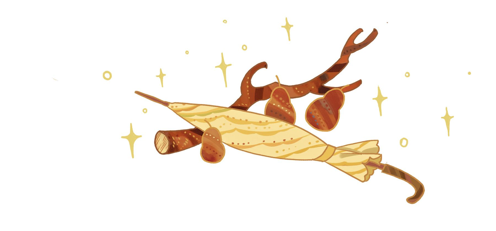
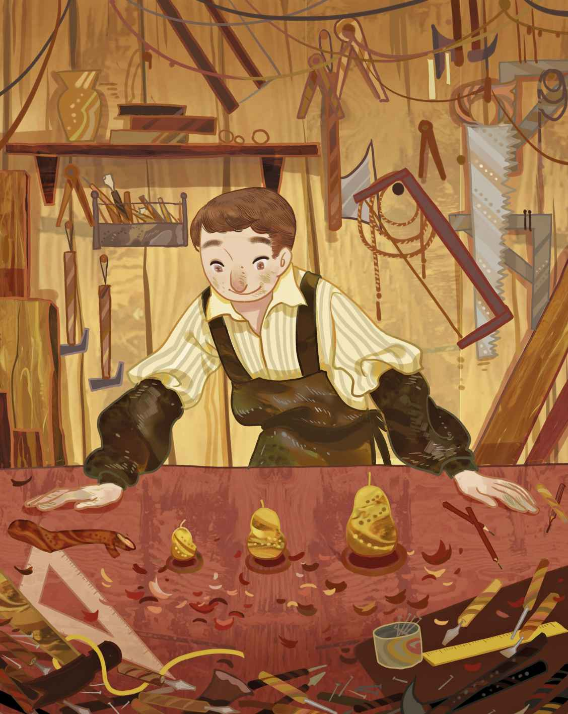

# 一根别针也能带来好运

我要给你讲个关于幸运的故事。什么叫走运，我们每个人都知道。有些人每天都能走运；有些人只能隔三岔五地等待好运降临；还有些人，一辈子只能走一次好运。不过幸运总会在某一刻出现在我们面前，或早或晚。

不用我说大家也都知道，小孩子是上帝赐予母亲们的。他们可能会降生在贵族人家的城堡里，可能会降生在工人家庭，也可能会降生在寒风瑟瑟的开阔的旷野上。各位有所不知的是，每当上帝让一个孩子降生，他总会赠予他一份幸运。这是真的。只是上帝并不会把这份幸运安放在孩子出生的场所，而是会把它藏在别处，藏在我们意想不到的奇异角落里。是的，诸位尽可放心，幸运迟早会来的，每个人早晚都会走好运。

这份幸运可能以苹果的形式出现。苹果找上了一位名叫牛顿的学者，它掉到了他身上，于是他就走了好运。你要是不知道牛顿的故事，你就去找人给你讲讲吧。我现在要讲别的故事了，一个关于梨的故事。

从前有个出身贫寒的人，从小在贫困中长大，长大后又在贫困中结了婚。顺便说一句，他的职业是个工匠，不过只会做雨伞的手柄和骨架，赚到的钱只能勉强糊口。

“我从来就没走过好运。”他总是这么说。

这绝对是一个真实的故事，它确确实实发生过。我能说出这位工匠住在哪个国家、哪个村，不过那并不重要。他家的房子和花园周围长满了野生的浆果，果子又红又酸，仿佛成为他家最华丽的装饰。花园里还长着一棵梨树，虽然这棵梨树从来不结果实，但是这位工匠的好运恰恰就隐藏在这棵树上，隐藏在尚未成型的那只梨身上。

一天晚上，狂风肆虐。邻村的人们都说，就连颇有些分量的邮政马车，都像是布片似的被风掀起，轻而易举地就摔去了马路对面。如此，那棵梨树被风扯下一大根树枝也就不足为奇了。那根树枝被吹去了工匠的铺子里。纯粹是为了解闷儿，工匠用它做成了大、中、小三种木梨。

“这下我的梨树也算是结出梨子了。”他笑言道，随后把三种木梨都当作玩具给了孩子们。

雨伞是生活必需品，对于那些多雨的地区更是如此。不过工匠家里只有一把雨伞。风吹得猛的时候，他们的雨伞就会被吹得翻个面。有时它还会有所破损，幸好工匠知道怎么修补。不过，用于把雨伞收住的环形搭扣变得愈来愈糟糕了。每当他们以为已经稳稳当当地把雨伞扣好的时候，搭扣总是会突然弹飞掉。

某天，搭扣又弹飞了。工匠到处找它。在地板的一条裂缝里，他发现了那种给孩子们当玩具的最小的木梨。

“如果我找不到搭扣的话，”他说，“就拿这个来做搭扣好了。”于是他在这只木梨上穿了一根线，然后用它稳稳当当地扣上了雨伞。现在雨伞扣得比以往任何时候都要好了。

后来，工匠去城里卖伞柄和骨架的时候，顺便带上了几只小木梨。它们被安在了一些新伞上，然后和上千把其他雨伞一起装上了驶往美国的货船。小木梨很快在美国人中间流行起来，他们发现这些小木梨比其他的雨伞搭扣更管用。于是商家们发来订单，要求今后所有的雨伞都要装上这种小木梨。

这下可有活儿干了——所有运往美国的雨伞都要安上小木梨，数以千计。工匠开始大规模地出口木梨，整棵梨树都被做成了小木梨。小木梨带来的财富愈来愈多，成了取之不尽的收入来源。

“原来我的好运一直就藏在梨树里啊。”他说。很快他就有了一座工厂，还有很多工人为他工作。如今闲来无事的时候，他总是开玩笑似的说：“一根别针也能带来好运。”

我这个讲故事的人，也非常同意这种说法。因为在丹麦，真的流传着这样一句谚语：在嘴里放一根银白色的别针，人就能隐形。不过那一定得是真正管用的别针，也就是上帝亲手赠予的那份幸运。我也得到过这样一根别针。每当我去美国的时候，我总是会随身携带着它。这个国家虽然很远，但是离我却很近。我说的这些已经传到了那里，海浪和风会把我的话语带去美国。也许有朝一日，我会在那里看到人们都在读我写的故事，也许我还会看见金灿灿的、丁零作响的金子——那是最好的金子，因为它们就在孩子们的眼睛里闪烁，在他们小时候的唇间丁零作响，他们长大以后也会念念不忘。我会去造访所有朋友的家，但是没有人会看得见我，因为我的嘴里有一根银白色的别针。

一根别针也可以带来好运。
