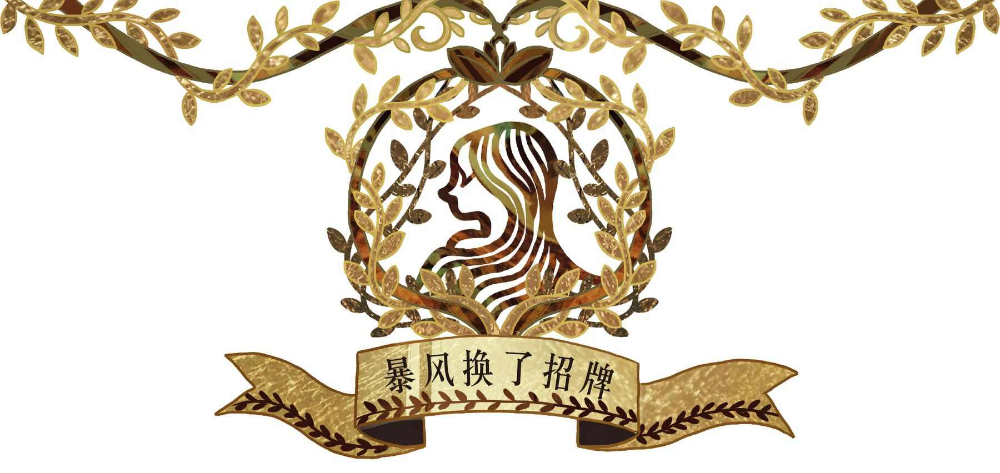
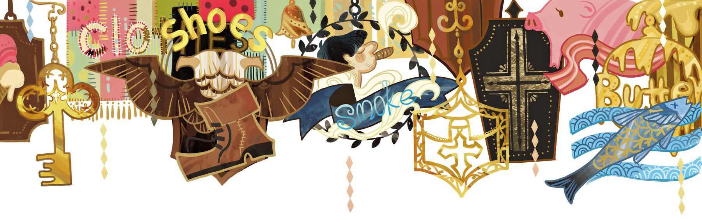

# 暴风换了招牌

很久以前，祖父还只是一个小男孩，那时他穿着红裤子、红夹克，腰上围着腰带，帽子上插着一根羽毛——那时的男孩若要盛装亮相，都会像他这样打扮——在那个年代，很多东西都跟今天很不一样。那时候街上常会有露天表演，如今我们可看不到，因为那种活动已经被人们遗忘，它们已经过时了。不过，听祖父说起那些事情的时候，还是别有一番趣味的。

那时候，制鞋行业协会换了新址，招牌也要一并搬过去。届时举行的表演仪式真是不得了。丝绸横幅迎风摆动，上面画着大鞋子和双头鹰。年纪较轻的鞋匠们手里抱着欢迎杯和协会的箱子，衣服袖子上挂着红、白两色的彩带。资历老一点的鞋匠们则佩着无鞘的剑，每把剑头上还插着一只柠檬。他们还有一整支乐队，其中最棒的那种乐器，祖父称之为“鸟琴”。这种琴由一根长长的杆子以及一只半月形模样的物件组成

> **注 131**　指的是土耳其传统乐器bagloma，形似鸟，又称“乌德琴”，有的琴身较长，有的则较短，有很多改良品种，是土耳其等中东国家的重要乐器。

队伍最前面有个小丑，他的衣服上满是五彩缤纷的色块，脸则涂成黑色，脑袋上挂了许多铃铛，活像是一匹拉雪橇的马。他伸出手杖戏弄围观的群众，不过他不会碰伤任何人，只是让人群热闹起来。人们前躲后闪，挤得好不热闹，男孩和女孩们全都被挤得歪到了排水沟里。上了年纪的女士们也只能跟着一块儿挤，她们的脸色很难看，嘴里骂骂咧咧的。有的人在大笑，有的人在谈天，有的人站在台阶上看热闹，有的人则在窗前看好戏。哦，是的，连屋顶上也站满了人。虽然天上正在出太阳，但时不时会下点小雨。农夫们倒是很乐意来点雨水，就算人被淋得湿透了，对农作物而言仍是好事一桩。

啊，祖父的那些故事可有讲头了！当他还是个小男孩时见识过各种热闹非凡的表演，那正是露天表演最为盛行的年代。当时，最年长的鞋匠上台发表了演讲，那块招牌也在台上挂着。演讲的内容全是韵文，就跟诗歌似的——或许真能称之为诗呢。演讲稿是由三个人一起写的，写之前他们还喝了一整碗潘趣酒

> **注 132**　一种果酒，算是鸡尾酒的分支，酒精度不高。

像那样的场面，你永远也不会忘记，不管你后来会变得多老，祖父说。他确实没有忘记，尽管他后来也见识过很多蔚为壮观、璀璨夺目的东西，并且也都能说得头头是道，不过要说最有趣的，还要属城里发生的那次暴风换招牌事件。

还是个孩子的时候，祖父跟他的父母一起去城里。那是他第一次见识全国最大的城镇。

那里的街上全是人，他还以为大家都要举行那种上招牌的仪式呢，因为这地方的招牌实在太多了。如果这些招牌挂在室内而不是室外，那么它们足足可以塞满好几百个房间。裁缝的招牌上是各式各样的布，扬言能把根本不会穿衣打扮的人变得衣冠楚楚。烟草商的招牌上面有抽雪茄的调皮小男孩形象，看上去十分逼真。还有黄油招牌、腌青鱼招牌、牧师衣领招牌、棺材招牌。更有甚者，招牌上只写了介绍和布告文字。事实上，要把这些招牌看个遍，你起码得花上一整天时间走遍所有街道。你一眼就能看出那些屋子里的人是干什么的，毕竟他们都在外面挂了招牌。那可都是他们的标志哟，别提有多方便了，祖父说。这么一座大城镇，你只消瞄一眼招牌，就能立马知道屋子里住着什么人。

不过，这些招牌身上很快就会有奇事上演。那会儿祖父刚到那座城镇。他已经把整件事讲给我听了，讲的时候连眼睛都不眨一下。我母亲总是说，祖父唬人的时候通常都这样，看上去一副千真万确的阵势。

祖父到那座大城镇的头一晚，天气糟透了，迄今为止任何书本上都还没描述过那般恶劣的天气，人们的记忆中也从未出现过如此厉害的暴风。屋顶上的砖瓦在漫天飞舞，年久失修的木栅栏全都被吹倒在地，单轮手推车仿佛活了起来，在街上到处跑来跑去。暴风在空中呼啸，它扫荡、摇撼着一切。这暴风委实厉害得不行，就连运河里的水也被卷上了岸，被它吹得不知归所。它席卷整座城镇，沿途将烟囱连根拔起。就连那些历史悠久、仪表堂堂的教堂塔楼也不得不屈尊弯腰避风头，此后它们再也没直起来过。

有栋房子外面设有消防岗亭，那里驻扎着忠诚的老消防队长。他总是在火灾现场坚持到最后一刻。暴风似乎对他那座岗亭颇为不满，粗暴地将其刮倒在台阶上，然后一路吹着它滚过整条街。接着发生的事情就有趣了，消防岗亭在不起眼的木匠家门前又立了起来，而这位木匠最近在一次火灾中救了三个人，消防岗亭固然不知道这点。理发师的招牌是一只大铜盆，这只铜盆也被暴风扯了下来，然后扔进了议员家的窗户里。邻里们都说，暴风这么干像是故意的，因为那些跟他们家女主人较为熟络的女友人们，平时都管他家女主人叫“剃须刀”——她的嘴巴太快，是个包打听，知道的事情比人家自己还多。

有块招牌上画着一条干鳕鱼，这块招牌飞到了一位报刊撰稿人家门前。这回暴风的表现不佳，这个玩笑开得可不怎么样。它大概忘了，报刊撰稿人是不应该遭到取笑的。人家可是报纸内容的主宰，肚子里是有墨水的。

风向标飞去了对面的屋顶，然后停在了上面——那画面别提有多诡异、多吓人

> **注 133**　旧时风向标的形状都是公鸡，风向标一词“weathercock”中的“cock”就是公鸡的意思。这里可能是风向标像是一只公鸡一样跳到了对面的屋顶。

桶匠的桶挂在了“女士服装”的招牌下面。

餐馆的菜单本来是裱在沉甸甸的相框里、放在餐馆门口的，现在却被暴风刮到了剧院的出入口。那家剧院原本一直无人光顾，如此一来倒是凑成一出滑稽节目，“山葵调味汤和卷心菜肉卷”，这节目绝对能把人们吸引进去。

皮毛商的镇店招牌是一张狐狸皮，现在这张皮挂在了一位年轻人的门铃绳上，看上去活像一把折叠起来的雨伞。这位年轻人每天早晨都去教堂祷告，人称“模范好青年”，他的婶婶是这么说的。

“高等教育机构”的招牌被吹去了桌球房，而这机构自己收到另一块招牌，上面写着“专售低幼用品”。与其说是幽默，倒不如说是淘气。这就是暴风干的勾当，真拿它没办法。

这真是个可怕的夜晚。到了早上，想想便可知，城里的所有招牌几乎都被换了位置！有些位置换得真是不怀好意，祖父不怎么谈那些，但他心里可是乐不可支。我能看得出来，他对这种恶作剧其实很感兴趣。

那座大城镇的居民算是遭了殃，尤其是那些并不熟门熟路的人。他们老是搞错地方，根本分不清哪儿是哪儿，错误的招牌把他们弄得晕头转向。城里长老们会定期举行会议，他们总是一起开会讨论一些重要事务，有些人以为自己去的是这种严肃场合，结果到了才发现眼前居然是一所学校，里头全是在课桌上又跳又闹的小孩子。

还有些人误把教堂当成剧院呢，那可真是丢人啊！

在我们如今生活的年代，从来就没有过那么厉害的暴风。那种暴风只有祖父见到过一次，当时他还是个非常小的小男孩。那样的暴风我们恐怕是见识不到了，不过我们的后代可能会遇到。到那时，但愿他们都乖乖地躲在家里，就让暴风在外面换招牌好啦！
