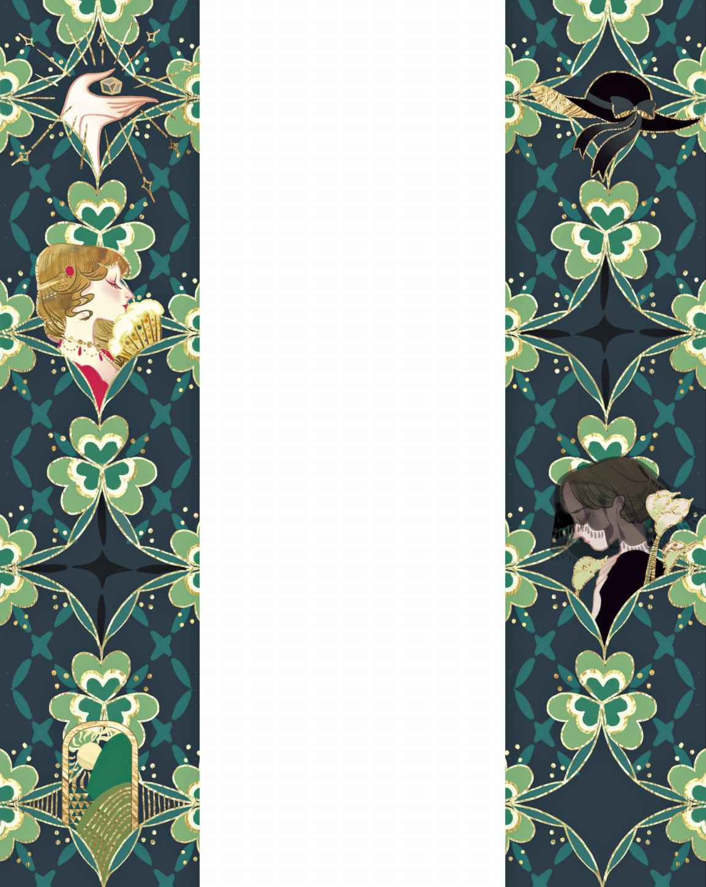

# 嘴上不说，心里却记着

从前有座年代悠久的公馆

> **注 134**　本来想译作“老宅”，但是体现不出贵族气。译成“庄园”虽然有贵族气，但又未免有点太大了。想来还是译成“公馆”为佳，富人居住的大型宅邸都可以叫“公馆”，符合主人的贵族身份。

> **注 135**　这里指的是小型的护城河，也可以译成小河，但太幽静了，原文并没有提倡这种感觉。据考察，但凡是王公将相居住的大型住宅四周都有护城河，要过河，就要通过下一句所说的“吊桥”。护城河其实就是挖壕沟积水而成，有水的和没水的，都可以叫壕沟，因此这里就译作壕沟。

> **注 136**　正是因为柴火潮湿，所以才会烧出很多烟来。

一天晚上，公馆里来了强盗，把女主人的三个守卫连同看门狗一起给杀了。他们用狗链将梅特女士拴在狗窝里，然后从地窖里搬出葡萄酒和上好的啤酒，坐在公馆的大厅里大喝起来。

梅特女士像狗一样被拴着，却不愿像狗一样对他们咆哮

> **注 137**　这里安徒生是在刻意体现她作为贵族的尊严。

不一会儿，强盗手下的小男仆来到了梅特女士跟前。他是飞快地溜过来的，并且确信他们没留意他，否则他们一定会把他处死的。

“梅特·莫根斯女士，”小男仆说道，“我的父亲曾经遭受过骑木马

> **注 138**　旧时刑法，人骑在木马上，双脚离地。

于是他们从马厩里牵出两匹马骑走，一路风雨兼程，得到了很多友人的帮助。

“我对那位老人家的微不足道的帮助竟会换来这般报答。”梅特·莫根斯说。

“我嘴上不说，心里却记着。”小男仆说。

那批强盗后来都被绞死了。

这里还有一座年代悠久的公馆，不过，那并不是梅特·莫根斯女士的公馆。那是另一家贵族的宅邸。

这一回，事情就发生在我们生活的时代。阳光洒在镀金的公馆角楼尖顶上，小树丛如同花束一般伸出湖面，野天鹅在四周游来游去。花园里生长着玫瑰花，不过，要问最可人的玫瑰是哪一朵，那就当属这座公馆的女主人了。她是那么光彩照人，这种光彩正是源自快乐，而快乐又源自她的善行。她从不抛头露面，但是人们总把她记在心里——人们嘴上不说，心里却记着。

这会儿她出了宅子，前往田野里的一间小农舍，里面住着一个瘫痪的可怜女孩。屋子的窗户是朝北的，阳光照不进来。唯一能映入眼帘的只有一小片草地，因为壕沟旁边有一堆高出地面的土挡住了她的视线。不过今天，阳光终于照进来了，那是来自上帝的暖意。美好舒适的阳光，终于有了。阳光是从南边为她新开的窗户照射进来的，而在此之前，那里始终只是一堵墙。

瘫痪的女孩坐在温暖的阳光里，望着外面的森林与河流，她的世界终于可以变得宽广，变得美丽了。这一切，对于这位善良的贵夫人而言，只是举手之劳。

“虽然是举手之劳，而且确实微不足道，”她说，“但是行善会为我带来难以用言语形容的、至高无上的快乐。”

所以她总是坚持多做善事，并因此被穷苦人家记在心里，也被富裕人家记在心里，因为富人当中也会有受到苦难折磨的人。她总是默默地行善，从不张扬，我们的主也会把这些善行记在心里。

还有一座年代久远的公馆，它位于一座繁华的大城市。这座公馆里厅堂遍布，但是我们用不着进去。我们就待在厨房便好。这里非常舒适，采光很好，又干净又整洁。铜制的炊具熠熠发光，桌子擦得发亮，水槽也光可鉴人，活像是刚擦洗过一般。这一切都要归功于那位女佣，她包揽了所有工作。尽管如此，她还是找时间给自己穿上了最好的衣服，看样子是要去教堂。她的帽子上扎着蝴蝶结，那是一只黑色蝴蝶结，这意味着她正在服丧。然而她并没有亲人，既没有父亲也没有母亲，既没有家也没有恋人。她只是个可怜的女佣。不过，她和一位贫穷的年轻人订过婚，他们深深地爱着对方。有一天，年轻人来到她面前。

“我们两个一无所有，”他说，“但是住在街对面的寡妇很富有。她已经向我示好，想让我过上好日子，可是我心里只有你。你说我该怎么办？”

“你觉得谁能给你带来幸福，就选择谁吧。”姑娘说，“好好地待她，全心全意地对她，但是请记住我俩的曾经，我们从此不要再见面了。”

很多年过去了。她在街上再次遇见了他，遇见了这位昔日心爱的恋人。他看上去病恹恹的，十分狼狈。她忍不住问他：“你过得如何？”

“每天都过得很好，”他说，“我妻子她是个好人，可是你一直占据着我的心。我为此痛苦挣扎，但这一切很快就结束了。现在我们又会彼此分开，但我们终将在上帝那里相见！”

又过去一周。那天早晨，报纸上刊出他死去的消息。她正是在为他服丧。她心爱的人留下一个寡妇妻子和三个并非他亲生的子女。报纸上就是这么说的。丧钟的鸣声固然悲哀，但铸就丧钟的却是纯洁。

黑色蝴蝶结代表着哀悼，悲伤在姑娘的脸上溢于言表。有些事情她会珍藏在心里，嘴上不说，心里却记着。

是啊，诚如您所见，我讲了三个故事，它们就像长在同一根茎上的三片叶子。您是否希望再看到这样的三叶草呢？在人们的心之书中，还记载着很多这样的故事呢。人们嘴上不说，心里却记着。
