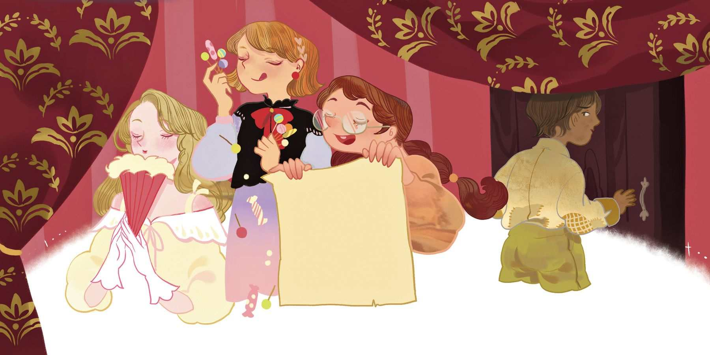

# 孩子们的空谈

商人在家中举办儿童派对。有钱人家的孩子和达官显贵的孩子都来了。做东的这位商人是一位饱学之士，他的父亲坚称，他可是拥有大学文凭的。你瞧，他父亲自己以前只是个从事家畜业的人，不过倒是一直为人实诚而节俭。家畜生意让他发家致富，并惠及他的儿子，也就是刚才提到的那位商人。商人又在原来的基础上把家产翻了番。他是个聪明人，而且心地善良，不过人们显然对他的财富更感兴趣。他的家里总是高朋满座，有的人是贵族出身，人称“贵族血统”；有的人肚子里很有墨水。这两项，有的人两者兼有，有的人却两者皆无。不过今天的来宾都是些孩子，这是让孩子们夸夸其谈的派对，孩子们想说什么就说什么。宾客当中有一位漂亮的小女孩，她有种莫名其妙的优越感，就因为她父亲是一位王室寝宫的男侍。把她娇惯成这样的是其他侍从，并不是她的父母。她的父母可要比他们明事理多了。

“我可是在王室寝宫出生的小孩。”她说。其实她搞不好是在地下室出生的，

> **注 139**　侍从阶层的孩子根本不可能在王室的房间出生，一般更可能是在杂物间或地下室等场所出生。

> **注 140**　这里的原文是sen，意思就是名字以“sen”结尾的都是平民老百姓。贵族都有自己的贵族姓氏，他们的名字不会使用“sen”这样的后缀。安徒生自己的名字“Andersen”就带有后缀“sen”。他笔下的很多故事都是他自己的写照。

不过商人的女儿感到很生气，因为她的父亲名叫马德生，她当然知道“生”字意味着什么，所以她尽可能高傲地回应道：“我父亲能买下价值一百元的糖果，然后全部扔掉，你们的父亲负担得起吗？”

“负担不起，”撰稿人的小女儿说，“不过我父亲可以把你父亲和其他所有人的父亲都写到报纸上！我母亲说，所有人都要敬他三分，因为他想把别人写成什么样都可以！”说着，她还昂首阔步起来，活脱脱就是一个公主，真正的公主都是那么走路的！

她们说话的时候，一个贫穷的男孩正站在半开的门口，透过门的空当朝里头偷看。这男孩的样子太寒酸了，甚至都没被允许进入房间。他只能帮着厨子一起烤肉，这才被允许朝里头瞥几眼。那些孩子穿着那么漂亮的衣服，在里头玩得那么高兴，他实在太想看了。

“我要是也能加入她们就好了。”他心想。可是他听见了她们刚才讲的话，那些话令他感到很是难过。他的父母连一便士的存款都没有，连一张报纸也买不起，更别提写文章在报纸上发表了。最令人心酸的是，他父亲的名字叫汉生，那也是一个以“生”结尾的名字。他这辈子都不可能有什么希望了！真是太悲哀了。但他自己好歹也算有个“出身”。是的，就跟大多数人一样——也只能这样了。

那晚的事情，就说到这里吧。

许多年过去了，当年的那些孩子也都长大了。如今，城里矗立着一栋漂亮的房子，房子里满是漂亮的家当，每个人都巴望着能进去看看，就连住在城外的人们也很想前来观摩一番。那么，在当年的那些孩子当中，究竟谁才是这栋房子的主人呢？是啊，这应该不难猜到。不过，也不是太容易就能猜到！那栋房子是属于当年那个穷男孩的！他如今有了出息，尽管他的名字末尾有个“生”字——托瓦尔生！

至于另外三个孩子——皇室出身的孩子、有钱的孩子和知识分子的孩子，她们如何了呢？唔，她们也没什么不好。说到底，她们当时都只不过是孩子，而如今已经成了风度翩翩、平易近人的大人，她们的心地还是善良的。不管那天晚上想过什么、说过什么，都只能算作是孩子们的空谈。
