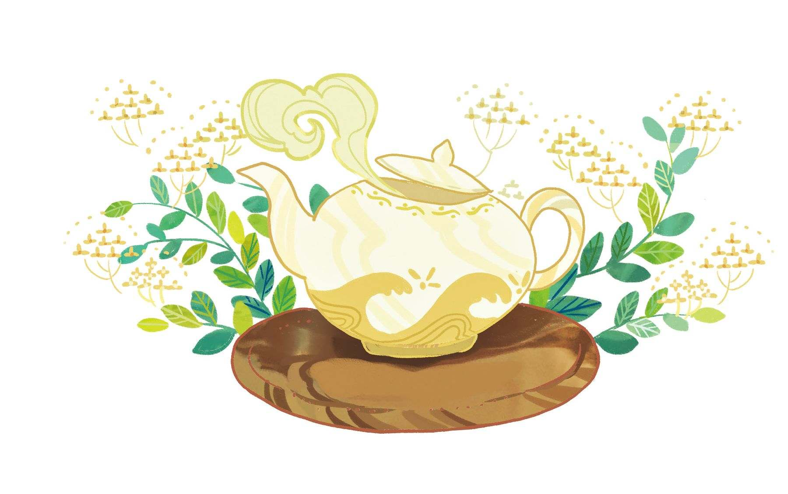
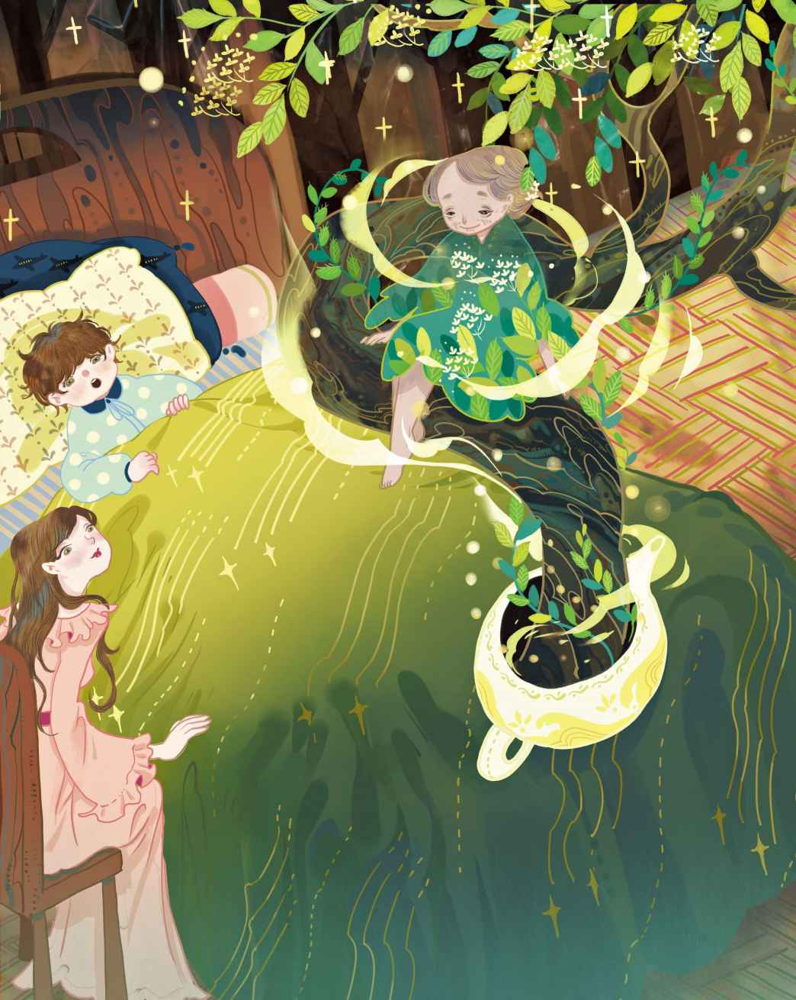
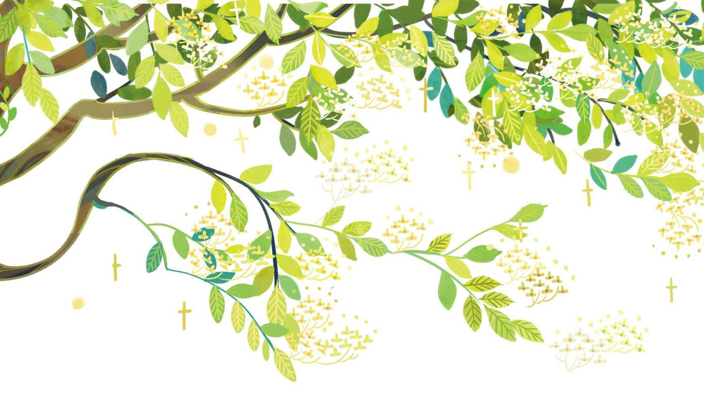
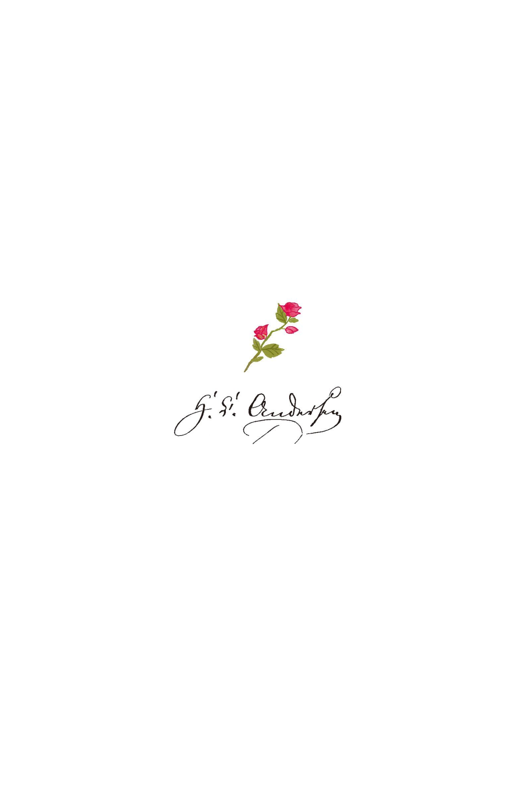

# 接骨木妈妈

从前有个小男孩，他外出的时候弄湿了双脚，结果就受寒感冒了。没人知道这是怎么回事，因为天气明明挺干燥的。

他妈妈帮他脱去衣服，抱他上床，然后把茶瓮

> **注 141**　茶瓮和茶壶是两种不同的器皿。茶壶有壶口，而茶瓮没有；茶壶用于泡茶，而茶瓮用于储存茶叶；茶壶的体积较小，而茶瓮的体积较大。

> **注 142**　接骨木茶有治疗感冒的功效。

这时候，一位在顶楼独居的老人前来登门造访。他看上去有点滑稽，既没有妻室也没有孩子，不过他很喜欢小孩子。他知道很多有趣的故事和童话，听他讲故事是一件很有意思的事。

“现在把茶喝了吧。”小男孩的妈妈说，“喝完之后，说不定有故事讲给你听哦。”

“是哦，”老人慈祥地点了点头，“要是我能想到一个新故事就好啦！不过，先告诉我，这孩子是怎么把脚给弄湿的？”他问道。

“是啊，究竟是在什么地方弄湿的呢？”男孩的妈妈说，“都没人知道是怎么一回事。”

“你能给我讲个童话故事吗？”小男孩问道。

“行啊，不过我得先弄清楚一些事情。你必须老实告诉我，你去上学时走的那条小街的排水沟有多深？”

“刚好能淹没我的靴子。”小男孩答道。“我是说，”他又补充道，“假如我站在排水沟最深的地方的话。”

“脚为什么会湿掉，看来我们已经弄明白喽。”老人说，“那么现在，我可以给你讲个故事了。不过眼下我没有新的故事。”

“你可以马上编一个呀。”小男孩说，“妈妈说，你能把看到过的东西全都编成故事，不管你碰到什么，你都能把它变成童话。”

“是哟，可是那种故事和童话没有任何价值。唔，真正的好故事都是自己冒出来的，它们会来敲敲我的脑门，然后说：‘在这儿呐！’”

“那它们现在能冒出来吗？”小男孩问道。他的妈妈一边笑一边把接骨木放进茶壶，然后往里头倒开水。

“请给我讲个故事吧！给我讲个故事吧！”

“如果有个故事自己冒出来，我倒是能讲给你听。不过那种好事情可不多见，它只在它觉得合适的时候冒出来。等等！”老人突然顿了一下，“有了！瞧！现在茶壶里就冒出来一个！”

于是小男孩朝茶壶看去。他发现壶盖慢慢地升了起来，里头钻出了白色的接骨木鲜花。接骨木的枝条也从茶壶口钻了出来，然后朝四面八方舒展开来，它们变得愈来愈大，最后变成了熠熠生辉的接骨木树——一棵真正的大树！那些树枝一直伸展到小男孩的床头，把窗帘拉向两侧——接骨木花有一种馥郁芬芳的香气。就在树的中央坐着一位面容和善、装扮奇异的老妇人，她身上的衣服是绿色的，绿得如同接骨木树的叶子，上面还饰有硕大的白色接骨木花。乍一看，都没法分清这身装扮到底是衣服还是活生生的绿叶和接骨木花。

“这位老婆婆是谁呀？”小男孩问道。

“唔，在过去，”老人说，“罗马人和希腊人管她叫‘Dryad

> **注 143**　森林女神，亦作森林精灵、树精或树妖。

“在钮敦镇就有这么一棵繁花盛开的大树，生长在一个破败的小院子角落。一个阳光明媚的午后，两位老人坐在树下，那是老水手和他年迈的妻子，他们已经到了四世同堂的年岁，如今正要庆祝金婚。不过纪念日具体是哪一天，他们已经记不清楚了。接骨木妈妈坐在树上，看上去一副称心如意的样子，她总是这样。‘我知道你们的金婚纪念日是哪天。’她说。然而他们没有听见——他们正在叙旧呢。

“‘唔，你还记得吗？’老水手说，‘在我们很小的时候，我们总是一起跑来跑去，一起玩耍。当时也是在这个院子里，就是我们现在坐着的这个院子，我们把树苗种进土里，培育出了一整个花园。’

“‘是啊，’他老伴回答道，‘真是记忆犹新啊。其中一棵树苗就是接骨木树，我们给它浇水，它从此生了根，长出了绿色的树枝，如今已经变得这么大了，而我们就坐在它下面，变成了老人。’

“‘真是这样呢，’老人又说，‘墙角那儿以前还有个盛水的盆子，我总是把自己做的小船放在里面玩。小船还真的在里头航行起来了！可是没过多久，我真的要去出海航行了。’

“‘是啊，不过我们先是去学校上学，学了些东西，’老伴说，‘然后我们受了坚信礼，还记得吗？我们都哭了。到了下午，我们一块儿结伴去圆塔

> **注 144**　最初是建于17世纪的天文塔。安徒生当年经常去与圆塔相邻的哥本哈根图书馆参观。《打火盒》中也提到了圆塔。

> **注 145**　距离哥本哈根约莫半小时车程，四面环湖，有“丹麦的凡尔赛宫”之称，如今是丹麦国家历史博物馆。

“‘然而我自己不得不出海远游，’老人说，‘就这样航行了很多年，我的航程是那么遥远又漫长。’

“‘我总是因为你而感到悲伤，’老伴说，‘我以为你已经死去，已经离开了这个世界，被埋葬于深深的海底，任凭海水拂动你的身体。不知有多少个夜晚，我起身遥望，观看风向标的变化。是啊，风向标的状况显示一切都好，可就是迟迟不见你归来。’

“‘我还清晰地记得，那是个大雨滂沱的日子。收垃圾的人来我工作的地方，我把垃圾桶递给他，然后在门口站着。天气是多么可怕！我就那么在门口站着，邮差刚好前来送信——一封你写来的信！我的天，这封信一定是历尽千辛万苦才到我手里的！我撕开信封，迫不及待地读了起来。那一刻的我是多么幸福，我边笑边哭，而你对我写道，你正在一个种植咖啡豆的温暖国度。那一定是个很美的国家！你在信里对我述说着一切，我就那么拿着垃圾桶，读着你的信，而外面下着滂沱的大雨。接着，忽然有人过来紧紧搂住了我的腰！’

“‘然后你在那人的耳朵上打了一巴掌，’老人说，‘那一巴掌声音可响了！’

“‘是啊，但我不知道那就是你呀！你的信才到，人就出现了。那时你真是英俊——当然啦，现在也是很帅的！我还记得，那时你的口袋里有一块长悠悠的金色丝绸手绢，头上戴着一顶闪亮的帽子。你看上去好极了！只是天气太糟，街道上一片狼藉！’

“‘后来我们就结婚了，还记得吗？’老人说，‘然后我们有了第一个小男孩，接着又有了玛丽、尼尔斯和彼得，还有汉斯·克里斯蒂安

> **注 146**　安徒生自己的名字即为“汉斯·克里斯蒂安·安徒生”。

“‘是哟，确实是呢，’老伴点着头，‘后来他们都长大了，变成了有用的大人。大家都很喜欢他们。’

“‘他们还有了自己的孩子，’老水手说，‘没错，于是我们就当上曾祖父、曾祖母啦，他们都是好孩子。如果我没搞错的话，今年的这个时候，就是我们的结婚纪念日。’

“‘对啦。今天就是你们的金婚纪念日哟！’接骨木妈妈说道。她把脑袋伸到了两位老人中间。老人们还以为这是隔壁邻居在跟他们打招呼呢。于是他们看着对方，握住了对方的手。

“这当儿，儿孙们都跑过来了。他们都知道今天是老夫妇的金婚纪念日——这天早上他们就已经送过祝福了。两位老人至今还记着许多年以前的往事，却把早上发生的事给忘了。

“接骨木树散发着芳香，阳光洒在老夫妇的脸上，使得他们的脸颊红通通的，仿佛又恢复了年轻时的朝气。孙儿们当中最小的那个在他们身边跳起舞来，他快乐地欢呼着，因为今晚将会有一顿大餐，可以吃到热乎乎的土豆啦！接骨木妈妈在树里点着头，和大家一起欢呼着‘万岁’！”

“这不是童话故事嘛。”小男孩说，他听完了整个故事。

“但，只要你能明白其中的含义，就不会觉得它是个童话故事了。”老人说，“让我们来问问接骨木妈妈吧。”

“确实，”接骨木妈妈说，“那算不上一个童话故事。但是现在，真正的童话故事要来了。因为最奇异的童话恰恰都是来自现实生活，若不是这样，我美丽的接骨木树就不可能从茶壶里长出来啦。”

说着，她把小男孩抱下床，然后拥在怀里。那些繁花盛开的树枝旋即朝他们围拢过来，他们看上去仿佛是坐在了厚实的藤椅里。接着，藤椅载着他们飞了起来！那一刻，接骨木妈妈变成了美丽的女孩子。她身上的衣服还是绿色的，上面依然缀满了白色的花朵，就跟之前一模一样。她的胸口那儿有一朵真正的接骨木花，金色的鬈发上戴着花环。她的眼睛那么大、那么蓝，噢，她看起来真是太美丽了！现在她和小男孩的岁数一样大了，于是他们亲吻了对方，为此感到欣喜万分。

他们手牵着手走下了树椅，来到了家里那座美丽的花园前。小男孩父亲的手杖就系在绿草地边的邮柱上，对小孩子而言，那根手杖可是有魔力、有生命的。当他们骑上手杖的时候，手杖光溜溜的杖头变成了高贵的马头，有着修长的黑色鬃毛，还会发出阵阵马嘶声。它还蹦出了四条细长而强健的马腿。它是如此强壮，而且精神抖擞。他们在草地上飞奔了起来。

“现在，我们要骑着它出发啦！”男孩说，“我们要去贵族的庄园，去年我们就去过！”

于是他们在草地上四处骑行起来。这个小女孩，各位应该还记得吧，就是之前的接骨木妈妈，此时她不停地喊着：“现在我们来到乡下咯！看，那是农舍，里头的大烘箱从墙壁上凸了出来，看上去就像是路边的一只巨蛋！屋子上的接骨木树长得真是枝繁叶茂。公鸡为了显摆给母鸡们看，到处走来走去，瞧它那昂首阔步的模样！现在我们快到教堂了，它在一座高山上，就建在那些茂盛的橡树之间。有棵橡树已经快要死了！现在我们来到了铁匠铺，火焰正在燃烧，光着膀子的男人正用锤子敲敲打打，瞧那些四处飞射的火星哟！我们到咯！我们已经抵达贵族的美丽庄园啦！”

少女坐在男孩身后，他们始终只是在草地上骑行，但是少女所描述的一切，男孩仿佛真的都看到了。接着他们又到人行道上去玩了。他们在泥地上划出一个小花园，少女从头发里取出一枝接骨木花，然后把它种进了泥土。于是它茁壮成长，就像钮敦镇的老夫妇种的那棵一样，那时候他们也都还是孩子，这个我之前已经讲过啦。他们手牵手走着，就跟老夫妇小时候一样，不过他们没有去圆塔，也没有去腓特烈堡的花园。他们没有去那些地方，但是少女抱着小男孩的腰，带着他一起在丹麦的乡间飞翔。

春去夏来，秋去冬至，少女对男孩唱道：“你永远不会忘记这一切的。”于是男孩的脑海与心间从此留下了成千上万的记忆画面。

他们旅行的时候，接骨木树一直散发着甜甜的芬芳香气。男孩发现，玫瑰花和山毛榉也有香气，但是接骨木的香气是最甜美的，因为接骨木的花儿就挂在少女的心上，而他们向前飞行的时候，男孩的脑袋总是依偎在她的心房。

“这里的春天真美！”女孩说。

这时他们来到了刚长出新叶的山毛榉树林，车叶草在他们的脚下散发着馥郁的香气，浅粉色的银莲花在鲜活的绿色中显得极为惹眼。

“噢，如果丹麦的这些山毛榉树林能够永驻春天该有多好啊！”

“这里的夏天真美！”女孩说。

这时他们飞过了古代的骑士城堡。红色的围墙和尖尖的山墙倒映在运河里，天鹅们在河中游弋，凝望着古老的林荫道。谷物在田野里随风摇摆，看上去仿佛是一片海洋。沟渠里长着黄色和红色的花儿，树篱上则长着野生的忽布以及正在绽放的旋花。到了晚上，一轮满月升起，草场上的干草堆也弥散着一股香味。

“真是叫人无法忘怀，这里的秋天真美！”女孩说。

这时的天空较之以往变得愈加的高远和湛蓝了，森林也因其红、黄、绿的光泽而显得格外绚丽。猎狗跑过草场，成队的野鸭尖叫着飞过古墓，那些古旧的石碑上缠满了荆棘。海水是深蓝色的，海面上到处点缀着船只的白帆。谷仓里，老妇人、少女和孩子们把谷粒捡进大盆里，年轻的人们唱着民谣，其他人则在讲关于精灵和妖怪的童话故事。再也没有比这更好的地方了。

“这里的冬天真美！”女孩说。

说这话的时候，所有的树木都披上了白霜，看上去宛如白色的珊瑚树。雪在脚下发出清脆的声响，仿佛人们走路时永远穿着崭新的鞋子。流星一颗接着一颗从天际划落，人们在家里点亮圣诞树，堆满了礼物和幸福。农夫的农舍里响起了小提琴声，大家在玩游戏，谁赢了谁就能吃到苹果派，就连最穷苦的小孩子也会喊道：“这个冬天真美妙！”

是啊，确实很美妙，女孩让男孩把这一切都尽收眼底。

开花的接骨木树总是有一股香气，绘有白色十字的红旗

> **注 147**　指的是丹麦国旗。

后来男孩变成了年轻人，他也不得不远航，前往一个种植咖啡豆的温暖国度。他们分别的时候，女孩摘下了胸前的接骨木花，把他送给男孩作为留念。他把这朵花藏在了赞美诗集里。在国外的时候，只要他取出赞美诗集，它就会自动在藏着接骨木花的那一页打开。那是记忆的花朵，越是凝视它，它就越是鲜艳和柔美，于是他仿佛又闻到了来自丹麦森林的空气，仿佛能够清晰地看见，女孩正用她那清澈的蓝色眼睛透过接骨木的花瓣凝望着他，仿佛还能听见她的微微细语：“这里的春夏秋冬，是多么美丽呀！”他的脑海中涌起了数不清的记忆画面。

许多年过去了，如今他已经变成老人，和他的老伴一起坐在开花的接骨木树下。他们携着对方的手，就像从前钮敦镇的曾祖父和曾祖母那样。他们也像他们一样，叙着旧，谈起他们的金婚纪念日。

现在，长着蓝眼睛、头发里有接骨木花的少女就坐在树上，她朝两位老人点头说道：“今天就是你们的结婚纪念日！”说着，她从头发里取出两朵花儿，然后吻了它们。于是这两朵花开始发光，先是银光，接着变成了金光。而当她把花儿戴到老夫妇的头上时，它们变成了金冠。两位老人坐在那儿，俨然成了国王与王后，他们就坐在芳香四溢的接骨木树下，这情景真是似曾相识。老人把接骨木妈妈的故事讲给老伴听，就像当年他自己还是小孩子时，别人讲给他听的那样。他们都觉得，这故事的很多桥段，都跟他们的故事像极了。他们尤为喜欢那些桥段。

“是啊，事情就是这样。”树上的女孩说，“有些人管我叫接骨木妈妈，有些人管我叫Dryad，但我真正的名字，其实叫做记忆。我坐在这棵生命延绵不绝的树里，我纪念着一切，然后把那一切变成故事。让我瞧瞧，你的花儿是否还在。”

于是老人打开了他的赞美诗集，那朵接骨木花就在里面，鲜艳得就如同才放进去不久。于是这位“记忆女孩”点了点头，而两位老人戴着金冠，坐在红色的暮光里缓缓地闭上了眼睛，缓缓地——缓缓地——于是这个故事就这样走进了尾声……

小男孩躺在床上，他分不清自己究竟是做了一个梦，还是听了一个故事。茶壶依然在他身旁的桌子上，可是现在，壶口里已经没有接骨木长出来了。那位讲故事的老人走出门外，已经悄然离开。

“那个故事真美！”小男孩说道，“妈妈，我好像真的去过那些温暖的国度了！”

“是啊，我相信你已经去过了。”妈妈说，“谁要是把两整杯接骨木热茶喝下肚，谁就会去那些温暖的国度的！”说着，她把被褥拢起来裹住男孩，以免他着凉。“我和老先生讨论那到底是一个真实的故事，还是童话故事的时候，你已经美美地小睡过一觉啦。”

“那，接骨木妈妈去哪儿了？”男孩问道。

“她就在茶壶里呢。”妈妈说，“她永远也不会消失的哟！”

